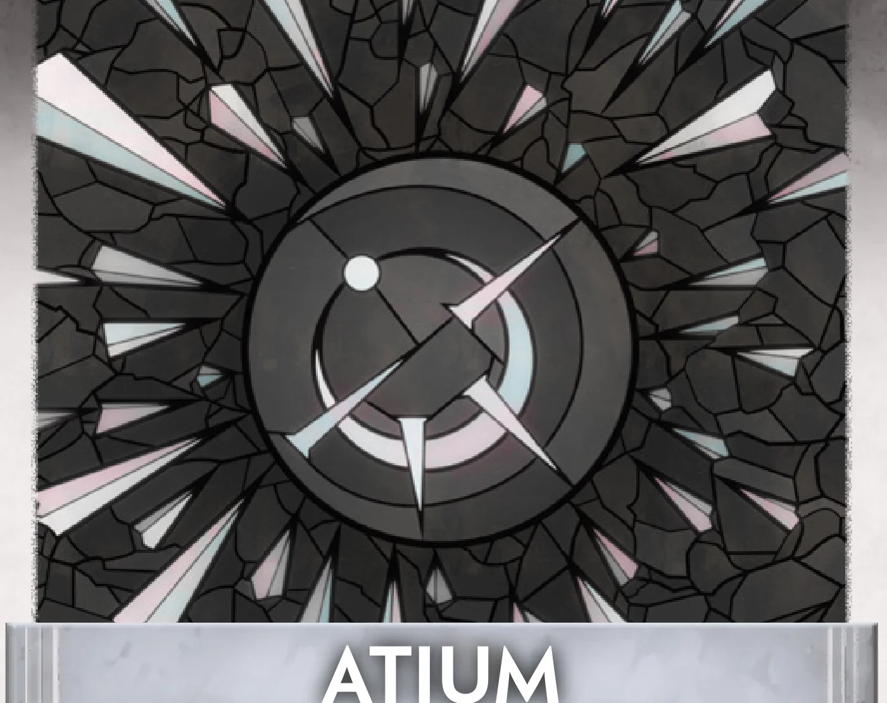
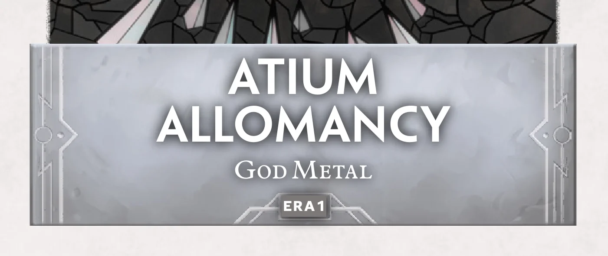
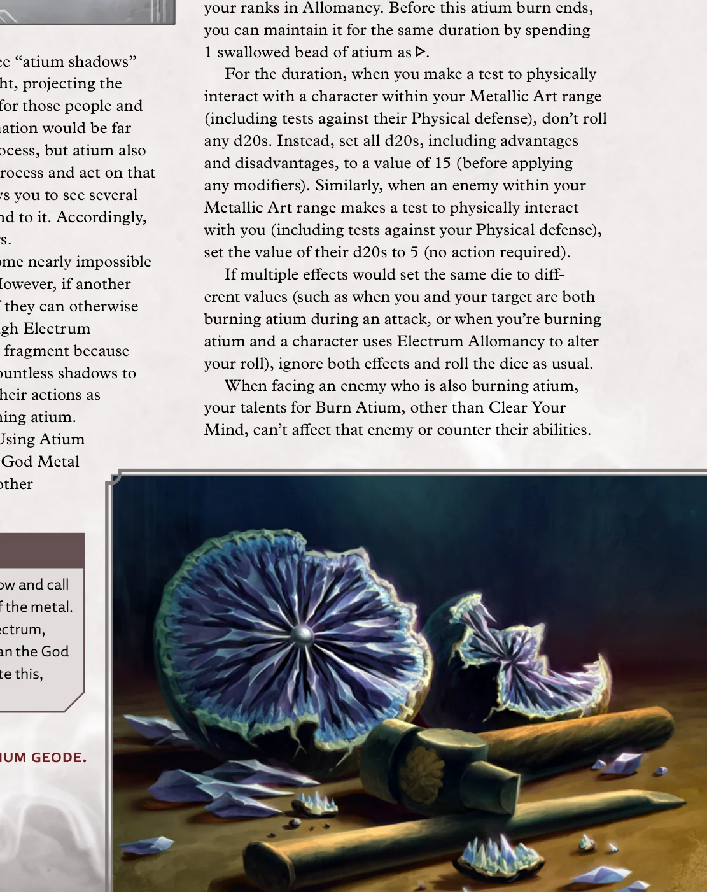
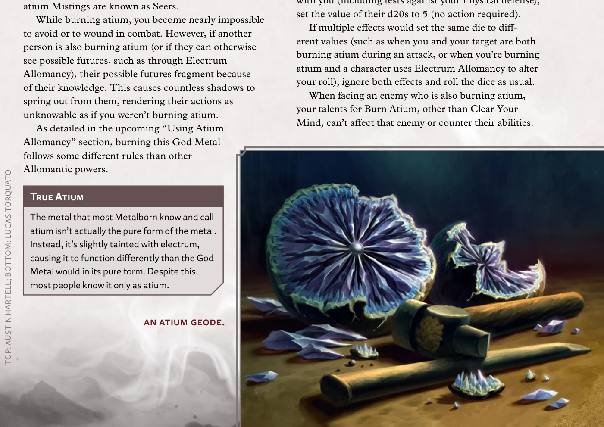
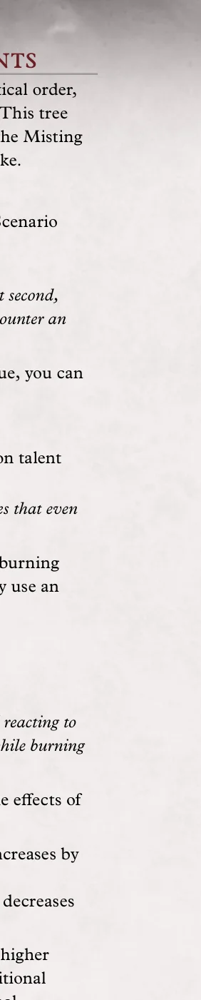
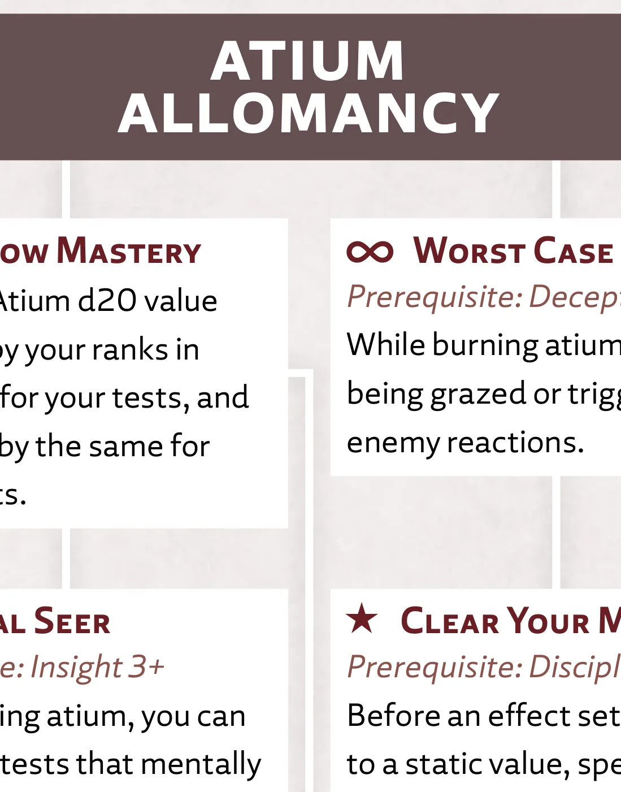
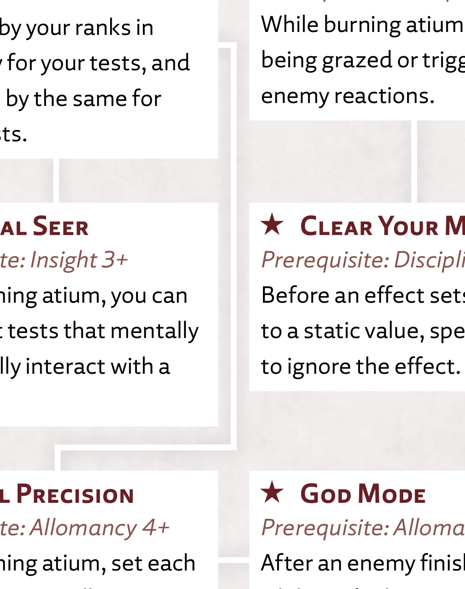
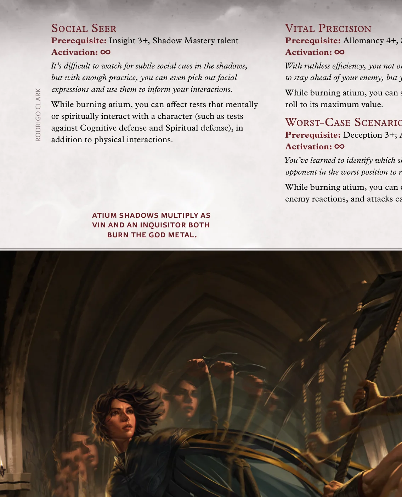
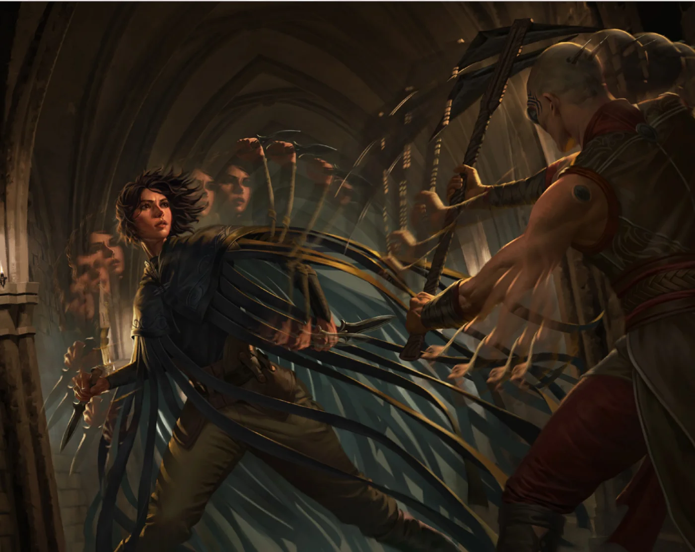

### 天金鎔金術（Atium Allomancy）

神金屬（God Metal）[第一時代]

天金鎔金術讓你看見視線內所有人物與物件的「天金影子」（Atium Shadow），呈現他們在接下來片刻可能經歷的種種未來。一般人的心智根本無法處理這股資訊洪流，但天金也會拓展你的心智，讓你能理解這些資訊並據此行動。如此一來，你實際上能預見幾秒後的未來，並作出反應。因此，天金迷霧人（Misting）被稱為先知（Seer）。

燃燒天金（Atium）時，你在戰鬥（Combat）中幾乎讓人無從閃避，也難以受傷。然而，如果另一個人也在燃燒天金，或能以其他方式看見可能的未來，例如使用電金（Electrum）鎔金術，他所掌握的資訊會使自身可能的未來分裂。無數影子因此從他身上湧現，讓他的行動（Action）變得無法預知，就像你沒有燃燒天金一樣。

如下方「使用天金鎔金術」所述，燃燒這種神金屬的部分規則，與其他鎔金能力（Allomantic Power）不同。

#### 真正的天金（True Atium）

大多數金屬之子（Metalborn）認識並稱為天金的金屬，其實並不是這種金屬的純粹形態。它混有微量電金，因此作用方式與純粹的神金屬不同。儘管如此，大多數人仍只知道它叫天金。

#### 吞下天金（Swallow Atium）

啟動（Activation）：[1行動]

你吞下一顆或多顆天金珠，準備稍後使用燃燒天金（Burn Atium）行動。作為這個行動的一部分，你也可以飲用金屬液（Drink Vial），補充其他金屬。

天金與其他金屬不同，不會增加你目前的授予（Investiture）。你必須將天金珠與其他金屬液分開記錄。

#### 燃燒天金

啟動：[1行動]

持續時間：等同於你的鎔金術（Allomancy）技能等級（Rank）的戰鬥回合（Round）數；非戰鬥時則為相同的分鐘數

燃燒天金時，花費 1 顆已吞下的天金珠，便能預見未來，持續等同於你鎔金術技能等級的回合數。此次天金燃燒結束前，你可以用 [自由行動] 再花費 1 顆已吞下的天金珠，將它維持相同的持續時間。

在持續時間內，當你進行檢定（Test），與金屬技藝距離（Metallic Art Range）內的一名角色（Character）作實體（Physical）互動（Interaction）時，包括對抗其實體防禦（Physical Defense）的檢定，不要擲任何 d20。改為將所有 d20 的數值設為 15，包括優勢（Advantage）與劣勢（Disadvantage）使用的骰子，再套用修正值。同樣地，當金屬技藝距離內的敵人進行檢定，與你作實體互動時，包括對抗你實體防禦的檢定，將其 d20 數值設為 5，不需花費行動。

如果多個效果會將同一顆骰子設為不同數值，就忽略這兩個效果，照常擲骰（Roll）。例如，攻擊（Attack）時你和目標（Target）都在燃燒天金，或你燃燒天金時，有角色使用電金鎔金術改變你的擲骰結果。

面對同樣在燃燒天金的敵人時，除了清空思緒（Clear Your Mind）以外，你的燃燒天金天賦（talent）都無法影響該敵人，也無法反制其能力。

*一顆天金晶洞。*

上方：AUSTIN HARTELL；下方：LUCAS TORQUATO

### 使用天金鎔金術

除了上述能力規則，運用這項能力時，也請參考下列指引。

#### 獨特性質

天金是碎力（Shard）滅絕（Ruin）的神金屬。在統御主（Lord Ruler）統治期間，它極為罕見，幾乎是無價之寶，詳見第 7 章「金屬液」。落灰之終（Catacendre）之後，更幾乎不可能找到。因此，使用這項能力不花費授予，而是另外記錄天金珠。先使用吞下天金行動吞入天金珠，再使用燃燒天金行動啟動能力。

由於這種神金屬極為稀有，性質也十分特殊，天金沒有初萌版本，也不需要完成「訓練你的能力」（Train Your Power）短期目標（goal）才能解鎖完整能力。如果你是迷霧之子（Mistborn）、天金迷霧人，或以其他方式取得天金鎔金術，就可以立刻使用這項能力的完整版本。

### 天金鎔金術天賦樹（talent tree）

#### 影子精通（Shadow Mastery）

啟動：[常駐]

解鎖來源：天金鎔金術

燃燒天金為你的檢定設定的 d20 數值，增加等同於你的鎔金術技能等級；為敵人檢定設定的數值，則降低相同的數量。

#### 最壞情境（Worst Case Scenario）

啟動：[常駐]

前提條件（Prerequisite）：欺騙（Deception）3+

解鎖來源：天金鎔金術

燃燒天金時，避免受到擦傷（Graze）或觸發敵人的反應（Reaction）。

#### 社交先知（Social Seer）

啟動：[常駐]

前提條件：洞察（Insight）3+

解鎖來源：影子精通

燃燒天金時，你也能影響以心智或靈魂方式與角色互動的檢定。

#### 清空思緒

啟動：[特殊啟動]

前提條件：紀律（Discipline）4+

解鎖來源：最壞情境

在效果將你的骰子設為固定數值之前，花費 1 專注點（Focus），忽略該效果。

#### 致命精準（Vital Precision）

啟動：[常駐]

前提條件：鎔金術 4+

解鎖來源：影子精通

燃燒天金時，將你擲出的每一顆傷害（Damage）骰設為該骰的最大數值。

#### 神威模式（God Mode）

啟動：[特殊啟動]

前提條件：鎔金術 5+

解鎖來源：致命精準

燃燒天金期間，敵人完成一個輪次（Turn）後，花費 1 專注點，使用 [1行動] 或 [自由行動]。

### 天金鎔金術天賦

下列天賦依英文字母排序，列於天金鎔金術天賦樹中。你可以透過迷霧人與迷霧之子路徑（Path）的關鍵天賦（Key Talent），或血金術尖刺（Hemalurgic Spike）解鎖這棵天賦樹。

#### 清空思緒

前提條件：紀律 4+；最壞情境天賦

啟動：[特殊啟動]

清空思緒，等到最後一刻，

你就能縮短自己未來的影子，反制正在燃燒天金的對手。

在效果將你的骰子設為固定數值之前，你可以花費 1 專注點，忽略該效果。

#### 神威模式

前提條件：鎔金術 5+；致命精準天賦

啟動：[特殊啟動]

你對燃燒天金的精通非比尋常，

即使成群敵人也毫無勝算。

燃燒天金期間，敵人完成一個輪次後，你可以花費 1 專注點，立即額外使用 [1行動] 或 [自由行動]。

#### 影子精通

前提條件：天金鎔金術能力

啟動：[常駐]

你不斷磨練解讀天金重重影子、並據此反應的技巧，

燃燒這種神金屬時，動作也因此更加優雅。

取得這項天賦時，你的燃燒天金行動效果獲得增強：

- 為你的檢定設定的固定 d20 數值，增加等同於你的鎔金術技能等級。

- 為敵人檢定設定的固定 d20 數值，降低等同於你的鎔金術技能等級。

如果這些效果會將 d20 設為高於 20 或低於 1 的數值，改為替你的檢定額外增加一個機遇（Opportunity），或替敵人的檢定額外增加一個變故（Complication）。例如，如果你的鎔金術有 6 個技能等級，燃燒天金會將你的 d20 數值從 15 提高到 21。此時改為將 d20 數值設為 20，並在檢定中增加兩個機遇：一個來自擲出自然20（Natural 20），另一個來自這項天賦將 d20 提高到最大骰面 20 以上。

第 6 章：金屬技藝（Metallic Arts）174

#### 社交先知

前提條件：洞察 3+、影子精通天賦

啟動：[常駐]

在影子中觀察細微的社交線索並不容易，

但只要勤加練習，你甚至能辨識面部表情，據此判斷該如何與人互動。

燃燒天金時，除了實體互動，你也能影響以心智或靈魂方式與角色互動的檢定，例如對抗認知防禦（Cognitive Defense）與靈性防禦（Spiritual Defense）的檢定。

#### 致命精準

前提條件：鎔金術 4+、影子精通天賦

啟動：[常駐]

你出手狠準而有效率，不只是運用天金影子搶得先機，

更會直接施以致命打擊。

燃燒天金時，你可以將自己擲出的每一顆傷害骰設為該骰的最大數值。

#### 最壞情境

前提條件：欺騙 3+；天金鎔金術能力

啟動：[常駐]

你已學會辨認哪些影子會讓對手

最難應付你的行動。

燃燒天金時，你可以選擇避免觸發敵人的反應，且攻擊無法對你造成擦傷。

*紋（Vin）與一名審判者（Inquisitor）同時燃燒神金屬，天金影子隨之倍增。*

RODRIGO CLARK

