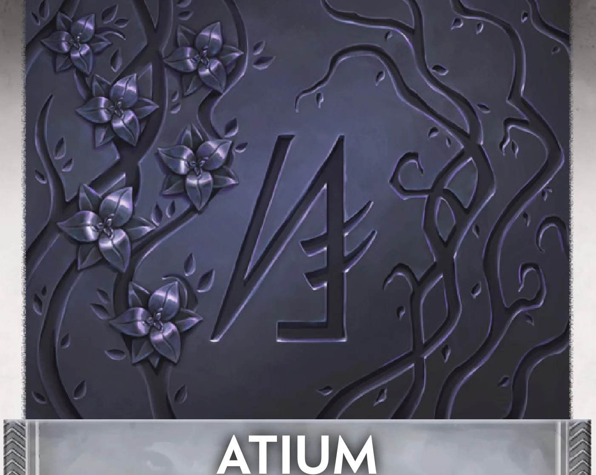
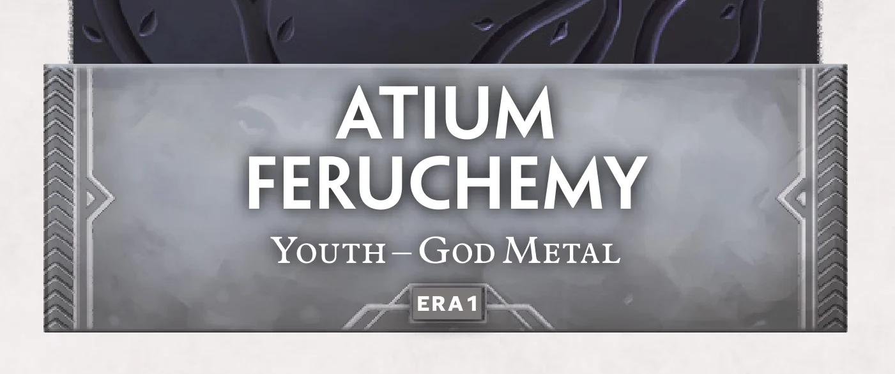

### 天金藏金術（Atium Feruchemy）

青春（Youth）－神金屬（God Metal）

第一時代

透過天金藏金術，你可以將青春儲存（Store）在天金意識（Atiummind）中。為天金意識累積充能時，你的身體會變老；相反地，汲取（Tap）時，身體則會變年輕。依照你選擇消耗所存青春的速度，你可以回到年輕許多的年齡，甚至可能重返童年。雖然從未有人知道天金單藏金術師（Ferring）確實存在，泰瑞司（Terris）學者仍為他們取名為回齡者（Timewinder）。使用天金意識改變身體年齡時，你的心智能力與身體能力可能受到影響，但整體個性、知識與技能（skill）不會改變。你無法儲存或汲取多到足以使自己死亡，或從世上消失的青春；不過，兩端的極限都會帶來重大影響，因此使用這項能力的人必須格外小心，別讓自己變得太年幼或太年老。然而，好奇的回齡者可以試探這些界線，儲存盡可能多的青春，藉此了解自己的自然壽命有多長。如果回齡者年輕時便發現能力，並一生持續儲存大量青春，那麼步入晚年後，就能不斷汲取天金，讓自己看起來遠比實際年齡年輕。

### 儲存青春（Store Youth）

啟動（Activation）：[1行動]　持續時間：每個場景（Scene）、每個年齡分類1點充能（Charge）

你的身體暫時變老，持續儲存青春，直到你以[自由行動]結束效果，或花費天金意識的一點充能為止。從下列年齡分類中選擇一個，必須比你的實際年齡更老。例如，你實際是青年（Young），就可以變成中年（Middle-Aged）或更老：

1. 幼年（Very Young）
2. 青年
3. 中年
4. 老年（Old）
5. 高齡（Very Old）

每當一個場景結束，而你在整個場景中都持續儲存青春時，依照你選擇的身體年齡，在天金意識中獲得充能。身體年齡每比實際年齡老一個分類，就獲得1點充能。例如，你的實際年齡是青年，使用此行動將身體變成老年，就會獲得2點充能。

### 汲取青春（Tap Youth）

啟動：[1行動]　持續時間：與你的藏金術（Feruchemy）技能等級（Rank）相同數量的回合（Round）

從天金意識花費至少1點充能，忽略你的金屬技藝上限（Metallic Art Limit），使身體變年輕，持續與你的藏金術技能等級相同數量的回合，或直到你開始儲存青春為止。每花費1點充能，身體就比實際年齡年輕一個年齡分類，最年輕只能到幼年：

1. 幼年
2. 青年
3. 中年
4. 老年
5. 高齡

青春汲取結束前，你可以用[自由行動]花費天金意識中相同數量的充能，將目前的身體年齡維持相同的時間。

### 真正的天金（True Atium）

大多數金屬之子（Metalborn）認識並稱為天金（Atium）的金屬，其實並非該金屬的純粹形態。它混入了少量電金（Electrum），因此作用與這種神金屬的純粹形態不同。儘管如此，大多數人仍只知道它叫天金。

第6章：金屬技藝（Metallic Arts）　215

JANETTE RAMOS

### 運用天金藏金術

除了上述能力規則，運用這項能力時，也可以參考以下指引。

### 改變體型（Size）

這項能力會讓你變大或變小，合理地符合身體年齡。例如，如果你是人類（Human），從青年變成幼年時，體型通常會從中型（Medium）變成小型（Small）。改變體型時，你持有的物品不會跟著改變大小。

### 創意運用

除了改變體型之外，讓自己變年輕或變老，不會自動改變任何數據或能力，但接下來介紹的天金藏金術天賦能做到這一點。不過，你的年齡會影響其他角色（Character）如何看待你，前提是他們有注意到你。我們鼓勵你自行發想天金藏金術的創意用途，例如以下幾種，並與GM討論如何判定：

**不起眼的小孩。** 有些角色容易輕視或忽略小孩。加上小孩較小的體型，你可能比平常更容易偷偷行動而不被發現。

**德高望重的長者。** 有些角色會更尊敬長輩。如果你的年齡分類與對方相同或更老，可能更容易說服對方聽你說話。

**你是誰？** 如果某個角色認識你，卻以為你應該是另一個年齡分類，對方很可能認不出你，甚至可能把你誤認為你的親人。

### 天金藏金術天賦（talent）

以下依英文字母順序列出的天賦，都出現在天金藏金術天賦樹（talent tree）中。你可以透過藏金術師（Feruchemist）路徑（Path）的關鍵天賦（Key Talent），或透過血金術尖刺（Hemalurgic Spike），解鎖這棵天賦樹。

### 成熟點（Act Your Age）

前提條件（Prerequisite）：欺騙（Deception）2+；天金藏金術能力

啟動：[常駐]

你能逼真地模仿他人的言行舉止，幫助自己與各個年齡層的人建立關係。

使用風采（Presence）屬性（attribute）進行檢定（Test），影響與你身體年齡分類相同的角色時，該檢定獲得一個優勢（Advantage）。

### 巔峰狀態（Peak Condition）

前提條件：藏金術3+；天金藏金術能力

啟動：[1行動]

你已找出哪個身體年齡能讓自己的身體發揮最佳狀態，並能輕易調整年齡，配合眼前的需要。

如果你的實際年齡分類是中年或更老，花費天金意識的2點充能，使身體變成青年，並獲得增益（Enhanced）[所有屬性+1]狀態（Condition），直到你的下一個輪次（Turn）結束。此效果結束前，你可以用[自由行動]花費天金意識的2點充能，將其維持相同的時間。

### 天金藏金術天賦樹

#### 巔峰狀態

啟動：[1行動]

前提條件：藏金術3+

解鎖來源：天金藏金術能力

實際年齡為中年或更老時，花費2點充能，暫時變成青年，並獲得增益[全部+1]。

#### 成熟點

啟動：[常駐]

前提條件：欺騙2+

解鎖來源：天金藏金術能力

使用風采進行檢定，影響與你目前年齡分類相同的角色時，獲得一個優勢。

第6章：金屬技藝　216
