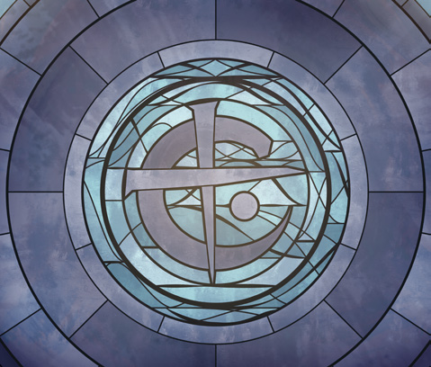
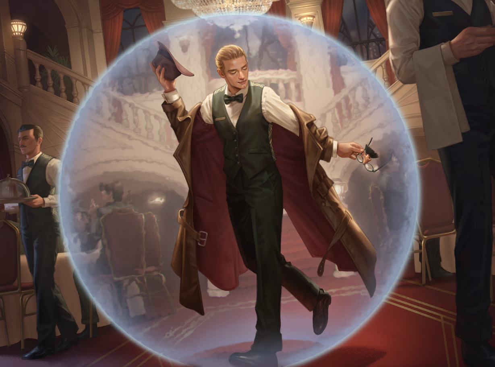

### 彎管合金鎔金術（Bendalloy Allomancy）

時序（Temporal）—外部（External）—推力（Pushing）

[第二時代]

彎管合金鎔金術會在你周圍形成速度圈（Time Bubble），圈內的時間流逝比圈外更快。在圈外的人看來，圈內的人移動得快到身影模糊，因此彎管合金鎔金術師（Allomancer）被稱為滑行（Slider）。

### 燃燒彎管合金（Burn Bendalloy）

啟動（Activation）：[2行動]　持續時間（Duration）：1 回合（Round）

燃燒彎管合金時，花費至少 1 授予（Investiture），最多不超過你的金屬技藝上限（Metallic Art Limit），以你目前的位置為中心，在巨型（Huge，15 呎）區域內製造彎管合金速度圈。這個圈通常固定在周遭地景上；但由 GM 裁定，它也可能固定在你正站著的極巨型（Colossal）載具上，例如火車或客輪。速度圈具有下列效果：

- 每個回合都以一個額外回合（Bonus Round）作結。在額外回合中，只有圈內的角色（Character）能行動，每人各有一個輪次（Turn）。輪到自己時，獲得的行動（Action）數等於 1 + 你燃燒彎管合金所花費的授予。

- 戰鬥（Combat）中，這個額外回合在每回合最後一個慢速輪次（Slow Turn）結束後開始。PC 先行動，再由 NPC 行動。

- 對話（Conversation）或試煉（Endeavor）中，這個額外回合在該回合最後一次貢獻（Contribution）結束後開始。圈內每名角色在額外回合中，每有 [2行動] 就能作出一次貢獻，次數無條件進位。例如，你在速度圈上花費 2 授予，圈內每名角色就獲得 [3行動]，因此能在額外回合中作出兩次貢獻。

- 圈內效果的持續時間也流逝得更快。速度圈每提供 [2行動]，就將圈內角色使用或正影響他們的持續效果，計作經過 1 回合；回合數無條件進位。例如，燃燒金屬與汲取（Tap）金屬意識庫（Metalmind）的持續時間都受此影響。

你的速度圈會在額外回合結束時終止，除非你花費與先前相同的授予，將它維持相同的持續時間。維持不需花費行動，但你必須身在圈內。你同時只能有一個彎管合金速度圈，而且必須等先前的圈終止後，才能製造新的速度圈。

### 使用彎管合金鎔金術

除了上面的能力規則，與這項能力互動時，也請參考下列指引。

### 重疊的速度圈

角色若位於多個速度圈重疊的區域，包括鎘（Cadmium）速度圈，就會同時受到這些圈的影響。彎管合金速度圈彼此重疊時，額外回合中獲得的行動數，依製造所有這些圈所花費的授予總和決定。

### 與速度圈互動

圈內與圈外的時間流速不同，因此影像、聲音、角色與物體都很難穿過圈的表面。這會造成下列奇特效果：

- 進出啟用中的速度圈會耗費心力。角色自願穿過圈的表面後，失去的專注點（Focus）等於你燃燒彎管合金所花費的授予。如果這使其專注點降至 0，或其專注點原本就為 0，該角色還會陷入震懾（Stunned），直到其下一個輪次結束。

- 聲音與動態影像會嚴重扭曲，無法穿過圈的表面進行溝通。圈外角色無法以一般手段影響（Influence）圈內角色，反之亦然。

- 穿過圈進行的攻擊（Attack），無論由外向內或由內向外，結果都可能極難預料，甚至可能偏轉，擊中原本不打算攻擊的目標。角色的攻擊穿過圈的表面時，承受的劣勢（Disadvantage）數量等於你燃燒彎管合金所花費的授予。這次攻擊獲得危險（Dangerous）武器（Weapon）特性；除非攻擊者花費 [機遇]（Opportunity），否則無法命中（Hit）或擦傷（Graze）目標（Target）。其他費用也必須照常支付。

AUSTIN HARTELL

第 6 章：金屬技藝（Metallic Arts）176

### 創意用法

如果能取得足夠的彎管合金，GM 可能允許你和盟友（Ally）運用彎管合金鎔金術，以比平常快得多的速度完成活動。你可以發想自己的創意用法，例如下列方式，再與 GM 一起決定如何結算：

**逼迫單挑。** 混戰中，將一名敵人困在彎管合金速度圈內，與他一對一交戰。

**延展休整時間。** 燃燒大量彎管合金，可能讓你在別人完成一項休整期（Downtime）活動的時間內，完成多項活動。

**瞬間行動。** 在一瞬間完成偽裝或開鎖，而且圈外聽不到任何聲音。

### 彎管合金鎔金術天賦

下列天賦（Talent）依英文字母順序排列，出現在彎管合金鎔金術天賦樹（Talent Tree）中。你可以透過迷霧人（Misting）或雙生師（Twinborn）路徑（Path）的關鍵天賦（Key Talent），或透過血金術尖刺（Hemalurgic Spike），解鎖這棵樹。

#### 防護速度圈（Defensive Bubble）

前提條件（Prerequisite）：反應展圈（Reflexive Bubble）天賦

啟動：[常駐]

在你的彎管合金速度圈中，時間流逝得更快，讓你更容易察覺並閃過圈外的攻擊。

身在彎管合金速度圈中時，對抗源自圈外的效果，你的每項防禦（Defense）都獲得加值。加值等於燃燒彎管合金製造該圈所花費的授予。

#### 擴大速度圈（Expanded Bubble）

前提條件：彎管合金鎔金術能力

啟動：[特殊啟動]

你受過訓練，能擴大速度圈的區域，一次影響更多人。

燃燒彎管合金或鎘時，你可以額外花費 1 授予，在 25 呎區域內製造速度圈，而非 15 呎。維持這個擴大的圈，也必須額外花費 1 授予。

### 彎管合金鎔金術天賦樹

#### 擴大速度圈

啟動：[特殊啟動]

解鎖條件：彎管合金鎔金術能力

額外花費 1 授予，將速度圈的區域擴大至 25 呎。

#### 反應展圈

啟動：[反應]

前提條件：鎔金術（Allomancy）2+

解鎖條件：彎管合金鎔金術能力

角色即將採取可能受速度圈影響的行動前，花費 1 專注點，使用燃燒彎管合金或燃燒鎘（Burn Cadmium）。

#### 迅速掩錯（Quickened Coverup）

啟動：[特殊啟動]

前提條件：鎔金術 3+

解鎖條件：擴大速度圈天賦

身在彎管合金速度圈中，若你的試煉技能檢定（Skill Test）失敗，可以花費 1 專注點，改為獲得 [變故]（Complication）。

#### 防護速度圈

啟動：[常駐]

解鎖條件：反應展圈天賦

身在彎管合金速度圈中時，你對抗圈外效果的防禦，提高等同製造該圈所花費授予的數值。

#### 迅速展圈（Expedited Bubble）

啟動：[常駐]

前提條件：鎔金術 3+

解鎖條件：反應展圈天賦

你使用燃燒彎管合金或燃燒鎘時，少花費一個 [1行動]。

> 瓦（Wax）抽空看了韋恩（Wayne）一眼，數出已有四名消賊（Vanisher）倒下。他的朋友正興高采烈地從桌上躍起，撲向一名手持霰彈槍（Shotgun）的男子。韋恩啟動速度圈，兩人的身影頓時模糊。轉瞬間，他已換了位置，躲在一張翻倒的桌子後方，子彈咻咻穿過他方才所在的地方；那名持霰彈槍的匪徒則癱倒在地。

第 6 章：金屬技藝 177

#### 迅速展圈

前提條件：鎔金術 3+；反應展圈天賦

啟動：[常駐]

你受過訓練，能縮短速度圈消失後，到你製造下一個圈之間的空檔。

你使用燃燒彎管合金或燃燒鎘時，少花費一個 [1行動]。

#### 迅速掩錯

前提條件：鎔金術 3+；擴大速度圈天賦

啟動：[特殊啟動]

你的彎管合金速度圈讓你行動飛快，能在任何人察覺之前補救失誤。

試煉中，身在彎管合金速度圈內的你若檢定（Test）失敗，可以花費 1 專注點，改為獲得 [變故]，而不將這次失敗計入試煉的結算。

#### 反應展圈

前提條件：鎔金術 2+；彎管合金鎔金術能力

啟動：[反應]

你能在一瞬間製造速度圈，尤其擅長用來應付危險。

角色即將採取可能受到新出現的速度圈影響的行動前，你可以使用此反應（Reaction），並花費 1 專注點，使用燃燒彎管合金或燃燒鎘。製造速度圈的授予仍須照常花費。

如果你是對攻擊作出反應，就必須在擲出攻擊檢定的骰子之前使用此天賦。接著，那次攻擊會穿過你速度圈的表面。

例如，你可以在角色影響你或盟友之前、在他以遠程（Ranged）攻擊選你或盟友為目標之前，或在他進出你可能製造速度圈的區域之前，製造速度圈。

*韋恩利用彎管合金速度圈，迅速完成換裝。*

ANDREW CHOU

