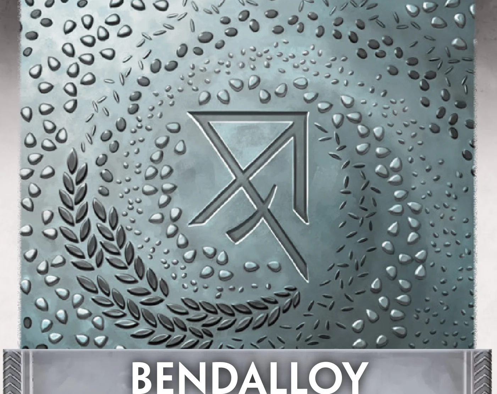
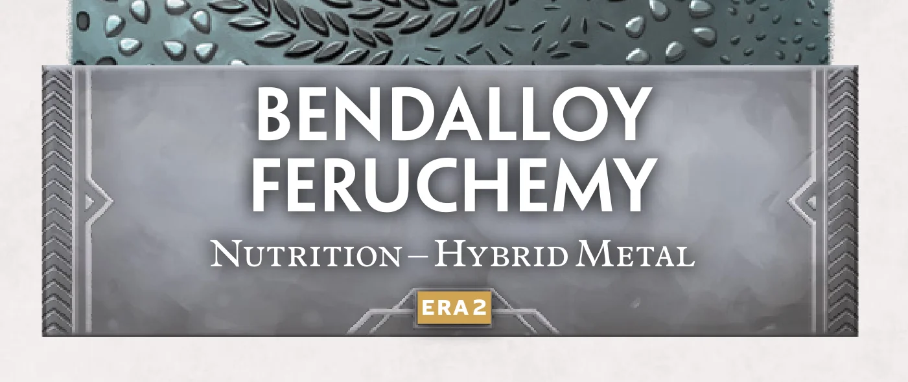
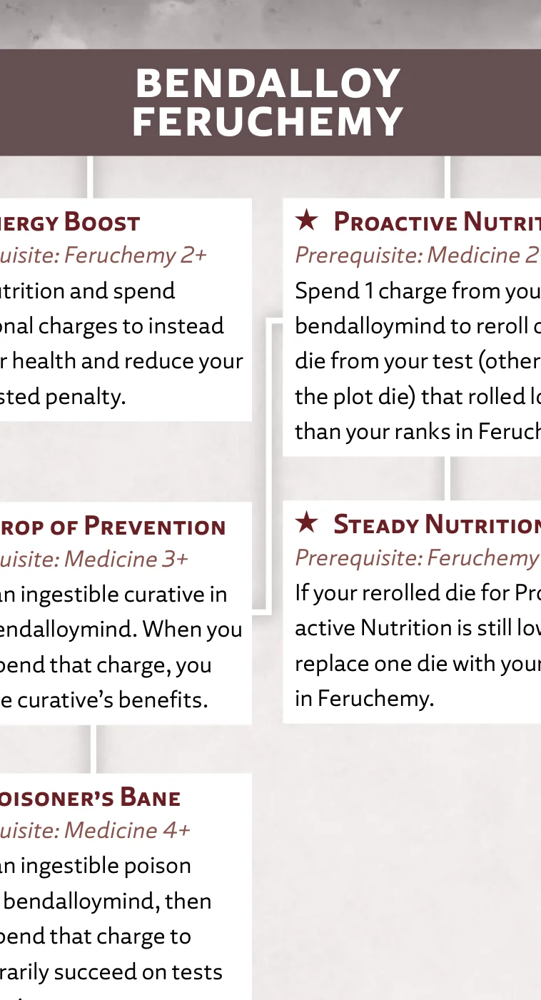

### 彎管合金藏金術（Bendalloy Feruchemy）

養分（Nutrition）－混合金屬（Hybrid Metal）

第二時代

彎管合金藏金術讓你將養分與水分儲存在彎管合金意識（Bendalloymind）中。這麼做時，你可以不停吃喝而不失去食慾，之後再汲取（Tap）那些養分與水分，直接送入體內，讓自己長時間不必進食或喝水。除了這些廣為人知的效果之外，彎管合金藏金術師（Feruchemist）還能運用這項能力做出遠超自己想像的事；他們被稱為吞蝕（Subsumer）。熟練的吞蝕會發現，幾乎任何吃喝下肚的東西都能儲存在彎管合金意識中。例如，藥物可以先儲存，等有需要時再汲取；酒精可以儲存，讓自己看似喝得過量卻保持清醒；毒物也可以儲存，再以可控制的劑量釋出，讓身體代謝系統逐漸產生抗性。

### 儲存養分（Store Nutrition）

啟動（Activation）：[1行動]

持續時間：每一日份的食物或飲料1點充能（Charge）

吃喝時不吸收養分，持續儲存（Store）養分，直到你以[自由行動]結束效果，或花費彎管合金意識的一點充能為止。儲存養分期間，你仍像平常一樣吃下食物或喝下飲料，但不會感到飽足，也無法滿足營養需求，詳見第9章「食物與水」。吃喝所需的時間仍與平常相同；一般而言，在故事中吃喝完一日份的食物或水，大約需要一分鐘。每當你吃喝完一日份的食物或飲料，並將其養分儲存起來，便在彎管合金意識中獲得1點充能。

### 汲取養分（Tap Nutrition）

啟動：[1行動]

持續時間：瞬間

花費彎管合金意識的1點充能，維持自身所需。汲取養分後，你會受到下列效果：

- 你獲得飽足與水分，視同攝取了一日份的食物與水，詳見第9章「食物與水」。

- 如果你處於精疲力竭（Exhausted）狀態，該狀態（Condition）的懲罰減少2。

### 運用彎管合金藏金術

除了上述能力規則，運用這項能力時，也可以參考以下指引。

### 創意運用

我們鼓勵你自行發想彎管合金藏金術的創意用途，例如以下幾種，並與GM討論如何判定：

**長時間躲藏。** 汲取養分，即使無法離開狹小的區域，也能維持健康。

**維持儲備。** 前往可能缺乏某些特定營養素的地區旅行時，事先儲存富含那些營養素的養分。

**贏得大胃王比賽。** 儲存養分，一口氣吃下足以成為傳奇的大量食物。

### 彎管合金藏金術天賦（talent）

以下依英文字母順序列出的天賦，都出現在彎管合金藏金術天賦樹（talent tree）中。你可以透過單藏金術師（Ferring）與雙生師（Twinborn）路徑（Path）的關鍵天賦（Key Talent），或透過血金術尖刺（Hemalurgic Spike），解鎖這棵天賦樹。

### GM提示：彎管合金藏金術與原作設定

在《迷霧之子》（Mistborn）小說中，吞蝕無法將養分與水分儲存在同一個彎管合金意識裡，因此大多數人會攜帶兩個。《寰宇 RPG》（Cosmere RPG）簡化了彎管合金藏金術：玩家不必分別記錄多種彎管合金意識充能，而是用一個彎管合金意識同時儲存養分與水分。如果你的團體想更貼近小說，可以允許吞蝕擁有兩個彎管合金意識，一個儲存養分，另一個儲存水分，並將充能上限分配到兩者之間。吞蝕吃喝時，由GM決定所儲存的充能算在養分彎管合金意識，還是水分彎管合金意識中。熟練的吞蝕甚至能服下並儲存藥物等物質。如果你願意，也可以讓吞蝕角色（Character）為每種藥物各帶一個獨立的彎管合金意識。

JANETTE RAMOS

第6章：金屬技藝（Metallic Arts）　217

### 未雨綢繆（Drop of Prevention）

前提條件（Prerequisite）：醫學（Medicine）3+；主動養分（Proactive Nutrition）天賦

啟動：[常駐]

你已學會將某些藥物儲存在彎管合金意識中，每種藥物各用一個。之後，你可以將這些藥物直接送入血液中。

儲存養分期間，你可以吃下一種可服用的療藥（Curative），例如補藥（Tonic），詳見第7章「裝備（Equipment）」，將其儲存，並在彎管合金意識中獲得1點充能，而不會受到該療藥的效果。以此方式獲得充能時，記下該點充能對應的是哪種療藥。之後花費該點充能時，你會獲得對應療藥的效果，而非維持自身所需。

### 活力提振（Energy Boost）

前提條件：藏金術（Feruchemy）2+；彎管合金藏金術能力

啟動：[特殊啟動]

你已找出哪些食物能迅速帶來活力，並從彎管合金意識中汲取它們，對抗疲勞與疼痛。

汲取養分時，你可以不只花費1點充能，改為花費任意數量的充能，最多不超過你的金屬技藝上限（Metallic Art Limit）。這麼做時，改為受到下列效果：

- 恢復等於1d4加上所花充能點數的生命值（Health）。這次擲骰使用你的金屬技藝骰（Metallic Art Die），因此骰型（Die Size）會隨你的藏金術技能等級（Rank）提高；2級時改擲1d6，而非1d4，依此類推。

- 如果你處於精疲力竭狀態，每花費1點充能，該狀態的懲罰就減少2。

### 毒師剋星（Poisoner’s Bane）

前提條件：醫學4+；未雨綢繆天賦

啟動：[常駐]

你已學會將彎管合金意識中儲存的毒藥，以極微小的劑量送入體內，逐漸提高對可能致命毒物的耐受力。

儲存養分期間，你可以吃下一種可服用的毒藥（Poison），詳見第7章「裝備」，或類似的毒物，將其儲存，並在彎管合金意識中獲得1點充能，而不會受到該毒藥的效果。以此方式獲得充能時，記下該點充能對應的是哪種毒藥。（GM可以裁定某些毒藥無法以此方式儲存。）之後花費該點充能時，你會暫時能夠耐受對應的毒藥，而非維持自身所需。直到場景（Scene）結束，你抵抗該種毒藥的所有檢定（Test）都會自動成功。

### 主動養分

前提條件：醫學2+；彎管合金藏金術能力

啟動：[特殊啟動]

你已找出哪些食物能加速心智與身體恢復，並從彎管合金意識中汲取它們，在有需要時助自己一臂之力。

進行檢定時，你可以花費彎管合金意識的1點充能，重擲其中一顆擲出數字低於你的藏金術技能等級的骰子，但不能重擲劇情骰（Plot Die）。

### 穩定養分（Steady Nutrition）

前提條件：藏金術3+；主動養分天賦

啟動：[特殊啟動]

你能精準控制送入血液的養分，讓自己的表現穩定，不會因活力起伏而忽高忽低。

使用主動養分重擲骰子時，如果重擲結果仍低於你的藏金術技能等級，你可以選擇這次檢定中擲出的任一顆骰子，但不能選擇劇情骰，將其結果替換為等同於你的藏金術技能等級的數字。

### 彎管合金藏金術天賦樹

#### 活力提振

啟動：[特殊啟動]

前提條件：藏金術2+

解鎖來源：彎管合金藏金術能力

汲取養分時花費額外充能，改為恢復生命值，並降低精疲力竭懲罰。

#### 主動養分

啟動：[特殊啟動]

前提條件：醫學2+

解鎖來源：彎管合金藏金術能力

花費彎管合金意識的1點充能，重擲檢定中一顆結果低於你的藏金術技能等級的骰子，但不能重擲劇情骰。

#### 未雨綢繆

啟動：[常駐]

前提條件：醫學3+

解鎖來源：主動養分天賦

將可服用的療藥儲存在彎管合金意識中。之後花費該點充能時，獲得療藥的好處。

#### 穩定養分

啟動：[特殊啟動]

前提條件：藏金術3+

解鎖來源：主動養分天賦

如果主動養分的重擲結果仍較低，以你的藏金術技能等級替換一顆骰子的結果。

#### 毒師剋星

啟動：[常駐]

前提條件：醫學4+

解鎖來源：未雨綢繆天賦

將可服用的毒藥儲存在彎管合金意識中，之後花費該點充能，暫時讓抵抗該種毒藥的檢定自動成功。

第6章：金屬技藝　218

