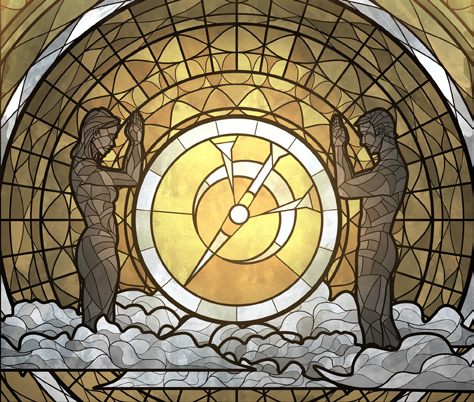
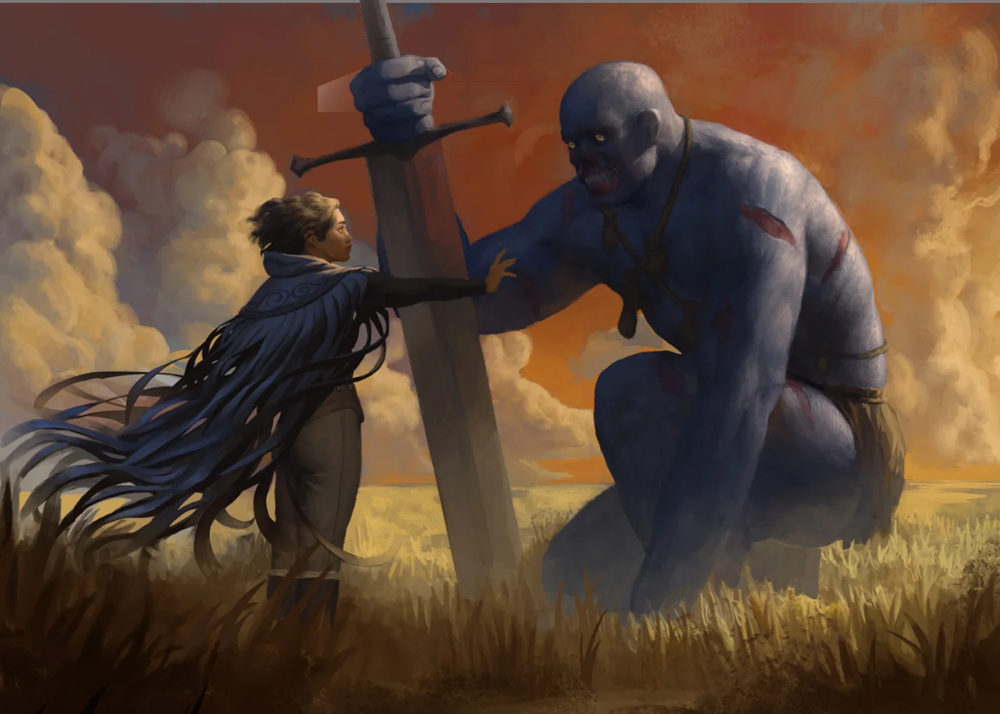

### 黃銅鎔金術（Brass Allomancy）

意志（Mental）—外部（External）—推力（Pushing）

黃銅鎔金術能巧妙地壓低附近人們的情緒，促使他們作出與那些情緒相反的行為，卻以為那是自己的主意。因此，黃銅鎔金術師（Allomancer）被稱為安撫者（Soother）。例如，你可以安撫（Soothe）憤怒，讓暴動平息；也能安撫專注，避開守門警衛的注意。熟練的安撫者甚至能同時影響多種情緒。然而，安撫者無法感知情緒，因此必須學會以一般方式判讀他人的情緒狀態。

### 燃燒黃銅（Burn Brass）

啟動（Activation）：[2行動]　持續時間：1 回合（Round）

燃燒黃銅（Brass）時，花費至少 1 授予（Investiture），最多不超過你的金屬技藝上限（Metallic Art Limit）。花費越多授予，對方就越難抵抗你的安撫。接著，選擇一種要壓低的情緒，例如不信任或衝動，再選擇金屬技藝距離（Metallic Art Range）內的一個大型（Large，10 呎）區域。直到你的下一個輪次（Turn）結束，你會安撫該區域內除你以外每名角色（Character）的這種情緒。GM 決定每名 NPC 在情緒改變後如何行動。如果你希望目標（Target）沒有察覺你的安撫，還要進行鎔金術（Allomancy）檢定（Test），對抗每名受你安撫角色的靈性防禦（Spiritual Defense）。成功時，目標不會察覺你的影響（Influence）；失敗時，目標知道自己正被安撫，且由 GM 裁定，他也可能知道來源就是你。此次黃銅燃燒結束前，你可以用 [自由行動] 花費至少 1 授予，對金屬技藝距離內每名受影響的角色維持相同時間的安撫。安撫的強度依這次花費的授予調整。

知道自己正被安撫的角色，可以用 [自由行動] 抵抗此效果，花費等同於你燃燒黃銅所花授予的專注點（Focus），取代抵抗影響時通常須付的費用。如此做之後，直到其下一個輪次開始，他都能抵抗你的影響，忽略被改變的情緒。

### 使用黃銅鎔金術

除了上述能力規則，運用這項能力時，也請參考下列指引。

### 變故（Complication）

燃燒黃銅期間，GM 可以花費你或盟友（Ally）檢定中的 [變故]，讓一名角色察覺自己正被安撫，或察覺你是安撫者。

### 重疊的操控

如果多個效果正在改變同一名角色的情緒，性質相近的效果會在該角色身上共同作用，互相對立的效果則會抵消。面對性質相近的效果，目標只需要抵抗最強的一個；互相對立的效果則會直接抵消。

### 控制 NPC

如果你花費至少 6 授予燃燒黃銅，黃銅鎔金術就能讓你更直接地控制坎得拉（kandra）、克羅司（koloss）或其他血金術實體 NPC。當你成功安撫這類專注點為 0 的 NPC 時，可以放棄燃燒黃銅的一般效果，改讓該 NPC 視為你的夥伴（Companion），詳見第 8 章「夥伴」。此效果持續到你傷害他，或另一名角色使他成為自己的夥伴為止。

### 創意用法

創意運用黃銅鎔金術，能完成驚人的操控。你可以發想自己的用法，例如下列方式，再與 GM 一起決定如何結算：

**多種情緒。** 同時操控多種情緒，但這可能使你的鎔金術檢定承受劣勢（Disadvantage）。你甚至能安撫大量情緒，讓其餘情緒相對高漲，藉此模仿鋅鎔金術（Zinc Allomancy）的效果。

**指定情緒對象。** 不去影響籠統的情緒，而是將對象縮小，例如減弱對某個特定人物或群體的友善。

第 6 章：金屬技藝（Metallic Arts）179

AUSTIN HARTELL

**明顯操控。** 故意讓被安撫的目標注意到你對情緒的干預，使他們起疑，也引誘他們花費專注點抵抗。

**轉移敵意。** 將敵人的注意力引向你的一名盟友，或讓他們不再注意該盟友。如此做時，你的鎔金術檢定須提高賭注（Raise the Stakes）。

更多情緒鎔金術（Emotional Allomancy）的運用範例，請參閱鋅鎔金術能力的「創意用法」。

### 黃銅鎔金術天賦

下列天賦（talent）依英文字母順序排列，出現在黃銅鎔金術天賦樹（talent tree）中。你可以透過迷霧人（Misting）、雙生師（Twinborn）與迷霧之子（Mistborn）路徑（Path）的關鍵天賦（Key Talent），或透過血金術尖刺（Hemalurgic Spike），解鎖這棵樹。

#### 群體調控（Crowd Control）

前提條件（Prerequisite）：鎔金術 2+；黃銅鎔金術能力

啟動：[常駐]

你擴大了情緒鎔金術的作用區域，一次能影響更多人。

燃燒黃銅或鋅（Zinc）時，你可以擴大效果的區域，最大達到極巨型（Colossal，30 呎）區域。

#### 壓倒性冷漠（Crushing Apathy）

前提條件：黃銅鎔金術能力

啟動：[自由行動]

安撫可以同時壓抑一個人的所有情緒，使其難以行動（Action）。

花費 2 授予，選擇一名正受你安撫、專注點為 0 的角色。在你的安撫持續期間，該角色陷入震懾（Stunned）。

#### 精準影響（Precise Influence）

前提條件：鎔金術 3+；群體調控天賦

啟動：[常駐]

將情緒鎔金術限制在單一目標身上並不容易，但你的運用已經精細入微。

使用燃燒黃銅或燃燒鋅（Burn Zinc）時，你少花費一個 [1行動]。

此外，燃燒黃銅或鋅來影響區域內角色時，你可以選擇任意數量自己能察覺的目標，使其不受該能力影響。

### 黃銅鎔金術天賦樹

#### 群體調控

啟動：[常駐]

前提條件：鎔金術 2+

解鎖來源：黃銅鎔金術能力

燃燒黃銅或鋅時，擴大作用區域，最大達到極巨型（30 呎）。

#### 壓倒性冷漠

啟動：[自由行動]

解鎖來源：黃銅鎔金術能力

安撫專注點為 0 的角色時，花費 2 授予，使其同時陷入震懾。

#### 精準影響

啟動：[常駐]

前提條件：鎔金術 3+

解鎖來源：群體調控天賦

你燃燒黃銅或鋅時，少花費一個 [1行動]，也能選擇讓部分目標不受這些能力影響。

#### 安撫疲憊（Soothe Fatigue）

啟動：[特殊啟動]

前提條件：洞察（Insight）2+

解鎖來源：壓倒性冷漠天賦

燃燒黃銅時，改讓目標恢復生命值（Health），並暫時降低其精疲力竭（Exhausted）減值。

#### 細微操控（Subtle Manipulation）

啟動：[1行動]

前提條件：洞察 3+

解鎖來源：精準影響天賦

花費 1 授予，在影響他人時獲得優勢（Advantage）。抵抗的嘍囉（Minion）與勁敵（Rival）額外失去 2 專注點。

#### 深度平靜（Profound Calm）

啟動：[特殊啟動]

前提條件：洞察 3+

解鎖來源：安撫疲憊天賦

使用安撫疲憊時，也終止等同於所花授予數量的效果。可選擇迷惑（Disoriented）、震懾、措手不及（Surprised），以及增加專注點費用的效果。

#### 深度平靜

前提條件：洞察 3+；安撫疲憊天賦

啟動：[特殊啟動]

你的安撫能緩解焦慮，減少分心。

使用安撫疲憊時，你也可以立刻終止每名目標身上的若干效果，數量等於你花費的授予。你只能終止下列效果：迷惑、震懾、措手不及，以及任何增加目標專注點費用的效果。

#### 安撫疲憊

前提條件：洞察 2+；壓倒性冷漠天賦

啟動：[特殊啟動]

你的安撫能減輕身心疲憊的感受。

每個場景（Scene）一次，燃燒黃銅時，你可以放棄一般效果，改讓區域內除你以外每名角色立刻恢復生命值，數量等於你燃燒黃銅所花費的授予。此外，在安撫持續期間，每名處於精疲力竭的目標，都會暫時降低該減值，降低的數值等於你燃燒黃銅所花費的授予。

第 6 章：金屬技藝 180

#### 細微操控

前提條件：洞察 3+；精準影響天賦

啟動：[1行動]

你以鎔金術干預情緒的手法已變得十分細膩，運用時幾乎不會被發現。

花費 1 授予，獲得下列益處，直到你的下一個輪次結束：

- 進行檢定，影響金屬技藝距離內的角色時，獲得優勢。這也包括讓目標未察覺你的情緒鎔金術的鎔金術檢定。

- 金屬技藝距離內的嘍囉或勁敵抵抗你的影響後，額外失去 2 專注點。

此效果結束前，你可以用 [自由行動] 花費 1 授予，將它維持相同的持續時間。

#### 改變後的情緒狀態（Altered Emotional States）

每名角色都會依自己的性格與經歷，以獨特的方式回應情緒。有些人悲傷時會發怒，有些人生氣時卻會流淚。黃銅或鋅鎔金術師若想引發另一名角色的某種特定反應，GM 可以要求洞察檢定，藉此了解哪些情緒可能帶來那種反應。

自己的角色受到情緒鎔金術影響時，由你決定如何回應改變後的情緒狀態。扮演出角色行為上的轉變，也想想這些感受如何影響其決定。然而，在作出與被改變的情緒直接相反的事情之前，你必須花費專注點，暫時抵抗安撫或煽動（Riot），詳見燃燒黃銅或燃燒鋅。

操控情緒並非心智控制，但確實是操控！使用情緒鎔金術可能帶來令人不適的場景。一如往常，請參閱第 13 章「安全指引」，運用其中工具處理這類情況。最好由整個團體先決定，是否要在遊戲中呈現煤氣燈操控（gaslighting）等行為；若要呈現，又該如何進行。

*年輕的紋（Vin）燃燒黃銅，安撫一名克羅司。*

SATOSHI KAMANAKA

