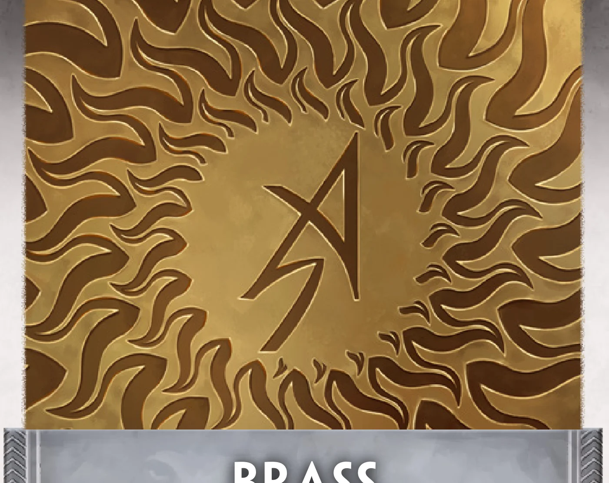
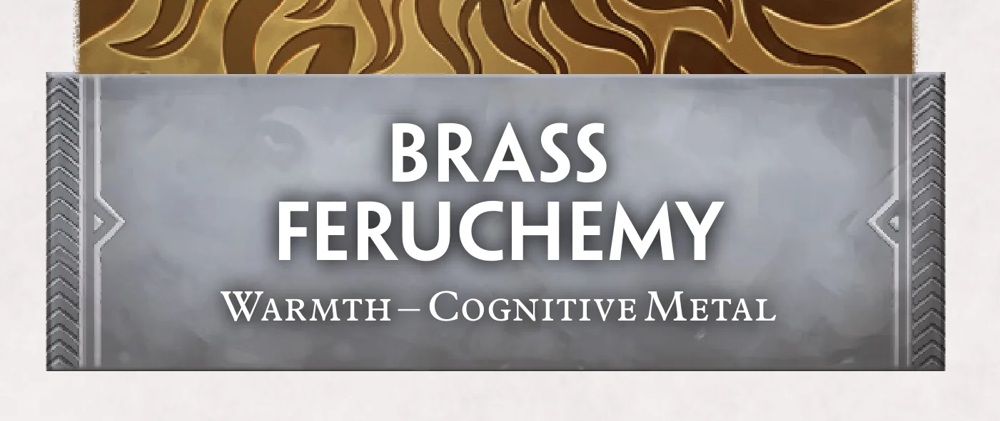
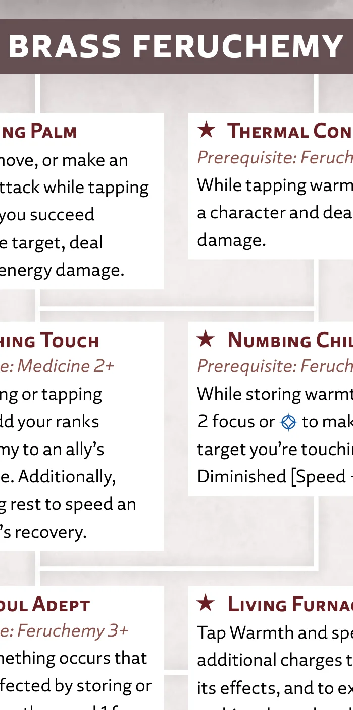
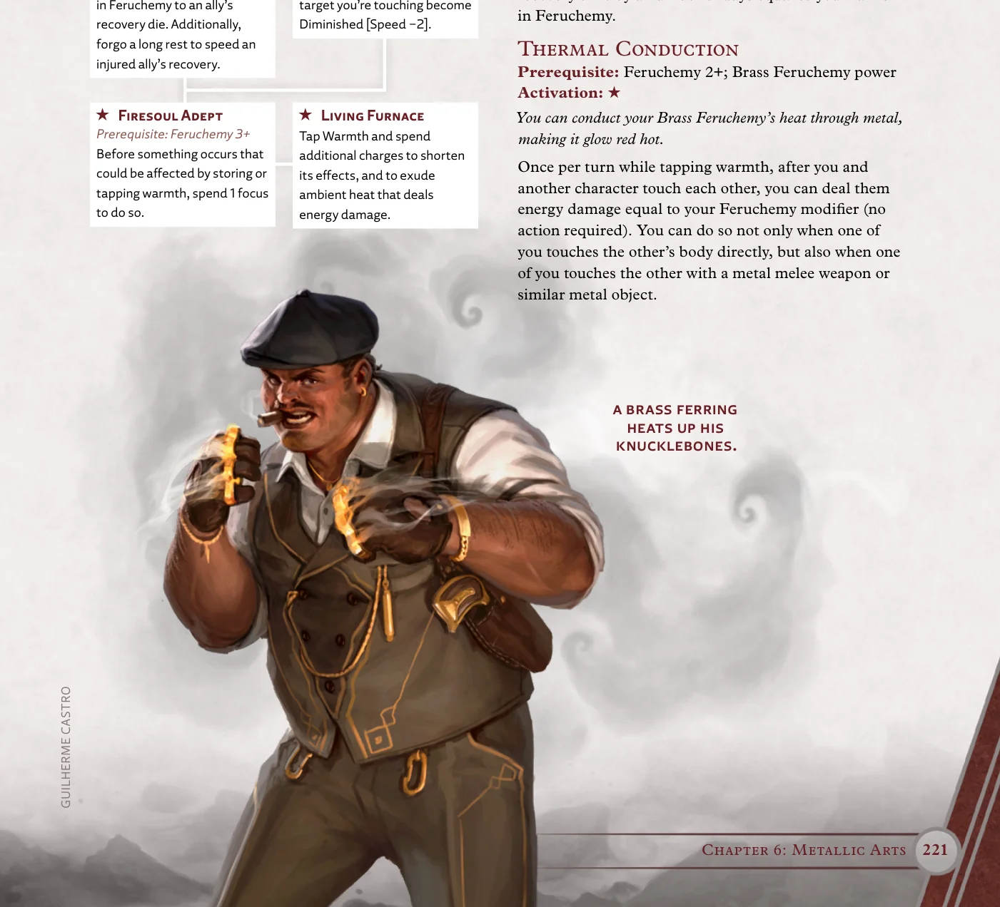

### 黃銅藏金術（Brass Feruchemy）

溫暖（Warmth）—意識金屬（Cognitive Metal）

黃銅藏金術讓你將身體的熱量儲存在黃銅意識（Brassmind）中。儲存時，你的體溫會降低，避免過熱，甚至能讓你在一定程度上抵擋明火。反過來，汲取（Tap）溫暖時，升高的體溫能避免寒冷氣候帶來的許多不良影響；正因為後一種能力，黃銅藏金術師（Feruchemist）被稱為火靈（Firesoul）。火靈的身體通常會調適體溫變化，即使熱到近身接觸就會傷害他人，也能避免傷到自己。不過，讓體溫升高到能向外輻射灼熱的熱浪時，就連火靈也可能受到傷害，因為這項能力只會調節內部溫度，不會調節外部溫度。

### 黃銅藏金術與南方人民

落灰之終（Catacendre）後，南司卡德利亞（Southern Scadrial）遭逢冰殲時代（Ice Death），氣溫急遽且永久地下降，導致大量人口死亡。然而，一位被稱為君王（Sovereign）的神祕人物，教導南方人民製作神奇的黃銅徽章（Medallion），詳見第8章「稀有造物」。這讓即使不是金屬之子（Metalborn）的人，也能使用黃銅藏金術。「火母（Firemother）」與「火父（Firefather）」犧牲自身的熱量，讓族人能藉由汲取這些徽章中的溫暖存活，這項做法一直延續至今。

### 儲存溫暖（Store Warmth）

啟動（Activation）：[1行動]

持續時間：每個場景（Scene）1點充能（Charge）

持續儲存溫暖，直到你以[自由行動]結束效果，或花費黃銅意識的一點充能為止。儲存溫暖期間，你會受到下列效果：

- 你的體溫降低。

- 你更能適應與抵抗炎熱環境，但更難承受寒冷環境。例如，炎熱的夏日會變得舒適，但溫和的秋日卻可能使你失溫。

- 在你受到能量傷害（Energy Damage）之前，先將傷害減少等同於你的階層（Tier）的數值。

每當一個場景結束，而你在整個場景中都持續儲存溫暖時，你的黃銅意識便獲得1點充能。

### 汲取溫暖（Tap Warmth）

啟動：[1行動]

持續時間：與你的藏金術（Feruchemy）技能等級（Rank）相同數量的回合（Round）

花費黃銅意識的1點充能，汲取溫暖，持續與你的藏金術技能等級相同數量的回合，或直到你開始儲存溫暖為止。汲取溫暖期間，你會受到下列效果：

- 你的體溫升高。

- 你更能適應與抵抗寒冷環境，但更難承受炎熱環境。

- 你受到能量傷害時，傷害增加等同於你的階層的數值。

- 在你的每個輪次（Turn）結束時，如果你與另一名角色（Character）已持續接觸超過幾秒，例如你們其中一方正擒抱（Grapple）另一方，或你對其實體防禦（Physical Defense）使用技能（Use a Skill），與其保持較長時間的接觸，你可以用[自由行動]對該角色造成等同於你的藏金術修正值的能量傷害。

溫暖汲取結束前，你可以用[自由行動]花費黃銅意識的1點充能，將其維持相同的時間。

JANETTE RAMOS

第6章：金屬技藝（Metallic Arts）　219

### 運用黃銅藏金術

除了上述能力規則，運用這項能力時，也可以參考以下指引。

### 創意運用

我們鼓勵你自行發想黃銅藏金術的創意用途，例如以下幾種，並與GM討論如何判定：

**冷卻物體。** 儲存溫暖的同時觸碰物體，吸取它的熱量。

**加熱物體。** 汲取溫暖的同時觸碰物體，將熱量傳入其中；這可能讓機械過熱而故障。

**點燃物體。** 觸碰一件無人看管的易燃物體時，花費1點充能，使自己瞬間熱到足以將該物體點燃。這可能形成危險地形（Dangerous Terrain），而且由GM裁定，火勢可能會蔓延。

### 黃銅藏金術天賦（talent）

以下依英文字母順序列出的天賦，都出現在黃銅藏金術天賦樹（talent tree）中。你可以透過單藏金術師（Ferring）、雙生師（Twinborn）與藏金術師路徑（Path）的關鍵天賦（Key Talent），或透過血金術尖刺（Hemalurgic Spike），解鎖這棵天賦樹。

### 火靈專家（Firesoul Adept）

前提條件（Prerequisite）：藏金術3+；舒緩之觸（Soothing Touch）天賦或麻痺寒意（Numbing Chill）天賦

啟動：[特殊啟動]

你儲存與汲取溫暖的次數多到幾乎已成為反射動作。

在一項行動（Action）或其他效果發生之前，若儲存或汲取溫暖可能影響它，你可以花費1點專注點（Focus），儲存溫暖或汲取溫暖，不需行動。例如，啟動另一項要求你正在儲存或汲取溫暖的黃銅藏金術天賦之前，你可以這麼做；遭到擒抱、落入冰冷的河流，或被烈焰爆炸捲入之前，也可以這麼做。

### 活體熔爐（Living Furnace）

前提條件：火靈專家天賦

啟動：[特殊啟動]

一次汲取大量溫暖，讓你向外輻射灼熱的熱浪，影響周圍所有人，甚至包括自己。

當你汲取溫暖時，可以花費黃銅意識中至少1點充能，最多不超過你的金屬技藝上限（Metallic Art Limit）。這麼做時，你會受到下列效果：

- 你只會汲取溫暖到你的下一個輪次結束，而非該行動通常的持續時間。

- 除了該行動通常的效果，你也會向周圍散發熱量，半徑等於你為汲取溫暖花費的充能點數乘以10呎。在你的每個輪次結束時，該區域內的每名角色，包括你自己，都受到等同於你的藏金術修正值的能量傷害，即使他們已經因接觸你而受傷，也一樣。

這次溫暖汲取結束前，你可以用[自由行動]花費黃銅意識中至少1點充能，將其維持相同的時間。

### 麻痺寒意

前提條件：藏金術2+；灼熱掌擊（Searing Palm）天賦或熱傳導（Thermal Conduction）天賦

啟動：[特殊啟動]

你能吸取所觸物體的熱量，甚至能從敵人的四肢吸走熱量，讓其突然麻木。

儲存溫暖期間，觸碰一名角色時，你可以花費2點專注點，不需行動，使其陷入減損（Diminished）[速度（Speed）−2]，直到你的下一個輪次結束。如果你是在某次檢定（Test）中觸碰目標（Target），可以改為花費該檢定中的[機遇]（Opportunity），而非專注點。

### 灼熱掌擊

前提條件：黃銅藏金術能力

啟動：[2行動]

你已練習將汲取的熱量，集中到用來打擊的部位。

汲取溫暖期間，使用這項行動，對觸及範圍（Reach）內一名角色的實體防禦，進行擒抱、推撞（Shove）或徒手攻擊（Unarmed Attack）。擒抱或推撞成功，或攻擊命中（Hit）或擦傷（Graze）時，對目標額外造成1d4能量傷害。這項額外傷害使用你的金屬技藝骰（Metallic Art Die），因此骰型（Die Size）會隨你的藏金術技能等級提高；2級時改擲1d6，而非1d4，依此類推。

第6章：金屬技藝　220

### 舒緩之觸

前提條件：醫學（Medicine）2+；灼熱掌擊天賦或熱傳導天賦

啟動：[特殊啟動]

你以藏金術觸碰他人，讓對方變暖或變涼，藉此麻痺疼痛，或放鬆緊繃的肌肉。

儲存或汲取溫暖期間，觸及範圍內願意接受的盟友（Ally）擲恢復骰（Recovery Die）時，你可以將自己的藏金術技能等級加到結果上。此外，完成一次長休息（Long Rest），且你在該次休息中放棄恢復、改為在金屬意識庫（Metalmind）中儲存時，可以選擇觸及範圍內一名有暫時傷勢的盟友。該盟友可以選擇一項暫時傷勢，將其恢復時間減少等同於你的藏金術技能等級的天數。

### 熱傳導

前提條件：藏金術2+；黃銅藏金術能力

啟動：[特殊啟動]

你可以透過金屬傳導黃銅藏金術的熱量，使其燒得通紅。

汲取溫暖期間，每個輪次一次，在你與另一名角色彼此觸碰之後，你可以對該角色造成等同於你的藏金術修正值的能量傷害，不需行動。不只直接接觸對方身體時可以這麼做，其中一方用金屬近戰（Melee）武器（Weapon）或類似的金屬物體碰觸另一方時，也可以。

一名黃銅單藏金術師加熱自己的指虎（Knucklebones）。

### 黃銅藏金術天賦樹

#### 灼熱掌擊

啟動：[2行動]

解鎖來源：黃銅藏金術能力

汲取溫暖期間，進行擒抱、推撞或徒手攻擊。如果成功或對目標造成擦傷，額外造成能量傷害。

#### 熱傳導

啟動：[特殊啟動]

前提條件：藏金術2+

解鎖來源：黃銅藏金術能力

汲取溫暖期間，觸碰一名角色，造成能量傷害。

#### 舒緩之觸

啟動：[特殊啟動]

前提條件：醫學2+

解鎖來源：灼熱掌擊天賦或熱傳導天賦

儲存或汲取溫暖期間，將你的藏金術技能等級加到盟友的恢復骰。此外，放棄一次長休息，加速受傷盟友的恢復。

#### 麻痺寒意

啟動：[特殊啟動]

前提條件：藏金術2+

解鎖來源：灼熱掌擊天賦或熱傳導天賦

儲存溫暖期間，花費2點專注點或[機遇]，使你正在觸碰的目標陷入減損[速度−2]。

#### 火靈專家

啟動：[特殊啟動]

前提條件：藏金術3+

解鎖來源：舒緩之觸天賦或麻痺寒意天賦

某件事發生之前，若儲存或汲取溫暖可能影響它，花費1點專注點來儲存或汲取溫暖。

#### 活體熔爐

啟動：[特殊啟動]

解鎖來源：火靈專家天賦

汲取溫暖時花費額外充能，縮短持續時間，並向周圍散發熱量，造成能量傷害。

GUILHERME CASTRO

第6章：金屬技藝　221

