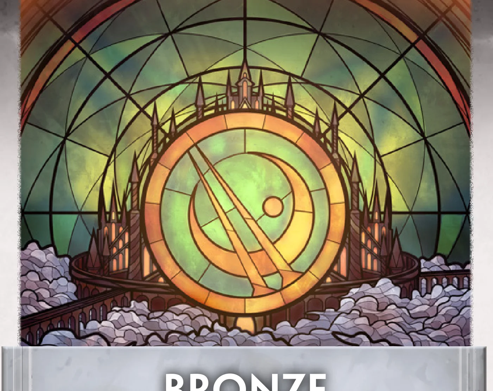
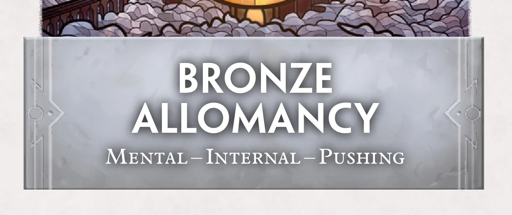
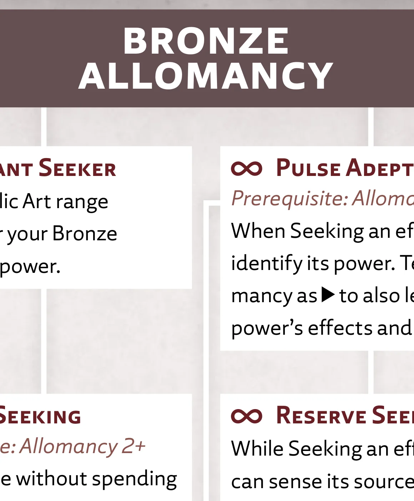
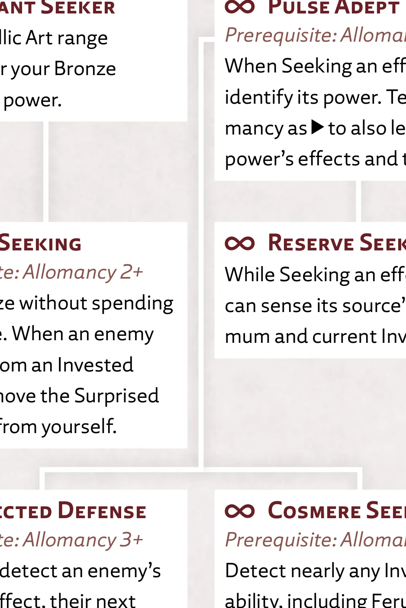
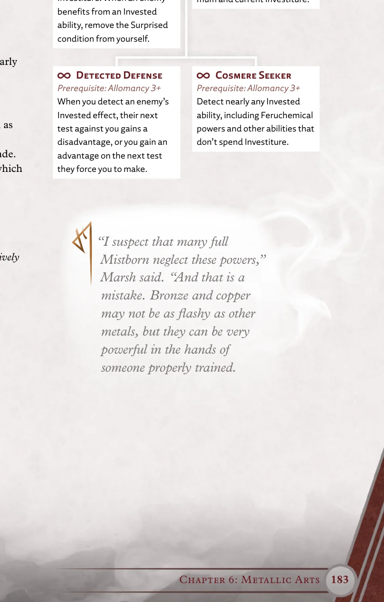
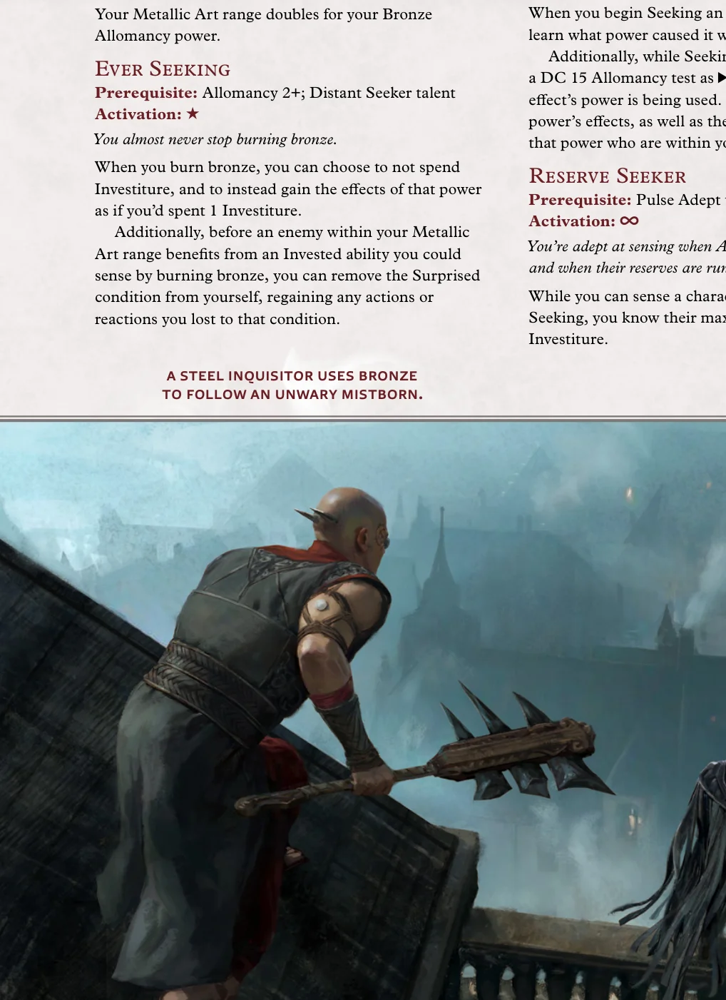
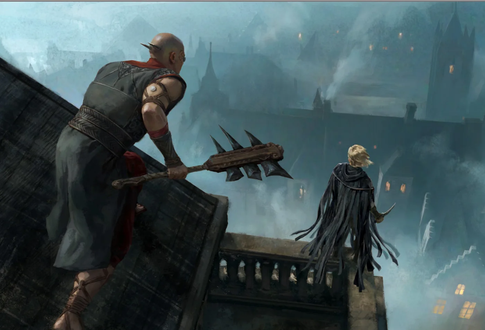

### 青銅鎔金術（Bronze Allomancy）

意志（Mental）—內部（Internal）—推力（Pushing）

青銅鎔金術讓你感知附近動態授予（Kinetic Investiture）發出如鼓點般的規律脈動。在司卡德利亞（Scadrial），最常偵測到的來源，是正在燃燒金屬的鎔金術師（Allomancer）。青銅鎔金術師能以這項能力追蹤其他鎔金術師，因此被稱為搜尋者（Seeker）。司卡德利亞人主要從三個面向為鎔金金屬（Allomantic Metal）分類，各金屬的分類詳見前面的「司卡德利亞的金屬」。這套分類來自經驗豐富的搜尋者；他們發現，燃燒不同金屬所產生的節律（Rhythm）與脈動，有若干相似之處：

- 金屬的四大類別，也就是實體（Physical）、意志、時序（Temporal）與增強（Enhancement）金屬，各有獨特的節律特徵。

- 外部（External）金屬的節奏比內部金屬更快。

- 具有推或拉作用的金屬，會讓搜尋者產生相應的推或拉感受。

### 燃燒青銅（Burn Bronze）

啟動（Activation）：[1行動]　持續時間（Duration）：等同於你的鎔金術（Allomancy）技能等級（Rank）的回合（Round）數

燃燒青銅時，花費至少 1 授予（Investiture），最多不超過你的金屬技藝上限（Metallic Art Limit）。花費越多授予，你就能搜尋（Seek）越多效果，得知其來源。在等同於你鎔金術技能等級的回合數內，你能偵測金屬技藝距離（Metallic Art Range）內的下列情況：

- 每一次授予的花費。

- 以授予維持的持續效果，例如鎔金術師的燃燒（Burn）行動（Action）。即使那份授予是在你使用這項能力之前花費的，也能偵測到。

偵測到效果時，你能感知其來源相對於你的大致方向，並選擇搜尋該效果，不需花費行動。你同時搜尋的效果數量，最多等於燃燒青銅時花費的授予。搜尋效果期間，你會得知其確切位置與來源；如果是持續效果，還能在它移動時追蹤其位置。此外，你可以用 [1行動] 進行 DC 15 的鎔金術檢定（Test）。成功時，你辨識出產生正在搜尋之效果的能力，例如燃燒了哪種金屬。此次青銅燃燒結束前，你可以用 [自由行動] 花費至少 1 授予，將它維持相同的持續時間。

### 使用青銅鎔金術

除了上述能力規則，運用這項能力時，也請參考下列指引。

### 在人群中搜尋

青銅鎔金術通常不需要技能檢定（Skill Test），辨識能力時除外。但在人群中，或許多授予同時被運用的地方，搜尋確切位置可能較為困難。由 GM 裁定，你可能必須通過鎔金術檢定，才能找出或追蹤某些來源。

### 偵測細微效果

有些授予效果較難偵測，例如照映（Illumination）波力（Surge）與其他織光術（Lightweaving）。此外，你通常無法偵測到授予遮蔽效果後方的任何事物，也無法偵測到該遮蔽效果本身。例如，紅銅（Copper）鎔金術師製造的紅銅雲（Coppercloud），就能如此遮蔽。不過，燃燒青銅時花費至少 6 授予，就能穿透這類效果，詳見紅銅鎔金術（Copper Allomancy）能力的「穿透紅銅雲」一節。

### 創意用法

在司卡德利亞，青銅鎔金術的作用相對單純。但在寰宇（cosmere）的其他世界與界域（Realm），這項能力能感知其他形式的動態授予，不限於授予之術（Invested Arts）使用者所花費的授予。你可以發想自己的用法，例如下列方式，再與 GM 一起決定如何結算：

- 調諧羅沙（Roshar）的節律。

- 利用意識界（Cognitive Realm）中龐大而神祕的脈動，協助你在幽界（Shadesmar）導航。

AUSTIN HARTELL

第 6 章：金屬技藝（Metallic Arts）182

- 傾聽碎力（Shard）的歌聲與節律，判斷一個恆星系中是否有碎力存在。如果你以前偵測過該碎力，還能辨識出是哪一個。

### 青銅鎔金術天賦

下列天賦（Talent）依英文字母順序排列，出現在青銅鎔金術天賦樹（Talent Tree）中。你可以透過迷霧人（Misting）、雙生師（Twinborn）與迷霧之子（Mistborn）路徑（Path）的關鍵天賦（Key Talent），或透過血金術尖刺（Hemalurgic Spike），解鎖這棵樹。

#### 寰宇搜尋者（Cosmere Seeker）

前提條件（Prerequisite）：鎔金術 3+；脈動專家（Pulse Adept）天賦

啟動：[常駐]

你已學會傾聽最細微的節律，從鎔金術與藏金術（Feruchemy），到司卡德利亞以外世界的能力，都能感知。

燃燒青銅時，你幾乎能偵測任何授予能力的使用，包括下列情況：

- 花費或恢復充能（Charge），而非授予的效果，例如藏金術的金屬意識庫（Metalmind）。

- 通常難以偵測的效果，例如照映波力。

- 召喚或收回碎刃（Shardblade）之類的效果。

- 歌者（Singers）調諧節律，你能辨識出是哪一種節律。

#### 感應防禦（Detected Defense）

前提條件：鎔金術 3+；脈動專家天賦

啟動：[常駐]

你處理金屬脈動的速度極快，能本能地避開其影響。

燃燒青銅期間，當你偵測到正在使用授予能力的敵人，就會產生下列兩種效果之一，以先發生者為準：在你下一個輪次（Turn）開始前，該敵人下一次對你進行的檢定具有一個劣勢（Disadvantage）；或在你下一個輪次開始前，你下一次被該敵人迫使進行的檢定，具有一個優勢（Advantage）。

### 青銅鎔金術天賦樹

#### 遠距搜尋者（Distant Seeker）

啟動：[常駐]

解鎖條件：青銅鎔金術能力

你的青銅鎔金術能力，其金屬技藝距離加倍。

#### 脈動專家

啟動：[常駐]

前提條件：鎔金術 2+

解鎖條件：青銅鎔金術能力

搜尋效果時，你辨識出產生它的能力。用 [1行動] 進行鎔金術檢定，還能得知該能力的效果與目標（Target）。

#### 持續搜尋（Ever Seeking）

啟動：[特殊啟動]

前提條件：鎔金術 2+

解鎖條件：遠距搜尋者天賦

燃燒青銅時不需花費授予。當敵人受益於授予能力時，移除自己的措手不及（Surprised）狀態（Condition）。

#### 儲備搜尋者（Reserve Seeker）

啟動：[常駐]

解鎖條件：脈動專家天賦

搜尋效果期間，你能感知其來源的授予上限與目前授予。

#### 感應防禦

啟動：[常駐]

前提條件：鎔金術 3+

解鎖條件：脈動專家天賦

當你偵測到敵人的授予效果，該敵人下一次對你的檢定具有一個劣勢，或你下一次被該敵人迫使進行的檢定具有一個優勢。

#### 寰宇搜尋者

啟動：[常駐]

前提條件：鎔金術 3+

解鎖條件：脈動專家天賦

偵測幾乎任何授予能力，包括藏金能力（Feruchemical Power），以及其他不花費授予的能力。

> 「我懷疑許多具備完整能力的迷霧之子都忽略了這些能力，」沼澤（Marsh）說。「這是個錯誤。青銅和紅銅或許不如其他金屬耀眼，但交到受過適當訓練的人手中，卻能發揮很強的力量。」

第 6 章：金屬技藝 183

#### 遠距搜尋者

前提條件：青銅鎔金術能力

啟動：[常駐]

你受過訓練，能將青銅鎔金術的感知範圍延伸得更遠，搜尋遠近各處。

你的青銅鎔金術能力，其金屬技藝距離加倍。

#### 持續搜尋

前提條件：鎔金術 2+；遠距搜尋者天賦

啟動：[特殊啟動]

你幾乎從不停止燃燒青銅。

燃燒青銅時，你可以選擇不花費授予，改為獲得如同花費 1 授予使用該能力的效果。

此外，在金屬技藝距離內的敵人，受益於你能藉由燃燒青銅感知的授予能力之前，你可以移除自己的措手不及狀態，取回因該狀態失去的所有行動或反應（Reaction）。

#### 脈動專家

前提條件：鎔金術 2+；青銅鎔金術能力

啟動：[常駐]

你能本能地辨別金屬脈動，轉瞬間就分辨出差異。

開始搜尋效果時，你不需進行檢定，就會自動得知是哪項能力造成了該效果。

此外，搜尋效果期間，你可以用 [1行動] 進行 DC 15 的鎔金術檢定，判斷造成該效果的能力正被如何運用。成功時，你會得知該能力的效果，以及該能力所有位於你金屬技藝距離內的目標所在位置。

#### 儲備搜尋者

前提條件：脈動專家天賦

啟動：[常駐]

你擅長感知鎔金術師何時驟燒（Flare）金屬，以及何時金屬儲備將盡。

你正在搜尋的效果，若來自一名你能感知的角色（Character），你就會得知該角色的授予上限與目前授予。

*一名鋼鐵審判者（Steel Inquisitor）使用青銅，跟蹤毫無戒心的迷霧之子。*

GAL OR

