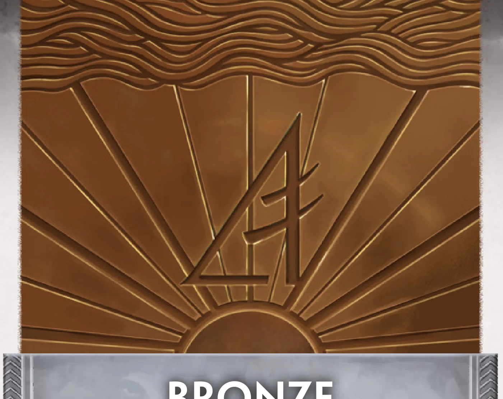
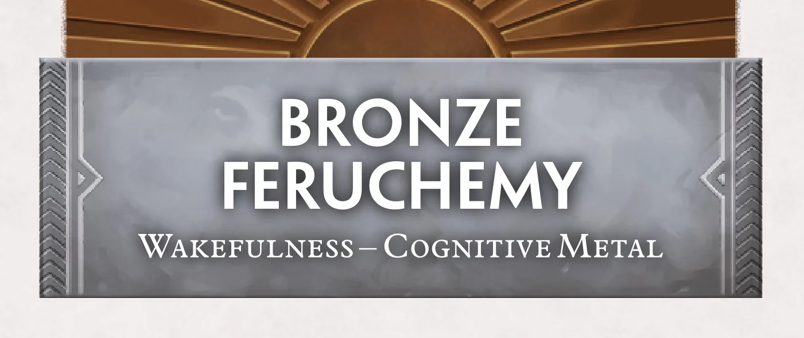
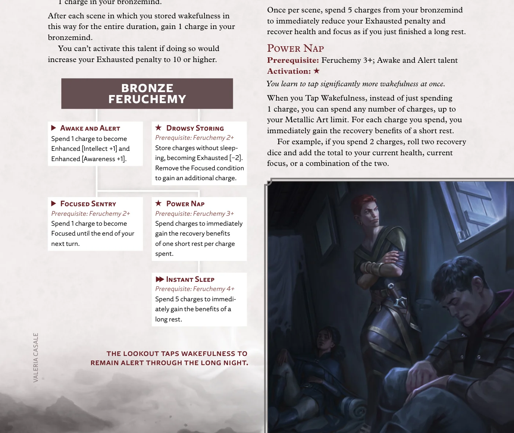

### 青銅藏金術（Bronze Feruchemy）

清醒（Wakefulness）—意識金屬（Cognitive Metal）

你可以使用青銅藏金術，將清醒儲存在青銅意識（Bronzemind）中；這是目前唯一已知能在睡眠中儲存的藏金特質。儲存時休息，你會進入近乎昏迷的狀態，但這種「睡眠」無法讓你充分恢復，而且極難喚醒。因此，大多數使用這項能力的人，只會在安全的地方休息時儲存。特別熟練的人甚至能在醒著時儲存，但會感到昏沉疲倦，彷彿睡眠不足。反過來，汲取（Tap）青銅意識時，你會變得更加警覺、專心。這項能力主要用來長時間保持清醒，而不受負面影響。青銅藏金術師（Feruchemist）常被稱為哨兵（Sentry），因為汲取清醒能瞬間讓身體恢復活力，重新集中精神。

### 儲存清醒（Store Wakefulness）

啟動（Activation）：[1行動]

持續時間：每次休息至少1點充能（Charge）

持續儲存清醒，直到你以[自由行動]結束效果，或花費青銅意識的一點充能為止。儲存清醒期間，你會受到下列效果：

- 你隱約感到昏沉，像是睡眠不足。

- 短休息（Short Rest）與長休息（Long Rest）不會產生通常的效果，詳見第9章「休息（Resting）」。取而代之，開始短休息或長休息時，你會陷入昏迷（Unconscious），在整段時間裡沉入無夢的深眠，並持續儲存清醒，直到醒來。除非受到傷害（Damage）或其他損害，否則你無法提早從這種睡眠中醒來。

每當一次休息結束，而你在整段休息中都持續儲存清醒時，便能為青銅意識充能。短休息後獲得1點充能；長休息後則獲得等同於你的藏金術（Feruchemy）技能等級（Rank）的充能點數。

### 汲取清醒（Tap Wakefulness）

啟動：[1行動]

持續時間：瞬間

花費青銅意識的1點充能，立即恢復生命值（Health）與／或專注點（Focus），就像剛完成一次短休息一樣。此外，當你已開始長休息，卻無法完成並獲得其收益時，可以花費青銅意識的2點充能，不需行動（Action），立即恢復生命值與專注點，並降低精疲力竭（Exhausted）懲罰，就像剛完成一次長休息一樣。

### 運用青銅藏金術

除了上述能力規則，運用這項能力時，也可以參考以下指引。

### 創意運用

我們鼓勵你自行發想青銅藏金術的創意用途，例如以下幾種，並與GM討論如何判定：

**通宵不眠。** 長休息期間，在盟友（Ally）睡覺時汲取清醒。除了獲得長休息通常提供的收益，你也可能獲得短休息的某一項替代收益，例如進行求生（Survival）檢定（Test），採集資源（Resources）。

**助眠。** 儲存清醒，強迫自己入睡，緩解長期失眠，或平息焦慮的思緒。

**不眠工作。** 汲取清醒並徹夜工作，讓休整期（Downtime）活動的進度以平常兩倍的速度推進。

### 青銅藏金術天賦（talent）

以下依英文字母順序列出的天賦，都出現在青銅藏金術天賦樹（talent tree）中。你可以透過單藏金術師（Ferring）、雙生師（Twinborn）與藏金術師路徑（Path）的關鍵天賦（Key Talent），或透過血金術尖刺（Hemalurgic Spike），解鎖這棵天賦樹。

### 清醒警覺（Awake and Alert）

前提條件（Prerequisite）：青銅藏金術能力

啟動：[1行動]

你能引導汲取的清醒，讓自己在短時間內更加警覺，精神充沛。

花費青銅意識的1點充能，獲得增益（Enhanced）[智力（Intellect）+1]與增益[察覺（Awareness）+1]，持續與你的藏金術技能等級相同數量的回合（Round），或直到你開始儲存清醒為止。這項效果結束前，你可以用[自由行動]花費青銅意識的1點充能，將其維持相同的時間。

JANETTE RAMOS

第6章：金屬技藝（Metallic Arts）　222

### 昏沉儲存（Drowsy Storing）

前提條件：藏金術2+；青銅藏金術能力

啟動：[特殊啟動]

你學會即使醒著，也能更有效地在青銅意識中儲存，但這會讓你精疲力竭。

儲存清醒時，你可以藉由承受下列效果，不必睡覺也能儲存充能：

- 你陷入精疲力竭[−2]，直到停止儲存清醒為止。

- 如果你在開始儲存清醒時處於集中（Focused）狀態（Condition），移除該狀態。在停止儲存清醒前，你無法再次獲得集中狀態。

- 每個場景（Scene）中，第一次以此方式移除集中狀態時，你的青銅意識額外獲得1點充能。

每當一個場景結束，而你在整個場景中都以此方式持續儲存清醒時，你的青銅意識便獲得1點充能。如果啟動這項天賦會讓你的精疲力竭懲罰增加到10或更高，你就不能啟動它。

瞭望者汲取清醒，在漫漫長夜中保持警覺。

### 集中哨兵（Focused Sentry）

前提條件：藏金術2+；清醒警覺天賦

啟動：[1行動]

你可以汲取清醒，在短時間內高度集中精神。

花費青銅意識的1點充能，獲得集中狀態，直到你的下一個輪次（Turn）結束，或直到你開始儲存清醒為止。這項效果結束前，你可以用[自由行動]花費青銅意識的1點充能，將其維持相同的時間。

### 瞬眠（Instant Sleep）

前提條件：藏金術4+；高效小睡（Power Nap）天賦

啟動：[2行動]

一次汲取驚人的清醒，讓你能將一整晚的睡眠濃縮成一瞬間。

每個場景一次，花費青銅意識的5點充能，立即降低精疲力竭懲罰，並恢復生命值與專注點，就像剛完成一次長休息一樣。

### 高效小睡

前提條件：藏金術3+；清醒警覺天賦

啟動：[特殊啟動]

你學會一次汲取多得多的清醒。

當你汲取清醒時，可以不只花費1點充能，而是改為花費任意數量的充能，最多不超過你的金屬技藝上限（Metallic Art Limit）。每花費1點充能，你便立即獲得一次短休息的恢復收益。例如，花費2點充能時，擲兩顆恢復骰（Recovery Die），將結果加總後，加到目前生命值、目前專注點，或分配到兩者上。

### 青銅藏金術天賦樹

#### 清醒警覺

啟動：[1行動]

解鎖來源：青銅藏金術能力

花費1點充能，獲得增益[智力+1]與增益[察覺+1]。

#### 昏沉儲存

啟動：[特殊啟動]

前提條件：藏金術2+

解鎖來源：青銅藏金術能力

不必睡覺也能儲存充能，但會陷入精疲力竭[−2]。移除集中狀態，額外獲得1點充能。

#### 集中哨兵

啟動：[1行動]

前提條件：藏金術2+

解鎖來源：清醒警覺天賦

花費1點充能，獲得集中狀態，直到你的下一個輪次結束。

#### 高效小睡

啟動：[特殊啟動]

前提條件：藏金術3+

解鎖來源：清醒警覺天賦

花費充能，立即獲得恢復收益；每花費1點充能，獲得一次短休息的恢復收益。

#### 瞬眠

啟動：[2行動]

前提條件：藏金術4+

解鎖來源：高效小睡天賦

花費5點充能，立即獲得一次長休息的收益。

VALERIA CASALE

