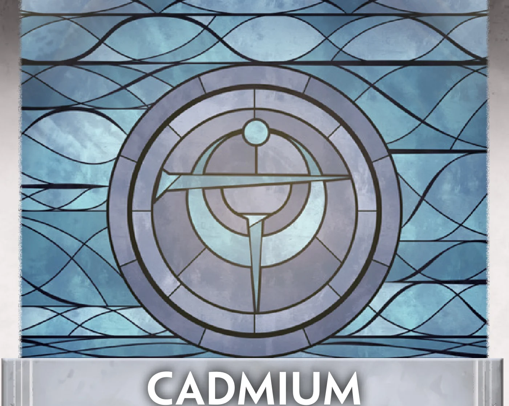
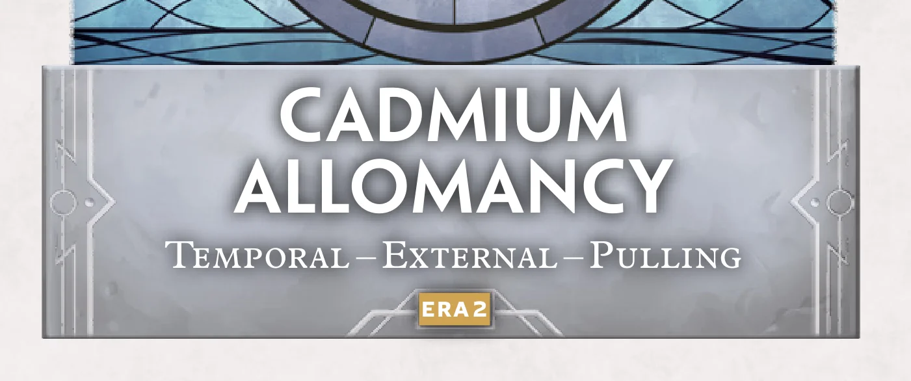
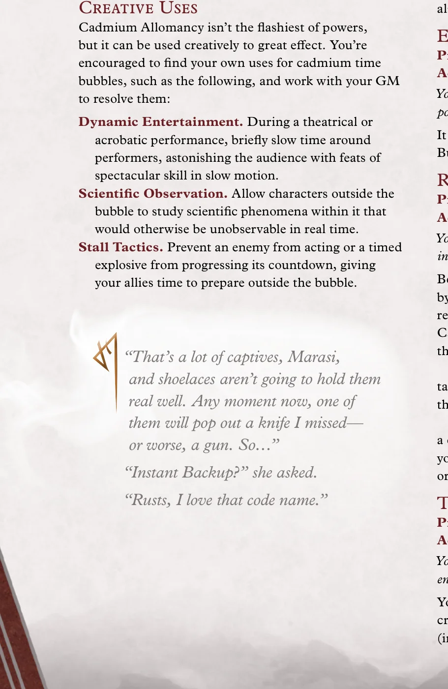
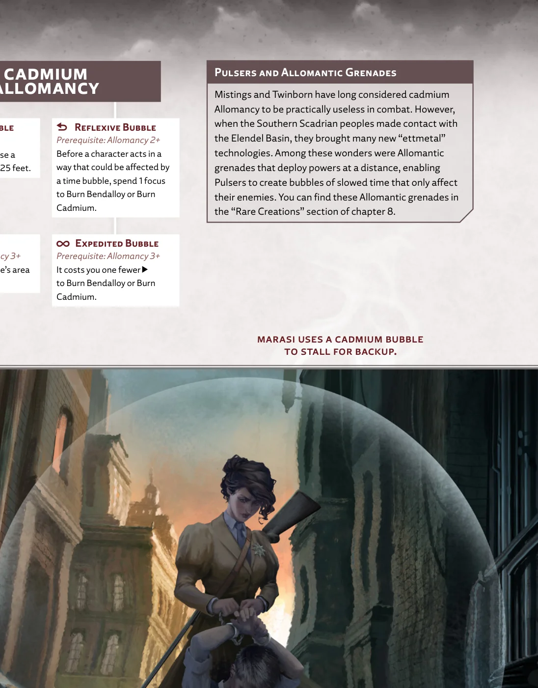
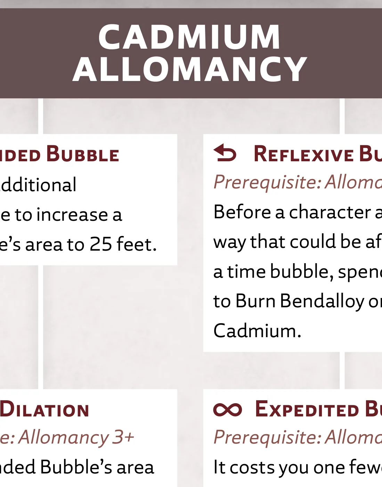
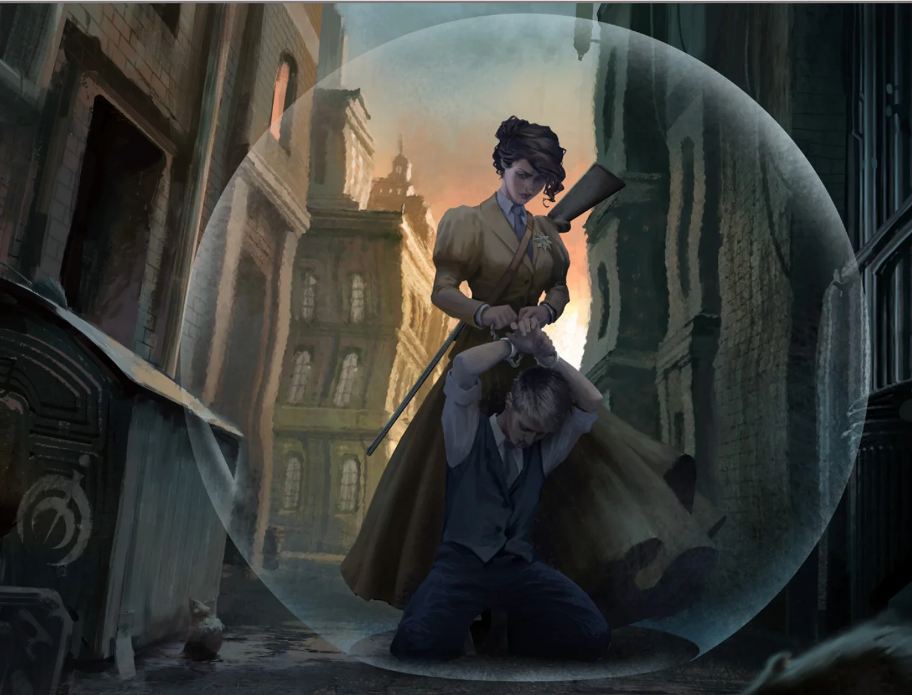

### 鎘鎔金術（Cadmium Allomancy）

時序（Temporal）—外部（External）—拉引（Pulling）

[第二時代]

鎘鎔金術會在你周圍形成速度圈（Time Bubble），圈內的時間流逝比圈外更慢。在圈外的人看來，圈內的人像在作慢動作，甚至彷彿完全靜止。正因為這種突然減速的「脈動」，鎘鎔金術師（Allomancer）被稱為脈動（Pulser）。

### 燃燒鎘（Burn Cadmium）

啟動（Activation）：[2行動]　持續時間：1 回合（Round）

燃燒鎘（Cadmium）時，花費至少 1 授予（Investiture），最多不超過你的金屬技藝上限（Metallic Art Limit），以你目前的位置為中心，在巨型（Huge，15 呎）區域內製造鎘速度圈。這個圈通常固定在周遭地景上；但由 GM 裁定，它也可能固定在你正站著的極巨型（Colossal）載具上，例如火車或客輪。圈內的時間會大幅減慢。圈內每名角色（Character），包括你在內，都獲得等同於 1 + 你燃燒鎘所花授予的延遲點（Delay Point）。只要角色至少還有 1 延遲點，就必須將所有可用的行動（Action）與貢獻（Contribution），以下列任一方式用來移除延遲點。在移除完延遲點之前，他不能使用其他行動或反應（Reaction）：

- 用 [1行動] 移除自己身上的 1 延遲點。角色每個輪次（Turn）可以多次使用此行動。

- 他可以使用自由行動（Free Action）。如果該效果提供一個或多個 [1行動]，就可以用這些行動移除延遲點。

- 對話（Conversation）或試煉（Endeavor）中，他可以使用自己的貢獻，移除身上的 2 延遲點。

圈內效果的持續時間也流逝得更慢。角色至少還有 1 延遲點時，他正在使用或正影響他的持續效果，例如燃燒金屬或汲取（Tap）金屬意識庫（Metalmind），其持續時間都會暫停，效果本身卻不會停止。因此，這些效果不計回合與輪次的經過。你的速度圈會在下一回合結束時終止；但只要你至少還有 1 延遲點，回合就不計入持續時間，所以這個圈會持續到你移除最後 1 延遲點的那個回合結束。圈終止時，從受影響角色身上移除這個圈剩餘的延遲點。此次鎘燃燒結束前，你可以用 [自由行動] 花費與先前相同的授予，將它維持相同的持續時間。如此做時，圈內每名角色都會額外獲得等同於 1 + 你燃燒鎘所花授予的延遲點。你必須身在圈內，才能維持這個圈。你同時只能有一個鎘速度圈，而且必須等先前的圈終止後，才能製造新的速度圈。

### 使用鎘鎔金術

除了上述能力規則，運用這項能力時，也請參考下列指引。

### 重疊的速度圈

角色若位於多個速度圈重疊的區域，包括彎管合金（Bendalloy）速度圈，就會同時受到這些圈的影響。鎘速度圈彼此重疊時，每名角色會獲得所有圈加起來的延遲點總數。

### 與速度圈互動

圈內與圈外的時間流速不同，因此影像、聲音、角色與物體都很難穿過圈的表面。這會造成下列奇特效果：

- 進出啟用中的速度圈會耗費心力。角色自願穿過圈的表面後，失去的專注點（Focus）等於你燃燒鎘所花費的授予。如果這使其專注點降至 0，或其專注點原本就為 0，該角色還會陷入震懾（Stunned），直到其下一個輪次結束。

- 移出速度圈的角色，移除自己所有延遲點。移入速度圈的角色，獲得的延遲點等於 1 + 燃燒鎘所花費的授予。

第 6 章：金屬技藝（Metallic Arts）185

AUSTIN HARTELL

- 聲音與動態影像會嚴重扭曲，無法穿過圈的表面進行溝通。圈外角色無法以一般手段影響（Influence）圈內角色，反之亦然。

- 穿過圈進行的攻擊（Attack），無論由外向內或由內向外，結果都可能極難預料，甚至可能偏轉，擊中原本不打算攻擊的目標。角色的攻擊穿過圈的表面時，承受的劣勢（Disadvantage）數量等於你燃燒鎘所花費的授予。這次攻擊獲得危險（Dangerous）武器（Weapon）特性；除非攻擊者花費 [機遇]（Opportunity），否則無法命中（Hit）或擦傷（Graze）目標（Target）。其他費用也必須照常支付。

### 創意用法

鎘鎔金術雖然不是最耀眼的能力，卻能靠創意運用發揮出色效果。你可以發想鎘速度圈的用法，例如下列方式，再與 GM 一起決定如何結算：

**動態娛樂。** 戲劇或特技表演時，短暫減慢表演者周圍的時間，讓觀眾看見精湛技巧的慢動作，驚嘆不已。

**科學觀察。** 讓圈外角色研究圈內的科學現象；這些現象若以正常時間流速發生，就無從觀察。

**拖延戰術。** 阻止敵人行動，或讓定時炸彈的倒數暫停，為圈外盟友（Ally）爭取準備時間。

> 「俘虜可真不少，瑪拉席（Marasi），光靠鞋帶可綁不牢。他們隨時可能掏出一把我沒搜到的刀，糟一點還可能是槍。所以……」
>
> 「即時後援（Instant Backup）？」她問。
>
> 「鐵鏽啊，我真喜歡這個代號。」

### 鎘鎔金術天賦

下列天賦（talent）依英文字母順序排列，出現在鎘鎔金術天賦樹（talent tree）中。你可以透過迷霧人（Misting）與雙生師（Twinborn）路徑（Path）的關鍵天賦（Key Talent），或透過血金術尖刺（Hemalurgic Spike），解鎖這棵樹。

#### 擴大速度圈（Expanded Bubble）

前提條件（Prerequisite）：鎘鎔金術能力

啟動：[特殊啟動]

你受過訓練，能擴大速度圈的區域，一次影響更多人。

燃燒彎管合金或鎘時，你可以額外花費 1 授予，在 25 呎區域內製造速度圈，而非 15 呎。維持這個擴大的圈，也必須額外花費 1 授予。

#### 迅速展圈（Expedited Bubble）

前提條件：鎔金術（Allomancy）3+；反應展圈（Reflexive Bubble）天賦

啟動：[常駐]

你受過訓練，能縮短速度圈消失後，到你製造下一個圈之間的空檔。

使用燃燒彎管合金（Burn Bendalloy）或燃燒鎘時，你少花費一個 [1行動]。

#### 反應展圈

前提條件：鎔金術 2+；鎘鎔金術

啟動：[反應]

你能在一瞬間製造速度圈，尤其擅長用來應付危險。

角色即將採取可能受到新出現的速度圈影響的行動前，你可以使用此反應，並花費 1 專注點，使用燃燒彎管合金或燃燒鎘。製造速度圈的授予仍須照常花費。

如果你是對攻擊作出反應，就必須在擲出攻擊檢定（Test）的骰子之前使用此天賦。接著，那次攻擊會穿過你速度圈的表面。

例如，你可以在角色影響你或盟友之前、在他以遠程（Ranged）攻擊選你或盟友為目標之前，或在他進出你可能製造速度圈的區域之前，製造速度圈。

#### 時間膨脹（Time Dilation）

前提條件：鎔金術 3+；擴大速度圈天賦

啟動：[常駐]

你精通燃燒鎘，能製造極為龐大的速度圈。

你的擴大速度圈天賦，現在能讓你在 35 呎或 45 呎區域內製造鎘速度圈，而非 25 呎。

第 6 章：金屬技藝 186

### 鎘鎔金術天賦樹

#### 擴大速度圈

啟動：[特殊啟動]

解鎖來源：鎘鎔金術能力

額外花費 1 授予，將速度圈的區域擴大至 25 呎。

#### 反應展圈

啟動：[反應]

前提條件：鎔金術 2+

解鎖來源：鎘鎔金術能力

角色即將採取可能受速度圈影響的行動前，花費 1 專注點，使用燃燒彎管合金或燃燒鎘。

#### 時間膨脹

啟動：[常駐]

前提條件：鎔金術 3+

解鎖來源：擴大速度圈天賦

你的擴大速度圈區域增加至 45 呎。

#### 迅速展圈

啟動：[常駐]

前提條件：鎔金術 3+

解鎖來源：反應展圈天賦

使用燃燒彎管合金或燃燒鎘時，你少花費一個 [1行動]。

#### 脈動與鎔金手榴彈（Allomantic Grenade）

迷霧人與雙生師長久以來都認為，鎘鎔金術在戰鬥中幾乎毫無用處。然而，司卡德利亞南方各族與依藍戴盆地（Elendel Basin）接觸時，帶來了許多新的「ettmetal」技術。其中就有能在遠處釋放能力的鎔金手榴彈，使脈動能製造只影響敵人的減速速度圈。這些鎔金手榴彈的資料，見第 8 章「稀有創造物」。

*瑪拉席利用鎘速度圈拖延時間，等待後援。*

SIRAJ FAKHRI

