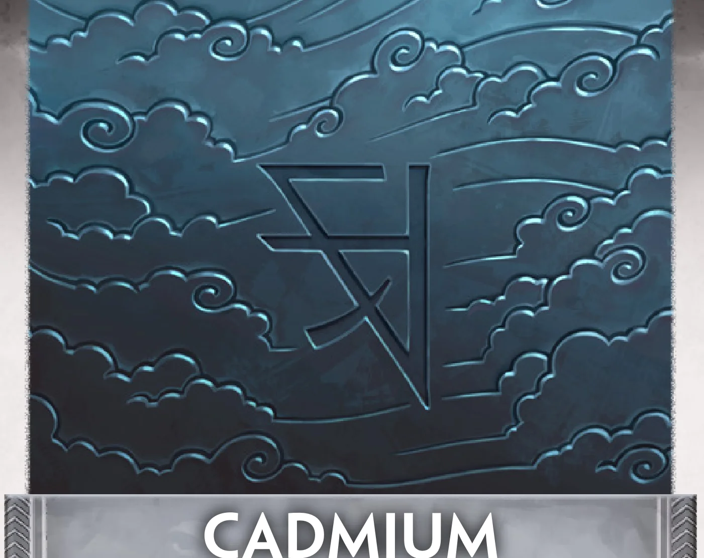
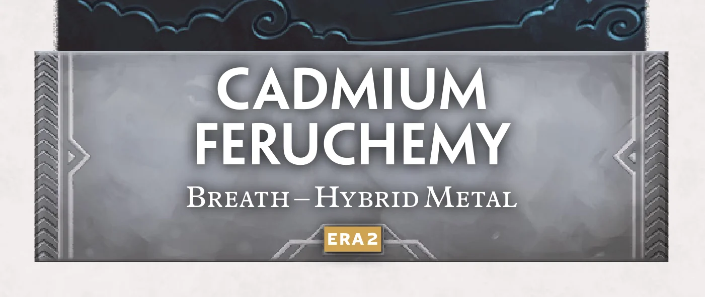
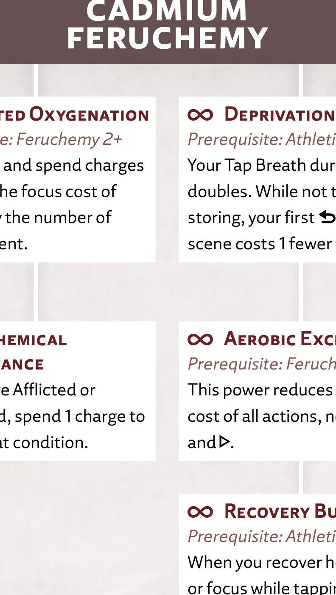
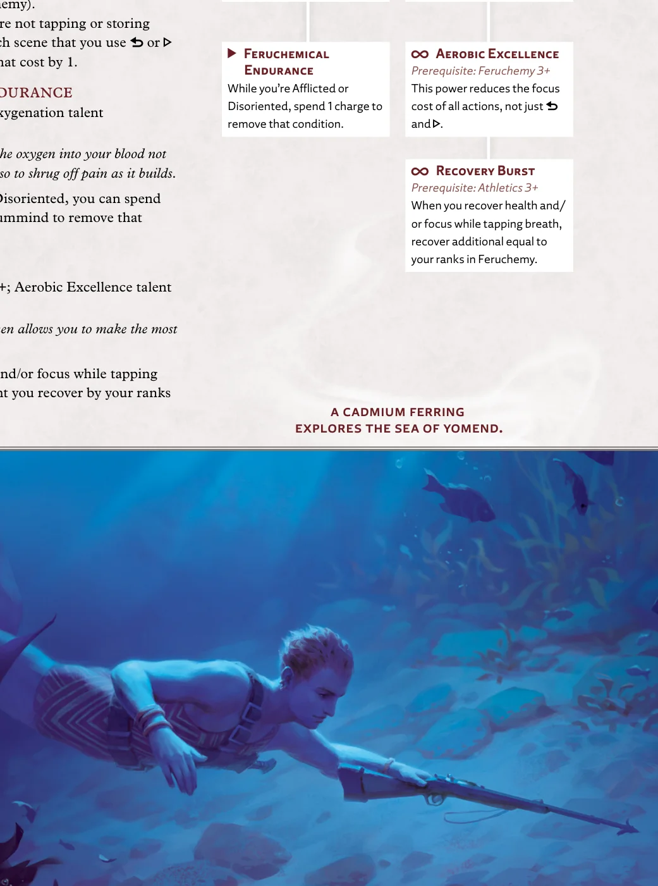

### 鎘藏金術（Cadmium Feruchemy）

呼吸（Breath）－混合金屬（Hybrid Metal）

第二時代

透過鎘藏金術，你可以儲存呼吸。你先以急促的呼吸填充鎘意識（Cadmiummind），之後再汲取（Tap），將氧氣直接釋放到血液中。這能讓你展現驚人的專注力與耐力。鎘藏金術師（Feruchemist）被稱為喘息（Gasper），他們用這項能力加速身體恢復，在關鍵時刻提振精神，或單純暫時停止呼吸，同時照常進行其他活動。

### 儲存呼吸（Store Breath）

啟動（Activation）：[1行動]

持續時間：每個場景（Scene）1點充能（Charge）

以過度換氣儲存呼吸，直到你選擇用[自由行動]結束效果。儲存呼吸期間，你會受到下列效果：

- 若要進行快速輪次（Fast Turn），你必須花費1點專注點（Focus）。

- 使用其他需要花費專注點的能力時，你必須額外花費1點專注點。

每當一個場景結束，而你在整個場景中都持續儲存呼吸時，你的鎘意識便獲得1點充能。

### 汲取呼吸（Tap Breath）

啟動：[1行動]

持續時間：與你的藏金術（Feruchemy）技能等級（Rank）相同數量的回合（Round）

花費鎘意識的1點充能，為自己供氧，持續與你的藏金術技能等級相同數量的回合，或直到你開始儲存呼吸為止。汲取呼吸期間，你會受到下列效果：

- 你不需要呼吸。身處空氣無法呼吸，或沒有空氣的環境時，你不會窒息。

- 使用[反應]或[自由行動]時，該能力的專注點費用減少1點。

呼吸汲取結束前，你可以用[自由行動]花費鎘意識的1點充能，將其維持相同的時間。

### 運用鎘藏金術

除了上述能力規則，運用這項能力時，也可以參考以下指引。

### 創意運用

我們鼓勵你自行發想鎘藏金術的創意用途，例如以下幾種，並與GM討論如何判定：

**完全靜止地躲藏。** 汲取呼吸來為自己供氧，不必發出呼吸聲，也不會有呼吸的動作。

**提升鍛鍊效果。** 儲存呼吸，模擬低氧環境來鍛鍊身體。

**裝死。** 汲取呼吸，讓自己從遠處看來像是已經死亡。

### 鎘藏金術天賦（talent）

以下依英文字母順序列出的天賦，都出現在鎘藏金術天賦樹（talent tree）中。你可以透過單藏金術師（Ferring）與雙生師（Twinborn）路徑（Path）的關鍵天賦（Key Talent），或透過血金術尖刺（Hemalurgic Spike），解鎖這棵天賦樹。

### 有氧精通（Aerobic Excellence）

前提條件（Prerequisite）：藏金術3+；缺氧訓練（Deprivation Training）天賦

啟動：[常駐]

你訓練身心，保持敏銳，並將氧氣帶來的好處發揮到極致。

你的汲取呼吸、缺氧訓練與強化供氧（Boosted Oxygenation），除了降低[反應]與[自由行動]的費用，也會降低所有行動（Action）的專注點費用。

### 強化供氧

前提條件：藏金術2+；鎘藏金術能力

啟動：[特殊啟動]

你更深入地汲取儲存的呼吸，讓自己突破極限。

汲取呼吸時，你可以不只花費1點充能，改為花費任意數量的充能，最多不超過你的金屬技藝上限（Metallic Art Limit）。這麼做時，[反應]與[自由行動]的專注點費用，改為減少等同於你為汲取呼吸花費的充能點數，而非只減少1點。這次呼吸汲取結束前，你可以用[自由行動]花費至少1點充能，將其維持相同的時間。

JANETTE RAMOS

第6章：金屬技藝（Metallic Arts）　224

### 缺氧訓練

前提條件：運動（Athletics）2+；鎘藏金術能力

啟動：[常駐]

經常儲存呼吸，讓你適應了高海拔地區等氧氣較少的環境。這提升了你的耐力，也讓汲取呼吸更有效。

你的汲取呼吸行動的持續時間加倍，變成等同於你的藏金術技能等級兩倍的回合數。此外，當你既未汲取、也未儲存呼吸時，每個場景中第一次使用需要花費專注點的[反應]或[自由行動]，費用減少1點。

### 藏金耐力（Feruchemical Endurance）

前提條件：強化供氧天賦

啟動：[1行動]

你知道如何分配送入血液的氧氣，不僅加快恢復，也能抵禦逐漸累積的疼痛。

處於折磨（Afflicted）或迷惑（Disoriented）狀態時，你可以花費鎘意識的1點充能，移除該狀態（Condition）。

### 恢復爆發（Recovery Burst）

前提條件：運動3+；有氧精通天賦

啟動：[常駐]

你對身體運作有深入的掌握，能充分發揮汲取呼吸的效益。

汲取呼吸期間，當你恢復生命值（Health）與／或專注點時，恢復的數量增加等同於你的藏金術技能等級的數值。

一名鎘單藏金術師探索Sea of Yomend。

### 鎘藏金術天賦樹

#### 強化供氧

啟動：[特殊啟動]

前提條件：藏金術2+

解鎖來源：鎘藏金術能力

汲取呼吸並花費充能，使[反應]與[自由行動]的專注點費用減少等同於所花充能點數的數值。

#### 缺氧訓練

啟動：[常駐]

前提條件：運動2+

解鎖來源：鎘藏金術能力

你的汲取呼吸持續時間加倍。未汲取、也未儲存時，每個場景中第一個[反應]或[自由行動]少花費1點專注點。

#### 藏金耐力

啟動：[1行動]

解鎖來源：強化供氧天賦

處於折磨或迷惑時，花費1點充能移除該狀態。

#### 有氧精通

啟動：[常駐]

前提條件：藏金術3+

解鎖來源：缺氧訓練天賦

這項能力會降低所有行動的專注點費用，而非只有[反應]與[自由行動]。

#### 恢復爆發

啟動：[常駐]

前提條件：運動3+

解鎖來源：有氧精通天賦

汲取呼吸期間，當你恢復生命值與／或專注點時，額外恢復等同於你的藏金術技能等級的數量。

ALEXANDR LESKINEN

