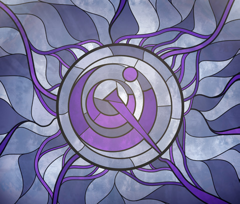
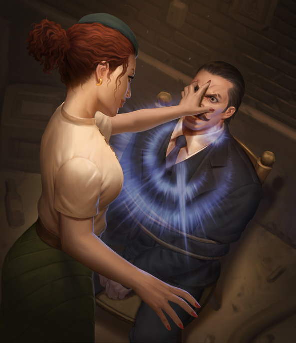

### 鉻鎔金術（Chromium Allomancy）

增強（Enhancement）—外部（External）—拉引（Pulling）

[第二時代]

鉻鎔金術讓你觸碰金屬之子（Metalborn），或其他擁有授予能力的角色（Character），瞬間耗盡對方的力量儲備，只留下突如其來的寒意。這種削弱力量的能力，讓鉻鎔金術師（Allomancer）被稱為水蛭（Leecher）。在司卡德利亞（Scadrial），隊伍常會僱用水蛭，預備應付遲早會遇到的其他金屬技藝（Metallic Arts）使用者。

### 燃燒鉻（Burn Chromium）

啟動（Activation）：[1行動]　持續時間：瞬間

燃燒鉻時，花費 1 授予（Investiture），觸碰你觸及範圍（Reach）內一名受授予的（Invested）角色或物件，吸取（Leech）目標（Target）的力量。若要吸取非自願角色或其持有物，就必須先進行鎔金術（Allomancy）檢定（Test），成功對抗該角色的實體防禦（Physical Defense）。失敗時，你沒有吸取目標，也不會為這次嘗試花費授予。吸取目標時，依目標的類型產生下列其中一種效果：

**受授予的角色。** 受授予的目標失去 1d4 授予。你也可以改為選擇一項已注入目標體內的效果，從該效果吸取這些授予。

**已注入授予的物件。** 注入了授予的物件，例如受到颶光（Stormlight）波力（Surge）影響的物件，失去 1d4 授予。

**具有充能的物件。** 擲 1d4。具有充能（Charge）的物件，例如颶光法器（Fabrial），失去等同骰值一半的充能。不過，若要從藏金術的金屬意識庫（Metalmind）吸取充能，就必須有一名授予為 0 的角色，正向該庫儲存（Store），或從中汲取（Tap）。

上述效果使用的骰子是你的金屬技藝骰（Metallic Art Die），因此骰型（Die Size）會隨鎔金術技能等級（Rank）提高。例如，鎔金術有 2 個技能等級時，改擲 1d6，而非 1d4，依此類推。

### 使用鉻鎔金術

除了上述能力規則，運用這項能力時，也請參考下列指引。

### 創意用法

你可以發想鉻鎔金術的創意用法，例如下列方式，再與 GM 一起決定如何結算：

**悄悄吸取。** 如果你非常緩慢地吸取目標，對方可能直到嘗試使用授予的那一刻，才察覺自己的授予已經流失。真是個令人不快的驚喜！

**預防性吸取。** 囚禁另一名鎔金術師時，定期吸取俘虜，確保他不會從飲水或其他來源，逐漸累積微量金屬。

### 鉻鎔金術天賦

下列天賦（Talent）依英文字母順序排列，出現在鉻鎔金術天賦樹（Talent Tree）中。你可以透過迷霧人（Misting）或雙生師（Twinborn）路徑（Path）的關鍵天賦（Key Talent），或透過血金術尖刺（Hemalurgic Spike），解鎖這棵樹。

#### 吸能抓握（Draining Grasp）

前提條件（Prerequisite）：鉻鎔金術能力

啟動：[特殊啟動]

你不再等待吸取敵人的機會，而會主動製造機會。

你使用實體（Physical）技能，對觸及範圍內的角色進行檢定並成功後，例如進行武器攻擊（Weapon Attack），或以竊術（Thievery）檢定偷走對方的金屬液，就可以花費 [機遇]（Opportunity）或 2 專注點（Focus），以燃燒鉻指定該角色為目標，不需花費行動（Action）。你對抗其實體防禦的鎔金術檢定自動成功。

#### 閃避吸能（Evasive Leecher）

前提條件：竊術 2+；反應吸取（Reactive Leech）天賦

啟動：[特殊啟動]

即使正在躲避危險，你也準備好吸取對方的授予。

戰鬥（Combat）開始時，以及你的每個輪次（Turn）開始時，你都獲得一個額外的 [反應]。此反應只能用於閃避（Dodge）或你的反應吸取天賦。此外，對觸及範圍內的攻擊者使用閃避反應（Reaction）後，你可以花費 1 專注點，以及照常所需的授予，以燃燒鉻指定該攻擊者為目標。

AUSTIN HARTELL

第 6 章：金屬技藝 188

#### 強效吸取（Hyperleech）

前提條件：吸能抓握天賦或反應吸取天賦

啟動：[特殊啟動]

經過訓練，你的吸取效果變得強勁許多。

燃燒鉻時，你可以額外花費授予，最多不超過你的金屬技藝上限（Metallic Art Limit）。決定吸取多少授予或充能時，額外擲等同此次額外花費授予數量的金屬技藝骰。

#### 金屬意識庫吸能（Metalmind Siphoner）

前提條件：鎔金術 4+；強效吸取天賦

啟動：[常駐]

你能強行突破金屬意識庫，吸取其中的力量。

吸取具有充能的物件時，它失去的充能等於你的金屬技藝骰結果，而非該數值的一半。此外，即使目標的授予不為 0，你也能吸取其金屬意識庫。不過，對方仍須像平常一樣，正向該庫儲存，或從中汲取。

#### 反應吸取

前提條件：鎔金術 2+；鉻鎔金術能力

啟動：[反應]

你能熟練地吸取附近敵人的力量，搶在他們有機會使用之前出手。

觸及範圍內的角色即將使用你知道的授予能力之前，例如鎔金術師燃燒金屬，或藏金術師（Feruchemist）汲取金屬意識庫，你可以使用此反應，以燃燒鉻指定該角色為目標，並照常花費授予。如果這使對方缺乏使用觸發能力所需的資源（Resources），該能力就不會結算，而且已花費在該能力上的行動都會失去。

#### 同步吸取（Simultaneous Leeching）

前提條件：鎔金術 3+；吸能抓握天賦

啟動：[特殊啟動]

訓練賦予你足夠的速度與精準度，能同時吸取兩個目標。

燃燒鉻時，你可以吸取觸及範圍內的兩個目標，而非一個。如果兩個目標都不願接受，就在鎔金術檢定中提高賭注（Raise the Stakes），並將結果分別與兩個目標的實體防禦比較。如果你對兩個目標都成功，就只花費一次授予，並將同一次金屬技藝骰結果套用到兩個目標。

### 鉻鎔金術天賦樹

**天賦連線**

| 天賦 | 解鎖來源 | 啟動 | 額外前提 |
| --- | --- | --- | --- |
| [吸能抓握](#吸能抓握) | 鉻鎔金術能力 | 特殊啟動 | — |
| [反應吸取](#反應吸取-1) | 鉻鎔金術能力 | 反應 | 鎔金術 2+ |
| [同步吸取](#同步吸取) | 吸能抓握 | 特殊啟動 | 鎔金術 3+ |
| [閃避吸能](#閃避吸能) | 反應吸取 | 特殊啟動 | 竊術 2+ |
| [強效吸取](#強效吸取) | 吸能抓握或反應吸取 | 特殊啟動 | — |
| [金屬意識庫吸能](#金屬意識庫吸能) | 強效吸取 | 常駐 | 鎔金術 4+ |

#### 吸能抓握

啟動：[特殊啟動]

解鎖條件：鉻鎔金術能力

對觸及範圍內的目標進行實體檢定並成功後，花費 [機遇] 或 2 專注點，對其使用燃燒鉻，且你的鎔金術檢定自動成功。

#### 反應吸取

啟動：[反應]

前提條件：鎔金術 2+

解鎖條件：鉻鎔金術能力

在角色使用授予能力之前，使用燃燒鉻，可能使其耗盡所需的資源。

#### 同步吸取

啟動：[特殊啟動]

前提條件：鎔金術 3+

解鎖條件：吸能抓握天賦

你可以同時吸取兩個目標；如果兩者都不願接受，就在鎔金術檢定中提高賭注。

#### 閃避吸能

啟動：[特殊啟動]

前提條件：竊術 2+

解鎖條件：反應吸取天賦

獲得一個 [反應]，用於閃避或你的反應吸取天賦。閃避攻擊者後，花費 1 專注點，以燃燒鉻指定該攻擊者為目標。

#### 強效吸取

啟動：[特殊啟動]

解鎖條件：吸能抓握或反應吸取天賦

使用燃燒鉻時，可以額外花費授予，最多不超過你的金屬技藝上限，並額外擲同等數量的骰子。

#### 金屬意識庫吸能

啟動：[常駐]

前提條件：鎔金術 4+

解鎖條件：強效吸取天賦

吸取金屬意識庫的充能，數量等於你的金屬技藝骰結果，而非該數值的一半；即使穿戴者仍有授予，也能吸取該金屬意識庫。

*Macil 吸取 Gave Entrone 的鎔金術儲備。*

SAEED RAMEZ

