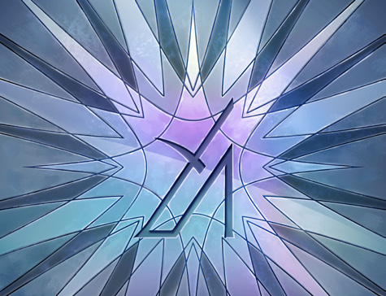
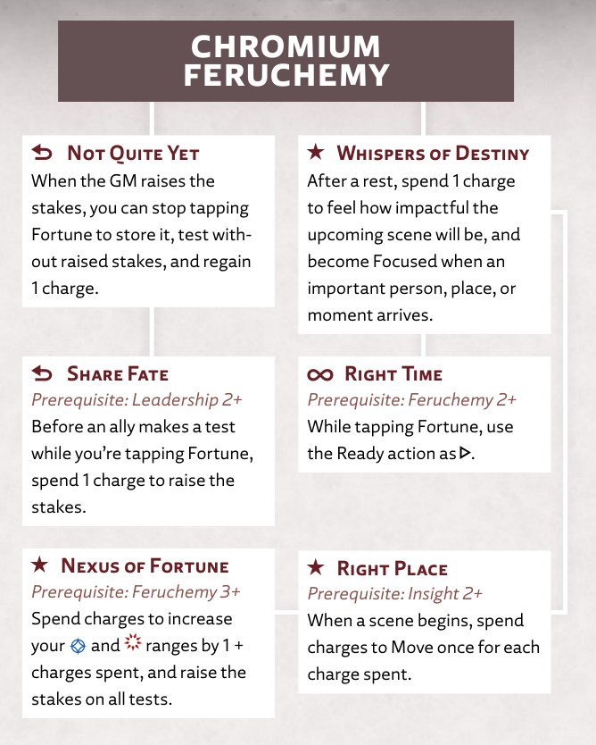

### 鉻藏金術（Chromium Feruchemy）

運氣（Fortune）—靈魂金屬（Spiritual Metal）

第二時代

鉻藏金術讓你能將靈魂層面的運氣儲存在鉻意識（Chromiummind）中。運氣是一種涵蓋整個寰宇（cosmere）的靈魂感知。為鉻意識充能時，你會失去這種宇宙直覺，感覺不到萬事萬物彼此相連。汲取（Tap）鉻意識時，你反而能感覺到命運之線的流動，順著這股宇宙暗流，走向某些即將變得重要的地點與人物。鉻藏金術師（Feruchemist）被稱為旋轉（Spinner）。汲取運氣的旋轉，無法預知未來，也無法完整理解命運。不過，他們能辨識行動的關鍵時刻，也擅長判斷如何激勵與協調他人。

### 儲存運氣（Store Fortune）

啟動（Activation）：[1行動]

持續時間：每個場景（Scene）1點充能（Charge）

持續儲存運氣，直到你以[自由行動]結束效果，或花費鉻意識的一點充能為止。儲存運氣期間，你會受到下列效果：

- 你進行的檢定（Test）不能提高賭注（Raise the Stakes）。

- 當你獲得機遇（Opportunity）或變故（Complication），例如來自自然20（Natural 20）、自然1（Natural 1）或堅定（Determined）狀態時，忽略該機遇或變故的效果，改為在鉻意識中獲得1點充能。

每當一個場景結束，而你在整個場景中都持續儲存運氣時，你的鉻意識便獲得1點充能。

### 汲取運氣（Tap Fortune）

啟動：[1行動]

持續時間：與你的藏金術（Feruchemy）技能等級（Rank）相同數量的回合（Round）

花費鉻意識的1點充能，增強你的運氣，持續與你的藏金術技能等級相同數量的回合，或直到你開始儲存運氣為止。汲取運氣期間，你會受到下列效果：

- 劇情骰（Plot Die）擲出空白（Blank）時，重擲該骰。

- 你的機遇範圍（Opportunity Range）與變故範圍（Complication Range）各擴大2。

運氣汲取結束前，你可以用[自由行動]花費鉻意識的1點充能，將其維持相同的時間。

### 運用鉻藏金術

除了上述能力規則，運用這項能力時，也可以參考以下指引。

### 創意運用

儲存與汲取運氣的基本原理很簡單，但發揮創意，就能將團體的故事引向重要的發展。我們鼓勵你自行發想鉻藏金術的用途，例如以下幾種，並與GM討論如何判定：

**無知的幸福。** 儲存運氣，暫時屏除充滿風險的冒險（Adventure）的吸引力，在責任再次召喚之前，於片刻休息與恢復中尋得平靜。

**鮮明的感覺。** 摸不著方向，或在互相衝突的選項之間猶豫時，汲取運氣，敞開自己，讓命運引導你踏出下一步。

**找出關鍵的旁觀者。** 並非每個人都注定成為名留青史的英雄，但平凡的英雄也能扭轉困境。汲取運氣，注意到某位看似不重要的旁觀者，鼓勵對方挺身而出，幫助場景中的其他人。

JANETTE RAMOS

第6章：金屬技藝（Metallic Arts）　226

運氣，並非偶然的好運

在寰宇中，「運氣」並非指偶然的好運，而是與靈魂界（Spiritual Realm），以及其中的命運與可能未來之間的牽繫（Connection）。能接觸更多運氣的人，包括鉻藏金術師與電金（Electrum）鎔金術師（Allomancer），會感覺到重要的命運在宇宙織錦中於何處交會，有時甚至能感覺到何時交會。這些人物或事件的交會，可能以榮耀收場，也可能釀成毀滅。操控運氣或許能讓你更有能力影響事件，但你的介入也同樣可能引發骨牌效應，在其他地方造成災難。因此，汲取運氣並不代表事情總會順你的意；你只是更可能參與情勢發展至關鍵高潮的局面，無論有意或無意。

### 鉻藏金術天賦（talent）

以下依英文字母順序列出的天賦，都出現在鉻藏金術天賦樹（talent tree）中。你可以透過單藏金術師（Ferring）與雙生師（Twinborn）路徑（Path）的關鍵天賦（Key Talent），或透過血金術尖刺（Hemalurgic Spike），解鎖這棵天賦樹。

### 運氣樞紐（Nexus of Fortune）

前提條件（Prerequisite）：藏金術3+；正確地點（Right Place）天賦

啟動：[特殊啟動]

一次汲取大量運氣，讓你置身於關鍵事件的中心。

當你汲取運氣時，可以不只花費1點充能，而是改為花費任意數量的充能，最多不超過你的金屬技藝上限（Metallic Art Limit）。這麼做時，放棄該行動（Action）通常提供的效果，改為獲得下列好處，直到你的下一個輪次（Turn）結束：

- 你進行的每次檢定都提高賭注。

- 劇情骰擲出空白時，重擲該骰。

- 你的機遇範圍與變故範圍，各擴大等於1加上你為汲取運氣花費的充能點數的數值。

這次運氣汲取結束前，你可以用[自由行動]花費至少1點充能，將其維持相同的時間。

### 時機未到（Not Quite Yet）

前提條件：鉻藏金術能力

啟動：[反應]

運氣在等你，但時候還沒到。你編織新線之際，感覺命運也暫緩了腳步。

汲取運氣期間，當GM對你的某次檢定提高賭注時，你可以使用這個反應（Reaction），改為儲存運氣，並在不提高賭注的情況下進行該檢定。這麼做時，你的鉻意識獲得1點充能。

### 鉻藏金術天賦樹

#### 時機未到

啟動：[反應]

解鎖來源：鉻藏金術能力

GM提高賭注時，你可以停止汲取運氣，改為儲存運氣，在不提高賭注的情況下檢定，並取回1點充能。

#### 命運低語（Whispers of Destiny）

啟動：[特殊啟動]

解鎖來源：鉻藏金術能力

休息後，花費1點充能，感覺下一個場景會有多大的影響；當重要的人物、地點或時刻到來時，獲得集中（Focused）狀態。

#### 共享命運（Share Fate）

啟動：[反應]

前提條件：領導（Leadership）2+

解鎖來源：時機未到天賦

汲取運氣期間，盟友（Ally）進行檢定前，花費1點充能，提高賭注。

#### 正確時機（Right Time）

啟動：[常駐]

前提條件：藏金術2+

解鎖來源：命運低語天賦

汲取運氣期間，以[自由行動]使用預備（Ready）行動。

#### 運氣樞紐

啟動：[特殊啟動]

前提條件：藏金術3+

解鎖來源：正確地點天賦

花費充能，將你的[機遇]範圍與[變故]範圍各擴大1加上所花充能點數，並對所有檢定提高賭注。

#### 正確地點

啟動：[特殊啟動]

前提條件：洞察（Insight）2+

解鎖來源：命運低語天賦

場景開始時，花費充能，每花費1點充能便移動（Move）一次。

第6章：金屬技藝　227

### 正確地點

前提條件：洞察2+；命運低語天賦

啟動：[特殊啟動]

寰宇廣大而複雜。幸好，你熟悉這一帶，能有效率地前往目的地。

場景開始時，在第一名角色（Character）的輪次之前，你可以花費鉻意識中至少1點充能，最多不超過你的金屬技藝上限。每花費1點充能，你便立即使用一次移動行動，不需行動；這次移動不會觸發反應或其他能力。接著，你便從新的位置開始這個場景。

### 正確時機

前提條件：藏金術2+；命運低語天賦

啟動：[常駐]

時機決定一切。你做好準備、保持警覺，時機一到就能立刻行動。

汲取運氣期間，你可以用[自由行動]使用預備行動，但仍須照常為你要預備的那項行動支付行動點數。

### 共享命運

前提條件：領導2+；時機未到天賦

啟動：[反應]

命運之線織在一起時更加堅韌。你直覺地感受到與他人的連結，也從彼此的互動中領悟意義。

汲取運氣期間，在你能感知到、願意接受的盟友進行檢定之前，你可以使用這個反應，花費鉻意識的1點充能，提高賭注。

### 命運低語

前提條件：鉻藏金術能力

啟動：[特殊啟動]

判讀命運徵兆，很像預測天氣。你得身在風暴之中，才真正知道它是什麼模樣；但只要保持警覺，就能感覺它正要來臨。

完成一次長休息（Long Rest）或短休息（Short Rest）後，你可以花費鉻意識的1點充能，對下一個場景可能帶來多大影響，以及某個特定人物、地點或時刻的潛在重要性，獲得一種直覺印象；具體人物、地點或時刻由GM選擇。當你遇見該人物、抵達該地點，或進入該時刻時，獲得集中狀態（Condition），直到你的下一個輪次結束。

對追尋重大新聞的記者而言，汲取運氣可是相當實用的能力！

KEVIN SIDHARTA

