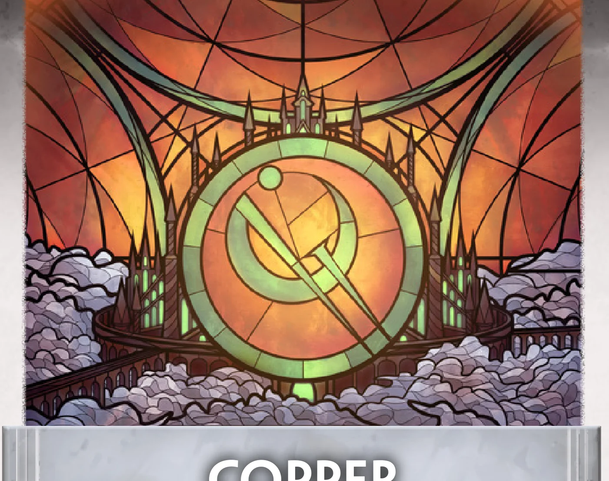
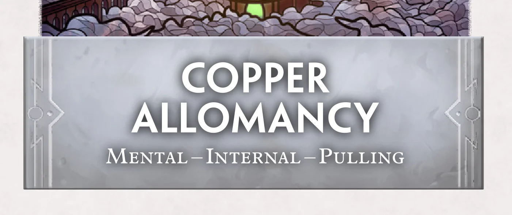
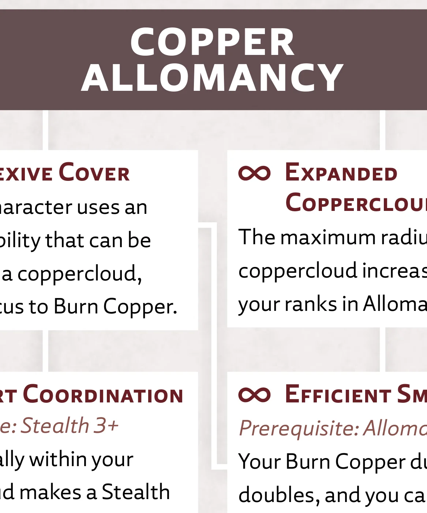

### 紅銅鎔金術（Copper Allomancy）

意志（Mental）—內部（Internal）—拉引（Pulling）

紅銅鎔金術會在你周圍製造無形的雲，阻止他人偵測紅銅雲（Coppercloud）內任何人使用的授予（Investiture），例如燃燒青銅（Bronze）的搜尋者（Seeker）就會受到阻擋。因此，紅銅鎔金術師（Allomancer）被稱為煙陣（Smoker），也稱紅銅雲。除了這種遮蔽效果，燃燒紅銅（Copper）的煙陣也能免疫情緒鎔金術（Emotional Allomancy），只有最強大的情緒鎔金術例外。在司卡德利亞（Scadrial）以外的世界，紅銅雲能與其他授予之術（Invested Arts）產生深刻的交互作用，並阻擋其效果。例如，它能阻止羅沙（Roshar）的歌者（Singers）調諧羅沙的節律（Rhythm），妨礙覺醒術師（Awakener）的生命感知（Life Sense），也能干擾秘靈（Secretspren）感知波力（Surge）的能力。

### 燃燒紅銅（Burn Copper）

啟動（Activation）：[1行動]　持續時間：等同於你的鎔金術（Allomancy）技能等級（Rank）的回合（Round）數

燃燒紅銅時，花費 1 授予，以你為中心製造紅銅雲，涵蓋最大半徑 10 呎的區域。你在使用或維持這項能力時決定大小。紅銅雲會隨你移動，並具有下列效果：

- 以授予運作的能力與感知，都無法偵測到紅銅雲，例如燃燒青銅的搜尋者就無法偵測。此外，這些能力也無法穿過紅銅雲偵測角色（Character）或授予的使用情況；這同樣會阻止雲內角色偵測雲外的效果。

- 燃燒紅銅期間，你不會受到影響心智或情緒的授予效果影響，例如黃銅鎔金術（Brass Allomancy）或鋅鎔金術（Zinc Allomancy）。

- 授予效果如果耗費至少 6 授予，或等量的同類授予資源，就會忽略上述兩種效果。同類資源包括金屬意識庫（Metalmind）的充能（Charge），詳見「穿透紅銅雲」。

紅銅雲會在等同於你鎔金術技能等級的回合數後終止，除非你用 [自由行動] 花費 1 授予，將它維持相同的持續時間。

### 使用紅銅鎔金術

除了上述能力規則，運用這項能力時，也請參考下列指引。

### 穿透紅銅雲（Piercing Copperclouds）

角色不必知道紅銅雲存在，也能穿透它，但只有最強大的角色，才能運用足夠的授予做到這一點。若紅銅雲原本會阻擋某項授予效果，角色就必須在該效果上至少花費 6 授予，或等量同類授予資源，例如金屬意識庫充能，才能穿透紅銅雲。例如，黃銅或鋅（Zinc）鎔金術師若在安撫（Soothing）或煽動（Rioting）上花費 6 授予，即使不知道紅銅雲存在，也能自動影響雲另一側的角色。使用授予偵測效果的角色，例如使用青銅鎔金術（Bronze Allomancy）時，可以在該效果上花費 6 授予，直接感知紅銅雲。在該場景（Scene）的剩餘時間裡，他也能感知紅銅雲原本隱藏的任何效果，而且其授予之術不再受該來源造成的授予遮蔽效果影響。請記得，大多數角色的金屬技藝上限（Metallic Art Limit）無法超過 5，因此不能花費足夠的授予，直接感知或穿透紅銅雲。然而，即使花費不到 6 授予，角色仍可能因為發現自己的能力未如預期影響某些角色，而大致察覺有紅銅雲存在。

AUSTIN HARTELL

第 6 章：金屬技藝（Metallic Arts）190

### 創意用法

你可以發想紅銅鎔金術的用法，例如下列方式，再與 GM 一起決定如何結算：

**紅銅推斷。** 交替燃燒與停止燃燒紅銅，可能讓你得知區域內其他鎔金術師的資訊。如果看見某人突然露出困惑的表情，他可能是搜尋者。如果你的情緒突然改變，你也許就能推斷，安撫者（Soother）正試圖壓低哪種情緒。

**策略性布雲。** 謹慎安排紅銅雲的位置，讓它涵蓋某些鎔金術師，卻不涵蓋另一些，藉此誤導附近的搜尋者，讓他們以為根本沒有紅銅雲。例如，若你的隊伍有數名鎔金術師，可以讓其中一人在雲外燃燒金屬，充當誘餌，讓搜尋者以為沒有煙陣。與此同時，你把其他鎔金術師藏在紅銅雲中，準備伏擊。

### 紅銅鎔金術天賦

下列天賦（talent）依英文字母順序排列，出現在紅銅鎔金術天賦樹（talent tree）中。你可以透過迷霧人（Misting）、雙生師（Twinborn）與迷霧之子（Mistborn）路徑（Path）的關鍵天賦（Key Talent），或透過血金術尖刺（Hemalurgic Spike），解鎖這棵樹。

#### 隱密協調（Covert Coordination）

前提條件（Prerequisite）：隱匿（Stealth）3+；反應掩護（Reflexive Cover）天賦

啟動：[特殊啟動]

你的隊伍信任紅銅雲，也有你的本領引導，行動精準而有默契。

紅銅雲內的盟友（Ally）進行隱匿檢定（Test），或已提高賭注（Raise the Stakes）的檢定之前，你可以花費 1 專注點（Focus），使其在該次檢定獲得優勢（Advantage）。

#### 高效煙陣（Efficient Smoker）

前提條件：鎔金術 2+；擴大紅銅雲（Expanded Coppercloud）天賦或反應掩護天賦

啟動：[常駐]

你幾乎從不停止燃燒紅銅。

你的燃燒紅銅持續時間加倍，變成等同於你鎔金術技能等級兩倍的回合數。此外，燃燒紅銅期間，你可以用 [自由行動] 改變紅銅雲的大小。

#### 擴大紅銅雲

前提條件：紅銅鎔金術能力

啟動：[常駐]

你特別擅長製造大型紅銅雲。

紅銅雲最大半徑增加的呎數，等於 5 × 你的鎔金術技能等級。例如，鎔金術有 2 個技能等級時，半徑增加 10 呎，最大半徑達到 20 呎。

#### 反應掩護

前提條件：紅銅鎔金術能力

啟動：[反應]

你隨時準備好以鎔金術提供掩護。

在你能感知的角色，使用你知道且能被紅銅雲阻擋的授予能力之前，例如青銅鎔金術，你可以使用此反應（Reaction），並花費 1 專注點，使用燃燒紅銅。授予仍須照常花費。此外，當你第一次察覺有人使用這類能力時，也可以使用此反應，即使該能力在你察覺之前就已啟動。

### 紅銅鎔金術天賦樹

#### 反應掩護

啟動：[反應]

解鎖來源：紅銅鎔金術能力

角色使用能被紅銅雲阻擋的授予能力之前，花費 1 專注點，使用燃燒紅銅。

#### 擴大紅銅雲

啟動：[常駐]

解鎖來源：紅銅鎔金術能力

紅銅雲的最大半徑，增加 5 × 你的鎔金術技能等級。

#### 隱密協調

啟動：[特殊啟動]

前提條件：隱匿 3+

解鎖來源：反應掩護天賦

紅銅雲內的盟友進行隱匿檢定，或已提高賭注的檢定之前，花費 1 專注點，使其獲得優勢。

#### 高效煙陣

啟動：[常駐]

前提條件：鎔金術 2+

解鎖來源：擴大紅銅雲或反應掩護天賦

你的燃燒紅銅持續時間加倍，也可以用 [自由行動] 改變紅銅雲的大小。

第 6 章：金屬技藝 191

