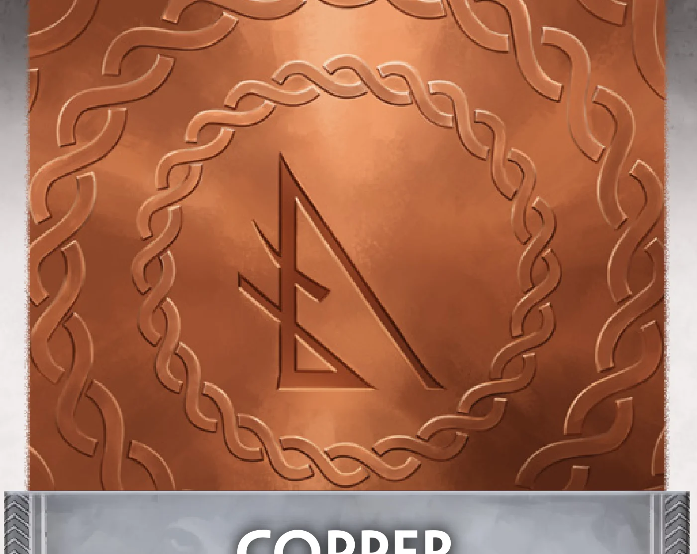
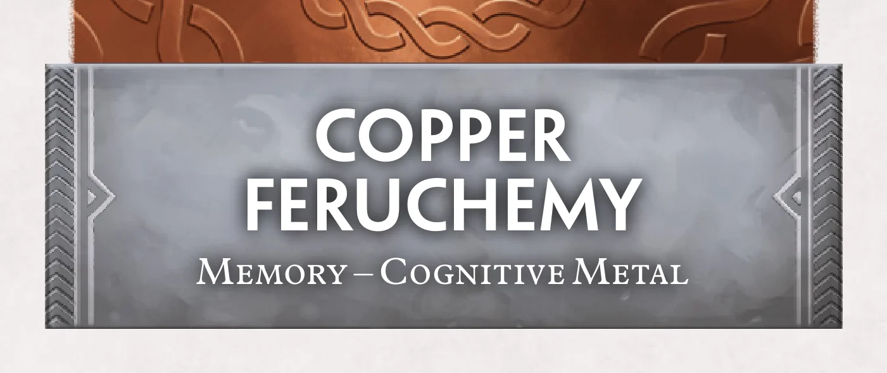
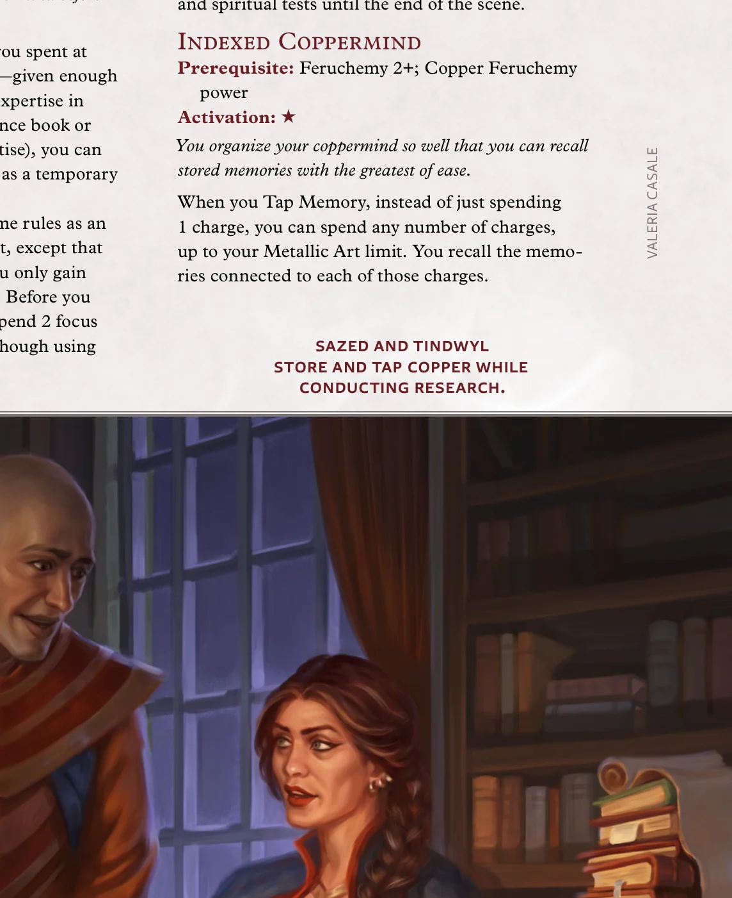
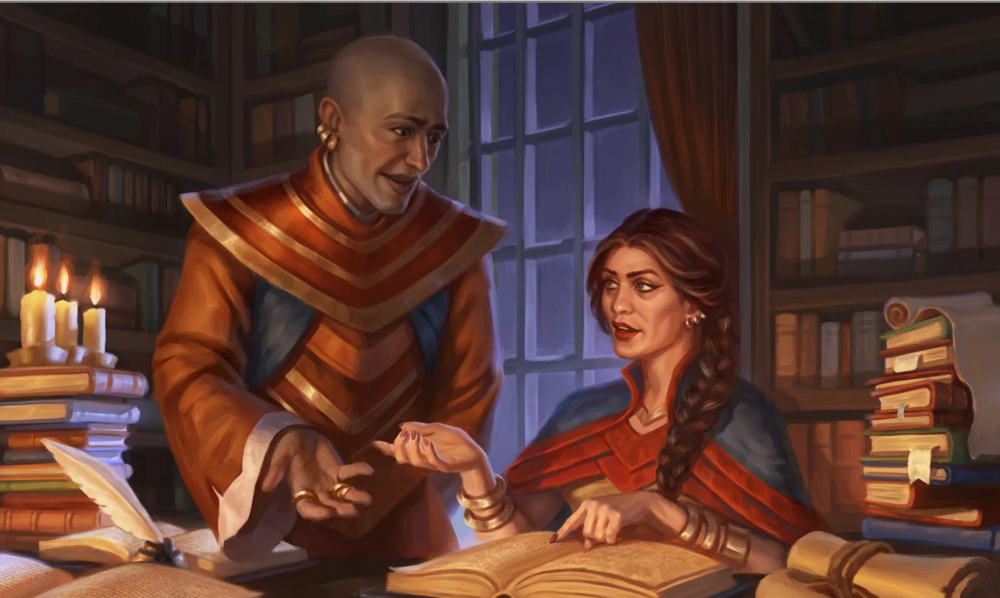
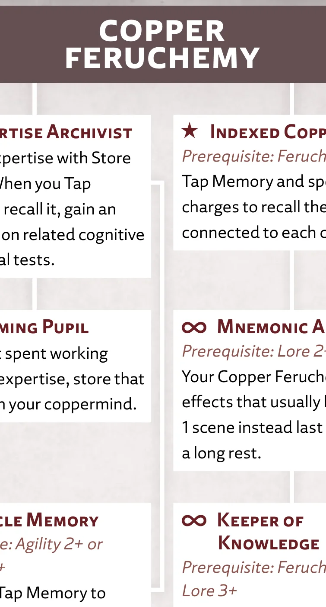
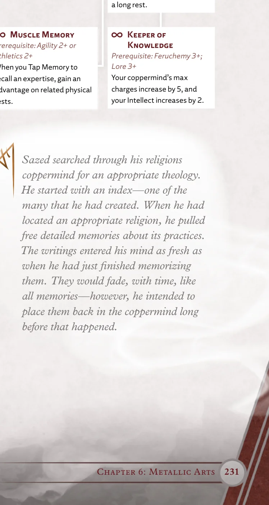

### 紅銅藏金術（Copper Feruchemy）

記憶（Memory）－意識金屬（Cognitive Metal）

紅銅藏金術讓你能將記憶存入紅銅意識（Coppermind），再從中取回。儲存一段記憶後，你只會模糊地記得那段記憶與什麼有關。之後，你可以從紅銅意識汲取（Tap）它，絲毫不差地回想起來。審慎運用這項能力，就能無限期保存知識，因此紅銅藏金術師（Feruchemist）被稱為庫藏（Archivist）。與其他藏金能力儲存的特質不同，停止儲存後，已存入的記憶不會回到你的腦海。每段記憶都會被遺忘，只能透過汲取當初存入的紅銅意識找回。如果你的紅銅意識遺失或遭到摧毀，裡面的所有記憶也會隨之失去。

### 儲存記憶（Store Memory）

啟動（Activation）：[1行動]

持續時間：瞬間

儲存你對某件事或其中一部分的記憶。一次最多能儲存多長的記憶，取決於你的藏金術（Feruchemy）技能（skill）等級（Rank）：

| 技能等級 | 時長 |
| --- | --- |
| 1 | 10分鐘 |
| 2 | 1小時 |
| 3 | 8小時 |
| 4 | 24小時（1日） |
| 5 | 168小時（7日） |
| 6+ | 720小時（30日） |

儲存該段記憶時，你會將其遺忘，並在紅銅意識中獲得1點充能（Charge）；請記下該點充能對應的是哪段記憶。

### 汲取記憶（Tap Memory）

啟動：[1行動]

持續時間：瞬間

花費紅銅意識的1點充能，回想起該點充能對應的記憶。這段回憶在你的腦海中，與當初儲存時一樣鮮明。作為此行動的一部分，或在本場景（Scene）稍後花費[1行動]，你可以嘗試從回想起的記憶中，發現新細節、得知更多背景，或獲得更深的領悟。依照你想了解的內容，GM可能要求你進行檢定（Test），通常使用推理（Deduction）、洞察（Insight）、學識（Lore）或感知（Perception）。

### 運用紅銅藏金術

除了上述能力規則，運用這項能力時，也可以參考以下指引。

### 創意運用

我們鼓勵你自行發想紅銅藏金術的創意用途，例如以下幾種，並與GM討論如何判定：

**失憶的清白。** 儲存自己參與犯罪的記憶，讓你更容易謊稱對那件事一無所知。

**暫時封存。** 儲存一段痛苦的記憶，延後面對它，以及承受它的影響。

**完美回想。** 當你針對先前已背熟的文本資訊進行檢定時，汲取該文本的記憶，使檢定自動成功。

### 紅銅藏金術與泰瑞司人

在第一時代，紅銅藏金術對泰瑞司（Terris）人而言，是關乎族群存續的神聖力量。一群稱為守護者（Keeper）的秘密藏金術師，運用紅銅意識保存知識與文化，再透過口述傳承給學徒。學徒接著將知識儲存在自己的紅銅意識中，傳給後世。如果沒有守護者，統御主（Lord Ruler）以鐵腕掌控最後帝國（Final Empire）的期間，必然會成功抹去更多知識。

JANETTE RAMOS

第6章：金屬技藝（Metallic Arts）　229

### 紅銅藏金術天賦（talent）

以下依英文字母順序列出的天賦，都出現在紅銅藏金術天賦樹（talent tree）中。你可以透過單藏金術師（Ferring）、雙生師（Twinborn）與藏金術師路徑（Path）的關鍵天賦（Key Talent），或透過血金術尖刺（Hemalurgic Spike），解鎖這棵天賦樹。

### 速成學徒（Cramming Pupil）

前提條件（Prerequisite）：專長庫藏（Expertise Archivist）天賦

啟動：[特殊啟動]

專心鑽研一個主題後，你能趁記憶尚未消退，將這些雖然短暫、卻令人印象深刻的知識存入紅銅意識。

短休息（Short Rest）或長休息（Long Rest）期間，若你花了至少1小時從事某項活動，而該活動只要投入足夠的休整期（Downtime）時間，最終就能讓你獲得相關主題的專長（Expertise），例如研讀參考書，或與擁有該專長的盟友（Ally）一起訓練，休息結束後，你可以將該專長作為暫時專長（Temporary Expertise）存入紅銅意識。暫時專長遵循透過專長庫藏儲存專長的相同規則，但以汲取記憶回想它時，你只會獲得該專長到場景結束為止。在失去該暫時專長之前，你可以花費2點專注點（Focus），將它重新存回紅銅意識，視同使用儲存記憶。

### 專長庫藏

前提條件：紅銅藏金術能力

啟動：[常駐]

除了單純的記憶，你也能儲存整個領域的專長，之後再將它回想起來，以煥然一新的心境重新思考。

你可以使用儲存記憶，將自己的一項專長視同對某件事的記憶來儲存。只要對應充能仍在儲存中，你就會失去該專長。之後使用汲取記憶回想該專長時，直到場景結束，你進行相關的意識（Cognitive）與靈魂（Spiritual）檢定都會獲得一個優勢（Advantage）。

### 紅銅意識索引（Indexed Coppermind）

前提條件：藏金術2+；紅銅藏金術能力

啟動：[特殊啟動]

你將紅銅意識整理得井然有序，能輕鬆回想起儲存的記憶。

汲取記憶時，你可以不只花費1點充能，改為花費任意數量的充能，最多不超過你的金屬技藝上限（Metallic Art Limit）。你會回想起每點充能對應的記憶。

沙賽德（Sazed）與廷朵（Tindwyl）一邊研究，一邊儲存與汲取紅銅。

VALERIA CASALE

### 知識守護者（Keeper of Knowledge）

前提條件：藏金術3+；學識3+；記憶專家（Mnemonic Adept）天賦

啟動：[常駐]

你經過訓練，精通運用自身的頭腦與紅銅意識，將記憶容量提升到超越凡人通常極限的程度。

取得這項天賦時，你會獲得以下好處：

- 你的紅銅意識充能上限增加5。

- 你的智力（Intellect）提高2，智力的屬性（attribute）數值上限也提高2。

- 一如平常，智力提高2，也會讓你獲得兩項新專長。

### 記憶專家

前提條件：學識2+；紅銅意識索引天賦

啟動：[常駐]

經過鍛鍊，你的頭腦能更長時間準確保留記憶，延緩記憶開始消退。

你透過紅銅藏金術產生、通常持續到場景結束的效果，改為持續到一次長休息之後。

### 肌肉記憶（Muscle Memory）

前提條件：敏捷（Agility）2+或運動（Athletics）2+；專長庫藏天賦

啟動：[常駐]

你更了解自己的身體，因此更容易回想起某項活動涉及的身體動作。

使用汲取記憶回想一項專長時，直到場景結束，你進行相關的實體（Physical）檢定也會獲得一個優勢。例如，回想一項武器專長（Weapon Expertise）時，使用該武器的攻擊（Attack）會獲得一個優勢。

> 沙賽德在儲存宗教的紅銅意識中搜尋合適的信仰。他從索引著手，那是他建立的眾多索引之一。找到合適的宗教後，他取出關於其習俗的詳細記憶。那些文字進入腦海時，與他剛背熟時一樣鮮明。它們會隨時間淡去，就像所有記憶一樣；不過，他打算早在記憶消退前，就把它們存回紅銅意識。

### 紅銅藏金術天賦樹

#### 專長庫藏

啟動：[常駐]

解鎖來源：紅銅藏金術能力

使用儲存記憶儲存一項專長。以汲取記憶將其回想起來時，相關的意識與靈魂檢定獲得一個優勢。

#### 紅銅意識索引

啟動：[特殊啟動]

前提條件：藏金術2+

解鎖來源：紅銅藏金術能力

汲取記憶並花費充能，回想起每點充能對應的記憶。

#### 速成學徒

啟動：[特殊啟動]

解鎖來源：專長庫藏天賦

休息期間為取得一項專長而努力後，將該專長儲存在紅銅意識中。

#### 記憶專家

啟動：[常駐]

前提條件：學識2+

解鎖來源：紅銅意識索引天賦

你透過紅銅藏金術產生、通常持續1個場景的效果，改為持續到一次長休息之後。

#### 肌肉記憶

啟動：[常駐]

前提條件：敏捷2+或運動2+

解鎖來源：專長庫藏天賦

使用汲取記憶回想一項專長時，相關的實體檢定獲得一個優勢。

#### 知識守護者

啟動：[常駐]

前提條件：藏金術3+；學識3+

解鎖來源：記憶專家天賦

你的紅銅意識充能上限增加5，智力提高2。

第6章：金屬技藝　231

