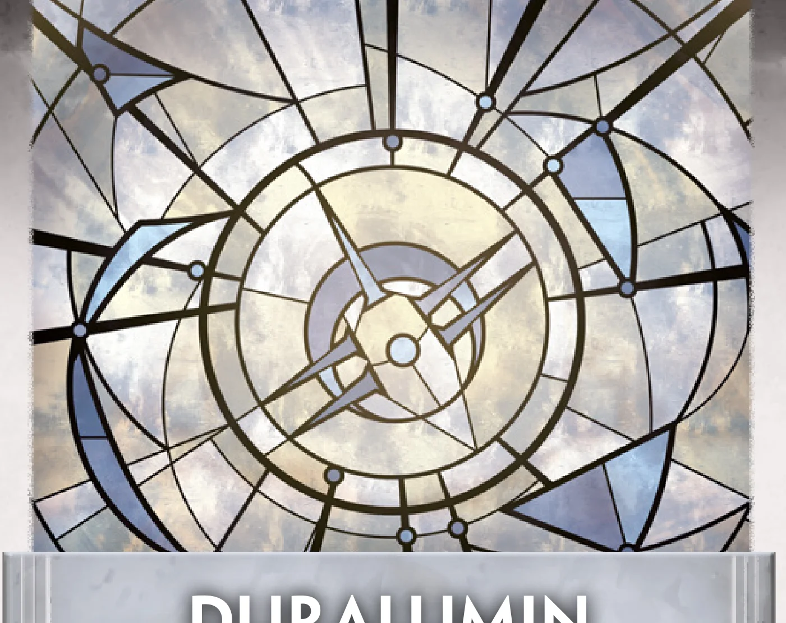
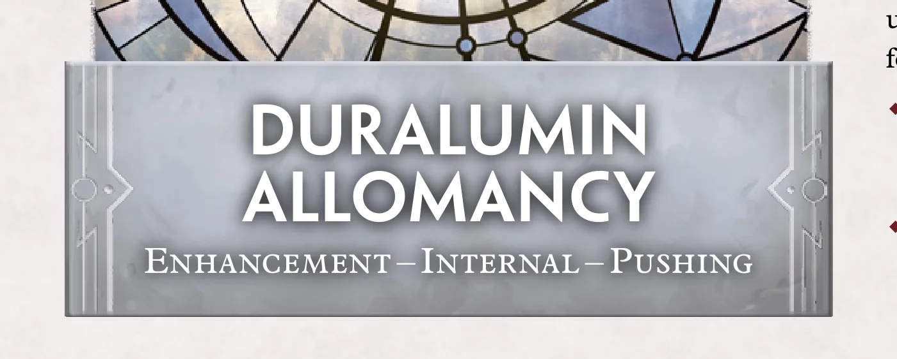
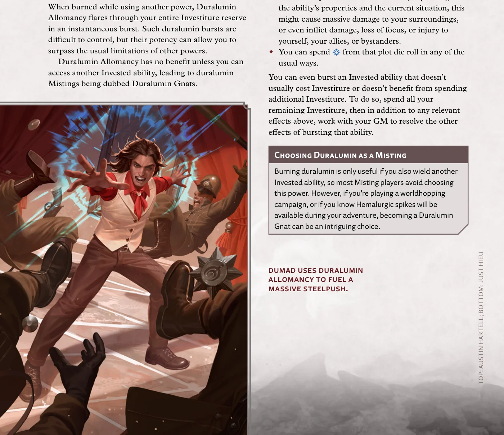

### 硬鋁鎔金術（Duralumin Allomancy）

增強（Enhancement）—內部（Internal）—推力（Pushing）

使用另一項能力時燃燒硬鋁，硬鋁鎔金術會在瞬間爆發（Burst）中，燒盡你全部的授予（Investiture）儲備。這種硬鋁爆發很難控制，威力卻能讓你超越其他能力平常的限制。除非你還能使用另一項授予能力，否則硬鋁鎔金術毫無益處，因此硬鋁迷霧人（Misting）被稱為硬鋁蟲（Duralumin Gnat）。

### 燃燒硬鋁（Burn Duralumin）

啟動（Activation）：[特殊啟動]

持續時間：瞬間

在使用或維持一項會花費授予的能力之前，例如另一項金屬能力，你也可以燃燒硬鋁，使該能力爆發。燃燒硬鋁本身不需花費行動（Action）。將你所有剩餘授予都花費在該能力上，忽略你的金屬技藝上限（Metallic Art Limit），以及該能力平常的授予費用。使該能力爆發會產生下列效果：

- 如果該能力平常允許你選擇其大小、距離或目標（Target）數量，你就必須各自選擇最大的可能值。

- 使用該能力時，擲一顆劇情骰（Plot Die），就像在檢定（Test）中提高賭注一樣。GM 可以花費此次擲骰中的 [變故]（Complication），讓你完全失去對該能力的控制。由 GM 裁定，依能力性質與當下情況而定，這可能嚴重破壞周遭環境，甚至使你、盟友（Ally）或旁觀者受到傷害（Damage）、失去專注點（Focus），或承受傷勢（Injury）。

- 你可以用任何一般允許的方式，花費此次劇情骰擲出的 [機遇]（Opportunity）。

即使一項授予能力平常不花費授予，或不會因花費更多授予而增強，你仍可使它爆發。如此做時，花費你所有剩餘授予，再與 GM 一起決定該能力爆發的其他效果；上面列出的相關效果也仍會發生。

#### 迷霧人選擇硬鋁

只有在你也能使用另一項授予能力時，燃燒硬鋁（Duralumin）才有用，因此多數迷霧人玩家不會選擇這項能力。不過，如果你正在進行跨世界的戰役（Campaign），或已知這次冒險（Adventure）中能取得血金術尖刺（Hemalurgic Spike），成為硬鋁蟲也可能是有趣的選擇。

*Dumad 使用硬鋁鎔金術，促成一次威力驚人的鋼推（Steelpush）。*

上方：AUSTIN HARTELL；下方：JUST HIEU

### 使用硬鋁鎔金術

除了上述能力規則，運用這項能力時，也請參考下列指引。

### 讓不隨資源成長的能力爆發

使用硬鋁或鎳鉻（Nicrosil）鎔金術時，能力爆發的威力通常大致隨投入的資源（Resources）成比例增加。有些能力本來就會依花費的授予增強；對於不會如此成長的能力，請考量該能力平常的費用，以及超出這個費用多少資源。接著，確定你運用能力的主要方式，例如造成傷害、治療（Healing）、削減專注點或恢復專注點，再據此增強該效果。如果你或另一名角色（Character）失去對爆發能力的控制，也可以用類似方式決定其負面影響。

### 創意用法

你可以和 GM 一起發想創意用法，決定硬鋁鎔金術讓能力爆發時如何結算，例如下列方式：

**白鑞鎔金術（Pewter Allomancy）的再生（Regenerate）。** 再生天賦（Talent）通常讓你花費 1 授予，擲 1d6 恢復生命值（Health）。讓該天賦爆發時，你可能會額外擲等同於額外花費授予數量的 d6，也可能以這些額外授予燃燒白鑞（Burn Pewter）。

**鋼鎔金術（Steel Allomancy）的球形護盾（Bubble Shield）。** 球形護盾天賦讓你花費 1 授予，在 1 回合（Round）內保護自己，抵禦金屬投射物。讓該天賦爆發時，每額外花費 1 授予，你可能會將球形護盾的半徑增加 5 呎；護盾也可能影響所有穿過其中的投射物，不論其目標是誰。

### 硬鋁鎔金術天賦

下列天賦依英文字母順序排列，出現在硬鋁鎔金術天賦樹（Talent Tree）中。你可以透過迷霧人、雙生師（Twinborn）與迷霧之子（Mistborn）路徑（Path）的關鍵天賦（Key Talent），或透過血金術尖刺，解鎖這棵樹。

#### 受控爆發（Controlled Burst）

前提條件（Prerequisite）：鎔金術（Allomancy）4+；硬鋁鎔金術能力；至少另一項能力或授予能力

啟動：[常駐]

你已受過訓練，能掌控硬鋁爆發的龐大力量。

使用燃燒硬鋁時，你獲得下列益處：

- 你不必擲劇情骰，但如果願意，仍然可以擲。

- 你不必將大小、距離與目標數量都選為最大的可能值。

- 當異常效果取代能力的一般效果，或在一般效果之外額外發生時，你能更精確地控制它們。與 GM 一起決定這些能力創意用法如何結算。

#### 選擇性爆發（Selective Burst）

前提條件：硬鋁鎔金術能力；至少另外兩項能力或授予能力

啟動：[特殊啟動]

你將授予儲備分開管理，讓一項能力爆發時，不必完全耗盡其他能力的儲備。

使用燃燒硬鋁時，你可以選擇讓本次以硬鋁增強的那項能力陷入耗竭（Depleted），取代花費剩餘授予。如此做時，視同你已花費這些授予，結算此次爆發。

### 硬鋁鎔金術天賦樹

#### 受控爆發

啟動：[常駐]

前提條件：鎔金術 4+；至少另一項能力或授予能力

解鎖條件：硬鋁鎔金術能力

使用燃燒硬鋁時，你獲得更好的控制力，也不必擲劇情骰。

#### 選擇性爆發

啟動：[特殊啟動]

前提條件：至少另外兩項能力或授予能力

解鎖條件：硬鋁鎔金術能力

使用燃燒硬鋁時，你可以讓本次以硬鋁增強的那項能力陷入耗竭，取代花費授予。

第 6 章：金屬技藝（Metallic Arts）193
