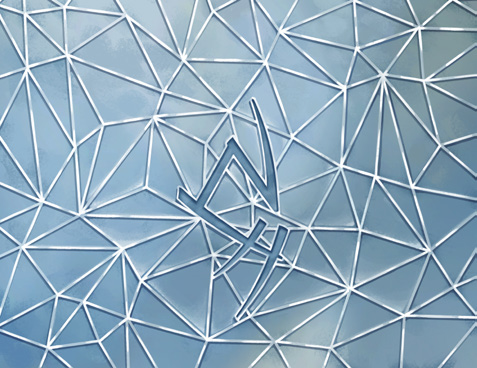

### 硬鋁藏金術（Duralumin Feruchemy）

牽繫（Connection）—靈魂金屬（Spiritual Metal）

透過硬鋁藏金術，你可以儲存靈魂牽繫（Spiritual Connection）。為硬鋁意識（Duraluminmind）充能時，你原有的牽繫會減弱，也更難建立新的牽繫。這會淡化友誼的羈絆，也讓陌生人更不容易注意到你。反過來，汲取（Tap）硬鋁意識時，你會變得更有吸引力與魅力，能輕易建立關係。硬鋁藏金術師（Feruchemist）被稱為聯絡（Connector），主要就是因為這項能力。

### 儲存牽繫（Store Connection）

啟動（Activation）：[1行動]

持續時間：每個場景（Scene）1點充能（Charge）

持續儲存牽繫，直到你以[自由行動]結束效果，或花費硬鋁意識的一點充能為止。儲存牽繫期間，你會受到下列效果：

- 你陷入減損（Diminished）[風采（Presence）−1]。

- 其他角色（Character）使用專門影響其盟友（Ally）的能力時，你不算是他們的盟友。

每當一個場景結束，而你在整個場景中都持續儲存牽繫時，你的硬鋁意識便獲得1點充能。

### 汲取牽繫（Tap Connection）

啟動：[1行動]

持續時間：與你的藏金術（Feruchemy）技能等級（Rank）相同數量的回合（Round）

花費硬鋁意識的1點充能，增強你與他人建立牽繫的能力，持續與你的藏金術技能等級相同數量的回合，或直到你開始儲存牽繫為止。汲取牽繫期間，你會受到下列效果：

- 你獲得增益（Enhanced）[風采+2]。

- 你可以選擇金屬技藝距離（Metallic Art Range）內一名你能感知到的角色，或選擇自己目前所在的聚落。在持續期間，你會像熟悉自己的母語一樣，熟悉該角色或聚落的母語，即使那是來自寰宇（cosmere）另一個世界的語言也一樣。

牽繫汲取結束前，你可以用[自由行動]花費硬鋁意識的1點充能，將其維持相同的時間。

### 運用硬鋁藏金術

除了上述能力規則，運用這項能力時，也可以參考以下指引。

### 創意運用

我們鼓勵你自行發想硬鋁藏金術的創意用途，例如以下幾種，並與GM討論如何判定：

**聚會焦點。** 汲取牽繫，將人群的注意力從盟友身上吸引過來。

**不起眼的旁觀者。** 在交談期間儲存牽繫，讓參與者更不容易記住與你有關的細節。

### 硬鋁藏金術天賦（talent）

以下依英文字母順序列出的天賦，都出現在硬鋁藏金術天賦樹（talent tree）中。你可以透過單藏金術師（Ferring）、雙生師（Twinborn）與藏金術師路徑（Path）的關鍵天賦（Key Talent），或透過血金術尖刺（Hemalurgic Spike），解鎖這棵天賦樹。

### 化敵為友（Foe to Friend）

前提條件（Prerequisite）：藏金術3+；瞬間羈絆（Instant Bond）天賦

啟動：[常駐]

你操控牽繫，就連敵人也能變成盟友。

你使用瞬間羈絆時，少花費一個[1行動]。此外，每個場景一次，使用瞬間羈絆時，你也可以改以一名敵方嘍囉（Minion）為目標（Target）。成功時，目標視為你的夥伴（Companion），但只持續到場景結束，而非一次長休息（Long Rest）之後。

JANETTE RAMOS

第6章：金屬技藝（Metallic Arts）　232

### 人格感召（Force of Personality）

前提條件：藏金術2+；硬鋁藏金術能力

啟動：[常駐]

你可以運用汲取的牽繫，成為現場最有影響力的人。

汲取牽繫期間，當你嘗試影響（Influence）另一名角色時，對方抵抗你的影響，需要額外花費2點專注點（Focus）。

### 個別牽繫（Individual Connection）

前提條件：硬鋁藏金術能力

啟動：[特殊啟動]

你更精細地控制牽繫的汲取與儲存，能與自己選擇的人建立持久的羈絆。

儲存牽繫時，你可以選擇一名或多名你能感知到的角色，使其不受你牽繫減弱的效果影響。對這些角色而言，你仍算是盟友。此外，透過汲取牽繫獲得一種語言後，你會持續熟悉該語言，直到你使用該行動（Action）獲得另一種語言為止。

### 瞬間羈絆

前提條件：藏金術2+；個別牽繫天賦

啟動：[3行動]

你運用汲取的牽繫，迅速建立新關係，或大幅加深既有關係。

花費硬鋁意識的2點充能，對金屬技藝距離內一名非敵人的NPC的靈魂防禦（Spiritual Defense），進行藏金術檢定（Test）；該NPC必須是你能感知並影響的對象。成功時，對方會成為你的朋友，或與你建立更深的關係，直到一次長休息之後。例如，一名角色可能暫時成為你的夥伴或贊助者（Patron），詳見第8章「獎勵類別」；如果對方原本就是夥伴或贊助者，其階層（Tier）可能暫時提高。我們鼓勵你創意運用這項天賦，並與GM討論效果如何判定。效果結束時，該角色會考量你與盟友在這段期間如何對待自己，再決定希望與你維持多友善的關係。

### 真切牽繫（True Connecting）

前提條件：藏金術3+；人格感召天賦

啟動：[特殊啟動]

一次汲取大量牽繫，讓你的社交吸引力幾乎無法抵擋。

當你汲取牽繫時，可以不只花費1點充能，而是改為花費任意數量的充能，最多不超過你的金屬技藝上限（Metallic Art Limit）。這麼做時，改為受到以下效果，直到你的下一個輪次（Turn）結束，取代該行動通常的效果與持續時間：

- 你獲得增益[風采]。該屬性（attribute）的加值，等於1加上你為汲取牽繫花費的充能點數。

- 角色嘗試抵抗你的影響時，需要額外花費的專注點，等於1加上你為汲取牽繫花費的充能點數。

- 你會熟悉金屬技藝距離內任何角色所知的每一種語言，以及該距離內任何聚落所使用的每一種語言。

這次牽繫汲取結束前，你可以用[自由行動]花費硬鋁意識中至少1點充能，將其維持相同的時間。

### 硬鋁藏金術天賦樹

**天賦連線**

| 天賦 | 解鎖來源 | 啟動 | 額外前提 |
| --- | --- | --- | --- |
| [個別牽繫](#個別牽繫) | 硬鋁藏金術能力 | 特殊啟動 | — |
| [人格感召](#人格感召) | 硬鋁藏金術能力 | 常駐 | 藏金術2+ |
| [瞬間羈絆](#瞬間羈絆-1) | 個別牽繫 | 3行動 | 藏金術2+ |
| [真切牽繫](#真切牽繫) | 人格感召 | 特殊啟動 | 藏金術3+ |
| [化敵為友](#化敵為友) | 瞬間羈絆 | 常駐 | 藏金術3+ |

#### 個別牽繫

啟動：[特殊啟動]

解鎖來源：硬鋁藏金術能力

儲存牽繫時，選擇要排除哪些角色。汲取牽繫獲得的語言，會保留到你汲取另一種語言為止。

#### 人格感召

啟動：[常駐]

前提條件：藏金術2+

解鎖來源：硬鋁藏金術能力

汲取牽繫期間，抵抗你的影響需要額外花費2點專注點。

#### 瞬間羈絆

前提條件：藏金術2+

解鎖來源：個別牽繫天賦

花費2點充能，對非敵人的靈魂防禦進行藏金術檢定；成功時，對方暫時成為你的朋友。

#### 真切牽繫

啟動：[特殊啟動]

前提條件：藏金術3+

解鎖來源：人格感召天賦

汲取牽繫時花費額外充能，縮短持續時間並增強效果，也讓抵抗你的影響需要額外花費專注點。

#### 化敵為友

啟動：[常駐]

前提條件：藏金術3+

解鎖來源：瞬間羈絆天賦

使用瞬間羈絆時，少花費一個[1行動]。此外，瞬間羈絆也能以嘍囉敵人為目標。

第6章：金屬技藝　233
