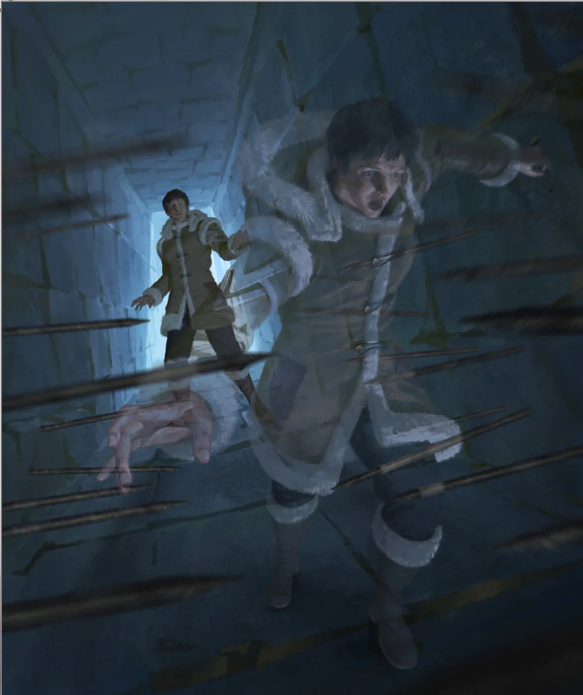

### 電金鎔金術（Electrum Allomancy）

時序（Temporal）－內部（Internal）－推力（Pushing）

電金（Electrum）鎔金術（Allomancy）會讓你看見從自己身上投射出的「電金影子（Electrum Shadow）」，呈現你在眼前片刻可能經歷的種種未來。由於能窺見未來，電金鎔金術師（Allomancer）被稱為預言師（Oracle）。不過，你只能看見自己，以及影子對可能發生之事的反應。你看不見是誰、或是什麼造成影子的反應，因此電金鎔金術師若未經練習，很難讀懂這些未來。一般認為，電金產生的影子遠不如天金影子（Atium Shadow）實用。不過，由於你能窺見可能的未來，燃燒電金會讓天金（Atium）對你失效。

### 燃燒電金（Burn Electrum）

啟動（Activation）：[1行動]　時限：1 回合（Round）

燃燒電金時，花費至少 1 點授予（Investiture），最多不超過你的金屬技藝上限（Metallic Art Limit）。擲出與花費授予點數相同數量的 d20，並記下每顆骰子的結果；這些就是你的電金影子，持續到你將其花費，或你的下一個輪次（Turn）結束為止。持續期間，每當敵人對你進行檢定（Test），你可以花費一個電金影子（不需行動），以該影子記錄的結果取代那次檢定的 d20 擲骰結果。你可以在看見敵人的擲骰結果，且敵人套用所有優勢（Advantage）或劣勢（Disadvantage）後，才決定是否替換；但必須在結算檢定效果之前決定。電金燃燒結束前，你可以用 [自由行動] 花費至少 1 點授予，將其維持相同的時限。這麼做時，即使先前的影子尚未花費，你仍必須重新擲骰，產生新的電金影子。新影子的持續時間與先前相同。

### 使用電金鎔金術

除了上述能力規則，運用這項能力時，也可以參考以下指引。

### 創意用法

電金鎔金術通常用來察覺並避開迫在眉睫的危險，燃燒電金行動（Action）便反映了這種用途。不過，鎔金術師也能透過電金，以其他方式窺探眼前片刻的未來；通常會仔細觀察影子在不同情況下的反應。我們鼓勵你自行發想電金鎔金術的用途，例如下列做法，並與 GM 討論如何判定：

**偵測陷阱。** 放出電金影子，藉由它們的反應，找出金屬技藝距離（Metallic Art Range）內的陷阱。花費至少 1 點授予，進行感知（Perception）檢定；花費的授予每比 1 點多 1 點，就獲得一個優勢。

**賭博。** 賭博時觀察影子，判斷是否下注、押誰獲勝、是否棄牌或加注，或在其他類似情況下該如何行動；該情況必須會在 1 回合內分出結果。花費至少 1 點授予，進行洞察（Insight）檢定；花費的授予每比 1 點多 1 點，就獲得一個優勢。

*一名預言師放出電金影子來偵測陷阱。*

上圖：AUSTIN HARTELL；下圖：WHITE HORN

第 6 章：金屬技藝（Metallic Arts）　194

### 電金鎔金術天賦樹（talent tree）

**天賦連線**

| 天賦 | 解鎖來源 | 啟動 | 額外前提 |
| --- | --- | --- | --- |
| [預知反應](#預知反應prescient-reactions) | 電金鎔金術能力 | 常駐 | — |
| [延續影子](#延續影子lingering-shadows) | 電金鎔金術能力 | 特殊啟動 | 鎔金術 2+ |
| [預言電金](#預言電金prophetic-electrum) | 預知反應 | 特殊啟動 | 鎔金術 2+ |
| [主動預言師](#主動預言師proactive-oracle) | 延續影子 | 特殊啟動 | 洞察 2+ |
| [滑溜目標](#滑溜目標slippery-target) | 預知反應 | 常駐 | 鎔金術 3+ |
| [理論演練](#理論演練theoretical-exercise) | 主動預言師 | 特殊啟動 | 鎔金術 3+ |

#### 預知反應（Prescient Reactions）

啟動：[常駐]

解鎖來源：電金鎔金術能力

花費一個電金影子，代替花費 [反應]，來使用閃避（Dodge）或反擊機會（Reactive Strike）。

#### 延續影子（Lingering Shadows）

啟動：[特殊啟動]

前提條件（Prerequisite）：鎔金術 2+

解鎖來源：電金鎔金術能力

維持燃燒電金時，額外花費授予，讓相同數量的影子再持續一個回合。

#### 預言電金（Prophetic Electrum）

啟動：[特殊啟動]

前提條件：鎔金術 2+

解鎖來源：預知反應天賦（talent）

你可以為一個影子重擲 d20。此外，燃燒電金會結束你身上的措手不及（Surprised）狀態（Condition）。

#### 主動預言師（Proactive Oracle）

啟動：[特殊啟動]

前提條件：洞察 2+

解鎖來源：延續影子天賦

對角色（Character）進行檢定時，花費一個影子，以該影子記錄的結果取代你的 d20 擲骰結果。

#### 滑溜目標（Slippery Target）

啟動：[常駐]

前提條件：鎔金術 3+

解鎖來源：預知反應天賦

燃燒電金期間，攻擊（Attack）無法對你造成擦傷（Graze），而反擊機會獲得一個劣勢。

#### 理論演練（Theoretical Exercise）

啟動：[特殊啟動]

前提條件：鎔金術 3+

解鎖來源：主動預言師天賦

每回合一次，使用行動或反應（Reaction）後，花費 3 點授予將其撤銷。

### 電金鎔金術天賦

以下依英文字母順序列出的天賦，都出現在電金鎔金術天賦樹中。你可以透過迷霧人（Misting）、雙生師（Twinborn）與迷霧之子（Mistborn）路徑（Path）的關鍵天賦（Key Talent），或透過血金術尖刺（Hemalurgic Spike），解鎖這棵天賦樹。

#### 延續影子

前提條件：鎔金術 2+；電金鎔金術能力

啟動：[特殊啟動]

你經過訓練，能看見更遠一些的未來事件所產生的影子。

維持電金燃燒時，你可以額外花費授予，最多不超過你的金屬技藝上限，讓目前相同數量的電金影子再持續一個回合（同時仍會擲出新的影子）。

#### 預知反應

前提條件：電金鎔金術能力

啟動：[常駐]

預先知道自己可能會做什麼，讓你更容易對這些情況作出反應。

你可以花費一個電金影子，代替花費 [反應]，對金屬技藝距離內的敵人使用閃避或反擊機會反應（即使你已用掉這個回合的 [反應] 也可以）。這麼做時，該影子記錄的結果不會產生任何效果。

#### 主動預言師

前提條件：洞察 2+；延續影子天賦

啟動：[特殊啟動]

你不只觀察影子來察覺外來危險，也留意各種行動之間的細微差異，找出自己成敗的關鍵。

當你進行的檢定會影響金屬技藝距離內的角色時，你可以花費一個電金影子，以該影子記錄的結果取代這次檢定的 d20 擲骰結果。你可以在看見自己的擲骰結果，並套用所有優勢或劣勢後，才決定是否替換；但必須在結算檢定效果之前決定。

#### 預言電金

前提條件：鎔金術 2+；預知反應天賦

啟動：[特殊啟動]

你早就料到了。

燃燒電金時，你可以在記錄電金影子結果之前，重擲其中一顆 d20。你必須使用新的結果。此外，若你在措手不及時燃燒電金，你會結束自己身上的該狀態，並取回因該狀態而失去的所有行動或反應。

#### 滑溜目標

前提條件：鎔金術 3+；預知反應天賦

啟動：[常駐]

你或許並非無懈可擊，但增強的預言師能力讓你難以受到傷害。

燃燒電金期間，攻擊無法對你造成擦傷，而對你發動的反擊機會會獲得一個劣勢。

#### 理論演練

前提條件：鎔金術 3+；主動預言師天賦

啟動：[特殊啟動]

你極為擅長判讀電金影子呈現的各種可能性，能據此作出決定，彷彿早已親身經歷所有可能的結果。

每回合一次，使用行動或反應並結算其效果後，你可以花費 3 點授予將其撤銷。你取回花在被撤銷的行動或反應上的所有資源（Resources），例如行動、專注點（Focus）與授予，並還原該行動或反應造成的一切效果。接著，你可以重新嘗試該行動或反應、改用不同的行動或反應，或選擇完全不採取行動。

第 6 章：金屬技藝　195
