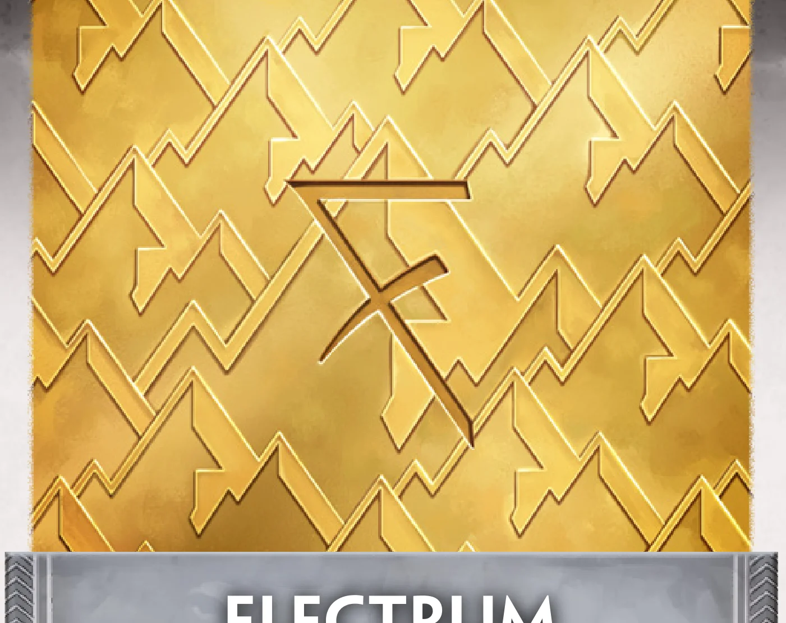
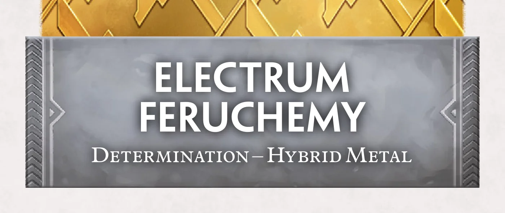
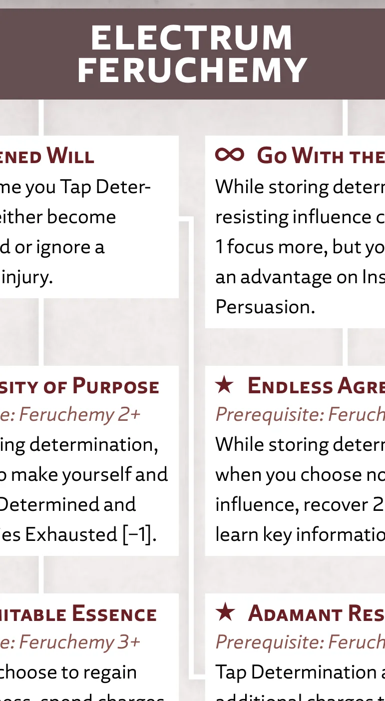

### 電金藏金術（Electrum Feruchemy）

決心（Determination）－混合金屬（Hybrid Metal）

電金藏金術讓你將決心儲存在電金意識（Electrummind）中。儲存時，你可能顯得漫無方向、心不在焉，但也能從原本可能排斥的觀點看待事情。汲取（Tap）電金意識中累積的意志，則能讓你在短時間內充滿強烈的決心。電金藏金術師（Feruchemist）經歷的高峰與低谷，讓他們得名為頂峰（Pinnacle）。

### 儲存決心（Store Determination）

啟動（Activation）：[1行動]

持續時間：每個場景（Scene）1點充能（Charge）

持續儲存決心，直到你以[自由行動]結束效果，或花費電金意識的一點充能為止。儲存決心期間，你會受到下列效果：

- 你陷入減損（Diminished）[意志（Willpower）−1]。

- 如果你在開始儲存時處於堅定（Determined）狀態，移除該狀態。在停止儲存決心前，你無法再次獲得堅定狀態。

- 每個場景中，第一次以此方式移除堅定狀態時，你的電金意識額外獲得1點充能。

此外，每當一個場景結束，而你在整個場景中都持續儲存決心時，你的電金意識便獲得1點充能。

### 汲取決心（Tap Determination）

啟動：[1行動]

持續時間：與你的藏金術（Feruchemy）技能等級（Rank）相同數量的回合（Round）

花費電金意識的1點充能，增強你的決心，持續與你的藏金術技能等級相同數量的回合，或直到你開始儲存決心為止。汲取決心期間，你會受到下列效果：

- 你獲得增益（Enhanced）[意志+2]。

- 你抵抗一名角色（Character）的影響（Influence）後，對方失去1點專注點（Focus）。

決心汲取結束前，你可以用[自由行動]花費電金意識的1點充能，將其維持相同的時間。

### 運用電金藏金術

除了上述能力規則，運用這項能力時，也可以參考以下指引。

### 創意運用

我們鼓勵你自行發想電金藏金術的創意用途，例如以下幾種，並與GM討論如何判定：

**不受挑釁。** 汲取決心，暫時控制自己面對不公義時的憤怒，讓你之後能更妥善地處理那些不公義。

**避免分心。** 汲取決心，在混亂的環境中保持專注，繼續完成手上的事。

**打破隔閡。** 儲存決心，更能理解他人的立場與動機。

### 電金藏金術天賦（talent）

以下依英文字母順序列出的天賦，都出現在電金藏金術天賦樹（talent tree）中。你可以透過單藏金術師（Ferring）、雙生師（Twinborn）與藏金術師路徑（Path）的關鍵天賦（Key Talent），或透過血金術尖刺（Hemalurgic Spike），解鎖這棵天賦樹。

### 堅不可摧的決心（Adamant Resolve）

前提條件（Prerequisite）：藏金術3+；堅韌意志（Hardened Will）天賦

啟動：[特殊啟動]

你深入汲取儲備的決心，挺過困境、失望，甚至身體的傷勢。

汲取決心時，你可以不只花費1點充能，改為花費任意數量的充能，最多不超過你的金屬技藝上限（Metallic Art Limit）。這麼做時，改為獲得下列效果，直到你的下一個輪次（Turn）結束，取代通常的效果與持續時間：

JANETTE RAMOS

第6章：金屬技藝（Metallic Arts）　234

- 你獲得增益[意志]。該屬性（attribute）的加值，等於1加上你為汲取決心花費的充能點數。

- 從你目前承受的暫時傷勢（Injury）中選擇若干項，數量最多等於1加上你為汲取決心花費的充能點數。你忽略這些傷勢的效果，但傷勢仍然存在，且仍會對傷勢擲骰（Injury Roll）施加懲罰。

這次決心汲取結束前，你可以用[自由行動]花費電金意識中至少1點充能，將其維持相同的時間。

### 無比隨和（Endless Agreeability）

前提條件：藏金術2+；隨勢而行（Go With the Flow）天賦

啟動：[特殊啟動]

你開放的態度與看似無害的模樣，讓人們在你面前卸下心防，即使你並未刻意讓他們鬆口。

儲存決心期間，當你選擇不抵抗一名角色的影響時，你恢復2點專注點。這麼做時，你也會得知關於該角色的一項關鍵資訊，例如其核心目的（purpose）、內在障礙（obstacle）或短期目標（goal）。

### 隨勢而行

前提條件：電金藏金術能力

啟動：[常駐]

儲存決心讓你更被動，也更容易被他人說服。不過，你已學會利用這份隨和的好處，藉此找到彼此的共同點，理解自己原本可能排斥的觀點。

儲存決心期間，抵抗影響（Resisting Influence）需要額外花費1點專注點，但你進行洞察（Insight）與說服（Persuasion）檢定（Test）時，會獲得一個優勢（Advantage）。

### 堅韌意志

前提條件：電金藏金術能力

啟動：[特殊啟動]

即使遭遇失敗與傷勢，你仍追求自己的目標。

每個場景中第一次汲取決心時，選擇以下一種效果，持續到場景結束：

- 你獲得堅定狀態。

- 選擇你目前承受的一項暫時傷勢。你忽略該傷勢的效果，但傷勢仍然存在，且仍會對傷勢擲骰施加懲罰。

### 不屈本質（Indomitable Essence）

前提條件：藏金術3+；信念之力（Intensity of Purpose）天賦

啟動：[特殊啟動]

經過大量練習，你會本能地汲取儲備的決心。即使瀕臨昏迷，你也能重新振作，繼續戰鬥。

當你處於昏迷（Unconscious），並選擇恢復意識時，你可以花費電金意識中的若干點充能，最多不超過你的金屬技藝上限。擲出與所花充能點數相同數量的恢復骰（Recovery Die），將結果加到目前生命值（Health）、目前專注點，或分配到兩者上。

### 信念之力

前提條件：藏金術2+；堅韌意志天賦

啟動：[特殊啟動]

當你深信不疑時，盟友會聚集在你這座決心的堡壘周圍；就連最痛恨你的敵人，也會覺得試圖動搖你只是徒勞。

汲取決心期間，進行檢定時，你可以花費[機遇]（Opportunity），展現超乎常人的信念。你與每名你能影響的盟友（Ally）都會獲得堅定狀態（Condition），而你能影響的每名敵人都會陷入精疲力竭（Exhausted）[−1]。

### 電金藏金術天賦樹

#### 堅韌意志

啟動：[特殊啟動]

解鎖來源：電金藏金術能力

第一次汲取決心時，獲得堅定狀態，或忽略一項暫時傷勢。

#### 隨勢而行

啟動：[常駐]

解鎖來源：電金藏金術能力

儲存決心期間，抵抗影響多花費1點專注點，但洞察與說服檢定獲得一個優勢。

#### 信念之力

啟動：[特殊啟動]

前提條件：藏金術2+

解鎖來源：堅韌意志天賦

汲取決心期間，花費[機遇]，讓你與盟友獲得堅定狀態，敵人則陷入精疲力竭[−1]。

#### 無比隨和

啟動：[特殊啟動]

前提條件：藏金術2+

解鎖來源：隨勢而行天賦

儲存決心期間，選擇不抵抗影響時，恢復2點專注點，並得知關鍵資訊。

#### 不屈本質

啟動：[特殊啟動]

前提條件：藏金術3+

解鎖來源：信念之力天賦

選擇恢復意識時，花費充能，每花費1點充能便擲一顆恢復骰。

#### 堅不可摧的決心

啟動：[特殊啟動]

前提條件：藏金術3+

解鎖來源：堅韌意志天賦

汲取決心時花費額外充能，縮短持續時間並增強效果，也能忽略你的傷勢。

第6章：金屬技藝　235

