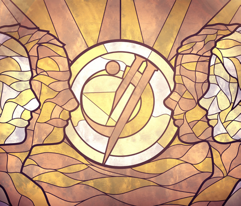
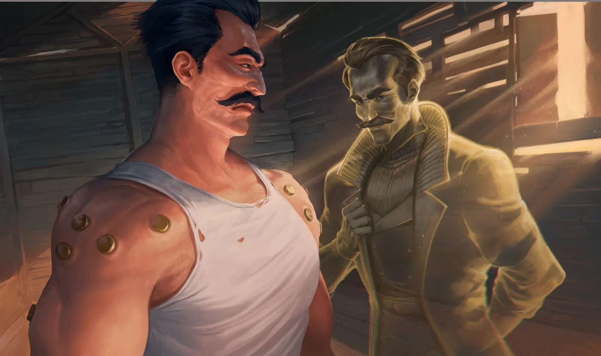

### 金鎔金術（Gold Allomancy）

時序（Temporal）—內部（Internal）—拉引（Pulling）

金鎔金術讓你看見自己的朦朧投影。這些「金影（Gold Shadow）」代表你若做出不同選擇，可能成為的各種自己，因此金鎔金術師（Allomancer）也被稱為命師（Augur）。命師每次燃燒金時，看見的通常都與上次不同。命師不只會體驗自己的視野與思緒，還能同時體驗那些來自另一段過往的影子的視野與思緒，但這會引發強烈的噁心感。一般人認為金鎔金術毫無用處，受過訓練的命師卻能更有效地運用金影。他們不只是窺見未曾發生的可能，也能藉此更清楚地認識自己的人生。在第一時代，人們普遍知道迷霧之子（Mistborn）可以燃燒金；然而，直到那個時代接近尾聲，除了鋼鐵教廷（Steel Ministry）之外，沒有人知道金迷霧人（Misting）的存在。

### 燃燒金（Burn Gold）

啟動（Activation）：[1行動]　持續時間：1個場景（Scene）

燃燒金時，花費至少1點授予（Investiture），最高不超過你的金屬技藝上限（Metallic Art Limit）。創造與花費授予點數相同數量的金影。每個金影都沒有形體，其他人也無法感知到。直到場景結束前，它們都會留在你周圍5呎內。在金燃燒完畢前，你可以用[自由行動]花費與先前相同的授予，將燃燒效果維持相同的時間。每個金影都代表一個有著不同經歷的你。第一次觸碰每個金影時，或以其他方式與它產生身體接觸時，你可以透過它的雙眼觀看，並得知它的想法。

這能讓你認識另一種自己，以及你的人生原本可能走上的另一條道路。這麼做時，擲一顆劇情骰（Plot Die），決定效果：

**機遇（Opportunity）。** 金影讓你對自己或周遭情勢有所領悟。恢復1點專注點（Focus），並獲得集中（Focused）狀態，直到你的下一個輪次（Turn）開始。

**變故（Complication）。** 強烈的噁心感讓你無法承受。你陷入迷惑（Disoriented）狀態，直到你的下一個輪次開始。

**空白（Blank）。** 什麼事也沒發生。

透過金影的雙眼看見的片段，是否能讓你獲得與故事或當前情勢有關的領悟，由你與GM決定。

### 運用金鎔金術

除了上述能力規則，運用這項能力時，也可以參考以下指引。

### 創意運用

你可以發揮創意，透過金影窺探自己的過往，或可能經歷的過往。我們鼓勵你找出金鎔金術的各種用途，例如以下幾種，並與GM討論如何判定：

**探看過去的自己。** 當你有一點時間可以沉思時，可以燃燒金，進行DC 15的鎔金術（Allomancy）檢定（Test），尋找某個特定時刻的自己。成功時，你與那個金影接觸後，就能體驗過去的自己的想法、情緒與感官，彷彿回到當時。藉此，你或許能從過去的自己身上發現新細節、得知更多背景，或獲得更深的領悟。不過，為了解讀你得知的資訊，GM可能會要求你再進行一次檢定，例如推理（Deduction）、洞察（Insight）或感知（Perception）。

**尋找特定的另一種自己。** 創造金影時，你可以尋找某種特定的自己，例如在關鍵時刻做出另一種決定，或選擇投入某個職業的自己。這些不同的自己，仍必須是依照你的人生經歷而言合理的可能。依照你要求的版本有多具體、與你有多大差異，GM可能會要求你進行鎔金術檢定。如果你與這樣的金影接觸時擲出機遇，GM可能會允許你花費該機遇，藉由金影特有的觀點、能力或專長（Expertise），對當前情勢獲得更多領悟。

AUSTIN HARTELL

第6章：金屬技藝（Metallic Arts）　196

### 金鎔金術天賦（Talent）

以下金鎔金術天賦，可以透過迷霧人、雙生師（Twinborn）與迷霧之子路徑（Path）的關鍵天賦（Key Talent）解鎖，也可以透過血金術尖刺（Hemalurgic Spike）解鎖。

#### 自我合金（Alloy of Self）

前提條件（Prerequisite）：鎔金術3+；金鎔金術能力

啟動：[特殊啟動]

你不再只是短暫透過金影的雙眼觀看，而是花上數小時，思索某個金影及其獨有的觀點。這能讓你對自己的現在與未來獲得有意義的領悟。

你可以放棄長休息（Long Rest）通常提供的收益，改用這段時間思索一個金影，尋求對當前情勢的領悟。花費1點授予，並擲一顆劇情骰，決定效果：

**機遇。** 描述金影帶來的領悟，如何幫助你推進角色（Character）的某個短期目標（goal）。如果GM認可這個解釋，該短期目標便推進一個里程碑（Milestone）。每個短期目標只能以此方式推進一次。

**變故。** 苦思數小時後，你仍在原地打轉，陷入精疲力竭（Exhausted）[−1]。

**空白。** 什麼事也沒發生。

#### 黃金機遇（Golden Opportunities）

前提條件：鎔金術4+；金鎔金術能力

啟動：[常駐]

經過大量練習，你已習慣透過金影的雙眼觀看，更能穩定地從中獲得有用的領悟。

當你因燃燒金或它的任一天賦擲劇情骰，擲出空白時，改將該空白視為機遇。此外，你因燃燒金獲得的集中狀態（Condition），會持續與你的階層（Tier）相同數量的回合（Round），不再只持續到你的下一個輪次開始。

### 金鎔金術天賦樹（talent tree）

#### 自我合金

啟動：[特殊啟動]

前提條件：鎔金術3+

解鎖來源：金鎔金術能力

放棄一次長休息，並花費1點授予，擲一顆劇情骰。擲出[機遇]時，推進一個短期目標。擲出[變故]時，陷入精疲力竭[−1]。

#### 黃金機遇

啟動：[常駐]

前提條件：鎔金術4+

解鎖來源：金鎔金術能力

為燃燒金與自我合金擲劇情骰時，空白視為[機遇]。此外，燃燒金的集中狀態持續時間更長。

*「百命」邁爾斯（Miles Hundredlives）燃燒金，窺見自己原本可能成為的另一個人。*

AMIRUL HHF

