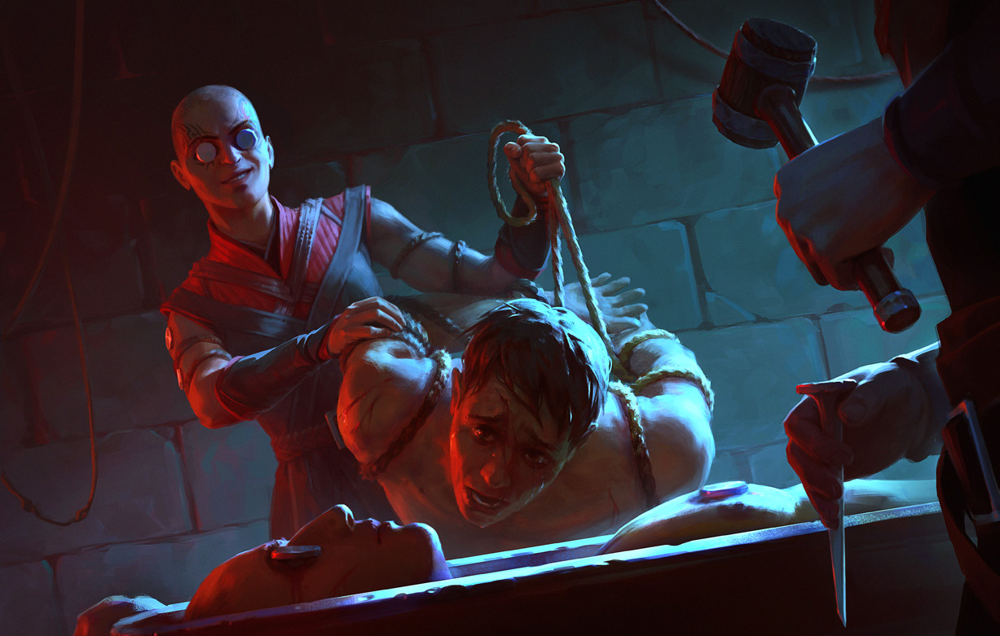
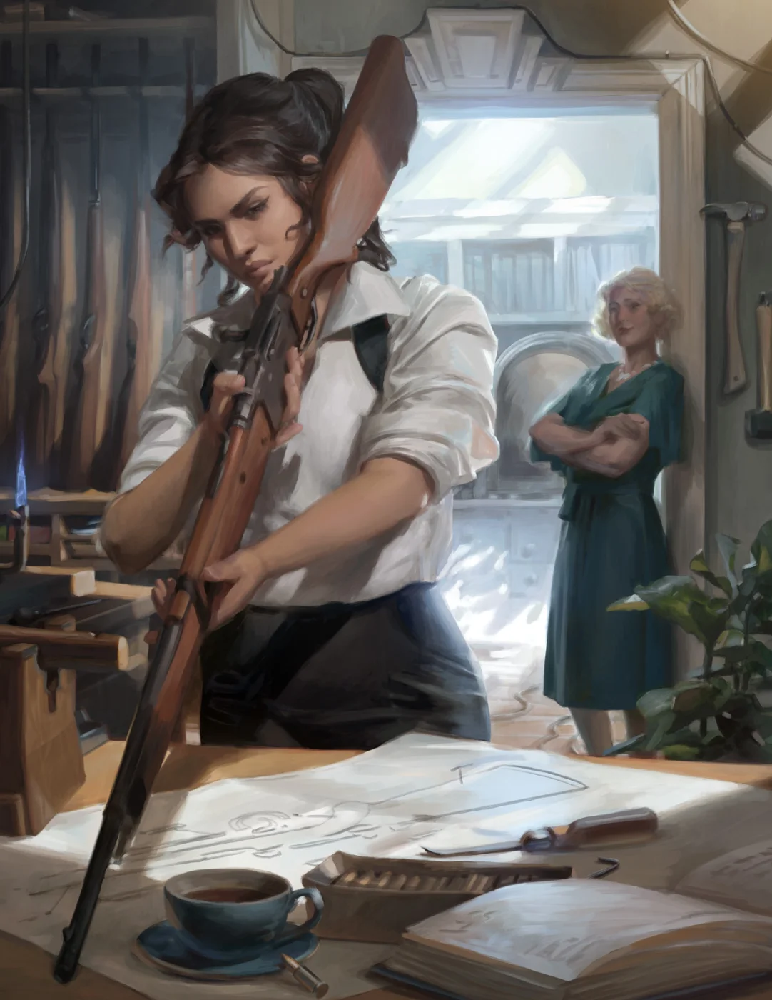

### 血金術（Hemalurgy）

血金術可以透過金屬尖刺，將力量從一個人轉移到另一個人身上。這能轉移鎔金能力（Allomantic Power）、藏金能力（Feruchemical Power），以及其他授予之術（Invested Arts）。不過，製作這些尖刺的過程通常十分殘酷。必須用尖刺刺穿擁有所需能力的人，為尖刺充能……而所有已知的充能方法，都會使這個人喪命。接受充能尖刺的人會獲得被奪取的能力，但尖刺也會擾亂其靈網（Spiritweb），也就是構成靈魂的牽繫（Connection）網絡，使其更容易遭受不良後果。在某些情況下，這甚至會在接受尖刺的人與某個碎力（Shard），例如滅絕（Ruin）或和諧（Harmony）之間，開啟溝通與施加影響的途徑。缺乏適當支撐卻使用過多尖刺，可能嚴重損傷靈網，有時甚至會導致死亡。

### 禁忌之術

若不深入了解這門禁忌之術的運作方式，幾乎不可能施行血金術。縱觀世界歷史，只有少數施術者對血金術了解得夠深，足以成功進行實驗。血金術需要經驗豐富的施術者，在充分知情下有意施行；替尖刺充能與置入尖刺時，也必須了解身體的血金術接合點（Hemalurgic Bind Point）。即使在施術者之中，知道如何製作新尖刺與其他血金術器具（Hemalurgic Instrument）的人也少之又少，例如製造鋼鐵審判者（Steel Inquisitor）所需的關鍵尖刺（Linchpin）。由於關於這項金屬技藝（Metallic Arts）的知識極為稀少，而替尖刺充能又是從他人的靈網中奪取力量，並在過程中殺死對方的掠奪性手段，因此本書沒有專設血金術師（Hemalurgist）路徑（Path）。不過，玩家角色（Player Character）仍能取得現有的血金術尖刺（Hemalurgic Spike）作為獎勵（Reward），詳見第8章「血金術尖刺」。使用血金術尖刺的人，通常都會被稱為血金術師。這個稱呼不只指懂得製造新尖刺或變異生物的血金術大師，也常泛指任何利用現有尖刺取得力量的人。

*審判者（Inquisitor）拖走一名受害者，準備犧牲對方來製作血金術尖刺。*

ALEXANDR LESKINEN

