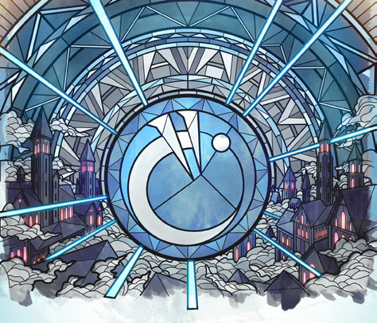
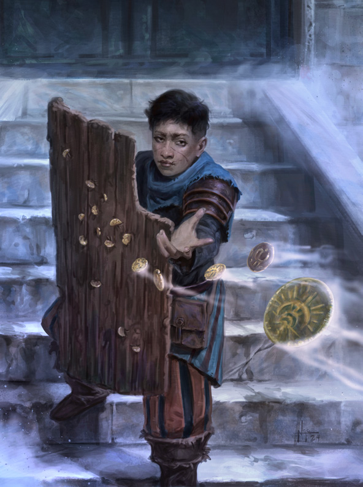

### 鐵鎔金術（Iron Allomancy）

實體（Physical）－外部（External）－拉引（Pulling）

鐵鎔金術讓你看見藍色線條，從自己的質心延伸到附近金屬物體的質心。你可以對這些金屬施展鐵拉（Ironpull），讓自己或物體朝另一方移動；哪一方會移動，取決於哪一方比較龐大。鐵鎔金術師（Allomancer）與他們操控的金屬投射物，移動起來猛然一扯一扯的，因此得名扯手（Lurcher）。大多數扯手都會攜帶木盾，接住自己轉向拉來的金屬投射物。

### 燃燒鐵（Burn Iron）

啟動（Activation）：[1行動]

持續時間：1回合（Round）

只要你還有至少1點授予（Investiture），就能燃燒少量的鐵，而不必花費授予。直到你的下一個輪次（Turn）結束，你都能感知金屬技藝距離（Metallic Art Range）內的每一處金屬，並得知其體型（Size），但有以下限制：

- 你無法用這項能力感知鋁（Aluminum）。

- 除非你的鎔金術（Allomancy）技能等級（Rank）達到6級以上，否則你無法感知受授予的（Invested）物品，例如金屬意識庫（Metalmind）與血金術尖刺（Hemalurgic Spike），也無法感知任何至少有一部分嵌入角色（Character）體內的物品，例如穿環。

鐵燃燒完畢前，只要你還有至少1點授予，就可以使用[自由行動]，將燃燒效果維持相同的時間。

### 鐵拉

啟動：[1行動]

持續時間：瞬間

燃燒鐵期間，花費至少1點授予，最多不超過你的金屬技藝上限（Metallic Art Limit），對你以這項能力感知到的一個金屬物體施展鐵拉。選擇以下一種效果：

**移動（Propel）。** 你與物體之中體型較小的一方，會被鐵拉沿直線拉向另一方；每花費1點授予，最多移動20呎。如果你與物體的體型相同，由你選擇要移動自己還是物體。如果你將物體拉向另一個夠大的物體或表面，例如建築物或地面，被鐵拉的物體會在撞上後停止移動，接著改由你移動剩下的距離。

**拉引衝撞（Lurching Crash）。** 如果物體比你大，你可以藉由對它施展鐵拉，讓自己每花費1點授予便最多移動20呎，撞向位於你與該物體之間的一個目標（Target）。對目標的實體防禦（Physical Defense）進行一次近戰（Melee）鎔金術攻擊（Attack），擲出1d4衝擊傷害（Impact Damage）。這次擲骰使用你的金屬技藝骰（Metallic Art Die），因此骰型（Die Size）會隨你的鎔金術技能等級提高；2級時改擲1d6，而非1d4，依此類推。GM可以花費這次攻擊產生的[變故]，使你不慎也讓自己受到擦傷（Graze）。

如果要移動固定在其他物體上的物體，或由角色穿戴、持握的物體，則將兩者的體型合併計算，判定哪一方會移動。

### 運用鐵鎔金術

除了上述能力規則，運用這項能力時，也可以參考以下指引。

### 困難的鐵拉

大多數鐵拉都不需要檢定（Test）。不過，當你嘗試格外棘手、富有創意或危險的做法時，GM可能會要求你使用鎔金術或相關的普通技能（skill）進行檢定。

#### GM提示：體型與重量

在《迷霧之子》（Mistborn）小說中，鐵與鋼鎔金術（Steel Allomancy）的效果，取決於鎔金術師與所選物體之間的相對重量。《寰宇 RPG》（Cosmere RPG）則改用體型判定這些能力的效果。這能讓遊戲進行得更順暢，免去在場景（Scene）中途計算各種重量的麻煩。不過，GM可以自行判斷，有些場景可能適合改用重量，而非體型。

第6章：金屬技藝（Metallic Arts）　198

AUSTIN HARTELL

### 創意運用

我們鼓勵你自行發想鐵鎔金術的用途，例如以下幾種，並與GM討論如何判定：

**繳械（Disarm）。** 對角色穿戴或持握的金屬物體施展鐵拉。進行鎔金術檢定，與目標的運動（Athletics）對抗；成功時，該角色會被繳械，該物體則被拉入你的佔位（Space）。

**附壁（Wall Cling）。** 如果牆壁或天花板由金屬製成，或上面固定著金屬物體，你可以施展鐵拉，將自己拉向那個表面，並將其視為穩固地面，直到你的下一個輪次開始。不過，沿著該表面移動時，可能需要進行敏捷（Agility）或運動檢定。

### 鐵鎔金術天賦（talent）

以下依英文字母順序列出的天賦，都出現在鐵鎔金術天賦樹（talent tree）中。你可以透過迷霧人（Misting）、雙生師（Twinborn）與迷霧之子路徑（Path）的關鍵天賦（Key Talent），或透過血金術尖刺，解鎖這棵天賦樹。

#### 拉引繳械（Disarming Lurch）

前提條件（Prerequisite）：鎔金術2+；投射物拉引（Projectile Lurch）天賦

啟動：[常駐]

你能讓幾乎所有金屬攻擊偏離原本的目標。

你也可以對以你為目標的攻擊（而非盟友（Ally）），以及使用金屬武器（Weapon）的攻擊（而非金屬投射物），使用投射物拉引。這麼做時，進行鎔金術檢定，與攻擊擲骰結果對抗。若你成功，你會成為攻擊的目標，不論你原本是否在該攻擊的距離內；攻擊結算後，該武器會從攻擊者手中被拉入你的佔位。若你失敗，攻擊照常對原本的目標結算。

#### 鐵拉專家（Ironpull Adept）

前提條件：鎔金術3+；拉引繳械天賦

啟動：[常駐]

對你而言，施展鐵拉已經像活動自己的身體一樣自然。

你每個輪次可以使用鐵拉行動（Action）不只一次。同一輪次中，第一次之後每次再使用鐵拉，都必須額外花費1點專注點（Focus），其他成本仍照常支付。此外，在戰鬥（Combat）開始時，以及你的每個輪次開始時，你都會獲得一個額外的[反應]，只能用來使用投射物拉引天賦。

### 鐵鎔金術天賦樹

**天賦連線**

| 天賦 | 解鎖來源 | 啟動 | 額外前提 |
| --- | --- | --- | --- |
| [借力架防](#借力架防leveraging-brace) | 鐵鎔金術能力 | 常駐 | — |
| [投射物拉引](#投射物拉引) | 鐵鎔金術能力 | 反應 | — |
| [鐵拉射擊](#鐵拉射擊ironpull-shot) | 借力架防 | 特殊啟動 | 鎔金術2+ |
| [拉引打擊](#拉引打擊lurching-strike) | 借力架防 | 特殊啟動 | 運動2+或重型武器2+ |
| [拉引繳械](#拉引繳械) | 投射物拉引 | 常駐 | 鎔金術2+ |
| [扯手裝備](#扯手裝備lurchers-gear) | 投射物拉引 | 常駐 | 擁有某種防禦型武器或偏轉值3+護甲的專長 |
| [鐵拉專家](#鐵拉專家) | 拉引繳械 | 常駐 | 鎔金術3+ |

#### 借力架防（Leveraging Brace）

啟動：[常駐]

解鎖來源：鐵鎔金術能力

使用比你大的物體或構造物架防（Brace）時，以它的體型取代你自己的體型，判定鐵拉與鋼推（Steelpush）的效果。

#### 投射物拉引

啟動：[反應]

解鎖來源：鐵鎔金術能力

盟友遭到金屬投射物攻擊之前，花費1點授予，讓自己成為目標。

#### 鐵拉射擊（Ironpull Shot）

啟動：[特殊啟動]

前提條件：鎔金術2+

解鎖來源：借力架防天賦

對物體施展鐵拉，將它拉向一名角色，並對其實體防禦進行一次遠程（Ranged）鎔金術攻擊。

#### 拉引打擊（Lurching Strike）

啟動：[特殊啟動]

前提條件：運動2+或重型武器（Heavy Weaponry）2+

解鎖來源：借力架防天賦

使用近戰武器或徒手攻擊（Unarmed Attack）進行拉引衝撞攻擊。

#### 拉引繳械

啟動：[常駐]

前提條件：鎔金術2+

解鎖來源：投射物拉引天賦

對金屬武器使用投射物拉引。以鎔金術檢定對抗攻擊擲骰結果，讓自己成為目標，並將武器從攻擊者手中拉走。

#### 扯手裝備（Lurcher’s Gear）

啟動：[常駐]

前提條件：擁有某種防禦型（Defensive）武器或偏轉值（Deflect）3+護甲（Armor）的專長（Expertise）

解鎖來源：投射物拉引天賦

燃燒鐵期間，若你正持握或穿戴本天賦前提條件所列的物品，提高你的偏轉值，並忽略穿刺（Pierce）。

#### 鐵拉專家

啟動：[常駐]

前提條件：鎔金術3+

解鎖來源：拉引繳械天賦

花費1點專注點，額外使用鐵拉。此外，每個輪次都獲得一個可用於投射物拉引的[反應]。

> 射幣（Coinshot）以優雅的跳躍追在他身後，扯手則直接得多，一陣一陣地拉扯建築鋼架裡的金屬，移動自己。他先向外躍出，再把自己往上、往建築的方向拉回去，彷彿某種古怪的反向垂降者。

第6章：金屬技藝　199

*一名扯手將硬幣拉向她的木盾。*

#### 鐵拉射擊

前提條件：鎔金術2+；借力架防天賦

啟動：[特殊啟動]

你施展鐵拉的力道，足以讓物體化為致命的投射物。

當你施展鐵拉，將物體拉向自己，而其路徑上有一名角色時，你可以對該角色的實體防禦進行一次遠程鎔金術攻擊，擲出1d4衝擊傷害。這次擲骰使用你的金屬技藝骰，因此骰型會隨你的鎔金術技能等級提高；2級時改擲1d6，而非1d4，依此類推。（這次攻擊視為使用金屬投射物的武器攻擊（Weapon Attack）。）以此方式攻擊時，你不會因為敵人在你周圍5呎內而獲得劣勢（Disadvantage）；如果你先前使用過架防行動，這次攻擊也不會結束架防帶來的好處。GM可以花費[變故]，讓你因這次攻擊而使自己受到擦傷，除非你正受益於架防行動。

#### 借力架防

前提條件：鐵鎔金術能力

啟動：[常駐]

你利用較大物體的重量，增加自身的分量。

使用比你大的物體或構造物架防，並正受益於架防行動時，你會獲得以下好處：

- 你可以用該物體的體型取代自己的體型，判定鐵拉與鋼推行動的效果。

- 對原本與你同體型或更小的物體施展鐵拉或鋼推時，你進行的鎔金術檢定獲得一個優勢（Advantage）。

#### 扯手裝備

前提條件：擁有某種防禦型武器或偏轉值3+護甲的專長；投射物拉引天賦

啟動：[常駐]

你巧妙地將攻擊引向自己的防護裝備。

燃燒鐵期間，若你正持握防禦型武器，或穿著偏轉值3以上的護甲，就更容易避開使用你以這項能力感知到的金屬武器所發動的攻擊。對抗這些攻擊時，你的偏轉值提高等同於你的鎔金術技能等級的數值，且忽略這些攻擊的穿刺武器特性。

#### 拉引打擊

前提條件：運動2+或重型武器2+；

借力架防天賦

啟動：[特殊啟動]

鐵拉的動能讓你的攻勢更有力道。

當你使用鐵拉進行拉引衝撞攻擊時，可以改為進行一次近戰武器攻擊或徒手攻擊，而非鎔金術攻擊。這麼做時，將拉引衝撞的傷害骰加入武器通常造成的傷害（Damage）。

#### 投射物拉引

前提條件：鐵鎔金術能力

啟動：[反應]

你可以將原本要擊中盟友的金屬投射物轉而拉向自己。

金屬技藝距離內的盟友，遭到你以這項能力感知到的金屬投射物攻擊之前，你可以使用這個反應（Reaction），並花費1點授予，將攻擊目標改為自己。你必須在得知攻擊檢定結果之前這麼做。

ALEXANDER NGO

第6章：金屬技藝　200

