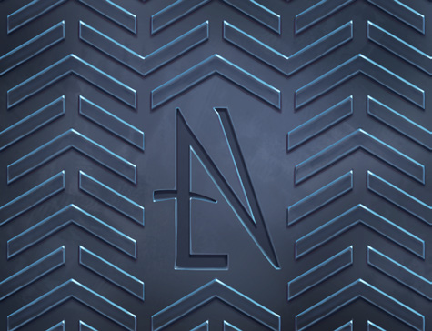
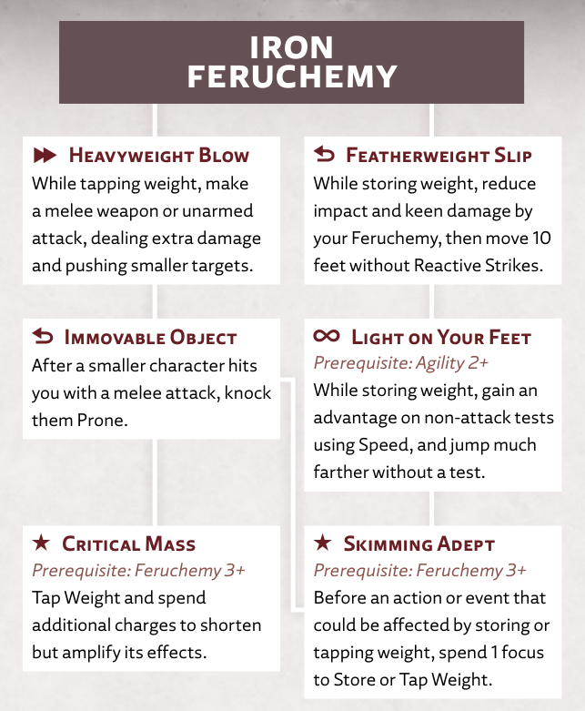

### 鐵藏金術（Iron Feruchemy）

重量（Weight）—實體金屬（Physical Metal）

鐵藏金術讓你將身體的重量儲存在鐵意識（Ironmind）中。為鐵意識充能時，你的體重會暫時減輕；汲取（Tap）鐵意識時，體重則會增加。你的身體會自然適應增加的重量，讓你仍能像平常一樣輕鬆活動。鐵藏金術師（Feruchemist）被稱為掠影（Skimmer）；熟練的掠影能一次汲取大量重量，讓體重變成平常的好幾倍，甚至重得足以壓破支撐自己的表面，或幾乎無法撼動。

### 儲存重量（Store Weight）

啟動（Activation）：[1行動]

持續時間：每個場景（Scene）1點充能（Charge）

持續儲存重量，直到你以[自由行動]結束效果，或花費鐵意識的一點充能為止。儲存重量期間，你會受到下列效果：

- 你的體重減輕若干磅，最多可減去平常體重的一半，也就是讓體重降為平常的一半。

- 除了佔據與控制的空間之外，判定所有效果時，你的體型（Size）都視為小一級。

- 你不會因墜落（Falling）受到傷害（Damage）。

- 對你發動的近戰攻擊（Attack）獲得一個優勢（Advantage）。

- 任何以物理力量違背你意願移動你的效果，其移動距離都加倍。

每個場景結束後，若你在整個場景中都持續儲存重量，鐵意識便獲得1點充能。

### 汲取重量（Tap Weight）

啟動：[1行動]

持續時間：與你的藏金術（Feruchemy）技能等級（Rank）相同數量的回合（Round）

花費鐵意識的1點充能來增加體重，持續與你的藏金術技能等級相同數量的回合，或直到你開始儲存重量為止。汲取重量期間，你會受到下列效果：

- 你的體重增加若干磅，最多可增加平常體重的重量，也就是讓體重變為平常的兩倍。

- 除了佔據與控制的空間之外，判定所有效果時，你的體型都視為大一級。

- 你的近戰攻擊獲得一個優勢。

- 在一項效果違背你的意願移動你之前，你可以將該效果使你移動的距離減少任意數量。

重量汲取結束前，你可以用[自由行動]花費鐵意識的1點充能，將其維持相同的時間。

### 運用鐵藏金術

除了上述能力規則，運用這項能力時，也可以參考以下指引。

### 創意運用

我們鼓勵你自行發想鐵藏金術的創意用途，例如以下幾種，並與GM討論如何判定：

**動量守恆。** 跳到空中後立刻儲存重量，讓自己能前進更遠的距離，由GM裁定。

**撞穿地板。** 汲取大量重量，壓破地板，落到下一層。

**重壓。** 站在或坐在一名倒地（Prone）的角色（Character）身上，再汲取重量，使其陷入定身（Immobilized）。對方可以進行敏捷（Agility）或運動（Athletics）檢定（Test），對抗你的實體防禦（Physical Defense），成功便能逃脫。

### 鐵藏金術天賦（talent）

以下依英文字母順序列出的天賦，都出現在鐵藏金術天賦樹（talent tree）中。你可以透過單藏金術師（Ferring）、雙生師（Twinborn）與藏金術師路徑（Path）的關鍵天賦（Key Talent），或透過血金術尖刺（Hemalurgic Spike），解鎖這棵天賦樹。

JANETTE RAMOS

第6章：金屬技藝（Metallic Arts）　238

### 臨界質量（Critical Mass）

前提條件（Prerequisite）：藏金術3+；不可撼動（Immovable Object）天賦

啟動：[特殊啟動]

你能一次從鐵意識中汲取驚人的重量。

汲取重量時，你可以不只花費1點充能，改為花費任意數量的充能，最多不超過你的金屬技藝上限（Metallic Art Limit）。每花費1點充能，效果便疊加一次，但持續時間改為直到你的下一個輪次（Turn）結束，而非通常的時間。例如，你的體重若是200磅，可以花費2點充能，讓體重最多增加400磅，最後達到600磅；你的體型視為大兩級，而你的近戰攻擊獲得兩個優勢。這次重量汲取結束前，你可以用[自由行動]花費鐵意識中至少1點充能，將其維持相同的時間。

### 輕量閃身（Featherweight Slip）

前提條件：鐵藏金術能力

啟動：[反應]

戰鬥（Combat）中，你隨時調整體重，減輕沉重打擊的傷害，再靈巧地閃開。

儲存重量期間，在你受到衝擊（Impact）或銳利傷害（Keen Damage）之前，可以使用這個反應（Reaction），將該傷害減少等同於你的藏金術修正值的數量。接著，朝遠離傷害來源的方向移動最多10呎，不會觸發反擊機會（Reactive Strike）。

### 重量打擊（Heavyweight Blow）

前提條件：鐵藏金術能力

啟動：[2行動]

更重的體重，讓你的攻擊帶上更強的動量。

汲取重量期間，對目標的實體防禦進行一次近戰武器攻擊（Weapon Attack）或徒手攻擊（Unarmed Attack）。為這次攻擊擲傷害骰時，額外增加1d4傷害。這項額外傷害使用你的金屬技藝骰（Metallic Art Die），因此骰型（Die Size）會隨藏金術技能等級提升；技能等級為2時，改擲1d6，而非1d4，依此類推。命中（Hit）時，若你的體型比目標大，可以將其推開最多10呎乘以你為汲取重量花費的充能點數的距離。

### 不可撼動

前提條件：重量打擊天賦

啟動：[反應]

汲取鐵意識時，你的身體會變得比外表看起來沉重、難以撼動，讓近戰對手措手不及。

當一名體型比你小的角色以近戰攻擊命中你後，你可以使用這個反應，使其倒地。

### 步履輕盈（Light on Your Feet）

前提條件：敏捷2+；輕量閃身天賦

啟動：[常駐]

減輕體重後，你能施展平常體重下只能想像的特技。

儲存重量期間，獲得下列收益：

- 使用速度（Speed）屬性（attribute）進行非攻擊檢定時，獲得一個優勢。

- 移動時，你不必成功通過運動檢定，就能水平跳躍最多等同於移動速率（Movement Rate）的距離，或垂直跳躍最多等同於移動速率一半的距離。

### 掠影專家（Skimming Adept）

前提條件：藏金術3+；不可撼動天賦或步履輕盈天賦

啟動：[特殊啟動]

你儲存與汲取重量的經驗豐富，做起來幾乎已是反射動作。

在一個可能因你儲存或汲取重量而受到影響的行動（Action）或其他效果發生前，你可以花費1點專注點（Focus），使用儲存重量或汲取重量，不需行動。例如，你可以在啟動一項要求你正儲存或汲取重量的鐵藏金術天賦前這麼做，也可以在攻擊、受到攻擊、被強制移動或墜落前這麼做。

### 鐵藏金術天賦樹

#### 重量打擊

啟動：[2行動]

解鎖來源：鐵藏金術能力

汲取重量期間，進行近戰武器或徒手攻擊，造成額外傷害，並推開較小的目標。

#### 輕量閃身

啟動：[反應]

解鎖來源：鐵藏金術能力

儲存重量期間，將受到的衝擊與銳利傷害減少等同於你的藏金術的數量，再移動10呎，不會觸發反擊機會。

#### 不可撼動

啟動：[反應]

解鎖來源：重量打擊天賦

較小的角色以近戰攻擊命中你後，使其倒地。

#### 步履輕盈

啟動：[常駐]

前提條件：敏捷2+

解鎖來源：輕量閃身天賦

儲存重量期間，使用速度進行非攻擊檢定時獲得一個優勢，且不需檢定就能跳得更遠。

#### 臨界質量

啟動：[特殊啟動]

前提條件：藏金術3+

解鎖來源：不可撼動天賦

汲取重量時花費額外充能，縮短持續時間並增強效果。

#### 掠影專家

啟動：[特殊啟動]

前提條件：藏金術3+

解鎖來源：不可撼動天賦或步履輕盈天賦

在可能因儲存或汲取重量而受到影響的行動或事件發生前，花費1點專注點，使用儲存重量或汲取重量。

第6章：金屬技藝　239

