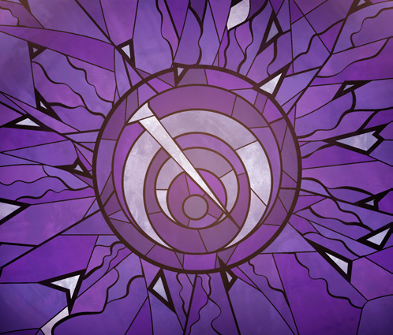
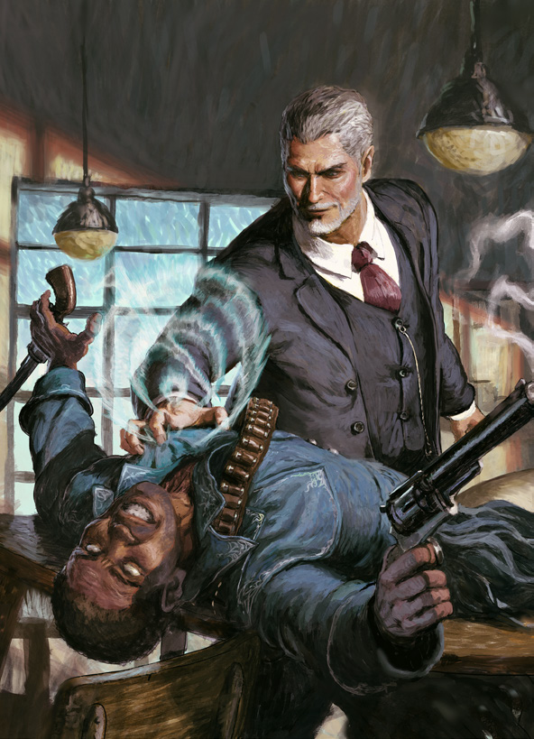

### 鎳鉻鎔金術（Nicrosil Allomancy）

增強（Enhancement）—外部（External）—推力（Pushing）

[第二時代]

鎳鉻鎔金術讓你觸碰正在使用授予能力的金屬之子（Metalborn），或其他受授予的（Invested）角色（Character），使他們儲備的力量在瞬間爆發（Burst），全部消耗殆盡。這種爆發讓鎳鉻鎔金術師（Allomancer）被稱為鎳爆（Nicroburst）。爆發很難控制，尤其當目標毫無準備時更是如此；然而，它的威力卻能讓目標超越自身能力平常的限制。

### 燃燒鎳鉻（Burn Nicrosil）

啟動（Activation）：[反應]

持續時間：瞬間

在你的觸及範圍（Reach）內，另一名角色即將使用或維持一項授予能力，例如鎔金術（Allomancy）的燃燒（Burn）行動，或藏金術（Feruchemy）的汲取（Tap）行動時，若你知道對方即將使用該能力，便可以使用此反應（Reaction），花費1點授予（Investiture）燃燒鎳鉻，使觸發此反應的能力爆發。若要使不願配合的角色的能力爆發，你必須對目標的實體防禦（Physical Defense）進行鎔金術檢定（Test）並成功。失敗時，你不會使該能力爆發，也不會為這次嘗試花費授予。使能力爆發會產生下列效果：

- 該角色被迫將所有相關的授予資源（Resources）都花費在該能力上，例如鎔金術的全部剩餘授予，或藏金術所用的金屬意識庫（Metalmind）中的全部剩餘充能（Charge）。忽略該角色的金屬技藝上限（Metallic Art Limit），以及該能力平常的費用；即使該能力平常不需花費資源，也一樣。

- 如果該能力平常允許該角色選擇其大小、距離或目標（Target）數量，就必須各自選擇最大的可能值。

- 該角色必須擲一顆劇情骰（Plot Die），就像在檢定中提高賭注（Raise the Stakes）一樣。如果該角色是敵人，你可以花費此次擲骰中的變故（Complication），讓該角色完全失去對該能力的控制；如果該角色不是敵人，則由GM花費變故。與GM一起決定結果。依照能力性質與當下情況，這可能嚴重破壞該角色周遭的環境，甚至使該角色、其盟友（Ally）或旁觀者受到傷害（Damage）、失去專注點（Focus），或承受傷勢（Injury）。

- 該角色可以用任何一般允許的方式，花費此次劇情骰擲出的[機遇]（Opportunity）。

即使一項能力平常不花費授予，或不會因花費更多授予而增強，你仍可使它爆發。除了上述相關效果之外，請與GM一起決定該能力爆發的其他效果。

### 使用鎳鉻鎔金術

除了上述能力規則，運用這項能力時，也請參考下列指引。

### 讓不隨資源成長的能力爆發

使用硬鋁（Duralumin）或鎳鉻（Nicrosil）鎔金術時，能力爆發的威力通常大致隨投入的資源成比例增加。有些能力本來就會依花費的授予增強；對於不會如此成長的能力，請考量該能力平常的費用，以及超出這個費用多少資源。接著，確定你運用能力的主要方式，例如造成傷害、治療（Healing）、削減專注點或恢復專注點，再據此增強該效果。如果你或另一名角色失去對爆發能力的控制，也可以用類似方式決定其負面影響。

### 鎳鉻鎔金術天賦樹（talent tree）

**天賦連線**

| 天賦 | 解鎖來源 | 啟動 | 額外前提 |
| --- | --- | --- | --- |
| [主動鎳爆](#主動鎳爆proactive-nicroburst) | 鎳鉻鎔金術能力 | 1行動 | — |
| [協助爆發](#協助爆發assisted-burst) | 鎳鉻鎔金術能力 | 常駐 | 鎔金術4+ |
| [爆發抓握](#爆發抓握bursting-grasp) | 主動鎳爆 | 特殊啟動 | 運動2+或竊術2+ |
| [出其不意的爆發](#出其不意的爆發unexpected-burst) | 爆發抓握 | 特殊啟動 | 隱匿3+ |

#### 主動鎳爆（Proactive Nicroburst）

啟動：[1行動]

解鎖來源：鎳鉻鎔金術能力

花費授予，使觸及範圍內一名角色的相同數量的授予能力爆發。若對方不願配合，對其實體防禦進行鎔金術檢定。

#### 協助爆發（Assisted Burst）

啟動：[常駐]

前提條件（Prerequisite）：鎔金術4+

解鎖來源：鎳鉻鎔金術能力

當你燃燒鎳鉻來協助盟友時，對方能更有效地控制能力，也不必擲劇情骰。

#### 爆發抓握（Bursting Grasp）

啟動：[特殊啟動]

前提條件：運動（Athletics）2+或竊術（Thievery）2+

解鎖來源：主動鎳爆天賦（talent）

對觸及範圍內的角色進行實體檢定後，花費[機遇]或2點專注點，以該角色為目標使用主動鎳爆。

#### 出其不意的爆發（Unexpected Burst）

啟動：[特殊啟動]

前提條件：隱匿（Stealth）3+

解鎖來源：爆發抓握天賦

使敵人的能力爆發時，讓對方的劇情骰獲得一個劣勢（Disadvantage），並影響[變故]的結算方式。

AUSTIN HARTELL

第6章：金屬技藝（Metallic Arts）　201

### 鎳鉻鎔金術天賦

下列天賦依英文字母順序排列，出現在鎳鉻鎔金術天賦樹中。你可以透過迷霧人（Misting）與雙生師（Twinborn）路徑（Path）的關鍵天賦（Key Talent），或透過血金術尖刺（Hemalurgic Spike），解鎖這棵樹。

#### 協助爆發

前提條件：鎔金術4+；鎳鉻鎔金術能力

啟動：[常駐]

你與盟友一起訓練，讓他們熟悉你的鎳鉻爆發，學會控制這股爆炸性的力量。

當你燃燒鎳鉻，使盟友的授予能力爆發時，對方獲得下列好處：

- 不必擲劇情骰，但仍可自行選擇擲骰。

- 不必選擇最大的可能大小、距離及目標數量。

- 對於哪些超常效果會取代該能力平常的效果，或在原有效果之外發生，對方能更有效地掌控。我們鼓勵對方與GM一起討論，判定這些能力的創意用法。

#### 爆發抓握

前提條件：運動2+或竊術2+；主動鎳爆天賦

啟動：[特殊啟動]

你可以在擒抱（Grapple）他人或扒竊時，順勢對他們施展鎳爆。

當你使用實體技能（skill），對觸及範圍內的角色進行檢定並成功後，例如進行武器攻擊（Weapon Attack），或進行竊術檢定偷取對方的金屬小瓶，你可以花費[機遇]或2點專注點，以該角色為目標使用主動鎳爆，不需行動（Action）。你對該角色實體防禦進行的鎔金術檢定自動成功。

#### 主動鎳爆

前提條件：鎳鉻鎔金術能力

啟動：[1行動]

你不再只是當下作出反應，而能在最符合自身策略的時機，使能力爆發。

選擇觸及範圍內的一名角色，花費至少1點授予，最高不超過你的金屬技藝上限，使該角色正在使用、持續中的授予能力爆發。由你選擇與花費授予點數相同數量的能力，且必須都來自觸及範圍內的同一名角色。一如平常，若目標不願配合，你必須先對其實體防禦進行鎔金術檢定並成功。每項選定的能力都會爆發，就像你在該能力最初啟動時，對它使用燃燒鎳鉻一樣。如果選定的多項能力使用相同資源，便將該資源平均分配給這些能力。

#### 出其不意的爆發

前提條件：隱匿3+；爆發抓握天賦

啟動：[特殊啟動]

在準備好要大肆擾亂敵人之前，你都不會暴露自己身為鎳爆的身分。

每個場景（Scene）中，你第一次成功使敵人的授予能力爆發時，可以讓對方為此次爆發擲的劇情骰獲得一個劣勢。如果你花費此次擲骰中的[變故]，讓對方失去對該能力的控制，你便能對這次爆發如何結算，多一些決定權。

*一名鎳爆使一名雙生師經錫（Tin）增強的感官不堪負荷。*

ANTTI HAKOSAARI

