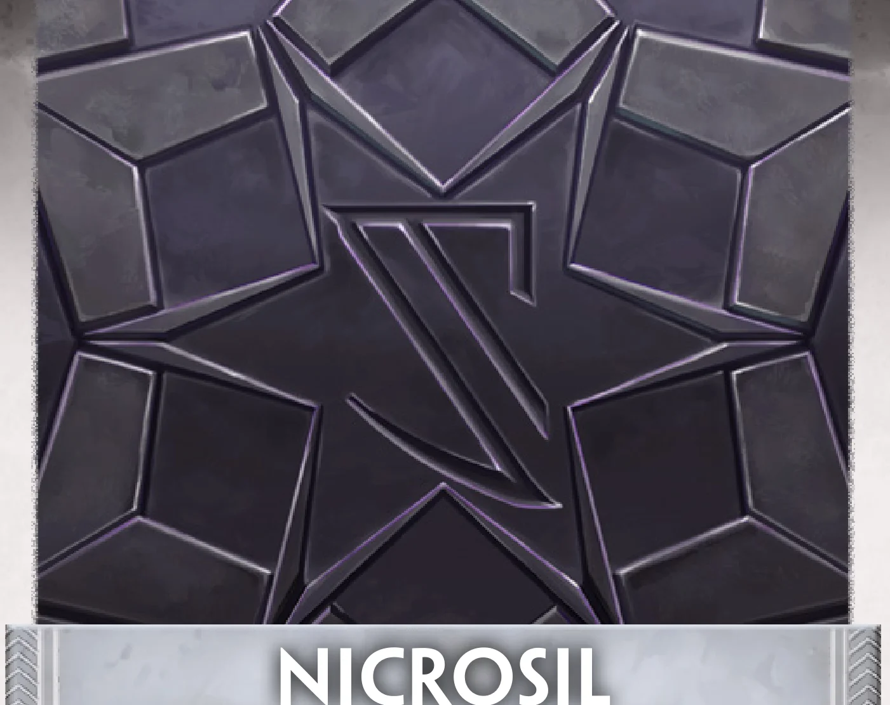
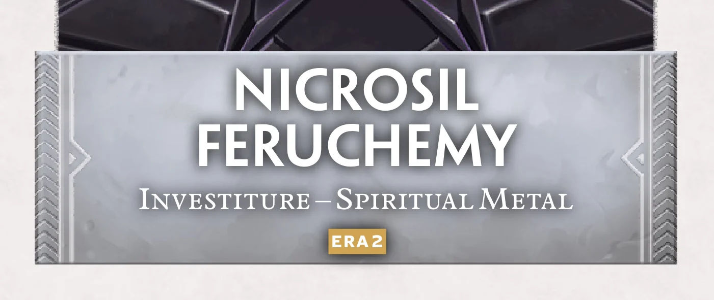

### 鎳鉻藏金術（Nicrosil Feruchemy）

授予（Investiture）—靈魂金屬（Spiritual Metal）

[第二時代]

透過鎳鉻藏金術，你可以儲存運用授予的能力本身。為鎳鉻意識（Nicrosilmind）充能時，你的一項授予能力會減弱。之後，你可以汲取（Tap）那項能力，暫時提升它的威力。汲取儲存的授予之術（Invested Art）時，你的身體、心智與靈魂會隨之調整，因應能力的提升。因此，你能以出乎意料的安全程度與控制力運用能力，尤其相較於瞬間爆發（Burst）而言，例如硬鋁鎔金術（Duralumin Allomancy）與鎳鉻鎔金術（Nicrosil Allomancy）造成的爆發。運用鎳鉻藏金術的人常被稱為承魂（Soulbearer），但他們並不真正了解自己在鎳鉻意識中儲存或汲取時，究竟做了什麼。即使放眼整個寰宇（cosmere），人們對這項能力的認識，也很少超出最基本的效果。

### 單藏金術師選擇鎳鉻

鎳鉻藏金術只有在你還能運用另一項授予能力時才有益處，因此多數單藏金術師（Ferring）玩家不會選擇這項能力。不過，如果你正在進行跨世界的戰役（Campaign），或已知這次冒險（Adventure）中能取得血金術尖刺（Hemalurgic Spike），成為承魂也可能是有趣的選擇。

### 儲存授予（Store Investiture）

啟動（Activation）：[1行動]

持續時間：每個場景（Scene）1點充能（Charge）

儲存你的一項能力，或其他授予能力，例如燦軍（Radiant）的波力（Surge），直到你選擇用[自由行動]結束效果，或花費鎳鉻意識的一點充能。儲存期間，該能力的威力會減弱：判定所儲存能力的效果時，將你對應的授予技能（Invested Skill）視為少1個技能等級（Rank）。不過，這不會影響你的金屬意識庫（Metalmind）充能上限，也不影響天賦（talent）的前提條件（Prerequisite）。該授予技能只在用於所儲存的能力時受到影響；其他使用相同技能的能力不受影響。

每個場景結束後，若你在整個場景中都持續儲存授予，鎳鉻意識便獲得1點充能。獲得充能時，記下該點充能與哪項授予能力相連。

### 汲取授予（Tap Investiture）

啟動：[1行動]

持續時間：與你的藏金術（Feruchemy）技能等級相同數量的回合（Round）

花費鎳鉻意識的1點充能，汲取與該點充能相連的那項能力（或其他授予能力）。在等同於你的藏金術技能等級的回合數內，或直到你開始儲存授予，判定所儲存能力的效果時，將你對應的授予技能視為額外增加2個技能等級。不過，這不會影響你的金屬意識庫充能上限，也不影響天賦的前提條件。該授予技能只在用於所儲存的能力時受到影響；其他使用相同技能的能力不受影響。

汲取授予之術的效果結束前，你可以用[自由行動]花費鎳鉻意識的1點充能，將效果維持相同的時間。這麼做時，若新花費的充能與另一項能力相連，便依照那項能力調整效果。

### 運用鎳鉻藏金術

除了上述能力規則，運用這項能力時，也可以參考以下指引。

### 創意運用

除了直接效果之外，人們對儲存與汲取授予仍所知甚少，即使是研究藏金術本質超過1500年的泰瑞司（Terris）社群也不例外。不過，發揮創意運用這項能力，或將它與其他效果結合，仍能辦到令人驚嘆的事。我們鼓勵你自行發想鎳鉻藏金術的用途，例如以下幾種，並與GM討論如何判定：

**隱藏生機（Hidden Life）。** 迅速儲存授予，避開偵測受授予角色（Character），甚至偵測活人的效果，例如青銅鎔金術師（Allomancer）的搜尋（Seeking），或覺醒術師（Awakener）的生命感知（Life Sense）。

**突破極限（Surpass Limits）。** 若從鎳鉻意識汲取能力，讓你對應的授予技能暫時達到6個技能等級以上，你或許能辦到遠超出該能力平常限制的事。除了發揮創意突破能力極限，有些能力也會給予技能等級6+的角色，或花費6點以上授予的角色特殊收益；各項能力的章節會提供這些資訊。

JANETTE RAMOS

第6章：金屬技藝（Metallic Arts）　240

