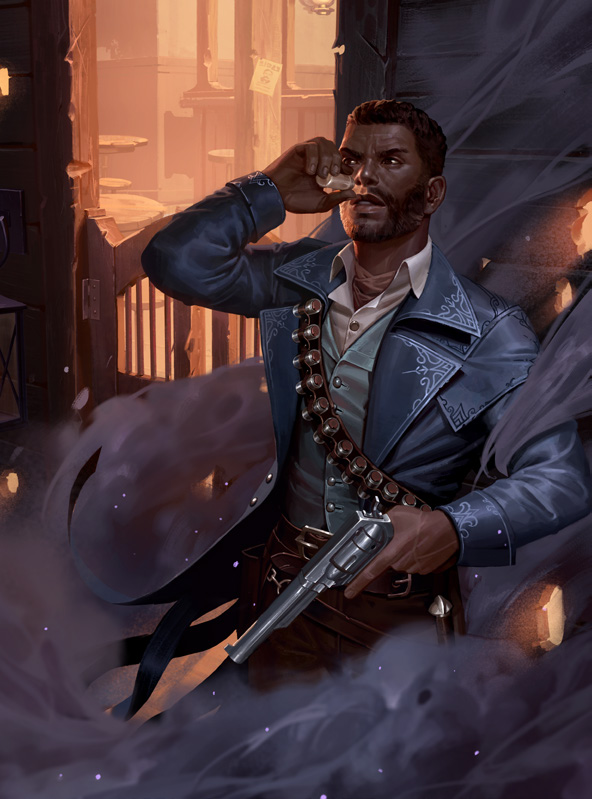
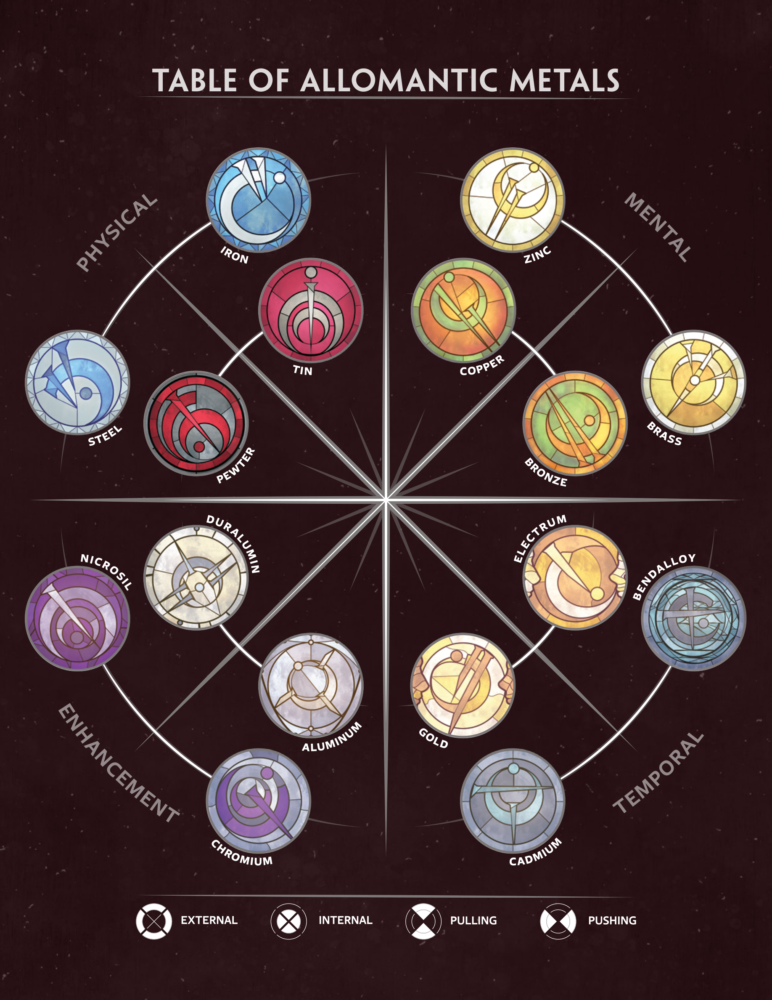
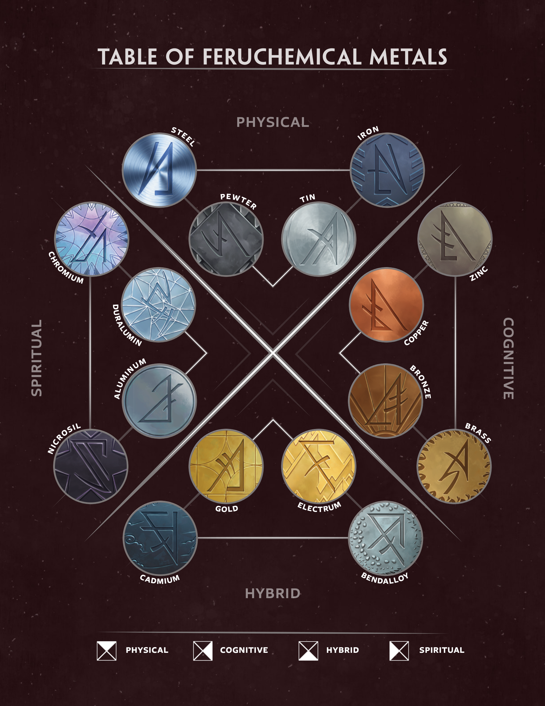

## 第6章：金屬技藝（Metallic Arts）

在司卡德利亞（Scadrial），有些人能運用各種金屬取得力量，施展奇妙的本領。

金屬技藝共有三種，各以不同方式運用司卡德利亞的金屬：

**鎔金術（Allomancy）**讓你攝入金屬並將其「燃燒」，以授予（Investiture）灌注自身，產生特定的魔法效果，影響周遭世界。

**藏金術（Feruchemy）**讓你將某種特質「儲存」於金屬意識庫（Metalmind），例如感官、身體或心智的速度、記憶，甚至與他人的牽繫（Connection）。儲存特質通常會使你變弱，但日後可以「汲取」儲存的特質，暫時大幅強化自身。

**血金術（Hemalurgy）**是較為陰險的金屬技藝。它使用金屬尖刺，從受害者身上奪取某種特質的一部分，過程幾乎必定會殺死對方。這根受授予的（Invested）尖刺之後可以植入另一人的身體，賦予對方被奪取的特質。血金術可以奪取身體與心智方面的屬性，以及鎔金能力和藏金能力。

寰宇（cosmere）各個世界有許多授予之術（Invested Arts），上述只是其中三種。每種授予之術都以獨特方式取得授予。

若你想親自施展鎔金術或藏金術，就必須成為金屬之子（Metalborn，見第5章），透過訓練自己或打造金屬意識庫來解鎖能力。《寰宇 RPG》（Cosmere RPG）的角色不會親自施行血金術，但你可能獲得別人製成的血金術尖刺（Hemalurgic Spike）作為獎勵（見第8章）。

接下來的〈司卡德利亞的金屬〉將概述各種金屬、它們在鎔金術與藏金術中的獨特效果，以及可取得它們的時代。

### 使用金屬技藝

本章介紹各種鎔金能力（Allomantic Power）與藏金能力（Feruchemical Power），並為大多數能力提供可用來升級的天賦樹（talent tree）。如第5章〈金屬之子路徑選項〉所述，你可以透過金屬之子路徑（Metalborn Path）取得一種或多種能力。

第8章則提供植入與移除血金術尖刺的規則。

### 金屬技藝能力（Metallic Art Power）

每種金屬都會賦予獨特能力，詳見後續各金屬的小節。鎔金能力以燃燒（Burn）行動呈現，讓你燃燒該金屬並啟動其效果。藏金能力則包含兩種行動：儲存（Store）行動讓你將特質儲存於金屬意識庫；汲取（Tap）行動讓你取用其中儲存的特質。能力天賦樹中的天賦（talent）可以升級能力，或賦予額外行動。規則提到你的「能力」時，涵蓋基本行動，以及你從該能力的天賦獲得的額外行動或其他效果。

#### 已知用途與可能性

金屬技藝的用途與組合極為複雜，潛力遠遠超出司卡德利亞人目前所知。

因此，本規則書列出的金屬技藝與天賦，並未涵蓋每種金屬的全部能耐，而是呈現司卡德利亞人在本書涵蓋的時代對它們的認識。有些能力的天賦很少，甚至沒有天賦；另一些能力與彼此結合時，或與鎔金能者化（Allomantic Savantism，第5章〈迷霧人〉有詳細說明）等能力結合時，可能需要發揮創意來詮釋。

這些規則雖然只涵蓋司卡德利亞人已知的效果，設計時仍保留了創作空間，讓你探索、推想尚未發現的能力用途。

*對頁：韋恩（Wayne）以彎管合金（Bendalloy）速度圈（Speed Bubble）偏轉子彈，避開攻擊。*

第6章：金屬技藝 161

KATERINA LADON

鎔金能力與藏金能力通常遵循和天賦相同的規則（見第4章〈使用路徑與天賦〉）。使用金屬技藝時，下列額外規則會決定你的鎔金能力或藏金能力有多大範圍、多強威力，以及效果持續多久。

### 初萌能力（Nascent Power）

在完成某項能力的金屬之子短期目標（Metalborn Goal）之前，你只能使用該能力的初萌版本（見第5章〈金屬之子短期目標與獎勵〉）。這代表你尚未熟練的初期運用，例如笨拙地試探剛發現的力量、無意識地燃燒微量鎔金金屬（Allomantic Metal），或在打造新金屬意識庫時，測試各塊金屬的效果。

使用初萌能力時，不採用該能力的完整規則。你只能展現與完整能力相關的輕微敘事效果（可參考各能力的〈創意用途〉尋找靈感）。你與 GM 可以發揮創意，以如下方式將這些微小效果融入遊戲：

**刻意選擇。**透過使用技能（Use a Skill）行動，以鎔金術或藏金術試驗自己的能力，達成有限的效果。

**本能嘗試。**花費[機遇]，啟動相關能力的有限版本。

**意外啟動。**將變故（Complication）描述為能力在不適當的時機發動，以某種方式弄巧成拙。

**控制練習。**在休整期（Downtime），以敘事方式描述你在低風險情境中使用能力。

初萌能力的效果始終小於完整版本，具體效果由 GM 裁定。下方的「初萌能力範例」表，提供初萌鎔金能力與初萌藏金能力在遊戲中可能展現的效果。

### 初萌鎔金能力（Nascent Allomantic Power）

當你選擇金屬之子路徑中賦予鎔金能力的關鍵天賦（Key Talent）時，就能使用授予這項資源。只有在你擁有至少1點授予值，且該能力並未耗竭（Depleted）時，才能使用鎔金能力的初萌版本。

GM 可以裁定使用初萌能力需要花費1點授予值。另一方面，當你吃下或喝下合理來說可能含有微量對應鎔金金屬的東西時，GM 也可能允許你恢復至少1點授予值。當然，你也可以照常透過飲用金屬液（Drink Vial）行動恢復授予值。

### 初萌能力範例

| 金屬技藝 | 初萌效果範例 |
| --- | --- |
| 彎管合金鎔金術（Bendalloy Allomancy） | 你的速度短暫加快，在戰鬥中額外獲得[1行動]，或在其他場景中做出更多貢獻。 |
| 鉻鎔金術（Chromium Allomancy） | 你碰觸一名角色，使其失去1點授予值。 |
| 紅銅鎔金術（Copper Allomancy） | 你在1回合（Round）內不受情緒鎔金術（Emotional Allomancy）影響。 |
| 鐵鎔金術（Iron Allomancy） | 你將10呎內的一塊金屬拉引到手中。 |
| 錫鎔金術（Tin Allomancy） | 你的一種感官成為超自然感知（Supernatural Senses），持續1回合。 |
| 鋅鎔金術（Zinc Allomancy） | 你煽動10呎內一名角色的情緒，持續1回合。 |
| 彎管合金藏金術（Bendalloy Feruchemy） | 你忽然覺得吃飽喝足。若你精疲力竭（Exhausted），該狀態的減值降低1。 |
| 黃銅藏金術（Brass Feruchemy） | 你本能地以[反應]儲存熱量。在1回合內，你受到的任何能量傷害（Energy Damage）均減少1。 |
| 鉻藏金術（Chromium Feruchemy） | 你的劇情骰（Plot Die）擲出空白面時，可以重擲。 |
| 紅銅藏金術（Copper Feruchemy） | 你鮮明地想起與當前場景有關的記憶。 |
| 金藏金術（Gold Feruchemy） | 看似挨了一記重擊，你卻若無其事，恢復1d6生命值（Health）。 |
| 鐵藏金術（Iron Feruchemy） | 你以[反應]短暫增加體重，抵擋敵人試圖對你施加的推撞（Shove）。 |
| 白鑞藏金術（Pewter Feruchemy） | 你的肌肉隆起。在1回合內，使用力量（Strength）屬性的非攻擊檢定獲得優勢（Advantage）。 |

### 初萌藏金能力（Nascent Feruchemical Power）

只有在你接觸的物件合理來說含有相當濃度的對應藏金金屬（Feruchemical Metal）時，才能使用藏金能力的初萌版本。該物件不具完整金屬意識庫的功能，也不能讓你儲存或汲取充能（Charge），但你仍能展現與儲存、汲取該能力對應特質有關的微小效果。

### 能力成長（Power Scaling）

當你的鎔金術或藏金術技能等級（Skill Rank）提高時，除了用於檢定的技能修正值（Skill Modifier）會增加，也可能增強部分對應能力。

第6章：金屬技藝 162

*紋（Vin）本能地安撫（Soothe）一名聖務官（obligator）。*

### 金屬技藝上限（Metallic Art Limit）

有些鎔金能力讓你選擇要花費多少授予值，有些藏金能力則讓你選擇要花費多少金屬意識庫充能。能力的費用可以變動時，通常不能一次花光所有可用的授予值或充能。你能為單一效果花費的該項資源數量，稱為金屬技藝上限。此上限等於對應授予技能（Invested Skill）的技能等級（最低為1），如下方「金屬技藝成長」表所示。

例如，一名鎔金術有2級的鋼鎔金術師使用鋼推（Steelpush）行動時，金屬技藝上限為2，因此最多可花費2點授予值來產生效果。當其鎔金術技能升至3級後，就能在鋼推上花費最多3點授予值。

### 金屬技藝骰（Metallic Art Die）

有時你會擲骰決定能力的效果，例如造成多少傷害或恢復多少生命值。規則有指定時，你的金屬技藝骰會隨對應授予技能的等級提高而提升骰型（Die Size），如下方「金屬技藝成長」表所示。

### 金屬技藝距離（Metallic Art Range）

許多能力只能影響你一定距離內的角色與物件。這個金屬技藝距離會隨對應授予技能的等級提高而增加，如下方「金屬技藝成長」表所示。（能力不需要效果線（Line of Effect），因此即使有實體障礙物，也能影響目標。）

### 金屬技藝成長（Metallic Art Scaling）

| 技能等級 | 上限 | 骰子 | 距離 |
| --- | --- | --- | --- |
| 0 | 1 | 1（不擲骰） | 10呎 |
| 1 | 1 | d4 | 20呎 |
| 2 | 2 | d6 | 40呎 |
| 3 | 3 | d8 | 80呎 |
| 4 | 4 | d10 | 160呎 |
| 5 | 5 | d12 | 320呎 |
| 6+* | 等於技能等級 | d20 | 640呎 |

*只有透過血金術或其他特殊效果，角色的技能等級才能超過5。

第6章：金屬技藝 163

KEVIN O’NEILL

### 金屬技藝的持續時間

許多能力讓你花費資源，啟動具有特定持續時間的效果。鎔金能力使用授予值；藏金能力則將充能儲存於金屬意識庫，或從庫中花費充能。有些效果持續至你下一個輪次（Turn）結束，其他效果則持續等同於鎔金術或藏金術技能等級的回合數（最低為1）。你可以同時啟用多個持續效果。

### 維持能力

在持續效果結束之前，你通常可以花費該能力指定的費用來維持效果。如此一來，效果的持續時間就會依規定延長。

有些能力的維持費用固定，效果也因此不變。其他能力則允許你調整用於維持效果的授予值或充能；調整時，能力效果也隨之改變。

若某個效果在你燃燒、汲取或儲存時生效，維持能力時也會生效。但若效果是直接指名該項能力，而非泛指燃燒、汲取或儲存，則不適用上述原則。

### 結束能力

當你選擇在之後的輪次中以[自由行動]結束效果、陷入昏迷（Unconscious），或效果的持續時間結束卻未花費資源維持時，持續效果就會結束。未維持可能是出於你的選擇，也可能是因為該項資源不足。

### 儲存行動的持續時間

有些能力，例如本章後面的藏金能力，需要透過維持持續效果來累積力量，這些效果有時對你不利。具有儲存行動的能力不會讓你花費資源來啟動效果，而是在每次指定的持續時間經過後，讓你獲得資源。你必須維持效果達到完整的持續時間，才能獲得該項資源。不過，若長時間效果只是短暫中斷，而你很快就恢復效果，GM 可能允許你忽略這次中斷。

大多數能儲存資源的能力都可以無限期維持，或維持到金屬意識庫存滿為止。每次指定的持續時間經過後，你就獲得資源。

這類持續時間往往以場景為單位。最簡單的處理方式，是讓 GM 在效果生效的每個場景結束時，給予你該項資源。不過，若你在某個場景中途才開始儲存，GM 可能在下一個場景進行到適當時機時，才給予充能。

關於藏金術金屬意識庫的更多使用方式，參閱第5章〈藏金術：使用金屬意識庫〉。

### 戰鬥以外的持續時間

能力規則常用「1回合」等以戰鬥為主的措辭描述效果的持續時間，但你也可以在戰鬥以外使用這些能力。為了讓各類場景的敘事保持簡單，除非另有說明，將1回合視為下列時長：

**戰鬥（Combat）。**一回合持續至你下一個輪次結束，大約10秒。因此，若效果持續1回合，就會在你下一個輪次結束時終止。

**對話（Conversation）。**一回合持續至每名參與角色都做出一次貢獻（Contribution），大約1分鐘。因此，若效果持續1回合，就會在你於下一回合做出貢獻後終止。

**試煉（Endeavor）。**一回合由每名參與角色各做出一次貢獻所組成。其時長隨試煉差異很大，但通常介於1至10分鐘。因此，若效果持續1回合，就會在你於下一回合做出貢獻後終止。

**場景以外。**若當下不在場景中，將每個「回合」視為大約10分鐘。

*一名雙生師（Twinborn）槍手（Gunslinger）灌下一瓶金屬液，迷霧在他身旁繚繞。*

第6章：金屬技藝 164

JUST HIEU

在對話與試煉中，若效果持續至「你的輪次結束」，通常表示持續到你做出一次貢獻，或由 GM 決定適合的持續時間。若你有額外的金屬液瓶可用，或金屬意識庫中存有合理數量的充能，GM 可以彈性處理效果的持續時間，不要求你精確追蹤資源與時間。

若持續效果跨越多個場景，敘事上會持續多久由 GM 決定，主要取決於該效果與新場景有多大關聯。例如，你以錫藏金術（Tin Feruchemy）汲取聽力，偷聽隔壁房間的祕密會議，接著自己所在房間外的走廊爆發戰鬥。此時，效果的持續時間與當下敘事沒有直接關聯，GM 可能讓它持續10分鐘，讓大家專心處理戰鬥，不必追蹤無關效果。然而，若你正是靠強化聽力才察覺戰鬥，或在戰鬥中運用聽力來獲取優勢（Gain Advantage），持續時間就會影響敘事。這時 GM 可能裁定，你必須如同參與戰鬥一般維持效果。

#### 創意運用金屬技藝

各能力的說明列出基本能耐，並為常見用途提供機制，天賦則擴充你的選擇。不過，你的選擇並不僅限於此！各能力的〈創意用途〉提供了一些靈感；只要 GM 同意，你幾乎可以運用能力嘗試任何你想得到的事。

採用這些較開放的用途時，你仍須進行必要的技能檢定（Skill Test），並花費 GM 決定數量的授予值或金屬意識庫充能。

如同任何技能檢定，由 GM 設定難度等級（DC）、在適當時提高賭注（Raise the Stakes），並敘述檢定結果。GM 可以參考前面的「金屬技藝成長」表，決定能力效果的規模，例如影響區域的大小，或傷害擲骰使用的骰型。臨場創造金屬技藝的用法，可能成為一次《迷霧之子》（Mistborn）遊戲中最難忘的時刻！

### 鎔金惰性材料（Allomantically Inert Material）

司卡德利亞的許多物品，包括大多數武器、護甲（Armor）和彈藥，都含有某種金屬，因此容易受到燃燒鐵或鋼的鎔金術師（Allomancer）影響。為了對抗這些能力，可以製作不含金屬的物件。

不含金屬的物件具有鎔金惰性（Allomantically Inert），因此不會受到鐵拉（Ironpull）或鋼推影響。與鎔金術師作戰時，使用具有鎔金惰性的武器與護甲是明智之舉，對方就無法反過來利用這些裝備對付你。

一些聰明的工匠會設計出巧妙結合一般金屬與鎔金惰性材料的物品，不過通常會嚴守這些創作的祕密。例如，稱為殺霧彈（Hazekiller Round）的子彈可以設計成會分離為兩半。當鎔金術師對彈藥中的金屬施加鋼推或鐵拉時，非金屬部分仍會沿原定彈道前進。關於製作這類鎔金惰性物品的指引，參閱第7章〈以非標準材料製作物品〉。

### 鋁（Aluminum）

在整個寰宇中，鋁對魔法會產生程度不一的特殊作用，通常也無法直接受到魔法影響。在司卡德利亞，鋁鎔金術（Aluminum Allomancy）與鋁藏金術（Aluminum Feruchemy）會運用這種金屬取得力量，但其他金屬技藝能力無法影響鋁；鋁也被視為具有鎔金惰性。

到了第二時代，許多司卡德利亞人已知曉這項特性。例如，富裕的人會戴上內襯鋁的帽子，防範情緒鎔金術（見第8章〈稀有造物〉）。有創業精神的工匠甚至可能製作昂貴的鋁製武器，使它們不受鐵拉或鋼推影響（見第7章〈以非標準材料製作物品〉）。

各種能力如何與鋁製物件互動，最終仍由 GM 決定。一般而言，含有這種金屬的物件具有下列效果：

- 該物件具有鎔金惰性。

- 該物件無法被鐵鎔金術或鋼鎔金術（Steel Allomancy）移動。

- 若該物件覆蓋角色的頭部，該角色就不會受到情緒鎔金術影響。

- 該物件嵌在角色體內期間，該角色無法透過金屬技藝或其他授予能力恢復生命值。

- 造成靈魂傷害（Spirit Damage）的武器無法傷害該物件。

第6章：金屬技藝 165

### 能力條目的結構

本章後續小節將介紹各項金屬技藝能力，依使用的授予技能排列，先介紹鎔金能力，再介紹藏金能力。條目包含下列資訊：

**名稱。**各條目的名稱先列出使用的金屬，再列出運用該金屬的金屬技藝，例如「鋼鎔金術」或「鋼藏金術（Steel Feruchemy）」。每種金屬都會在能力條目中出現兩次，因為每種金屬都有鎔金術與藏金術的用途。

**行動。**每項能力都賦予一種或多種基本本領，運作方式很像天賦。每項本領都會列出啟動所需的行動數量、持續時間及相關規則。

**使用能力。**基本規則之後，有些能力會提供更多使用指引，以及運用效果的創意點子。

**天賦。**最後，各條目會列出可用來升級該能力的天賦。在完成該能力的金屬之子短期目標之前，你不能選擇這些天賦。它們遵循第4章〈使用路徑與天賦〉中的規則。

### 司卡德利亞的金屬

縱觀司卡德利亞的歷史，學者與金屬之子一直透過分類測試，增進對金屬技藝及適用金屬的認識。鎔金術與藏金術雖有共通之處，對金屬的分類仍略有差異，詳見「鎔金術金屬」與「藏金術金屬」兩表。

### 鎔金術金屬

「鎔金術金屬」表包含下列欄位：

**鎔金金屬。**可用於鎔金術的金屬名稱。先依類別排列，再依效果屬於外部或內部、推力或拉引排序。

**效果。**概述鎔金術師燃燒該金屬時會發生的事。

**迷霧人名稱。**能燃燒該金屬的迷霧人（Misting）之通稱。

**配對金屬（Paired Metal）。**大多數純金屬（Pure Metal），例如鐵，都有一種效果互補的配對合金（Alloy），例如鋼。（若你選擇迷霧之子路徑，其關鍵天賦會賦予「訓練你的能力（Train Your Powers）」短期目標，讓你逐步解鎖第一組配對金屬。）

**時代。**可以取得該金屬的時代。

**拉引（Pulling）或推力（Pushing）。**鎔金術師將每種純金屬的效果歸為拉引，配對合金的效果則歸為推力。這些名稱最初用於描述鐵與鋼的鎔金效果，後來成為所有金屬通用的標準術語。

**外部（External）或內部（Internal）。**每種鎔金能力都歸為內部，影響使用者本身；或歸為外部，影響使用者周遭的世界。每種純金屬的配對合金通常具有相同分類。

**類別。**鎔金術分為四種主要金屬類別：實體（Physical）、意志（Mental）、增強（Enhancement）與時序（Temporal）。此外，還有數種強大而神祕的神金屬（God Metal）。這五種類別，大致表示燃燒該類金屬會產生哪種類型的效果。

*瓦希黎恩．拉德利安（Waxillium Ladrian）沿街飛掠，同時按住自己的帽子。*

DORUK GOLCU

### 常見與稀有金屬

在《迷霧之子》的兩個時代，有些金屬都十分常見，鎔金術師很容易就能維持金屬液瓶的存量，飲用後為能力供應力量。每種實體金屬（Physical Metal）與意志金屬（Mental Metal）都很容易取得。

相較之下，稀有金屬，包括所有增強金屬（Enhancement Metal）、時序金屬（Temporal Metal）與神金屬，都難取得得多。原因可能是資源確實稀少，也可能只是受到法律管制。如第5章〈鎔金術：使用授予〉中的〈管理金屬〉所述，若你的鎔金能力需要稀有金屬，可以逐瓶購買並追蹤用量，或尋求穩定的供應來源作為獎勵。

### 藏金術金屬

「藏金術金屬」表包含下列欄位：

**藏金金屬。**可用於藏金術的金屬名稱，依類別排列。

**效果。**概述藏金術師（Feruchemist）可以儲存在該金屬製成的金屬意識庫中，並於日後汲取的特質。

**單藏金術師名稱。**能使用該金屬製成的金屬意識庫之單藏金術師（Ferring）的通稱。

**配對金屬。**大多數純金屬，例如鐵，都有一種配對合金，例如鋼。不過，合金的性質在藏金術中沒有在鎔金術中那麼重要。（若你選擇藏金術師路徑，其關鍵天賦會賦予「打造你的金屬意識庫（Construct Your Metalminds）」短期目標，讓你逐步解鎖第一組配對金屬。）

**時代。**可以取得該金屬的時代。

**合金或純金屬。**說明該金屬必須是純金屬，還是具有特定比例的合金，才能用於藏金術。

**類別。**藏金術分為四種主要金屬類別：實體、意識（Cognitive）、靈魂（Spiritual）與混合（Hybrid）。此外，還有數種強大而神祕的神金屬。這五種類別，大致表示藏金術師可以在該類金屬中儲存哪種類型的特質。

### 神金屬

神金屬及其合金，是雅多納西（Adonalsium）的碎力（Shard）之力量的實體顯現。除非碎力另有意願，否則只能在其垂裂點（perpendicularity）找到該碎力的神金屬。垂裂點匯聚了高度濃縮的碎力力量，甚至能讓人往返實體界（Physical Realm）與意識界（Cognitive Realm）。第一時代的司卡德利亞有兩個碎力及其神金屬：存留（Preservation）及 Lerasium，以及滅絕（Ruin）及天金（Atium）。第二時代只有和諧（Harmony）這一個碎力存在，其神金屬是 Harmonium。不過，在司卡德利亞也找得到另一個碎力的神金屬 Trellium。

### 遺失與發現的金屬

某些司卡德利亞金屬可能尚未被發現，或已消失在歷史中，因此無法取得。具體情況取決於遊戲所處的時代，以及該時代的哪個時期。

#### 兩個時代皆有

常見金屬，包括黃銅（Brass）、青銅（Bronze）、紅銅（Copper）、鐵（Iron）、白鑞（Pewter）、鋼（Steel）、錫（Tin）與鋅（Zinc），在《迷霧之子》的兩個時代都能取得。金（Gold）也能取得，只是鋼鐵教廷（Steel Ministry）直到接近第一時代末期，都還隱瞞著金迷霧人的存在。

#### 整個第一時代

下列神金屬雖然極為稀有，在最後帝國（Final Empire）興起之前就已能取得：天金、脈天金（Malatium）、Lerasium，以及 Lerasium 合金（Lerasium Alloy）。

#### 第一時代末期

第一時代時，人們不知道硬鋁（Duralumin）的特性；統御主（Lord Ruler）與其鋼鐵教廷雖已發現鋁和電金（Electrum），卻封鎖了相關知識。然而，在統御主死去、最後帝國崩潰之後，這些金屬才廣為人知，金迷霧人的存在也同樣公開。玩家角色（PC）在統御主死前就知道這些金屬的可能性極低，但你可以與 GM 商量，確定自己是在何時、以何種方式得知的。

#### 第二時代

落灰之終（Catacendre）後不久，第一時代的神金屬便失落了。因此，在第二時代無法取得天金、脈天金、Lerasium 與 Lerasium 合金。

在第二時代小說的事件發生之前，人們發現了彎管合金、鎘（Cadmium）、鉻（Chromium）、Harmonium 與鎳鉻（Nicrosil）。

第6章：金屬技藝 167

### 鎔金術金屬

| 鎔金金屬 | 效果 | 迷霧人名稱 | 配對金屬 | 時代 | 拉引／推力 | 外部／內部 | 類別 |
| --- | --- | --- | --- | --- | --- | --- | --- |
| 鐵 | 拉引附近金屬 | 扯手（Lurcher） | 鋼 | 兩者皆有 | 拉引 | 外部 | 實體 |
| 鋼 | 推動附近金屬 | 射幣（Coinshot） | 鐵 | 兩者皆有 | 推力 | 外部 | 實體 |
| 錫 | 強化你的感官 | 錫眼（Tineye） | 白鑞 | 兩者皆有 | 拉引 | 內部 | 實體 |
| 白鑞 | 強化你的身體能力 | 白鑞臂（Pewterarm）／打手（Thug） | 錫 | 兩者皆有 | 推力 | 內部 | 實體 |
| 鋅 | 煽動他人情緒 | 煽動者（Rioter） | 黃銅 | 兩者皆有 | 拉引 | 外部 | 意志 |
| 黃銅 | 抑制他人情緒 | 安撫者（Soother） | 鋅 | 兩者皆有 | 推力 | 外部 | 意志 |
| 紅銅 | 隱藏附近授予之術，使其不被偵測 | 煙陣（Smoker）／紅銅雲（Coppercloud） | 青銅 | 兩者皆有 | 拉引 | 內部 | 意志 |
| 青銅 | 偵測授予之術的使用 | 搜尋者（Seeker） | 紅銅 | 兩者皆有 | 推力 | 內部 | 意志 |
| 鉻 | 清空他人的授予儲備 | 水蛭（Leecher） | 鎳鉻 | 第二時代 | 拉引 | 外部 | 增強 |
| 鎳鉻 | 使他人的授予效果爆發 | 鎳爆（Nicroburst） | 鉻 | 第二時代 | 推力 | 外部 | 增強 |
| 鋁 | 清空你的授予儲備 | 鋁蟲（Aluminum Gnat）／虛無（Void） | 硬鋁 | 第二時代‡ | 拉引 | 內部 | 增強 |
| 硬鋁 | 使你的授予效果爆發 | 硬鋁蟲（Duralumin Gnat） | 鋁 | 第二時代‡ | 推力 | 內部 | 增強 |
| 鎘 | 在你周圍形成時間減慢的圈子 | 脈動（Pulser） | 彎管合金 | 第二時代 | 拉引 | 外部 | 時序 |
| 彎管合金 | 在你周圍形成時間加快的圈子 | 滑行（Slider） | 鎘 | 第二時代 | 推力 | 外部 | 時序 |
| 金 | 顯示你的過去與其他可能的自己 | 命師（Augur） | 電金 | 兩者皆有‡ | 拉引 | 內部 | 時序 |
| 電金 | 顯示你眼前可能發生的未來 | 預言師（Oracle） | 金 | 第二時代‡ | 推力 | 內部 | 時序 |
| 天金 | 顯示他人眼前可能發生的未來 | 先知（Seer） | 不適用 | 第一時代 | 不適用 | 不適用 | 神金屬 |
| 脈天金* | 顯示他人的過去與其他可能的樣貌 | 占卜師（Diviner） | 不適用 | 第一時代 | 不適用 | 不適用 | 神金屬 |
| Lerasium† | 使你成為迷霧之子 | 不適用 | 不適用 | 第一時代 | 不適用 | 不適用 | 神金屬 |
| Lerasium 合金† | 使你成為具有合金所含金屬能力的迷霧人 | 不適用 | 不適用 | 第一時代 | 不適用 | 不適用 | 神金屬 |
| Harmonium* | 未知 | 不適用 | 不適用 | 第二時代 | 不適用 | 不適用 | 神金屬 |
| Trellium* | 未知 | 不適用 | 不適用 | 第二時代 | 不適用 | 不適用 | 神金屬 |

*本書未提供此能力的規則。

†此金屬見第8章〈稀有金屬〉。

‡接近第一時代末期時，鋁、硬鋁與電金不再只有鋼鐵教廷知曉。

金迷霧人的存在也同樣公開。

第6章：金屬技藝 168

對頁插畫：AUSTIN HARTELL

### 鎔金金屬圖表

| 類別 | 金屬 |
| --- | --- |
| 實體 | 鐵、鋼、錫、白鑞 |
| 意志 | 鋅、黃銅、紅銅、青銅 |
| 增強 | 鉻、鎳鉻、鋁、硬鋁 |
| 時序 | 鎘、彎管合金、金、電金 |

#### 圖例

- 外部
- 內部
- 拉引
- 推力

### 藏金金屬圖表

| 類別 | 金屬 |
| --- | --- |
| 實體 | 鐵、鋼、錫、白鑞 |
| 意識 | 鋅、黃銅、紅銅、青銅 |
| 靈魂 | 鉻、鎳鉻、鋁、硬鋁 |
| 混合 | 鎘、彎管合金、金、電金 |

#### 圖例

- 實體
- 意識
- 混合
- 靈魂

### 藏金術金屬

| 藏金金屬 | 效果 | 單藏金術師名稱 | 配對金屬 | 合金或純金屬？ | 時代 | 類別 |
| --- | --- | --- | --- | --- | --- | --- |
| 鐵 | 儲存體重 | 掠影（Skimmer） | 鋼 | 純金屬 | 兩者皆有 | 實體 |
| 鋼 | 儲存實體速度 | 鋼奔（Steelrunner） | 鐵 | 合金 | 兩者皆有 | 實體 |
| 錫 | 儲存感知 | 風語（Windwhisperer） | 白鑞 | 純金屬 | 兩者皆有 | 實體 |
| 白鑞 | 儲存力量 | 蠻力（Brute） | 錫 | 合金 | 兩者皆有 | 實體 |
| 鋅 | 儲存心智速度 | 星火（Sparker） | 黃銅 | 純金屬 | 兩者皆有 | 意識 |
| 黃銅 | 儲存溫暖 | 火靈（Firesoul） | 鋅 | 合金 | 兩者皆有 | 意識 |
| 紅銅 | 儲存記憶 | 庫藏（Archivist） | 青銅 | 純金屬 | 兩者皆有 | 意識 |
| 青銅 | 儲存清醒 | 哨兵（Sentry） | 紅銅 | 合金 | 兩者皆有 | 意識 |
| 鉻 | 儲存靈魂層面的運氣（Fortune） | 旋轉（Spinner） | 鎳鉻 | 純金屬 | 第二時代 | 靈魂 |
| 鎳鉻 | 儲存授予能力 | 承魂（Soulbearer） | 鉻 | 合金 | 第二時代 | 靈魂 |
| 鋁 | 儲存靈魂身分（Spiritual Identity） | 真我（Trueself） | 硬鋁 | 純金屬 | 第二時代† | 靈魂 |
| 硬鋁 | 儲存靈魂層面的牽繫 | 聯絡（Connector） | 鋁 | 合金 | 第二時代† | 靈魂 |
| 鎘 | 儲存呼吸 | 喘息（Gasper） | 彎管合金 | 純金屬 | 第二時代 | 混合 |
| 彎管合金 | 儲存營養 | 吞蝕（Subsumer） | 鎘 | 合金 | 第二時代 | 混合 |
| 金 | 儲存健康 | 制血者（Bloodmaker） | 電金 | 純金屬 | 兩者皆有 | 混合 |
| 電金 | 儲存決心 | 頂峰（Pinnacle） | 金 | 合金 | 第二時代† | 混合 |
| 天金 | 儲存青春 | 回齡者（Timewinder） | 不適用 | 不適用 | 第一時代 | 神金屬 |
| 脈天金* | 未知 | 不適用 | 不適用 | 不適用 | 第一時代 | 神金屬 |
| Lerasium* | 未知 | 不適用 | 不適用 | 不適用 | 第一時代 | 神金屬 |
| Lerasium 合金* | 未知 | 不適用 | 不適用 | 不適用 | 第一時代 | 神金屬 |
| Harmonium* | 未知 | 不適用 | 不適用 | 不適用 | 第二時代 | 神金屬 |
| Trellium* | 未知 | 不適用 | 不適用 | 不適用 | 第二時代 | 神金屬 |

*本書未提供此能力的規則。

†接近第一時代末期時，鋁、硬鋁與電金不再只有鋼鐵教廷知曉。

第6章：金屬技藝 171

對頁插畫：JANETTE RAMOS
