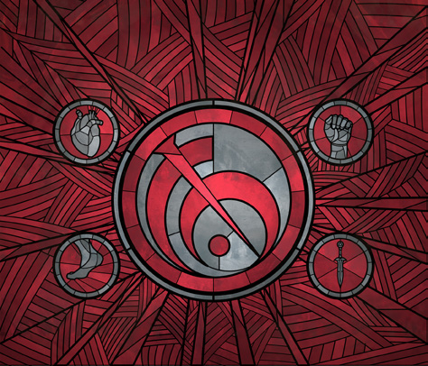
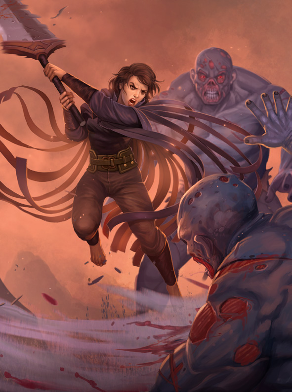
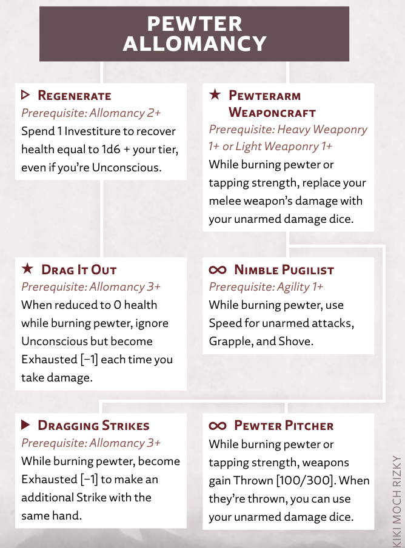

### 白鑞鎔金術（Pewter Allomancy）

實體（Physical）－內部（Internal）－推力（Pushing）

白鑞（Pewter）鎔金術（Allomancy）能大幅提升你的身體能力與體質。燃燒白鑞時，人們常採用能充分發揮增強後力量與速度的戰鬥風格。這些風格通常以擒抱（Grapple）、徒手搏鬥或臨時武器（Improvised Weapon）戰鬥為主，因此這些鎔金術師（Allomancer）也被稱為白鑞臂（Pewterarm）或打手（Thug）。燃燒白鑞會讓你感覺不到疲勞的影響，使你能長時間驅策身體、挑戰極限，這通常稱為白鑞延燒（Pewter Dragging）。不過，一旦停止燃燒白鑞，累積的疲勞就會立刻全部襲來。

### 燃燒白鑞（Burn Pewter）

啟動（Activation）：[1行動]

持續時間：1回合（Round）

燃燒白鑞時，花費至少1點授予（Investiture），最多不超過你的金屬技藝上限（Metallic Art Limit），獲得以下好處，直到你的下一個輪次（Turn）結束：

- 你獲得增益（Enhanced）[速度（Speed）]與增益[力量（Strength）]。這兩項屬性（attribute）的加值，等於你為燃燒白鑞花費的授予點數的一半，無條件進位。

- 如果你處於精疲力竭（Exhausted）狀態，在燃燒結束前，你的檢定（Test）結果不會套用該懲罰。

白鑞燃燒完畢前，你可以用[自由行動]花費至少1點授予，將燃燒效果維持相同的時間。

### 運用白鑞鎔金術

除了上述能力規則，運用這項能力時，也可以參考以下指引。

### 創意運用

我們鼓勵你自行發想白鑞鎔金術的用途，例如以下幾種，並與GM討論如何判定：

**加速旅行（Expedited Travel）。** 藉由白鑞延燒長途奔跑，大幅加快旅行速度。你甚至可以拉著載有其他角色（Character）的手推車或馬車，縮短他們的旅行時間。以此方式白鑞延燒時，每隔一段由GM決定的時間，你就會陷入精疲力竭[−1]。

**代謝過濾（Metabolic Filtering）。** 燃燒白鑞期間，酒精、藥物與毒物等致醉或有毒物質，會更快排出你的體外。

### 白鑞鎔金術天賦（talent）

以下依英文字母順序列出的天賦，都出現在白鑞鎔金術天賦樹（talent tree）中。你可以透過迷霧人（Misting）、雙生師（Twinborn）與迷霧之子（Mistborn）路徑（Path）的關鍵天賦（Key Talent），或透過血金術尖刺（Hemalurgic Spike），解鎖這棵天賦樹。

#### 延燒續戰（Drag It Out）

前提條件（Prerequisite）：鎔金術3+；再生（Regenerate）天賦

啟動：[特殊啟動]

身受重傷時，你仍能繼續戰鬥，直到白鑞儲備耗盡，或身體終於撐不住為止。

燃燒白鑞期間，若你的生命值（Health）降至0，你可以選擇忽略昏迷（Unconscious）狀態（Condition），但仍會照常承受傷勢（Injury）。燃燒結束時，如果你的生命值仍為0，你就會陷入昏迷。當你處於0生命值，並正忽略昏迷狀態時，每次受到傷害（Damage），還會陷入精疲力竭[−1]。

#### 延燒打擊（Dragging Strikes）

前提條件：鎔金術3+；白鑞臂武技（Pewterarm Weaponcraft）天賦

啟動：[1行動]

燃燒白鑞讓你能大幅超越身體極限，對敵人發動毫不間斷的攻勢。

燃燒白鑞期間，你選擇陷入精疲力竭[−1]，接著用本輪次已經用來打擊（Strike）過的那隻手，額外使用一次打擊行動（Action）。

第6章：金屬技藝（Metallic Arts）　203

AUSTIN HARTELL

#### 靈活拳手（Nimble Pugilist）

前提條件：敏捷（Agility）1+；白鑞臂武技天賦

啟動：[常駐]

你燃燒白鑞，靈巧地穿梭於敵人之間；即使赤手空拳，也是不容小覷的對手。

燃燒白鑞期間，你可以用速度屬性取代力量，進行徒手攻擊（Unarmed Attack）、擒抱行動與推撞（Shove）行動。（這也包括使用速度進行這些運動（Athletics）檢定，以及決定你的徒手傷害骰。）

#### 白鑞臂武技

前提條件：重型武器（Heavy Weaponry）1+或輕型武器（Light Weaponry）1+；白鑞鎔金術能力

啟動：[特殊啟動]

你能更精巧地運用白鑞增強的蠻力，將這股力量更有效地發揮在武器上。

當你正在燃燒白鑞，或從白鑞意識（Pewtermind）汲取（Tap）力量，並進行近戰（Melee）武器攻擊（Weapon Attack）時，你可以改為造成徒手攻擊的傷害，而非通常的傷害。（你必須在擲骰前決定，武器原本的傷害類型與特性仍然適用。）

#### 白鑞投手（Pewter Pitcher）

前提條件：白鑞臂武技天賦

啟動：[常駐]

多虧白鑞，就連沉重的武器也能在必要時成為投射物。

當你正在燃燒白鑞，或從白鑞意識汲取力量時，你會獲得以下好處：

- 你使用的武器獲得投擲（Thrown）[100/300]特性。

- 使用具有投擲特性的武器進行遠程（Ranged）攻擊時，你可以使用白鑞臂武技，視同這次進行的是近戰武器攻擊。

#### 再生

前提條件：鎔金術2+；白鑞鎔金術能力

啟動：[自由行動]

即使昏迷不醒，你也能燃燒白鑞，加快身體恢復。

花費1點授予，恢復等於1d6＋你目前階層（Tier）的生命值。例如，階層2的角色會恢復1d6＋2點生命值。即使你處於昏迷，或因其他原因無法使用行動，你仍可使用這個自由行動（Free Action）。

### 白鑞鎔金術天賦樹

#### 再生

啟動：[自由行動]

前提條件：鎔金術2+

解鎖來源：白鑞鎔金術能力

花費1點授予，恢復等於1d6＋你階層的生命值，即使昏迷時也能使用。

#### 白鑞臂武技

啟動：[特殊啟動]

前提條件：重型武器1+或輕型武器1+

解鎖來源：白鑞鎔金術能力

燃燒白鑞或汲取力量期間，以徒手傷害骰取代近戰武器的傷害。

#### 延燒續戰

啟動：[特殊啟動]

前提條件：鎔金術3+

解鎖來源：再生天賦

燃燒白鑞期間，生命值降至0時，忽略昏迷，但每次受到傷害時都陷入精疲力竭[−1]。

#### 靈活拳手

啟動：[常駐]

前提條件：敏捷1+

解鎖來源：白鑞臂武技天賦

燃燒白鑞期間，以速度進行徒手攻擊、擒抱與推撞。

#### 延燒打擊

啟動：[1行動]

前提條件：鎔金術3+

解鎖來源：白鑞臂武技天賦

燃燒白鑞期間，陷入精疲力竭[−1]，以同一隻手額外進行一次打擊。

#### 白鑞投手

啟動：[常駐]

解鎖來源：白鑞臂武技天賦

燃燒白鑞或汲取力量期間，武器獲得投擲[100/300]。投擲武器時，你可以使用徒手傷害骰。

KIKI MOCH RIZKY

