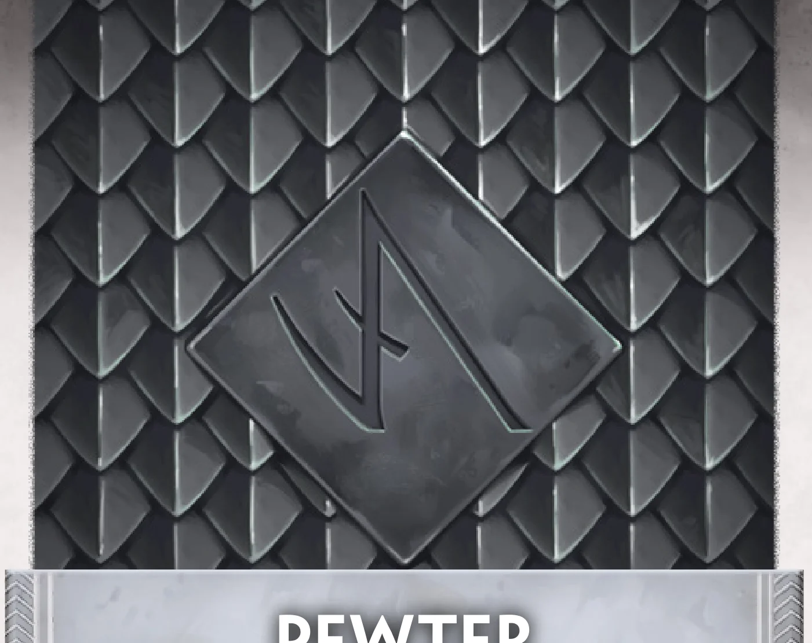
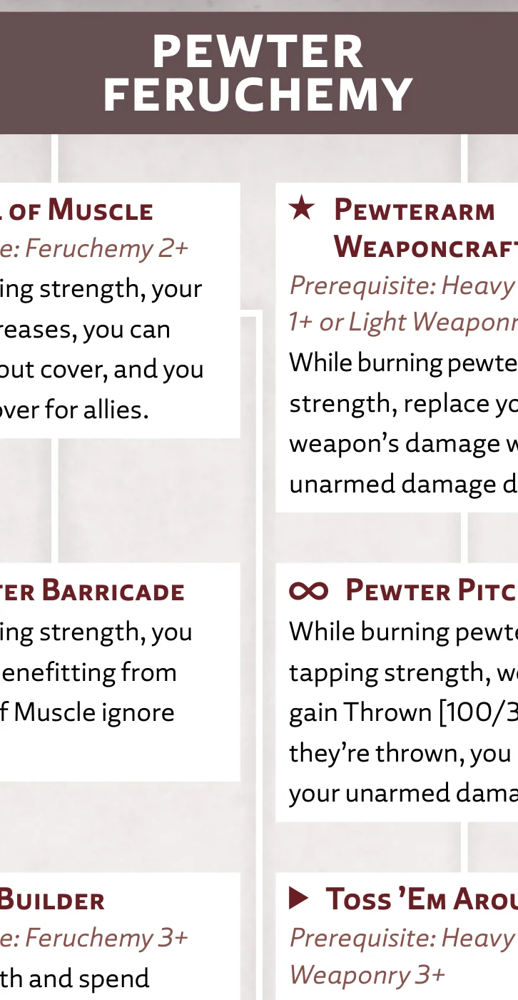
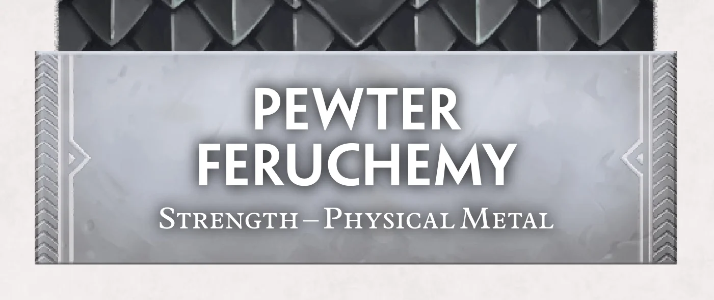

### 白鑞藏金術（Pewter Feruchemy）

力量（Strength）—實體金屬（Physical Metal）

透過白鑞藏金術，你可以將力量儲存在白鑞意識（Pewtermind）中，儲存時會變得瘦弱無力。日後汲取（Tap）這些力量時，你的體型（Size）與肌肉量會增加，力氣與塊頭也隨之增長。白鑞藏金術師（Feruchemist）又被稱為蠻力（Brute）；他們佩戴的白鑞金屬意識庫（Metalmind）能夠伸展，配合佩戴者各種大小的體型。

### 儲存力量（Store Strength）

啟動（Activation）：[1行動]

持續時間：每個場景（Scene）1點充能（Charge）

持續儲存力量，直到你以[自由行動]結束效果，或花費白鑞意識的一點充能為止。儲存力量期間，你會受到下列效果：

- 你陷入減損（Diminished）[力量−1]。

- 使用力量屬性（attribute）的檢定（Test）獲得一個劣勢（Disadvantage）。

每個場景結束後，若你在整個場景中都持續儲存力量，白鑞意識便獲得1點充能。

### 汲取力量（Tap Strength）

啟動：[1行動]

持續時間：與你的藏金術（Feruchemy）技能等級（Rank）相同數量的回合（Round）

花費白鑞意識的1點充能來汲取力量，持續與你的藏金術技能等級相同數量的回合，或直到你開始儲存力量為止。汲取力量期間，你會受到下列效果：

- 你獲得增益（Enhanced）[力量+2]。

- 使用力量屬性進行非攻擊檢定時，獲得一個優勢（Advantage）。

力量汲取結束前，你可以用[自由行動]花費白鑞意識的1點充能，將其維持相同的時間。

### 白鑞藏金術天賦樹（talent tree）

#### 肌肉之牆（Wall of Muscle）

啟動：[常駐]

前提條件（Prerequisite）：藏金術2+

解鎖來源：白鑞藏金術能力

汲取力量期間，你的偏轉值（Deflect）增加；你可以在沒有掩護（Cover）時架防（Brace），並視為盟友（Ally）的掩護。

#### 白鑞臂武技（Pewterarm Weaponcraft）

啟動：[特殊啟動]

前提條件：重型武器（Heavy Weaponry）1+或輕型武器（Light Weaponry）1+

解鎖來源：白鑞藏金術能力

燃燒白鑞（Burn Pewter）或汲取力量期間，以徒手傷害骰取代近戰武器的傷害（Damage）。

#### 白鑞屏障（Pewter Barricade）

啟動：[常駐]

解鎖來源：肌肉之牆天賦（talent）

汲取力量期間，你與受益於肌肉之牆的盟友忽略穿刺（Pierce）。

#### 白鑞投手（Pewter Pitcher）

啟動：[常駐]

解鎖來源：白鑞臂武技天賦

燃燒白鑞或汲取力量期間，武器獲得投擲（Thrown）[100/300]。投擲武器時，你可以使用徒手傷害骰。

#### 健美者（Body Builder）

啟動：[特殊啟動]

前提條件：藏金術3+

解鎖來源：肌肉之牆天賦

汲取力量時花費額外充能，縮短持續時間並增強效果，同時讓你的體型增加一級。

#### 拋來擲去（Toss ’Em Around）

啟動：[1行動]

前提條件：重型武器3+

解鎖來源：白鑞投手天賦

汲取力量期間，將一名盟友或受束縛（Restrained）的敵人扔到最多100呎外；若扔的是敵人，還會對其造成傷害。

### 運用白鑞藏金術

除了上述能力規則，運用這項能力時，也可以參考以下指引。

### 創意運用

我們鼓勵你自行發想白鑞藏金術的創意用途，例如以下幾種，並與GM討論如何判定：

**展現力量（Display of Strength）。** 進行威嚇（Intimidation）檢定時汲取力量，讓自己看來更具威脅。

**不起眼的鬥士（Unremarkable Fighter）。** 儲存力量，讓人覺得你很弱，避開傲慢鬥士或其他敵手（adversary）的注意。

**調整體型（Size Adjustment）。** 儲存力量，減少肌肉量，更容易穿過狹窄的空間。

### 白鑞藏金術天賦

以下依英文字母順序列出的天賦，都出現在白鑞藏金術天賦樹中。你可以透過單藏金術師（Ferring）、雙生師（Twinborn）與藏金術師路徑（Path）的關鍵天賦（Key Talent），或透過血金術尖刺（Hemalurgic Spike），解鎖這棵天賦樹。

JANETTE RAMOS

第6章：金屬技藝（Metallic Arts）　241

### 健美者

前提條件：藏金術3+；肌肉之牆天賦

啟動：[特殊啟動]

你能精準控制自己的肌肉。

汲取力量時，你可以不只花費1點充能，改為花費任意數量的充能，最多不超過你的金屬技藝上限（Metallic Art Limit）。這麼做時，改為獲得下列效果，直到你的下一個輪次（Turn）結束，取代通常的效果與持續時間：

- 你獲得增益[力量]。該屬性的加值，等於1加上你為汲取力量花費的充能點數。

- 當你進行使用力量屬性的檢定時，例如徒手攻擊（Unarmed Attack），獲得的優勢數量等於你為汲取力量花費的充能點數的一半，無條件進位。

- 你的體型增加一級。

這次力量汲取結束前，你可以用[自由行動]花費白鑞意識中至少1點充能，將其維持相同的時間。

### 白鑞臂武技

前提條件：重型武器1+或輕型武器1+；白鑞藏金術能力

啟動：[特殊啟動]

你能更精巧地運用白鑞增強的蠻力，將這股力量更有效地發揮在武器上。

當你正在燃燒白鑞，或從白鑞意識汲取力量，並進行近戰（Melee）武器攻擊（Weapon Attack）時，你可以改為造成徒手攻擊的傷害，而非通常的傷害。（你必須在擲骰前決定，武器原本的傷害類型與特性仍然適用。）

### 白鑞屏障

前提條件：肌肉之牆天賦

啟動：[常駐]

增強的肌肉更加緊實，也更難突破。

汲取力量期間，對你或受到肌肉之牆掩護的盟友發動攻擊時，該攻擊無法受益於穿刺武器特性。

### 白鑞投手

前提條件：白鑞臂武技天賦

啟動：[常駐]

多虧白鑞，就連沉重的武器也能在必要時成為投射物。

當你正在燃燒白鑞，或從白鑞意識汲取力量時，你會獲得以下好處：

- 你使用的武器獲得投擲[100/300]特性。

- 使用具有投擲特性的武器進行遠程（Ranged）攻擊時，你可以使用白鑞臂武技，視同這次進行的是近戰武器攻擊。

### 拋來擲去

前提條件：重型武器3+；白鑞投手天賦

啟動：[1行動]

增強的力量讓你能輕而易舉地將敵人扔來扔去。

汲取力量期間，選擇你100呎內地面上的一個目標（Target）或位置，用一隻空手，將一名自願的盟友或受束縛的敵人扔向該目標。被你扔出的角色（Character）必須在你的觸及範圍（Reach）內，且體型最多只能比你大一級。扔出該角色時，套用下列效果：

**盟友。** 盟友安全地落在最靠近目標、且未被佔據的空間。

**敵人。** 你將敵人當成具有投擲特性的臨時（Improvised）重型武器，進行一次遠程武器攻擊。不論攻擊檢定結果如何，被扔出的敵人都會受到傷害，視同被該次攻擊命中（Hit）。

### 肌肉之牆

前提條件：藏金術2+；白鑞藏金術能力

啟動：[常駐]

增加的肌肉量，讓懂得運用它的人獲得更好的防護。

汲取力量期間，你還會獲得下列效果：

- 你的偏轉值增加等同於你為汲取力量花費的充能點數的一半，無條件進位。

- 你可以將增強的肌肉當成盾牌，即使附近沒有掩護，也能架防。

- 你視為盟友的掩護，詳見第10章「地形（Terrain）」。

第6章：金屬技藝　242
