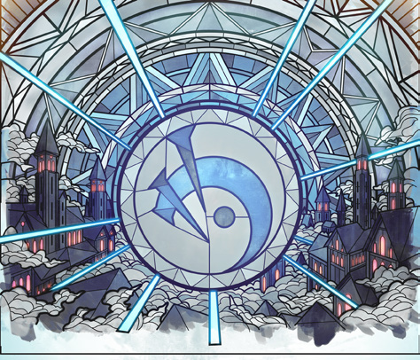
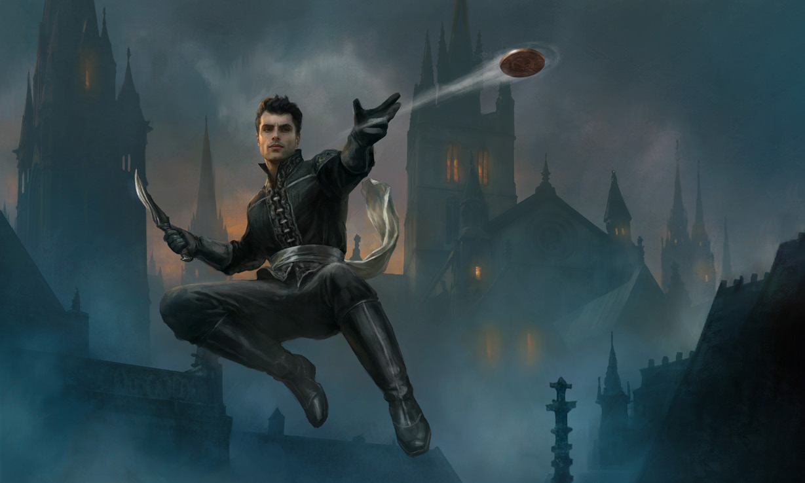
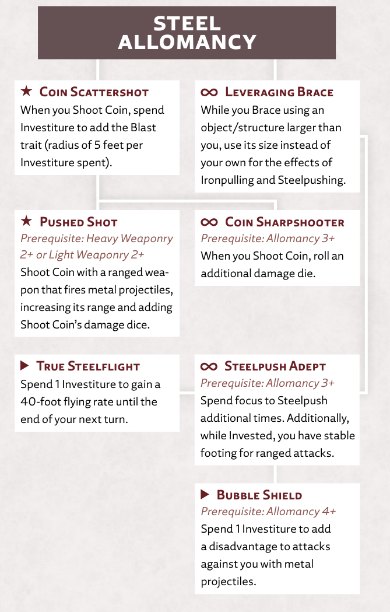

### 鋼鎔金術（Steel Allomancy）

實體（Physical）—外部（External）—推力（Pushing）

鋼鎔金術讓你看見藍色線條，從自己的質心延伸到附近金屬物體的質心。你可以對這些金屬施展鋼推（Steelpush），讓自己或物體遠離另一方；哪一方會移動，取決於哪一方比較龐大。鋼鎔金術師（Allomancer）能以致命的速度射出小型金屬物體，因此許多人稱他們為射幣（Coinshot）。

### 燃燒鋼（Burn Steel）

啟動（Activation）：[1行動]

持續時間：1回合（Round）

只要你還有至少1點授予（Investiture），就能燃燒少量的鋼，而不必花費授予。直到你的下一個輪次（Turn）結束，你都能感知金屬技藝距離（Metallic Art Range）內的每一處金屬，並得知其體型（Size），但有以下限制：

- 你無法用這項能力感知鋁（Aluminum）。

- 除非你的鎔金術（Allomancy）技能等級（Rank）達到6級以上，否則你無法感知受授予的（Invested）物品，例如金屬意識庫（Metalmind）與血金術尖刺（Hemalurgic Spike），也無法感知任何至少有一部分嵌入角色（Character）體內的物品，例如穿環。

鋼燃燒完畢前，只要你還有至少1點授予，就可以使用[自由行動]，將燃燒效果維持相同的時間。

### 鋼推

啟動：[1行動]

持續時間：瞬間

燃燒鋼期間，花費至少1點授予，最多不超過你的金屬技藝上限（Metallic Art Limit），對你以這項能力感知到的一個金屬物體施展鋼推。選擇以下一種效果：

**移動（Propel）。** 你與物體之中體型較小的一方，會被鋼推沿直線推離另一方；每花費1點授予，最多移動20呎。如果你與物體的體型相同，由你選擇要移動自己還是物體。如果你將物體推向另一個夠大的物體或表面，例如建築物或地面，被鋼推的物體會在撞上後停止移動，接著改由你移動剩下的距離。

**射出錢幣（Shoot Coin）。** 如果物體比你小，你可以對它施展鋼推，每花費1點授予，最多將它推出20呎，力道足以使其成為危險的投射物。對這段距離內一個目標（Target）的實體防禦（Physical Defense），進行一次遠程（Ranged）鎔金術攻擊（Attack），擲出1d4衝擊傷害（Impact Damage）。這次擲骰使用你的金屬技藝骰（Metallic Art Die），因此骰型（Die Size）會隨你的鎔金術技能等級提高；2級時改擲1d6，而非1d4，依此類推。（這視為使用金屬投射物的武器攻擊（Weapon Attack）。）

如果要移動固定在其他物體上的物體，或由角色穿戴、持握的物體，則將兩者的體型合併計算，判定哪一方會移動。

### 運用鋼鎔金術

除了上述能力規則，運用這項能力時，也可以參考以下指引。

### 困難的鋼推

大多數鋼推都不需要檢定（Test）。不過，當你嘗試格外棘手、富有創意或危險的做法時，GM可能會要求你使用鎔金術或相關的普通技能（skill）進行檢定。

#### GM提示：體型與重量

在《迷霧之子》（Mistborn）小說中，鐵與鋼鎔金術的效果，取決於鎔金術師與所選物體之間的相對重量。《寰宇 RPG》（Cosmere RPG）則改用體型判定這些能力的效果。這能讓遊戲進行得更順暢，免去在場景（Scene）中途計算各種重量的麻煩。不過，GM可以自行判斷，有些場景可能適合改用重量，而非體型。

第6章：金屬技藝（Metallic Arts）　205

AUSTIN HARTELL

### 創意運用

許多射幣會隨身攜帶一袋袋錢幣或其他金屬碎片，在非金屬的物體與構造物上充當施力支點。我們鼓勵你自行發想鋼鎔金術的創意用途，例如以下幾種，並與GM討論如何判定：

**「飛行」（Flying）。** 對固定住或比你大的物體，朝斜下方施展鋼推，讓自己騰空而起，沿直線飛行，最遠不超過這次鋼推的距離。GM可能會要求你進行鎔金術檢定，也可能提高賭注（Raise the Stakes）。失敗時，你會安全落地，但落在預期以外的位置。GM可以花費[變故]（Complication），讓你重重落地，受到墜落傷害。

**傳遞物件（Passing an Object）。** 對物體施展鋼推，將它推向願意接收的盟友（Ally）；只要對方有一隻空手，就能接住。如果你們之間有任何明顯的障礙物，就進行鎔金術檢定，判定是否成功。

### 鋼鎔金術天賦（talent）

以下依英文字母順序列出的天賦，都出現在鋼鎔金術天賦樹（talent tree）中。你可以透過迷霧人（Misting）、雙生師（Twinborn）與迷霧之子路徑（Path）的關鍵天賦（Key Talent），或透過血金術尖刺，解鎖這棵天賦樹。

#### 球形護盾（Bubble Shield）

前提條件（Prerequisite）：鎔金術4+；鋼推專家（Steelpush Adept）天賦

啟動：[1行動]

你朝四面八方施展微弱的鋼推，讓自己得到一些抵擋金屬投射物的保護。

花費1點授予，在自己周圍建立一個鋼推球形區域，直到你的下一個輪次結束。持續期間，當你成為遠程攻擊的目標，而該攻擊使用你能以這項能力感知到的金屬投射物時，該攻擊獲得一個劣勢（Disadvantage），且對你造成擦傷（Graze）時，需要額外花費1點專注點（Focus）。這項效果結束前，你可以用[自由行動]花費1點授予，將其維持相同的時間。

#### 錢幣散射（Coin Scattershot）

前提條件：鋼鎔金術

啟動：[特殊啟動]

你抓起一把錢幣、彈殼或其他細小的金屬物件，朝一個集中的範圍散射。

使用鋼推進行射出錢幣攻擊之前，你可以額外花費授予，最多不超過你的金屬技藝上限，讓這次攻擊獲得爆破（Blast）武器特性。該特性的半徑為額外花費的授予點數乘以5呎。

*詹（Zane）懸浮在空中，以不可思議的精準度射出一枚錢幣。*

GAL OR

#### 錢幣神射（Coin Sharpshooter）

前提條件：鎔金術3+；錢幣散射天賦

啟動：[常駐]

你射出的錢幣精準致命。

當你使用鋼推進行射出錢幣攻擊時，額外擲一顆相同骰型的傷害骰。

#### 借力架防（Leveraging Brace）

前提條件：鋼鎔金術能力

啟動：[常駐]

你利用較大物體的重量，增加自身的分量。

使用比你大的物體或構造物架防（Brace），並正受益於架防行動（Action）時，你會獲得以下好處：

- 你可以用該物體的體型取代自己的體型，判定鐵拉（Ironpull）與鋼推行動的效果。

- 對原本與你同體型或更小的物體施展鐵拉或鋼推時，你進行的鎔金術檢定獲得一個優勢（Advantage）。

#### 鋼推射擊（Pushed Shot）

前提條件：重型武器（Heavy Weaponry）2+或輕型武器（Light Weaponry）2+；錢幣散射天賦

啟動：[特殊啟動]

彈藥飛向目標時，你對彈藥施展鋼推，增強遠程武器的威力。

當你使用鋼推進行射出錢幣攻擊時，可以改用一把遠程武器進行攻擊，而非一般的鎔金術攻擊。該武器必須發射你能以這項能力感知到的金屬投射物。進行這次攻擊時，使用該武器的距離，但每花費1點授予，其短距離（Short Range）與長距離（Long Range）便各增加20呎，並將射出錢幣的傷害骰加入該武器的傷害（Damage）。

#### 鋼推專家

前提條件：鎔金術3+；借力架防天賦

啟動：[常駐]

對你而言，施展鋼推已經像活動自己的身體一樣自然。

你每個輪次可以使用鋼推行動不只一次。同一輪次中，第一次之後每次再使用鋼推，都必須額外花費1點專注點，其他成本仍照常支付。此外，只要你還有至少1點授予，進行遠程攻擊時，就視為有穩固的立足點。

#### 真正的鋼推飛行（True Steelflight）

前提條件：鋼推專家天賦

啟動：[1行動]

你已精通對錢幣、彈殼等細小金屬物體施展鋼推，將它們抵在表面，讓自己流暢地飛行於空中。

花費1點授予，獲得40呎的飛行速率，直到你的下一個輪次結束。飛行期間，穩固的構造物或地面必須始終位於你的金屬技藝距離內。這項效果結束前，你可以用[自由行動]花費1點授予，將其維持相同的時間。

### 鋼鎔金術天賦樹

#### 錢幣散射

啟動：[特殊啟動]

解鎖來源：鋼鎔金術能力

射出錢幣時，花費授予，加入爆破特性，半徑為每花費1點授予5呎。

#### 借力架防

啟動：[常駐]

解鎖來源：鋼鎔金術能力

使用比你大的物體或構造物架防時，以它的體型取代你自己的體型，判定鐵拉與鋼推的效果。

#### 鋼推射擊

啟動：[特殊啟動]

前提條件：重型武器2+或輕型武器2+

解鎖來源：錢幣散射天賦

用發射金屬投射物的遠程武器射出錢幣，增加其距離，並加入射出錢幣的傷害骰。

#### 錢幣神射

啟動：[常駐]

前提條件：鎔金術3+

解鎖來源：錢幣散射天賦

射出錢幣時，額外擲一顆傷害骰。

#### 真正的鋼推飛行

啟動：[1行動]

解鎖來源：鋼推專家天賦

花費1點授予，獲得40呎飛行速率，直到你的下一個輪次結束。

#### 鋼推專家

啟動：[常駐]

前提條件：鎔金術3+

解鎖來源：借力架防天賦

花費專注點，額外使用鋼推。此外，受授予期間，進行遠程攻擊時有穩固的立足點。

#### 球形護盾

啟動：[1行動]

前提條件：鎔金術4+

解鎖來源：鋼推專家天賦

花費1點授予，讓以金屬投射物對你發動的攻擊獲得一個劣勢。

第6章：金屬技藝　207

