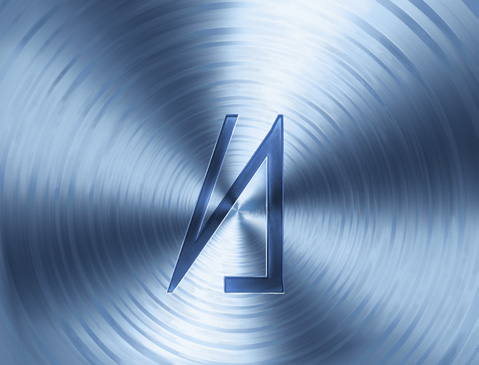
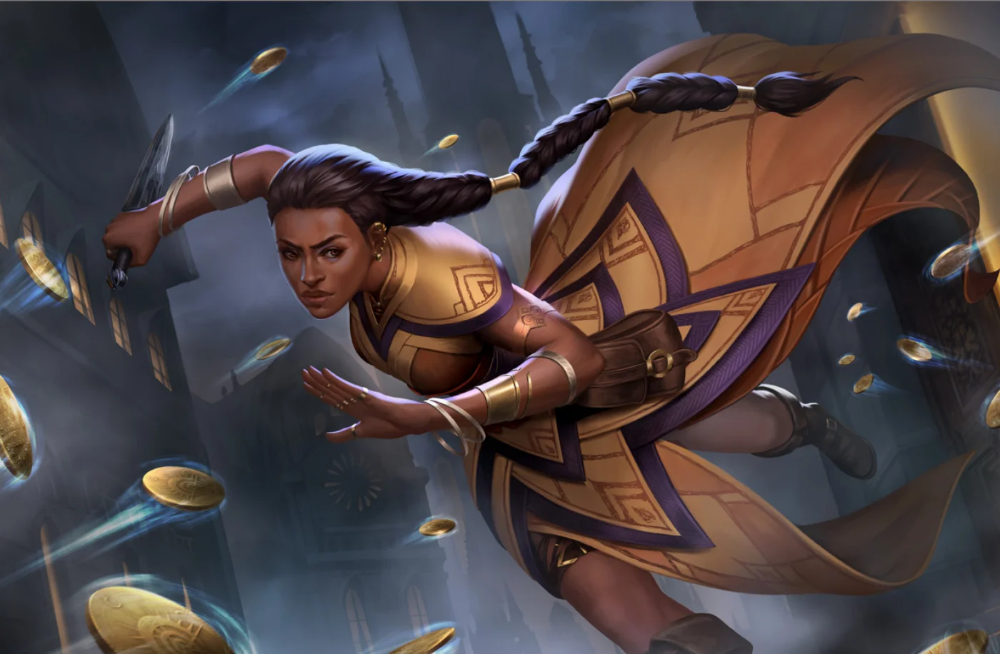

### 鋼藏金術（Steel Feruchemy）

速度（Speed）—實體金屬（Physical Metal）

鋼藏金術讓你將身體的速度儲存在鋼意識（Steelmind）中。儲存時，你的動作會變得遲緩，彷彿正試著穿過糖蜜。汲取（Tap）速度時，你則能以平常好幾倍的速度移動；如果一次汲取足夠的速度，甚至可能快到旁人的目光都跟不上。鋼藏金術師（Feruchemist）被稱為鋼奔（Steelrunner），奔跑時必須小心摩擦力與風阻。不過，他們的身體也會部分適應增加的速度，讓他們承受加速的力量，並像以平常速度移動時一樣理解周遭情況。

### 儲存速度（Store Speed）

啟動（Activation）：[1行動]

持續時間：每個場景（Scene）1點充能（Charge）

持續儲存速度，直到你以[自由行動]結束效果，或花費鋼意識的一點充能為止。儲存速度期間，你會受到下列效果：

- 你陷入減損（Diminished）[速度−1]。

- 你的每個輪次（Turn）只能使用一次移動（Move）行動。

每個場景結束後，若你在整個場景中都持續儲存速度，鋼意識便獲得1點充能。

### 汲取速度（Tap Speed）

啟動：[1行動]

持續時間：與你的藏金術（Feruchemy）技能等級（Rank）相同數量的回合（Round）

花費鋼意識的1點充能來增加速度，持續與你的藏金術技能等級相同數量的回合，或直到你開始儲存速度為止。汲取速度期間，你會受到下列效果：

- 你獲得增益（Enhanced）[速度+2]。

- 你的每個輪次各有一次，可以用[自由行動]移動。

速度汲取結束前，你可以用[自由行動]花費鋼意識的1點充能，將其維持相同的時間。

### 運用鋼藏金術

除了上述能力規則，運用這項能力時，也可以參考以下指引。

### 創意運用

我們鼓勵你自行發想鋼藏金術的創意用途，例如以下幾種，並與GM討論如何判定：

**假死（Faking Death）。** 儲存速度，讓心跳與代謝過程減慢到看起來像是死去的程度。

**虛假隊伍（False Squadron）。** 汲取速度，在周遭環境中飛快移動，短暫營造出同時出現在多個地方的假象。

**悄行（Slinking）。** 在視線受遮蔽的環境中儲存速度，讓動作更緩慢、謹慎，降低自己引起的注意。

### 鋼藏金術天賦（talent）

以下依英文字母順序列出的天賦，都出現在鋼藏金術天賦樹（talent tree）中。你可以透過單藏金術師（Ferring）、雙生師（Twinborn）與藏金術師路徑（Path）的關鍵天賦（Key Talent），或透過血金術尖刺（Hemalurgic Spike），解鎖這棵天賦樹。

JANETTE RAMOS

第6章：金屬技藝（Metallic Arts）　243

### 加速反應（Accelerated Reflexes）

前提條件（Prerequisite）：藏金術3+；疾速閃避（Hastened Dodge）天賦

啟動：[1行動]

你學會以汲取速度來加快反應，接連回應多次刺激。

汲取速度或心智速度（Mental Speed）期間，花費對應的鋼意識或鋅意識（Zincmind）的1點充能，加快反應，直到你的下一個輪次開始。持續期間，除你以外的每名角色（Character），在其輪次開始時，你都會獲得一個額外的[反應]，持續到該輪次結束。

### 疾速閃避

前提條件：鋼藏金術能力

啟動：[常駐]

汲取速度讓你更善於閃避攻擊。

汲取速度期間，當你使用閃避（Dodge）反應（Reaction）時，觸發該反應的攻擊（Attack）無法對你造成擦傷（Graze）。

### 再來一次（Run It Back）

前提條件：藏金術2+；鋼藏金術能力

啟動：[1行動]

強化的速度，常讓你能在敵人反應過來之前，再施展一次相同的戰術。

汲取速度期間，花費1點專注點（Focus），使用一次你在這個輪次已經使用過的行動（Action）。該行動的費用必須是[1行動]，但你不需再次支付這項費用，只需支付啟動本天賦的費用。此外，你必須在該行動中進行一次實體（Physical）檢定（Test），例如獲取優勢（Gain Advantage）、打擊（Strike）或使用技能（Use a Skill）。

### 速度爆發（Speed Burst）

前提條件：藏金術3+；再來一次天賦

啟動：[自由行動]

汲取鋼意識時，你動作快得足以完成好幾個人的工作。

汲取速度期間，花費鋼意識的1點充能，獲得[2行動]。這些行動只能用於以下行動：架防（Brace）、脫離（Disengage）、互動（Interact）、移動，或任何會進行實體檢定的行動。在對話（Conversation）或試煉（Endeavor）中，你可以改為花費這全部[2行動]，在該回合額外進行一次貢獻（Contribution）；但這次貢獻仍僅限使用上述行動。

### 鋼藏金術天賦樹

#### 疾速閃避

啟動：[常駐]

解鎖來源：鋼藏金術能力

汲取速度期間閃避時，你不會受到擦傷。

#### 再來一次

啟動：[1行動]

前提條件：藏金術2+

解鎖來源：鋼藏金術能力

汲取速度期間，花費1點專注點，再次使用一個行動。該行動必須包含實體檢定。

#### 加速反應

啟動：[1行動]

前提條件：藏金術3+

解鎖來源：疾速閃避天賦

汲取速度或心智速度期間，花費1點充能，在每名角色的輪次中獲得[反應]。

#### 速度爆發

啟動：[自由行動]

前提條件：藏金術3+

解鎖來源：再來一次天賦

汲取速度期間，花費1點充能，獲得[2行動]，用於架防、脫離、互動、移動或實體檢定。

#### 真正的鋼奔（True Steelrunning）

啟動：[特殊啟動]

解鎖來源：加速反應天賦或速度爆發天賦

汲取速度時花費額外充能，縮短持續時間並增強效果。此外，你每個輪次可以用[自由行動]移動，次數與花費的充能點數相同。

#### 鋼奔疾跑（Steelsprinter）

啟動：[特殊啟動]

解鎖來源：再來一次天賦

在場景開始前花費1點充能，便能在場景開始時獲得[2行動]，或額外進行一次貢獻。

> 審判者（Inquisitor）的速度猛然加快。他的身影變得模糊，依藍戴（Elend）一劍揮去，卻只砍中空氣。依藍戴轉過身，臉上露出震驚的神情。審判者逼近，手裡握的不是斧頭，而是——奇怪的是——一根金屬尖刺，像他自己身上的那些，卻更纖細修長。那生物舉起尖刺，快得不像人類，甚至比任何鎔金術師（Allomancer）應有的速度還快。

第6章：金屬技藝　244

### 鋼奔疾跑

前提條件：再來一次天賦

啟動：[特殊啟動]

你汲取速度，跑到隊伍前方，便能在其他人抵達前採取行動。

場景開始之前，你可以花費鋼意識的1點充能，提早抵達目的地。若你在戰鬥（Combat）中這麼做，並在第一個回合選擇快速輪次（Fast Turn），便會額外獲得[2行動]。若你在對話或試煉中這麼做，則能在第一個回合額外進行一次貢獻。

### 真正的鋼奔

前提條件：加速反應天賦或速度爆發天賦

啟動：[特殊啟動]

一次汲取大量速度，讓你化為模糊的身影。

汲取速度時，你可以不只花費1點充能，改為花費任意數量的充能，最多不超過你的金屬技藝上限（Metallic Art Limit）。這麼做時，你會獲得下列效果，持續到你的下一個輪次結束，取代通常的效果與持續時間：

- 你獲得增益[速度]。該屬性（attribute）的加值，等於1加上你為汲取速度花費的充能點數。

- 你的每個輪次都能用[自由行動]移動，最多可使用與你為汲取速度花費的充能點數相同的次數。

這次速度汲取結束前，你可以用[自由行動]花費鋼意識中至少1點充能，將其維持相同的時間。

*一名藏金術師汲取速度，躲避敵方射幣（Coinshot）。*

TU DO

