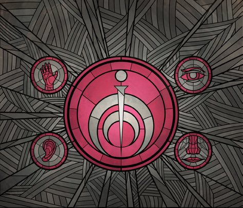
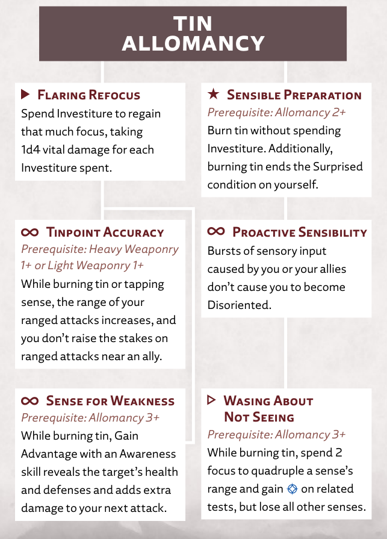

### 錫鎔金術（Tin Allomancy）

實體（Physical）—內部（Internal）—拉引（Pulling）

錫鎔金術能大幅增強你的感官。雖然錫鎔金術師（Allomancer）被稱為錫眼（Tineye），燃燒這種金屬卻會提升所有感官，而不只是視覺。因此，錫眼很適合擔任守衛或斥候，尤其是在光線昏暗的地方。錫眼感到疼痛或疲憊時，有時會驟燒（Flare）錫，藉由強烈的感官刺激震撼身體，讓自己暫時恢復清醒。

### 燃燒錫（Burn Tin）

啟動（Activation）：[1行動]

持續時間：與你的鎔金術（Allomancy）技能等級（Rank）相同數量的回合（Round）

燃燒錫時，花費至少1點授予（Investiture），最多不超過你的金屬技藝上限（Metallic Art Limit），獲得下列收益，持續與你的鎔金術技能等級相同數量的回合：

- 你獲得增益（Enhanced）[察覺（Awareness）]。該屬性（attribute）的加值，等於你為燃燒錫花費的授予點數的一半，無條件進位。

- 你的每一種感官都成為超自然感知（Supernatural Senses），使你更加敏銳，卻也更容易受到影響，詳見第3章「超自然感知」。

錫燃燒結束前，你可以用[自由行動]花費至少1點授予，將其維持相應的時間。

### 運用錫鎔金術

除了上述能力規則，在遊戲中運用這項能力時，也可以參考以下指引。

### 創意運用

我們鼓勵你自行發想錫鎔金術的創意用途，例如以下幾種，並與GM討論如何判定：

**熟悉的感受（Familiar Sensations）。** 嘗試回想景象、氣味或其他感受時，燃燒錫可能幫助你記起更多細節。

**穿透迷霧（Piercing the Mists）。** 錫眼能看穿許多形式的氣態授予，例如司卡德利亞（Scadrial）的迷霧。

### 錫鎔金術天賦（talent）

以下依英文字母順序列出的天賦，都出現在錫鎔金術天賦樹（talent tree）中。你可以透過迷霧人（Misting）、雙生師（Twinborn）與迷霧之子（Mistborn）路徑（Path）的關鍵天賦（Key Talent），或透過血金術尖刺（Hemalurgic Spike），解鎖這棵天賦樹。

#### 驟燒凝神（Flaring Refocus）

前提條件（Prerequisite）：錫鎔金術能力

啟動：[1行動]

你驟燒錫，以片刻的疼痛換取更清醒的頭腦。

花費至少1點授予，恢復相同數量的專注點（Focus）。每花費1點授予，你便受到1d4命力傷害（Vital Damage）。

### 錫鎔金術天賦樹

#### 驟燒凝神

啟動：[1行動]

解鎖來源：錫鎔金術能力

花費授予，恢復相同數量的專注點。每花費1點授予，便受到1d4命力傷害。

#### 感官戒備（Sensible Preparation）

啟動：[特殊啟動]

前提條件：鎔金術2+

解鎖來源：錫鎔金術能力

不花費授予就能燃燒錫。此外，燃燒錫會結束你身上的措手不及（Surprised）狀態（Condition）。

#### 錫感精準（Tinpoint Accuracy）

啟動：[常駐]

前提條件：重型武器（Heavy Weaponry）1+或輕型武器（Light Weaponry）1+

解鎖來源：驟燒凝神天賦

燃燒錫或汲取（Tap）感知時，你的遠程攻擊（Attack）距離增加，而且對盟友（Ally）附近的目標進行遠程攻擊時，不必提高賭注（Raise the Stakes）。

#### 主動感官調控（Proactive Sensibility）

啟動：[常駐]

解鎖來源：感官戒備天賦

你或盟友造成的強烈感官刺激，不會使你陷入迷惑（Disoriented）。

#### 弱點感知（Sense for Weakness）

啟動：[常駐]

前提條件：鎔金術3+

解鎖來源：驟燒凝神天賦

燃燒錫期間，以察覺技能獲取優勢（Gain Advantage），便能得知目標的生命值（Health）與防禦（Defense），並使你下一次攻擊造成額外傷害（Damage）。

#### 不看（Wasing About Not Seeing）

啟動：[自由行動]

前提條件：鎔金術3+

解鎖來源：主動感官調控天賦

燃燒錫期間，花費2點專注點，使一種感官的範圍變為四倍，並在相關檢定（Test）中獲得[機遇]（Opportunity），但會失去所有其他感官。

AUSTIN HARTELL

第6章：金屬技藝（Metallic Arts）　208

#### 主動感官調控

前提條件：感官戒備天賦

啟動：[常駐]

與盟友協調，能幫助你減輕突如其來的感官刺激所造成的影響。

你或盟友造成的強烈感官刺激，不會使你的超自然感知受到過度刺激。因此，面對這類刺激時，你不必進行紀律（Discipline）檢定來避免陷入迷惑。

#### 弱點感知

前提條件：鎔金術3+；驟燒凝神天賦

啟動：[常駐]

增強的感官，讓你在戰鬥中觀察敵人時成為不可或缺的助力。

燃燒錫期間，當你以推理（Deduction）或任何使用察覺屬性的技能成功獲取優勢時，你也會得知目標目前的生命值，以及其實體防禦（Physical Defense）、意識防禦（Cognitive Defense）與靈魂防禦（Spiritual Defense）數值。此外，你在這個輪次（Turn）中下一次對該目標發動的攻擊，會造成額外1d4傷害。這項額外傷害使用你的金屬技藝骰（Metallic Art Die），因此骰型（Die Size）會隨鎔金術技能等級增加；技能等級為2時，擲1d6而非1d4，依此類推。

#### 感官戒備

前提條件：鎔金術2+；錫鎔金術能力

啟動：[特殊啟動]

你幾乎隨時都在燃燒錫，讓人極難悄悄接近你。

燃燒錫時，你可以選擇不花費授予，改為獲得這項能力的效果，視同花費了1點授予。此外，燃燒錫會結束你身上的措手不及狀態，並取回因該狀態而失去的所有行動（Action）或反應（Reaction）。

#### 錫感精準

前提條件：重型武器1+或輕型武器1+；驟燒凝神天賦

啟動：[常駐]

增強的感官幫助你精準地進行長距離攻擊。

燃燒錫或從錫意識（Tinmind）汲取感知時，你會獲得下列收益：

- 你的遠程攻擊的短距離（Short Range）與長距離（Long Range），都增加等同於你的感知範圍（Senses Range）的距離。

- 當你對盟友5呎內、且你能感知到的目標進行遠程攻擊時，你可以選擇不提高賭注。

*紋（Vin）偽裝成法蕾特（Valette），燃燒錫竊聽貴族的談話。*

#### 不看

前提條件：鎔金術3+；主動感官調控天賦

啟動：[自由行動]

你更加擅長控制不同的感官訊息，能專注於單一感官，排除其他感官的干擾。

燃燒錫期間，花費2點專注點，並選擇一種感官。直到你的下一個輪次結束，或直到你停止燃燒錫為止，你會受到下列效果：

- 選擇的感官成為你的主要感官（Primary Sense），而你會失去所有其他感官。

- 你的感知範圍變為四倍。

- 你的每個輪次各有一次，當你進行依賴所選感官的檢定時（由GM判定），你可以選擇在該檢定中獲得一個機遇。

效果結束前，你可以用[自由行動]花費2點專注點，將其維持相同的時間。

第6章：金屬技藝　209

LINDA LITHÉN

