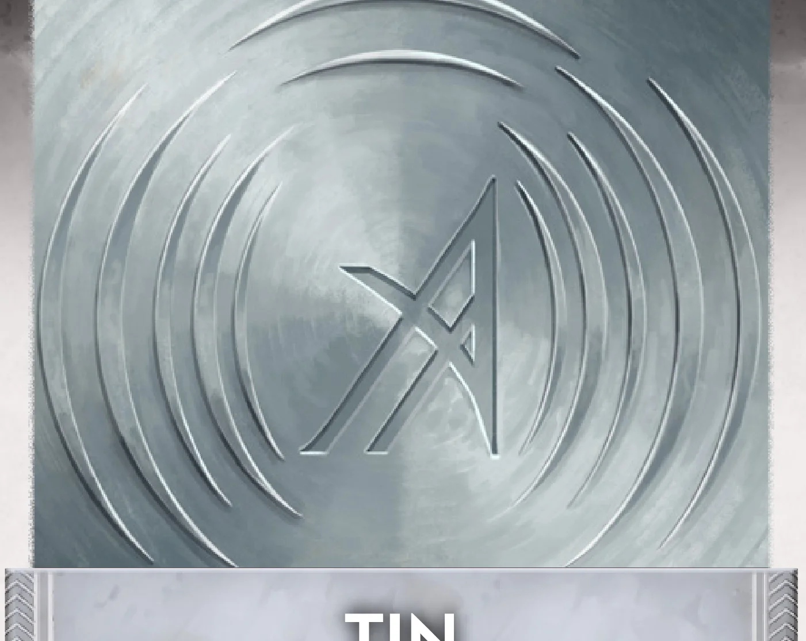
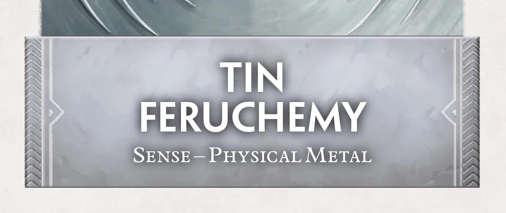
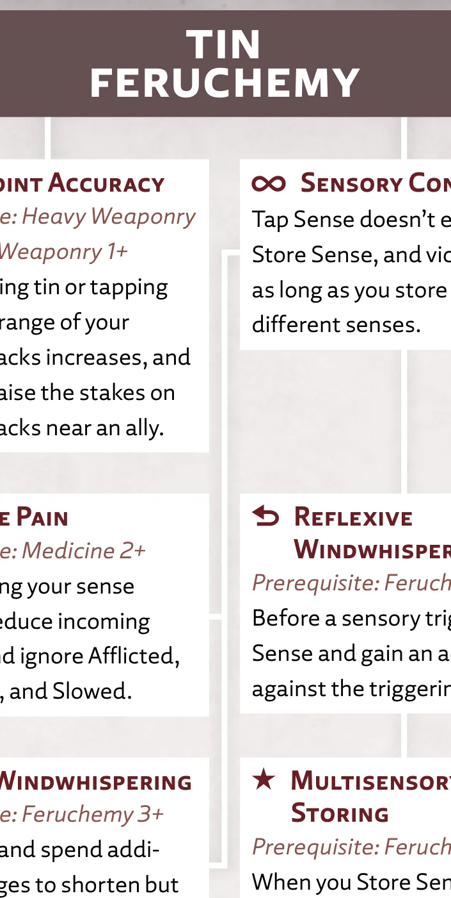
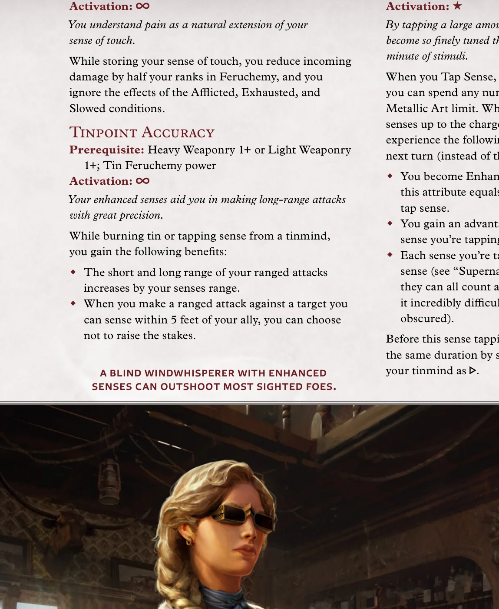
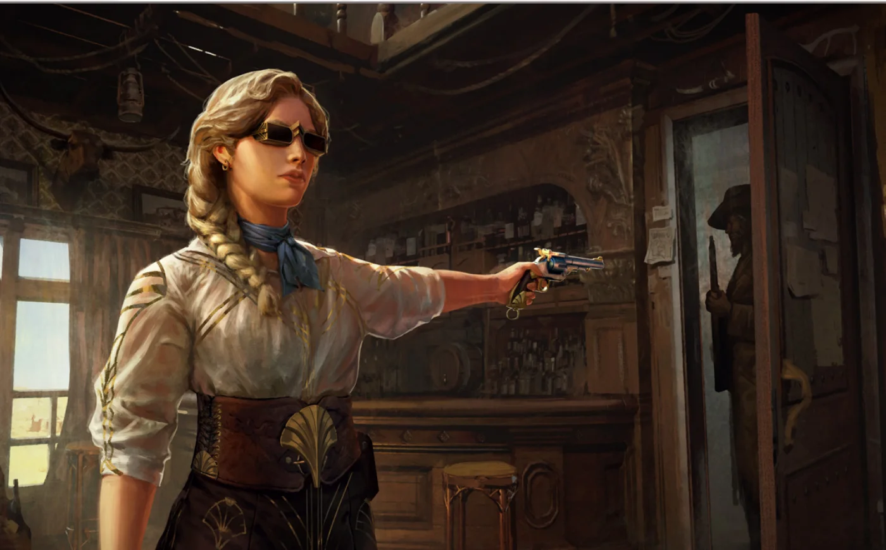

### 錫藏金術（Tin Feruchemy）

感官（Sense）—實體金屬（Physical Metal）

錫藏金術讓你將感官儲存在錫意識（Tinmind）中，通常是聽覺、視覺、嗅覺、味覺與觸覺。你選擇的感官會在儲存時減弱，在汲取（Tap）時增強。錫藏金術師（Feruchemist）能隔著擁擠的房間聽見低語，因此被稱為風語（Windwhisperer）。

### 儲存感官（Store Sense）

啟動（Activation）：[1行動]

持續時間：每個場景（Scene）1點充能（Charge）

持續儲存一種感官，直到你以[自由行動]結束效果，或花費錫意識的一點充能為止。這項能力一開始只允許你同時儲存一種感官。儲存至少一種感官期間，你會受到下列效果：

- 你陷入減損（Diminished）[察覺（Awareness）−1]。

- 依賴你正在儲存的感官的檢定（Test）會獲得一個劣勢（Disadvantage），由GM裁定。例如，儲存視覺或聽覺時，洞察（Insight）檢定可能獲得一個劣勢；儲存視覺或嗅覺時，求生（Survival）檢定可能獲得一個劣勢；儲存觸覺時，武器攻擊（Weapon Attack）與許多其他實體（Physical）檢定可能獲得一個劣勢。

每個場景結束後，若你在整個場景中都持續儲存感官，錫意識便獲得1點充能。

### 汲取感官（Tap Sense）

啟動：[1行動]

持續時間：與你的藏金術（Feruchemy）技能等級（Rank）相同數量的回合（Round）

花費錫意識的1點充能，並選擇一種感官來汲取，持續與你的藏金術技能等級相同數量的回合，或直到你開始儲存任何一種感官為止。汲取一種感官期間，你會受到下列效果：

- 你獲得增益（Enhanced）[察覺+2]。即使汲取超過一種感官，你也只會獲得一次這個狀態（Condition），效果不會疊加。

- 依賴所汲取感官的非攻擊檢定會獲得一個優勢（Advantage），由GM裁定。

- 汲取的感官成為超自然感知（Supernatural Senses），詳見第3章「超自然感知」，而且你可以將它視為你的主要感官（Primary Sense）。

若想同時汲取超過一種感官，你必須為每種感官分別啟動這項能力。感官汲取結束前，你可以用[自由行動]花費錫意識的1點充能，將其維持相同的時間。這麼做時，你可以繼續汲取相同的感官，或改為汲取另一種感官。

### 運用錫藏金術

除了上述能力規則，運用這項能力時，也可以參考以下指引。

### 創意運用

我們鼓勵你自行發想錫藏金術的創意用途，例如以下幾種，並與GM討論如何判定：

**獵犬追蹤（Bloodhound Tracking）。** 汲取嗅覺，追蹤某個人獨特的氣味。

**精細感知（Fine Perception）。** 開鎖時汲取觸覺或聽覺，察覺鎖內制栓移動的聲響。

**感官阻隔（Sense Blocking）。** 儲存一種感官，減輕不想感受到的刺激，例如儲存味覺或嗅覺，讓難吃的食物更容易入口。

此外，你能儲存的不只是一般感官。例如，青銅鎔金術（Bronze Allomancy）讓你能感知授予能力的脈動，而羅沙（Roshar）的歌者（Singers）能感知羅沙的節律（Rhythm）。儲存與汲取特殊感官會產生哪些額外效果，請與GM共同決定。

JANETTE RAMOS

第6章：金屬技藝（Metallic Arts）　246

### 錫藏金術天賦（talent）

以下依英文字母順序列出的天賦，都出現在錫藏金術天賦樹（talent tree）中。你可以透過單藏金術師（Ferring）、雙生師（Twinborn）與藏金術師路徑（Path）的關鍵天賦（Key Talent），或透過血金術尖刺（Hemalurgic Spike），解鎖這棵天賦樹。

### 多感官儲存（Multisensory Storing）

前提條件（Prerequisite）：藏金術3+；反射風語（Reflexive Windwhisperer）天賦

啟動：[特殊啟動]

你學會同時儲存多種感官。

使用儲存感官時，你可以不只儲存一種感官，改為儲存最多等同於你的階層（Tier）數量的感官，並為每種感官分別獲得充能。每多儲存一種感官，你便再次陷入減損[察覺−1]。例如，同時儲存兩種感官時，你會陷入減損[察覺−2]，且每個場景獲得2點充能。

### 反射風語

前提條件：藏金術2+；感官控制（Sensory Control）天賦

啟動：[反應]

你能迅速回應令人不適的感官刺激。

在一個可能因你儲存某種感官而受到影響的行動（Action）或其他效果發生前，你可以使用這個反應（Reaction）來儲存感官。直到這個輪次（Turn）結束，抵抗觸發效果的檢定會獲得一個優勢，而該效果的來源因該效果對你進行檢定時，則會獲得一個劣勢。例如，你可以用這個反應，減輕巨響、強光、濃烈氣味，或其他可能使你陷入迷惑（Disoriented）的感官效果所造成的影響。

### 感官控制

前提條件：錫藏金術能力

啟動：[常駐]

你可以在儲存一種感官時，汲取另一種感官。

只要儲存與汲取的是不同感官，使用汲取感官便不會結束儲存感官，反之亦然。此外，同時儲存與汲取感官期間，儲存感官造成的減損[察覺]效果，不會套用於依賴你目前正汲取的感官的檢定。

### GM提示：錫藏金術與原著設定

《迷霧之子》小說中，風語每個錫意識只能儲存一種感官，因此大多數風語至少帶著五個錫意識。《寰宇 RPG》（Cosmere RPG）簡化了錫藏金術，讓玩家用一個錫意識儲存所有感官，不必分別記錄多種類型的錫意識充能。若你的團體想更貼近小說，可以允許風語為每種感官使用不同的錫意識，並將充能上限分配到這些錫意識中。如此一來，儲存時只能為對應感官的錫意識獲得充能，汲取該錫意識時，也只能增強同一種感官。

### 錫藏金術天賦樹

#### 錫感精準（Tinpoint Accuracy）

啟動：[常駐]

前提條件：重型武器（Heavy Weaponry）1+或輕型武器（Light Weaponry）1+

解鎖來源：錫藏金術能力

燃燒錫（Burn Tin）或汲取感官期間，你的遠程攻擊（Attack）距離增加，而且對盟友（Ally）附近的目標進行遠程攻擊時，不必提高賭注（Raise the Stakes）。

#### 感官控制

啟動：[常駐]

解鎖來源：錫藏金術能力

只要儲存與汲取的是不同感官，汲取感官就不會結束儲存感官，反之亦然。

#### 儲存痛覺（Store Pain）

啟動：[常駐]

前提條件：醫學（Medicine）2+

解鎖來源：感官控制天賦

儲存觸覺期間，減少受到的傷害（Damage），並忽略折磨（Afflicted）、精疲力竭（Exhausted）與減速（Slowed）。

#### 反射風語

啟動：[反應]

前提條件：藏金術2+

解鎖來源：感官控制天賦

感官刺激觸發前，儲存感官，並獲得對抗觸發效果的優勢。

#### 真正的風語（True Windwhispering）

啟動：[特殊啟動]

前提條件：藏金術3+

解鎖來源：感官控制天賦

汲取感官時花費額外充能，縮短持續時間並增強效果；同時將效果套用到最多等同於花費充能點數的感官數量。

#### 多感官儲存

啟動：[特殊啟動]

前提條件：藏金術3+

解鎖來源：反射風語天賦

使用儲存感官時，可以儲存最多等同於階層數量的感官。每多儲存一種感官，獲得1點充能，並陷入減損[察覺−1]。

第6章：金屬技藝　247

### 儲存痛覺

前提條件：醫學2+；感官控制天賦

啟動：[常駐]

你明白痛覺是觸覺的自然延伸。

儲存觸覺期間，你受到的傷害減少等同於你的藏金術技能等級的一半，並忽略折磨、精疲力竭與減速狀態的效果。

### 錫感精準

前提條件：重型武器1+或輕型武器1+；錫藏金術能力

啟動：[常駐]

增強的感官幫助你精準地進行長距離攻擊。

燃燒錫或從錫意識汲取感官時，你會獲得下列收益：

- 你的遠程攻擊的短距離（Short Range）與長距離（Long Range），都增加等同於你的感知範圍（Senses Range）的距離。

- 當你對盟友5呎內、且你能感知到的目標進行遠程攻擊時，你可以選擇不提高賭注。

### 真正的風語

前提條件：藏金術3+；感官控制天賦

啟動：[特殊啟動]

一次汲取大量感官，讓你的感官變得極為敏銳，連最細微的刺激也能察覺。

汲取感官時，你可以不只花費1點充能，改為花費任意數量的充能，最多不超過你的金屬技藝上限（Metallic Art Limit）。這麼做時，選擇若干種感官，數量最多等於你為汲取感官花費的充能點數。你會獲得下列效果，直到你的下一個輪次結束，取代通常的效果與持續時間：

- 你獲得增益[察覺]。該屬性（attribute）的加值，等於1加上你為汲取感官花費的充能點數。

- 所有依賴你正汲取的任何一種感官的檢定，都會獲得一個優勢，由GM裁定。

- 你正汲取的每種感官都成為超自然感知，詳見第3章「超自然感知」，而且它們都能視為你的主要感官，讓你的感知極難受到遮蔽。

這次感官汲取結束前，你可以用[自由行動]花費錫意識中至少1點充能，將其維持相同的時間。

*一名失明的風語藉由增強的感官，射擊表現能勝過大多數看得見的敵人。*

JOSHUA CHIA

