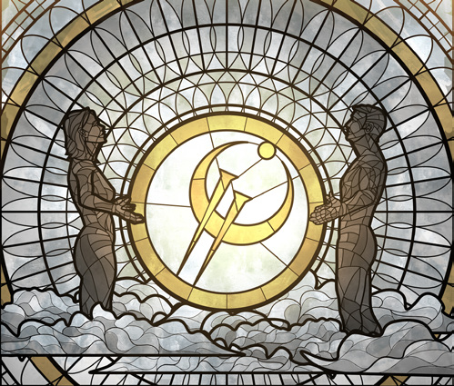
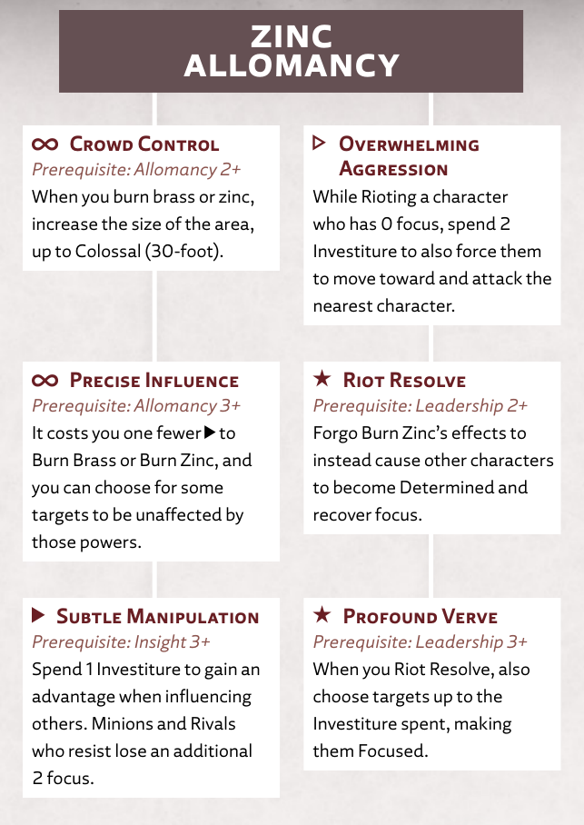
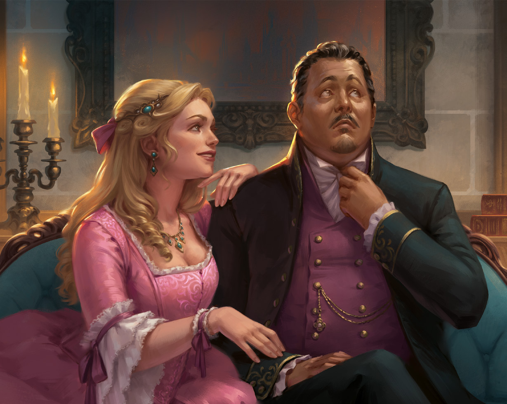
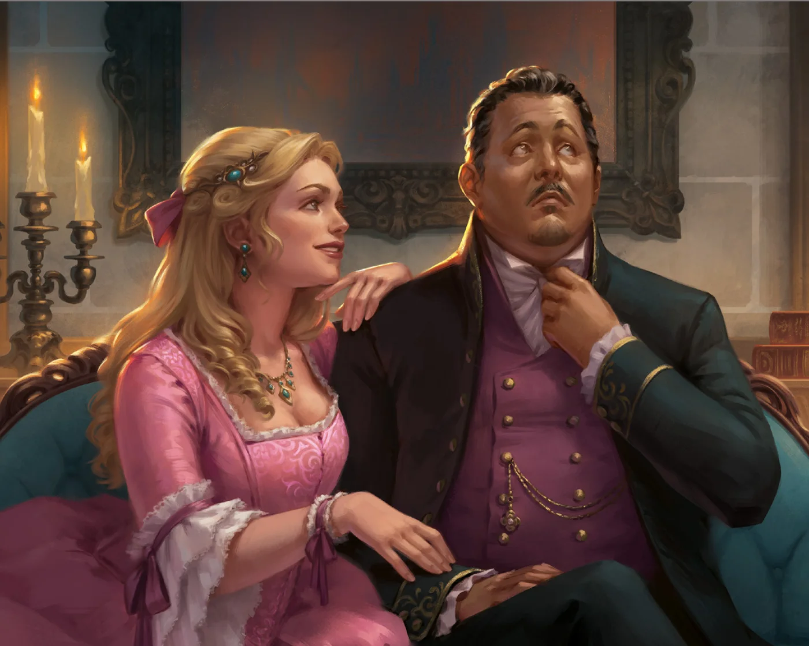

### 鋅鎔金術（Zinc Allomancy）

意志（Mental）－外部（External）－拉引（Pulling）

鋅鎔金術能巧妙地激起附近他人的情緒，促使他們順著那些情緒行動，卻以為那是自己的主意。因此，鋅鎔金術師（Allomancer）被稱為煽動者（Rioter）。例如，你可以在舞會上煽動（Riot）衝動，讓一名貴族失態，毀掉自己的名聲；也可以煽動陌生人的信任感，取得他們的協助。經過練習，你甚至能同時煽動多種情緒。然而，煽動者無法感知情緒，因此必須學會以一般方式判讀他人的情緒狀態。

### 燃燒鋅（Burn Zinc）

啟動（Activation）：[2行動]

持續時間：1回合（Round）

燃燒鋅（Zinc）時，花費至少1點授予（Investiture），最多不超過你的金屬技藝上限（Metallic Art Limit）。花費越多授予，對方就越難抵抗你的煽動。接著，選擇一種要激起的情緒，例如憤怒或友善，再選擇金屬技藝距離（Metallic Art Range）內的一個大型（Large，10呎）區域。直到你的下一個輪次（Turn）結束，你會煽動該區域內除你以外每名角色（Character）的這種情緒。GM決定每名NPC在情緒改變後如何行動，詳見黃銅鎔金術（Brass Allomancy）能力的「改變後的情緒狀態（Altered Emotional States）」側欄。如果你希望目標（Target）沒有察覺你的煽動，還要進行鎔金術（Allomancy）檢定（Test），對抗每名受你煽動角色的靈魂防禦（Spiritual Defense）。成功時，目標不會察覺你的影響（Influence）；失敗時，目標知道自己正被煽動，且由GM裁定，他也可能知道來源就是你。此次鋅燃燒結束前，你可以用[自由行動]花費至少1點授予，對金屬技藝距離內每名受影響的角色維持相同時間的煽動。煽動的強度依這次花費的授予調整。

知道自己正被煽動的角色，可以用[自由行動]抵抗此效果，花費等同於你燃燒鋅所花授予的專注點（Focus），取代抵抗影響時通常須付的費用。如此做之後，直到其下一個輪次開始，他都能抵抗你的影響，忽略被改變的情緒。

### 使用鋅鎔金術

除了上述能力規則，運用這項能力時，也請參考下列指引。

### 變故（Complication）

燃燒鋅期間，GM可以花費你或盟友（Ally）檢定中的[變故]，讓一名角色察覺自己正被煽動，或察覺你是煽動者。

### 重疊的操控（Overlapping Manipulations）

如果多個效果正在改變同一名角色的情緒，性質相近的效果會在該角色身上共同作用，互相對立的效果則會抵消。面對性質相近的效果，目標只需要抵抗最強的一個；互相對立的效果則會直接抵消。

### 控制NPC

如果你花費至少6點授予燃燒鋅，鋅鎔金術就能讓你更直接地控制坎得拉（kandra）、克羅司（koloss）或其他血金術實體NPC。當你成功煽動這類專注點為0的NPC時，可以放棄燃燒鋅的一般效果，改讓該NPC視為你的夥伴（Companion），詳見第8章「夥伴」。此效果持續到你傷害他，或另一名角色使他成為自己的夥伴為止。

### 創意用法

創意運用鋅鎔金術，能完成驚人的操控。我們鼓勵你自行發想這項能力的用途，例如以下幾種，並與GM討論如何判定：

**多種情緒。** 同時操控多種情緒，但這可能使你的鎔金術檢定承受劣勢（Disadvantage）。你甚至能煽動大量情緒，讓其餘情緒相對低落，藉此模仿黃銅鎔金術的效果。

**洞察後影響。** 煽動之前，嘗試以洞察（Insight）獲取優勢（Gain Advantage）。成功時，你也會得知哪些情緒可能引發你想要的反應。

**鼓舞。** 幫助願意接受的盟友抵抗自己的內在障礙（obstacle），改做出勇敢、大膽或其他他期望自己能做到的事。

AUSTIN HARTELL

第6章：金屬技藝（Metallic Arts）　210

更多情緒鎔金術（Emotional Allomancy）的運用範例，請參閱黃銅鎔金術能力的「創意用法」。該節的「改變後的情緒狀態」側欄，也提供角色可能如何回應情緒操控的指引。

### 鋅鎔金術天賦（talent）

下列天賦依英文字母順序排列，出現在鋅鎔金術天賦樹（talent tree）中。你可以透過迷霧人（Misting）、雙生師（Twinborn）與迷霧之子（Mistborn）路徑（Path）的關鍵天賦（Key Talent），或透過血金術尖刺（Hemalurgic Spike），解鎖這棵樹。

#### 群體調控（Crowd Control）

前提條件（Prerequisite）：鎔金術2+；鋅鎔金術能力

啟動：[常駐]

你擴大了情緒鎔金術的作用區域，一次能影響更多人。

燃燒黃銅（Brass）或鋅時，你可以擴大效果的區域，最大達到極巨型（Colossal，30呎）區域。

#### 壓倒性攻擊欲（Overwhelming Aggression）

前提條件：鋅鎔金術能力

啟動：[自由行動]

你強烈地煽動一種情緒，讓對方完全被這股感受淹沒。

花費2點授予，選擇一名正受你煽動、專注點為0的角色，強迫這個目標不分敵我地攻擊附近的一名角色。在你的煽動持續期間，目標的每個輪次都必須花費所有行動（Action），移向並攻擊距離自己最近的角色。如果有多名角色距離相同，就隨機選擇一個目標。

#### 精準影響（Precise Influence）

前提條件：鎔金術3+；群體調控天賦

啟動：[常駐]

將情緒鎔金術限制在單一目標身上並不容易，但你的運用已經精細入微。

使用燃燒黃銅（Burn Brass）或燃燒鋅時，你少花費一個[1行動]。此外，燃燒黃銅或鋅來影響區域內角色時，你可以選擇任意數量自己能察覺的目標，使其不受該能力影響。

#### 深度振奮（Profound Verve）

前提條件：領導（Leadership）3+；煽動決心（Riot Resolve）天賦

啟動：[特殊啟動]

你的煽動能振奮人心。

使用煽動決心時，你也可以從受影響的目標中選擇若干名，數量最多等於你花費的授予點數。在持續期間，每名被選中的目標都會獲得集中（Focused）狀態。

### 鋅鎔金術天賦樹

#### 群體調控

啟動：[常駐]

前提條件：鎔金術2+

解鎖來源：鋅鎔金術能力

燃燒黃銅或鋅時，擴大作用區域，最大達到極巨型（30呎）。

#### 壓倒性攻擊欲

啟動：[自由行動]

解鎖來源：鋅鎔金術能力

煽動專注點為0的角色時，花費2點授予，額外強迫對方移向並攻擊最近的角色。

#### 精準影響

啟動：[常駐]

前提條件：鎔金術3+

解鎖來源：群體調控天賦

你燃燒黃銅或鋅時，少花費一個[1行動]，也能選擇讓部分目標不受這些能力影響。

#### 煽動決心

啟動：[特殊啟動]

前提條件：領導2+

解鎖來源：壓倒性攻擊欲天賦

放棄燃燒鋅的效果，改讓其他角色獲得堅定（Determined）狀態，並恢復專注點。

#### 細微操控（Subtle Manipulation）

啟動：[1行動]

前提條件：洞察3+

解鎖來源：精準影響天賦

花費1點授予，在影響他人時獲得優勢（Advantage）。抵抗的嘍囉（Minion）與勁敵（Rival）額外失去2點專注點。

#### 深度振奮

啟動：[特殊啟動]

前提條件：領導3+

解鎖來源：煽動決心天賦

使用煽動決心時，也選擇數量最多等於所花授予點數的目標，使其獲得集中狀態。

> 匪徒與士兵跟在她身後，奧瑞安妮（Allrianne）確保自己煽動了雙方的情緒，增強彼此的信任。要讓士兵接受這些匪徒可不容易，尤其風向一轉，將整群匪徒的惡臭全吹到了他們身上。儘管如此，所有人仍平安抵達營地，沒有發生衝突。

第6章：金屬技藝　211

#### 煽動決心

前提條件：領導2+；壓倒性攻擊欲天賦

啟動：[特殊啟動]

你的煽動能幫助盟友挺過最險惡的處境。

每個場景（Scene）一次，燃燒鋅時，你可以放棄一般效果，改讓區域內除你以外每名角色恢復專注點，數量等於你燃燒鋅所花授予的一半，無條件進位。此外，每名目標都會獲得堅定狀態（Condition），直到其移除該狀態，或你的煽動結束為止。

#### 細微操控

前提條件：洞察3+；精準影響天賦

啟動：[1行動]

你以鎔金術干預情緒的手法已變得十分細膩，運用時幾乎不會被發現。

花費1點授予，獲得下列益處，直到你的下一個輪次結束：

- 進行檢定，影響金屬技藝距離內的角色時，獲得優勢。這也包括讓目標未察覺你的情緒鎔金術的鎔金術檢定。

- 金屬技藝距離內的嘍囉或勁敵抵抗你的影響後，額外失去2點專注點。

此效果結束前，你可以用[自由行動]花費1點授予，將它維持相同的持續時間。

*奧瑞安妮煽動微風（Breeze）的情緒。*

DEANDRA SCICLUNA

