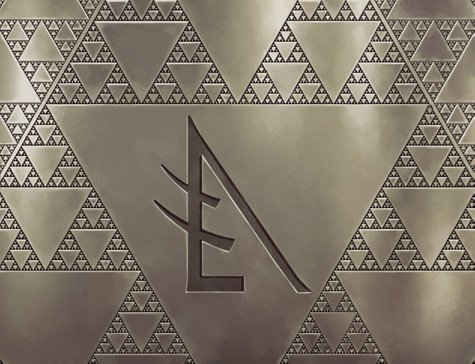
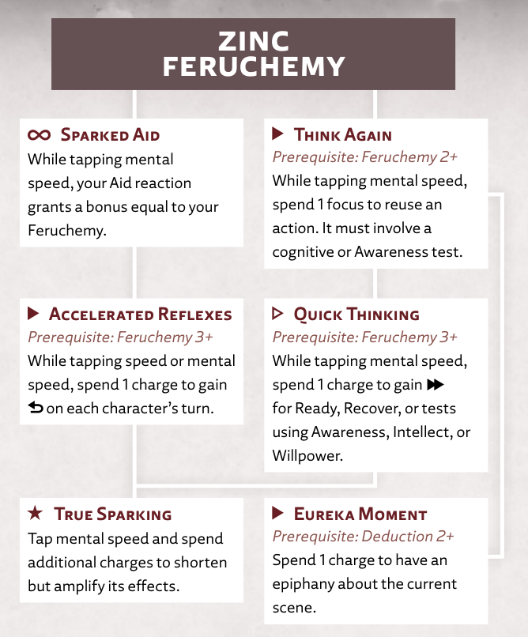

### 鋅藏金術（Zinc Feruchemy）

心智速度（Mental Speed）—意識金屬（Cognitive Metal）

鋅藏金術讓你將心智速度儲存在鋅意識（Zincmind）中。儲存時，你的思考會變慢，處理與回想資訊也需要更久。汲取（Tap）時，你則能更快吸收資訊、預先規劃，並得出準確的結論，周遭世界卻彷彿變成慢動作。鋅藏金術師（Feruchemist）又被稱為星火（Sparker），他們很快就會發現，汲取心智速度有個不尋常的副作用：思考如此迅速會消耗額外的熱量，讓星火很快感到飢餓。

### 儲存心智速度（Store Mental Speed）

啟動（Activation）：[1行動]

持續時間：每個場景（Scene）1點充能（Charge）

持續儲存心智速度，直到你以[自由行動]結束效果，或花費鋅意識的一點充能為止。儲存心智速度期間，你會受到下列效果：

- 你陷入減損（Diminished）[智力（Intellect）−1]。

- 使用預備（Ready）行動時，必須額外花費[1行動]。

- 使用智力屬性（attribute）進行獲取優勢（Gain Advantage）或使用技能（Use a Skill）行動時，必須額外花費[1行動]。

每個場景結束後，若你在整個場景中都持續儲存心智速度，鋅意識便獲得1點充能。

### 汲取心智速度（Tap Mental Speed）

啟動：[1行動]

持續時間：與你的藏金術（Feruchemy）技能等級（Rank）相同數量的回合（Round）

花費鋅意識的1點充能來加快思考，持續與你的藏金術技能等級相同數量的回合，或直到你開始儲存心智速度為止。

汲取心智速度期間，你會受到下列效果：

- 你獲得增益（Enhanced）[智力+2]。

- 你的每個輪次（Turn）各有一次，可以用[自由行動]使用以下其中一個行動：預備（仍需為你所預備的行動支付通常數量的[1行動]）、使用智力屬性獲取優勢，或使用智力屬性進行使用技能行動。

心智速度汲取結束前，你可以用[自由行動]花費鋅意識的1點充能，將其維持相同的時間。

### 運用鋅藏金術

除了上述能力規則，運用這項能力時，也可以參考以下指引。

### 創意運用

我們鼓勵你自行發想鋅藏金術的創意用途，例如以下幾種，並與GM討論如何判定：

**打發時間（Pass Time）。** 儲存心智速度，放慢思考，讓時間感覺過得更快，減輕長時間等待對心理的影響。

**預測（Prediction）。** 汲取心智速度，預測一名角色（Character）在下一個輪次會怎麼行動。例如，你可以進行推理（Deduction）檢定（Test），對抗其意識防禦（Cognitive Defense），判斷對方會選擇快速輪次（Fast Turn）還是慢速輪次（Slow Turn）、使用哪個行動，或攻擊誰。

### 鋅藏金術天賦（talent）

以下依英文字母順序列出的天賦，都出現在鋅藏金術天賦樹（talent tree）中。你可以透過單藏金術師（Ferring）、雙生師（Twinborn）與藏金術師路徑（Path）的關鍵天賦（Key Talent），或透過血金術尖刺（Hemalurgic Spike），解鎖這棵天賦樹。

### 加速反應（Accelerated Reflexes）

前提條件（Prerequisite）：藏金術3+；星火援助（Sparked Aid）天賦

啟動：[1行動]

你學會以汲取心智速度來加快反應，接連回應多次刺激。

汲取速度或心智速度期間，花費對應的鋼意識（Steelmind）或鋅意識的1點充能，加快反應，直到你的下一個輪次開始。持續期間，除你以外的每名角色，在其輪次開始時，你都會獲得一個額外的[反應]，持續到該輪次結束。

JANETTE RAMOS

第6章：金屬技藝（Metallic Arts）　249

### 靈光乍現（Eureka Moment）

前提條件：推理2+；再想一次（Think Again）天賦

啟動：[1行動]

汲取心智速度，讓你輕易察覺別人錯過的細節。

花費鋅意識的1點充能，對目前場景產生頓悟。由GM裁定，你可能得知一些有趣、可疑、不尋常，或值得進一步調查的事，可能與周遭環境有關，也可能與場景中的某名角色有關。如果GM判定沒有值得得知的事，你便改為獲得一個機遇（Opportunity）。

### 快速思考（Quick Thinking）

前提條件：藏金術3+；再想一次天賦

啟動：[自由行動]

汲取鋅意識時，你思考快得足以負擔好幾個人的心智工作。

汲取心智速度期間，花費鋅意識的1點充能，獲得[2行動]。這些行動只能用於以下行動：預備、恢復（Recover），或任何需要使用察覺（Awareness）、智力或意志（Willpower）屬性進行檢定的行動。在對話（Conversation）或試煉（Endeavor）中，你可以改為花費這全部[2行動]，在該回合額外進行一次貢獻（Contribution）；但這次貢獻仍僅限使用上述行動。

### 星火援助

前提條件：鋅藏金術

啟動：[常駐]

汲取心智速度，讓每個瞬間對你而言都變得更長，使你能更精準地引導盟友（Ally）。

汲取心智速度期間，當你使用援助（Aid）反應（Reaction）時，盟友會獲得一項額外收益：對方為檢定擲骰之後，可以選擇其中一顆骰子，劇情骰（Plot Die）除外，讓該顆骰子的結果獲得等同於你的藏金術技能等級的加值。

### 再想一次

前提條件：藏金術2+；鋅藏金術

啟動：[1行動]

強化的心智速度，常讓你能再次進行相同的思考過程。

汲取心智速度期間，花費1點專注點（Focus），使用一次你在這個輪次已經使用過的行動（Action）。該行動的費用必須是[1行動]，但你不需再次支付這項費用，只需支付啟動本天賦的費用。此外，你必須在該行動中使用察覺、智力或意志屬性進行檢定，例如獲取優勢、使用技能，或需要進行鎔金術（Allomancy）檢定的行動。

### 鋅藏金術天賦樹

#### 星火援助

啟動：[常駐]

解鎖來源：鋅藏金術能力

汲取心智速度期間，你的援助反應會提供等同於你的藏金術的加值。

#### 再想一次

啟動：[1行動]

前提條件：藏金術2+

解鎖來源：鋅藏金術能力

汲取心智速度期間，花費1點專注點，再次使用一個行動。該行動必須包含意識（Cognitive）或察覺檢定。

#### 加速反應

啟動：[1行動]

前提條件：藏金術3+

解鎖來源：星火援助天賦

汲取速度或心智速度期間，花費1點充能，在每名角色的輪次中獲得[反應]。

#### 快速思考

啟動：[自由行動]

前提條件：藏金術3+

解鎖來源：再想一次天賦

汲取心智速度期間，花費1點充能，獲得[2行動]，用於預備、恢復，或使用察覺、智力、意志進行檢定。

#### 真正的星火（True Sparking）

啟動：[特殊啟動]

解鎖來源：加速反應天賦或快速思考天賦

汲取心智速度時花費額外充能，縮短持續時間並增強效果。

#### 靈光乍現

啟動：[1行動]

前提條件：推理2+

解鎖來源：再想一次天賦

花費1點充能，對目前場景產生頓悟。

### 真正的星火

前提條件：加速反應天賦或快速思考天賦

啟動：[特殊啟動]

一次汲取大量心智速度，讓你處理資訊的速度快得使周遭世界彷彿慢到幾乎停滯。

汲取心智速度時，你可以不只花費1點充能，改為花費任意數量的充能，最多不超過你的金屬技藝上限（Metallic Art Limit）。這麼做時，你會獲得下列效果，持續到你的下一個輪次結束，取代通常的效果與持續時間：

- 你獲得增益[智力]。該屬性的加值，等於1加上你為汲取心智速度花費的充能點數。

- 使用本天賦時，以及你的每個輪次開始時，你都會獲得若干個[1行動]，數量等同於你正汲取的心智速度量。這些行動只能用於以下行動：預備、使用智力屬性獲取優勢，或使用智力屬性進行使用技能行動。

這次心智速度汲取結束前，你可以用[自由行動]花費鋅意識中至少1點充能，將其維持相同的時間。

第6章：金屬技藝　250

