你的角色所屬的文化，不是由出生背景或人生中的某一刻決定。你對文化的認識會受到國籍、族裔、遷徙、旅行經驗等許多因素形塑。

以下各節介紹玩家角色（Player Character）可選的文化專長（Cultural Expertise）。在角色建立（Character Creation）的步驟 1，你可以選擇其中兩項專長（Expertise）。

擁有某項專長，表示你的角色瞭解該文化及其發源地，甚至可能流利使用當地的方言或語言。（關於專長的用法，見第 3 章〈專長〉。）各文化雖然都列出了這項專長能讓你懂得哪些事情，但這些只是方便查閱的簡介。你可以在《迷霧之子世界指南》（Mistborn World Guide）中，進一步認識司卡德利亞（Scadrial）的地區與文化。

司卡德利亞在不同時代的文化面貌差異極大。生活在最後帝國（Final Empire）或崩解時期（the Collapse）的玩家角色，可以選擇〈第一時代文化專長〉中的專長。生活在落灰之終（Catacendre）之後的角色，可以選擇〈第二時代文化專長〉中的專長。兩個時代都能選擇的專長，則列在〈跨時代文化專長〉中。

如果你願意，文化專長可以與你的血統（Ancestry）及族裔有關。若角色在與自身血緣相關的文化中長大，或曾長期生活於其中，這種選擇很常見。另一方面，你也可能對自身血緣所屬的文化所知甚少，卻十分熟悉養育自己長大的統御區（Dominance）或地區的文化。選擇文化不是為了限制角色的身分認同，而是用來突顯你對哪些文化的認識最為全面。例如，建立泰瑞司（Terris）血統的角色，並不需要選擇泰瑞司統御區（Terris Dominance）專長。

## 第一時代文化專長

本節文化呈現的是統御主（Lord Ruler）統治末期，以及他被擊敗後至落灰之終之間的司卡德利亞。若遊戲設定在最後帝國較早的年代，也可以調整這些資訊來使用。

最後帝國時期，統御主禁止人民使用他自身語言以外的所有語言。因此，你的角色幾乎肯定會說帝國語（Imperial），但也可能懂得各地的方言。

### 司卡（Skaa）　第一時代

司卡是最後帝國人口最多的族群，人數是貴族的十倍。在統御主刻意安排下，他們遭到貴族踐踏與壓迫，人身自由受到嚴格限制。許多司卡被迫在帝國的工廠、礦場與種植園勞動，另一些則擔任守衛或士兵。也有司卡靠著經商或精湛的手藝維生，尤其是在帝國的城市裡。

司卡往往十分重視社群，從親友身上獲得快樂。多數司卡都明白彼此照應的重要，同在一處工作或住在同一棟出租公寓的人，通常有著深厚的情誼。城市裡緊密相連的司卡社群，可能以商店與會所、工廠工人宿舍，甚至盜賊集團為中心。司卡社群往往頗為迷信，人們常透過講述民間故事與「長篇傳奇」凝聚感情。

大多數司卡無力講究排場。他們通常穿著粗織布料製成的樸素短褲、襯衣與長衫。少數司卡會佩戴簡單的金屬飾品，這些飾品會作為禮物或傳家寶，在社群中流傳。

#### 司卡姓名

Alder, Bolan, Criden, Fare, Hosahn, Jeller, Karalle, Lened, Nendel, Phin, Ruel, Sannson, Thess, Venn, Yelin.

*司卡勞工。*

第 2 章：起源 40

DEANDRA SCICLUNA

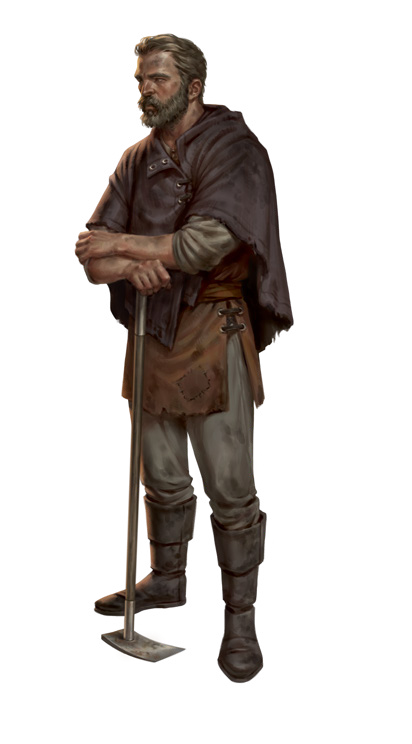

#### 司卡專長

擁有司卡專長的你，能輕易找到司卡社群，理解其組織方式，辨認領袖並安排會面（除非對方刻意隱藏身分），也能找到落腳處。此外，你知道關於迷霧人（Misting）、霧魅（Mistwraith）與其他當地傳說的民間故事。請決定你有多熟悉帝國語的書寫；多數司卡不識字，除非擁有一門手藝或經營生意。

### 陸沙德（Luthadel）　第一時代

陸沙德是司卡德利亞最大的城市，也是統御主的統治中心。統御主的宮殿克雷迪克．霄（Kredik Shaw）高踞城中，時時提醒人們他擁有絕對的權力。權力匯聚於首都，也讓城中貴族，尤其是大家族之間，陷入殘酷的政治角力。陸沙德的各區由這些家族瓜分，各家都在城牆內設有堡壘。陸沙德位於帝國運河網的核心，也是貿易與商業中心。司卡被迫在城市工廠與運河碼頭區從事繁重勞動，貴族則聚集交易，以人情與盒金（Boxing）作為籌碼。大家族每晚舉辦奢華舞會，貴族在席間爭權奪利，麾下的迷霧之子（Mistborn）則在暗處與屋頂間活動。這座城市始終徘徊在全面家族戰爭的邊緣。

#### 陸沙德姓名

Antou, Carmend, Dormond, Denna, Formont, Greston, Jateuse, Lavreux, Melvier, Obson, Quiss, Ren, Sebroux, Terneau, Vedent.

#### 陸沙德專長

陸沙德是統御主的權力樞紐，因此你熟悉鋼鐵教廷（Steel Ministry）與聖務官（Obligator），也很可能親眼見過鋼鐵審判者（Steel Inquisitor）執行任務。你也知道鎔金術師（Allomancer）與迷霧之子的存在，甚至可能看過他們在屋頂上交鋒。

### 內統御區（Inner Dominances）　第一時代

中央、北方、西方、東方與南方統御區，構成最後帝國人口稠密的核心地帶。內統御區多為平原，氣候也相對「溫和」，世界上數座大城皆坐落於此，包括陸沙德、鎢都（Urteau）與哈佛富雷克斯（Fadrex）。貴族對司卡的文化霸權，決定了這些地區的生活樣貌。貴族雖在陸沙德互相爭鬥，但回到各自的祖傳領地後，權力幾乎不受制衡。貴族家族，有時則是鋼鐵教廷的各廷，負責管理並開發領地資源。貴族與教廷的控制如此穩固，司卡叛亂極少能在此站穩腳步。

內統御區非常適合農耕，司卡被殘酷地驅使，清除田間落灰。各統御區也有各自的產業；例如，泛圖爾家族（House Venture）掌權的北方統御區（Northern Dominance），便以豐富的煤礦聞名。

#### 內統御區姓名

Anture, Dammel, Farene, Galea, Japes, Keliera, Lian, Mantare, Nomoron, Parteau, Quindees, Seloux, Taradare, Vendex.

#### 內統御區專長

請選擇五個內統御區中的一個；你可以多次選擇這項專長，表示熟悉更多統御區。擁有內統御區專長的你，知道該區掌權的大家族與小貴族的名字，也瞭解當地重要的產業。你還知道當地灰山（Ashmount）的名稱，以及海司辛深坑（Pits of Hathsin）、黑湖（Black Lake）等著名地標。因此，你能輕易在所選統御區的道路與運河間往來。請決定你有多熟悉帝國語的書寫。你也能說或聽懂該統御區的方言，例如東方街頭俚語。

*陸沙德的消息靈通人士（左）與東方貴族。*

第 2 章：起源 41

DEANDRA SCICLUNA

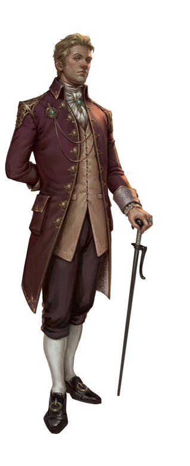

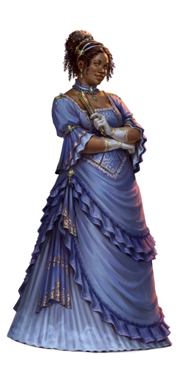

### 泰瑞司統御區　第一時代

泰瑞司統御區位於帝國北緣，是泰瑞司人的故鄉，也是一片多山的凍原。審判廷（Canton of Inquisition）的上聖祭司（High Prelan）Savrian 坐鎮塔辛文（Tathingdwen），直接代表鋼鐵教廷統治這片地區。為了控制泰瑞司人口，並消除世代遺傳的藏金術（Feruchemy），教廷推行殘酷的育種計畫（Breeding Program）與侍從官計畫（Steward Program）。絕大多數泰瑞司男子受契約束縛，成為貴族的僕役，離開故土。挺過這些制度而留下的人多為女性，在鄉間村落中靠採礦、畜牧與耕作維生。在艱難的處境下，守護者（Keeper）與領導他們的席諾德（Synod）祕密努力，保存古老傳統與藏金能力。泰瑞司人受到的教化重視完美、耐心、韌性與學識。他們通常身形高挑纖細，男性常剃光頭，女性則編辮。傳統泰瑞司服飾包括帶有彩色重疊 V 形圖樣的長袍，以及戒指、手鐲等金屬飾品。許多泰瑞司人會擴張耳垂，以佩戴大型耳環。

#### 泰瑞司統御區姓名

Arawyl, Cerytith, Deneleze, Forwyn, Handal, Idreh, Kwandel, Mylindweth, Orzed, Pyndal, Razwym, Tindel, Ulwyl, Vwashek, Wanderwyl.

#### 泰瑞司統御區專長

擁有泰瑞司統御區專長的你，瞭解泰瑞司習俗，以及育種計畫與侍從官計畫的實施情形。請決定你有多熟悉帝國語的書寫。泰瑞司語雖然大多已失傳，但若曾接觸守護者，你可能學過幾個詞。你聽說過某些泰瑞司「神祕人士」擁有奇妙能力的傳言。然而，藏金術與守護者的真相並不廣為人知，即使擁有這項專長也不例外。

### 外圍統御區（Outer Dominances）　第一時代

極遠統御區（Farmost Dominance）、新月統御區（Crescent Dominance）與偏遠統御區（Remote Dominance）位於帝國最外緣，環境通常比內統御區更難居住。東方的新月統御區遍布乾燥的大沙漠，西方的沿海統御區則飽受狂風巨浪侵襲。南方群島（Southern Islands）雖然青翠茂盛，卻同時蘊藏著同樣程度的危險與發財機會。遠離內統御區後，最後帝國在外圍統御區的控制力也隨之衰退。有些貴族仍能順利開發領地與經營生意，但司卡叛亂在此十分常見。統御區邊緣的焦土（Burnlands），是游牧社群與盜匪的家園，其成員由反抗者與逃亡司卡組成。統御主的克羅司（Koloss）大軍駐紮在外圍統御區邊境，尤其活躍於焦土，與反抗統御主秩序的人們衝突。

#### 外圍統御區姓名

Axshon, Colette, Cartoux, Egon, Farlene, Hoxs, Janier, Mioux, Oskar, Renli, Seren, Seaban, Thrice, Ulla, Yuem.

*泰瑞司牧羊人（左）與極遠統御區的貴族女子。*

第 2 章：起源 42

DEANDRA SCICLUNA

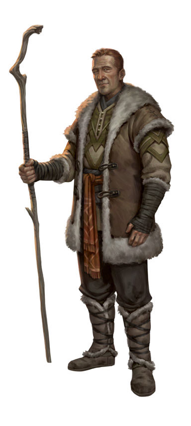

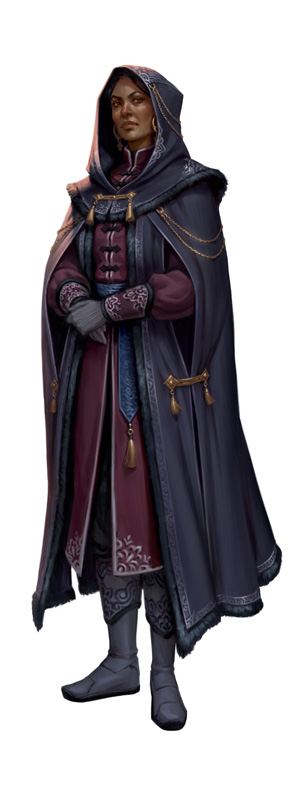

#### 外圍統御區專長

請選擇一個外圍統御區；你可以多次選擇這項專長，表示熟悉更多統御區。擁有外圍統御區專長的你，知道哪些小貴族宣稱統治所選地區，也瞭解他們偏重的產業。你知道克羅司的真實情況，包括統御主軍隊的規模，甚至可能親眼見識過他們的凶猛。不過，你也很清楚最後帝國並非完全掌控一切，邊境仍有反抗勢力盤踞。請決定你有多熟悉帝國語的書寫。若選擇極遠統御區、偏遠統御區或南方群島，你知道如何安全航行於沿岸海域；若選擇新月統御區，你知道如何安全穿越沙漠。

## 第二時代文化專長

以下文化呈現的是小說《悼環》（The Bands of Mourning）與《The Lost Metal》之間，依藍戴盆地（Elendel Basin）與南司卡德利亞（Southern Scadrial）的情況。若遊戲設定在落灰之終之後的其他年代，也可以調整這些資訊來使用。最後帝國瓦解之後，帝國語的各種方言仍在依藍戴盆地與蠻橫區（The Roughs）通行，但這種語言改稱司卡語。上皇族語（High Imperial）成為學術語言，泰瑞司語也蓬勃發展。盆地與蠻橫區的大多數居民，即使使用其他語言，仍然聽得懂司卡語。Malwish 人使用 Malwish 語，也可能懂得或會說其他南方國家的語言。

### 依藍戴（Elendel）　第二時代

依藍戴是司卡德利亞最大的城市，坐落於最終昇華（Final Ascension）發生之處，也是商業與發明的中心。城市由民選總督與參議院共同治理，參議院席位分為民選與世襲兩類。依藍戴在科技、基礎建設與社會發展上都迅速邁向現代化。居民的膚色與髮色相當多樣，膚色較深、身形較高的特徵在泰瑞司人口中更常見。時尚是城中地位與成就的重要標誌，富裕居民偏好剪裁合身的西裝與洋裝。流行設計多採深色布料，或以單一濃豔色彩搭配點綴。工作服則包括鈕扣襯衫與長褲，或簡單的洋裝，通常使用低調的色彩。

#### 依藍戴姓名

Allriandre, Alvery, Brill, Carmine, Collette, Daius, Ennasi, Hedwarn, Hinston, Jackstom, Juli, Karoline, Kip, Limmi, Matilda, Mase, Rian, Sindren, Windra, Xavian.

#### 依藍戴專長

擁有依藍戴專長的你，知道城中權勢家族的名字，以及常見的法律與規章。你熟悉警察的運作，知道如何尋求執法人員協助，或避開他們。即使不是迷霧人，你也熟悉鎔金術（Allomancy），能說出各種鎔金術金屬，以及每種迷霧人能使用的能力。請選擇你居住的分區（Octant）。你知道該區的商家、公共組織與著名地標。也請選擇你接受過的教育，並決定你使用司卡語與上皇族語口說及書寫的熟練程度。無論自身信仰為何，你都熟悉倖存者教（Survivorism）、碎刺教（Sliverism）與道教（the Path）的基本教義。

*依藍戴的組織工作者（左）與克羅司混血（Koloss-Blooded）牧場主人。*

第 2 章：起源 43

DEANDRA SCICLUNA

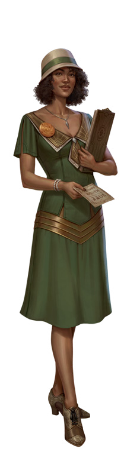

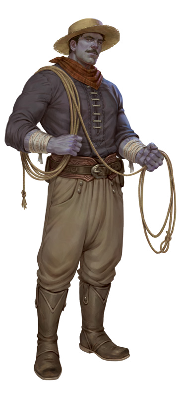

### 克羅司混血　第二時代

克羅司混血子女的父母中，至少有一方是克羅司或克羅司混血。他們在兩個族群的世界中成長。在克羅司混血文化裡，家庭、社群與忠於自我都極為重要。蠻橫區的克羅司氏族會將孩子送往城市社群，與親人建立聯繫；克羅司混血家庭也會將孩子送到克羅司氏族，學習自身傳承。依藍戴盆地的大多數聚落，至少都有少量克羅司混血人口；依藍戴、Bilming 與 New Seran 等大城市，則有好幾個克羅司混血社區。蠻橫區有數十個克羅司氏族，以及相當多的克羅司混血人口，其中還有以克羅司混血為多數的城鎮。

#### 克羅司混血姓名

Augurd, Bailen, Boly, Dav, Dylan, Erma, Hadeline, Karoline, Larson, Lizzie, Lunille, Martin, Moe, Mollie, Nax, Persephonine, Ray, Roscoe, Tillie, Willium.

#### 克羅司氏族姓名

Calder, Chennant, Douglan, Dramal, Hinnaird, Hudowen, Hukainly, Kobarr, Kogarroch, Kovlair.

#### 克羅司混血專長

擁有克羅司混血專長的你，知道當地克羅司氏族的名字，以及主要克羅司混血社區或城鎮的名稱。你能在克羅司氏族與克羅司混血社群中取得服務，並遵循當地習俗。請選擇一處你曾居住的克羅司或克羅司混血社群。你瞭解該社群的領土、領袖、家族與歷史。請選擇你接受過的教育，並決定你使用司卡語口說與書寫的熟練程度。無論自身信仰為何，你都熟悉倖存者教、碎刺教與道教的基本教義。

### Malwish　第二時代

Malwish 國是司卡德利亞南方大陸五個民族之一的家園。這個文化崇尚軍事，擁有先進科技，十分重視禮節，也極為尊重金屬之子（Metalborn）。三個世紀前，Malwish 人遭遇 冰殲時代（Ice Death）。和諧（Harmony）將司卡德利亞恢復成統御主統治前的模樣時，降低了南方的氣溫，帶來嚴重苦難。Malwish 文明崩潰之後，君王（Sovereign）到來，帶來拯救他們性命的科技，他們後來又在此基礎上繼續發展。Malwish 人崇拜 Jaggenmire，延續君王來到之前的宗教。如今，Malwish 人正努力將南方諸國統一在同一面旗幟之下，也就是他們自己的旗幟。Malwish 人有著多樣的膚色與髮色。每個人都會佩戴上色並加以裝飾的木製面具，通常為紅色。他們會隨著流行或興趣更換面具，也可能在轉換職業或紀念某項成就時，改變面具的樣式或裝飾。Malwish 人用手勢表達情緒與心情，年輕人也可能掀起面具，以強調某種情緒或某句話。

#### Malwish 姓名

Andrid, Astrine, Brigine, Dagmar, Dagnus, Eihannes, Ellis, Folse, Hendrik, Hilda, Indraal, Jarika, Julavil, Kaanus, Kadri, Osval, Preida, Sveikki, Ulvis, Vilmmes.

#### Malwish 專長

擁有 Malwish 專長的你，瞭解南司卡德利亞的地貌與自身民族的面具習俗，也可能至少擁有一副自己的面具。你也熟悉徽章（Medallion）與浮空船（Airship）科技。請決定你使用 Malwish 語口說與書寫的熟練程度。無論自身信仰為何，你都熟悉 Jaggenmire 的基本教義。

### 外圍城市（Outer Cities）　第二時代

外圍城市包括 Bilming、New Seran 等人口密集的大城，也包括 Doriel、Drypost、Dryport 與 Garmet 等小型聚落。多數外圍城市會自行選出領袖，數代以來，在政策、經濟與執法方面都以依藍戴為首。然而，近幾年來，獨立運動日益受到支持。小型社群的時尚與生活態度偏向實用。Bilming 是工業進步的中心，當地服飾色彩鮮豔，風格別出心裁。New Seran 則流行穩重端莊的西裝與洋裝，尤其是鐵路條紋西裝與粉彩色洋裝。

#### 外圍城市姓名

Attica, Billiam, Brambleton, Dion, Drefan, Gill, Hazy, Joshe, Mariola, Marven, Nip, Noal, Porval, Ro’chelle, Sebastia, Serefina, Tema, Tielle, Virzal, Vobrier.

#### 外圍城市專長

擁有外圍城市專長的你，熟悉盆地的產業，尤其是貨運與運輸的物流運作。請選擇一座角色曾經生活過的依藍戴盆地城市或地區。你可以多次選擇這項專長，

第 2 章：起源 44

表示熟悉更多地區。你瞭解該地的進出口貨品，也知道如何找到商家與著名地標。請選擇你接受過的教育，並決定你使用司卡語與上皇族語口說及書寫的熟練程度。無論自身信仰為何，你都熟悉倖存者教、碎刺教與道教的基本教義。

### 蠻橫區　第二時代

越過依藍戴盆地的山脈，便是相較之下荒涼許多的邊疆地帶：蠻橫區。惡劣的天氣、稀少的資源與稀疏的人口，讓這裡的人們成為堅毅的拓荒者、精於算計的實業家、大膽的探礦者，以及走投無路的罪犯。礦業公司掌握大部分財富，經營公司城鎮，將原料運入盆地，並透過懸賞名單嚇阻盜匪。有些克羅司氏族會與聚落貿易，另一些則劫掠公司與城鎮，與他們交戰，也彼此爭鬥。大多數居民在盆地長大，後來才搬到蠻橫區，有些人尋求更好的前景，有些人則想逃離某些事物。另有一些家族已在蠻橫區生活數代。當地的族群組成與盆地相近，但泰瑞司人比例較低，克羅司混血的比例則高得多。不分性別，人們普遍穿著蠻橫區式長褲、鈕扣襯衫與寬邊帽。有些人會穿長版防塵外套，許多人還會在外套上裝飾彩色圖案。

#### 蠻橫區姓名

Abba, Avery, Benjamin, Carmen, Charls, Dora, Florence, Flossie, Frederick, Hannah, Herman, Jackson, Larker, Mareon, Mark, Nicah, Ryan, Sylvester, Vincent, Wanda.

#### 蠻橫區專長

擁有蠻橫區專長的你，熟悉鐵路路線與礦業公司，也知道主要人口聚集地的名稱。即使沒有受過求生訓練，你也具備尋找水源或辨認天然地標所需的基本技巧。請選擇你曾在北方蠻橫區（Northern Roughs）、南方蠻橫區（Southern Roughs），或兩者都生活過。你知道該地區小型聚落的名稱，也瞭解各地方企業的勢力強弱。請選擇你接受過的教育，並決定你使用司卡語口說與書寫的熟練程度。無論自身信仰為何，你都熟悉倖存者教、碎刺教與道教的基本教義。

*由左至右：Malwish 技師、Bilming 實業大亨，以及蠻橫區女牛仔。*

第 2 章：起源 45

DEANDRA SCICLUNA

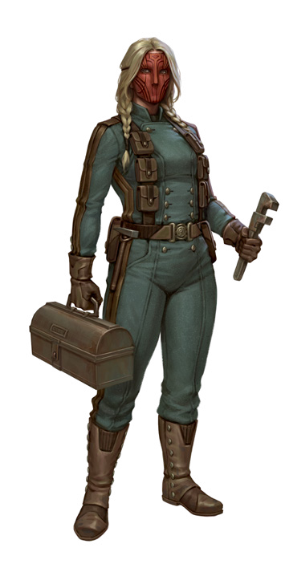

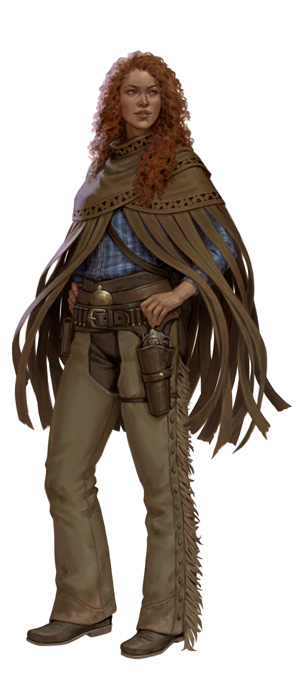

### 泰瑞司聚居地（Terris Enclaves）　第二時代

依藍戴盆地各處都有泰瑞司聚居地，規模最大、影響最深的是依藍戴城內的泰瑞司村（the Village）。聚居地由各自的席諾德管理，通常是長老議會，但每處聚居地選擇領袖的方法都不同。傳統泰瑞司文化鼓勵順從、謙和與恭敬莊重的態度。此外，泰瑞司人非常重視學問與教育，實用科學與心靈健康同樣重要。他們的膚色從淺到深都有，身高通常比非泰瑞司人高，髮色多樣，但以深色較多。有些人編辮，另一些則剃光頭。傳統派泰瑞司人會佩戴許多飾品，並穿著 tinningdar，也就是胸前帶有 V 形圖樣的長袍。即使不遵循傳統的泰瑞司人，也常在服飾中融入 V 形設計。

#### 泰瑞司聚居地姓名

Arathwyn, Gindanwyl, Hexaldweth, Idashim, Kanderwyl, Kenlew, Kwathendwyl, Marshek, Nessenwy, Nilzan, Razendal, Sazzek, Sebaam, Tellingwym, Tessen, Vedlip, Vezlanaze, Vorch, Vwadenar.

#### 泰瑞司聚居地專長

擁有泰瑞司聚居地專長的你，知道著名泰瑞司教師、長老與席諾德成員的名字。你能遵循泰瑞司習俗，取得查閱圖書館與紀錄的機會。即使不是單藏金術師（Ferring），你也熟悉藏金術，能說出各種藏金術金屬，以及各種單藏金術師能儲存的屬性（Attribute）。請選擇一處你曾經待過的泰瑞司聚居地。你知道當地的商家、學校與專精的學術領域。請選擇你接受過的教育，並決定你使用泰瑞司語口說與書寫的熟練程度。也請決定你對泰瑞司學問與冥想修習的熟悉程度。無論自身信仰為何，你都熟悉和諧與古老的泰瑞司宗教。

## 跨時代文化專長

以下文化專長可供任一時代的角色選擇，其中許多都不受特定國籍或族裔身分所限。

### 坎得拉家園（Kandra Homeland）

統御主統治時期，坎得拉（Kandra）家園是一處地下庇護所，由綿延的隧道、巨大的洞穴與舒適的小室構成。這個神祕族群由古老的第一代統治，但大多數日常事務由第二代負責。坎得拉遵守一套名為「初約」（First Contract）的法律，內容重視效忠統御主、尊敬較早世代的坎得拉、所有坎得拉的法律權利等。最後帝國時期的坎得拉契約（Contract）也禁止殺死人類，並要求坎得拉在契約持有人死亡，或自己違反契約時，返回家園。落灰之終之後，坎得拉與人類共同生活在依藍戴盆地，家園成為他們拜訪，而非居住的地方。

#### 坎得拉家園姓名

CharSun, CheOon, DenMar, Draalm, FhorSell, JeOrr, JilMaar, KeeLaan, Laahm, LunPook, ParSaag, RaDuun, RenKood, SaCaar, SovDell, TaLeur, TeeSar, TeSun, VarLuur, ZanMuur.

#### 坎得拉家園專長

坎得拉家園專長通常只有坎得拉角色能選。如果你是其他血統，但曾與坎得拉一起生活，或有密切合作，GM 可能會允許你選擇這項專長。

*泰瑞司藝術家（左）與坎得拉的真體（True Body）。*

第 2 章：起源 46

DEANDRA SCICLUNA

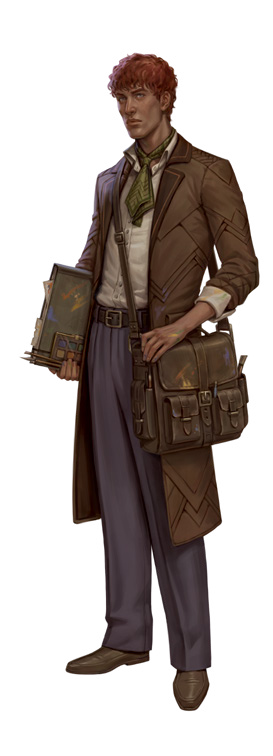

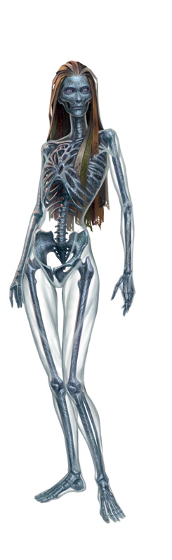

擁有坎得拉家園專長的你，知道第一代成員的名字，以及第二代各自的專長領域與職責。你理解初約的條款與要求，也知道坎得拉歷史的其他祕密，包括本章前文〈坎得拉血統〉中的資訊。若遊戲設定在第一時代，請決定你有多少家園之外的活動經驗；若設定在第二時代，你熟悉坎得拉的活動、生意與休閒去處，也熟悉現代坎得拉的習俗與規則。請選擇你接受過的教育，並決定你使用帝國語／司卡語與泰瑞司語口說及書寫的熟練程度。無論自身信仰為何，你都熟悉泰瑞司諸神：存留（Preservation）與滅絕（Ruin）；若遊戲發生在落灰之終之後，你也熟悉和諧。

### 上流社會（High Society）

最後帝國時期，貴族在奢華舞會、餐桌與吸菸室裡談生意、處理政治事務。落灰之終之後，不平等仍然普遍，只是不再受到如此嚴格的制度維護。即使在和諧的世界中，許多貴族仍緊握領導權，新興的實業家與銀行家階級也躋身上流社會。你不必出身貴族也能選擇這項專長。你可能只是懂得如何在富人圈中周旋，也可能曾仔細研究過自己的敵人。

#### 上流社會專長

擁有上流社會專長的你，深諳富人與貴族的禮儀、規矩與時尚。你知道當地貴族的名字，也瞭解他們的影響力如何延伸至商業與政治。你幾乎總能弄到舞會或類似活動的邀請函。

### 地下社會（Underworld）

對司卡的剝削，促使地下社會蓬勃發展。反抗者與革命者在暗中謀畫，盜賊與騙徒集團則設法取得自己應得的一份。即使在落灰之終之後，紛爭與不平等仍很常見，富豪權貴的算計迫使窮人走上犯罪之路，也吸引想投機取巧的人加入。

#### 地下社會專長

擁有地下社會專長的你，知道或能迅速查出當地的權力掌握在誰手中，無論對方是否被視為合法勢力。你幾乎總能聯絡上盜賊、幫派與集團，即使得透過熟人的熟人牽線。你能理解地下社會的暗號，例如走私者的標記與盜賊黑話。你很容易就能找到銷贓人或贓物買家，不過報酬有多少，風險也就有多高。

### 旅行者（Wayfarer）

一直都有司卡德利亞人因為職業、流亡或觀光，而過著四處旅行的生活。你可能是從焦土往內陸前進、鼓動反抗的游牧者，可能是遠離家鄉、尋找奇觀的紳士或淑女學者，也可能是來自蠻橫區、尋求新家的流浪者，甚至是渴望親眼看看依藍戴的 Malwish 探索者。無論原因為何，長年旅行都讓你熟悉所處時代的導航與交通，以及旅途中的危險。

#### 旅行者專長

擁有旅行者專長的你，瞭解各國地理，能閱讀各國地圖與跨國地圖。你擅長與遠方來客交流文化。你學會了司卡德利亞各地的俚語與其他類似的文化共通話題，能藉此贏得信任與援助。你也能辨認世界各地的野生動物與家畜。

### 其他文化

角色不受本章列出的文化限制。只要 GM 同意，你也可以選擇其他文化專長，例如以下幾種：

- **其他地區。** 你可以扮演出身於本章未詳述的文化，或熟悉該文化的角色。只要角色合理地具備某種文化的專業知識，就儘管為該文化建立自己的專長。
- **次文化。** 如同上流社會與地下社會專長，許多次文化都有超越國籍或族裔身分的價值觀與規範。你可以為社會中的其他次文化建立專長，例如軍旅生活（Military Life）。

第 2 章：起源 47

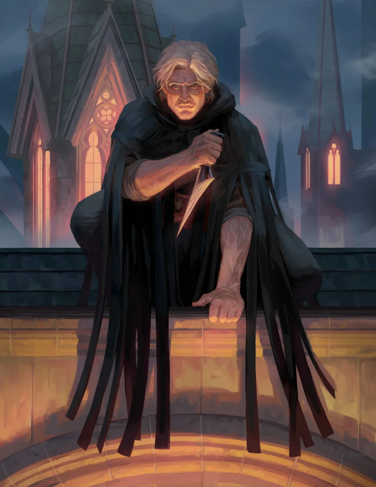