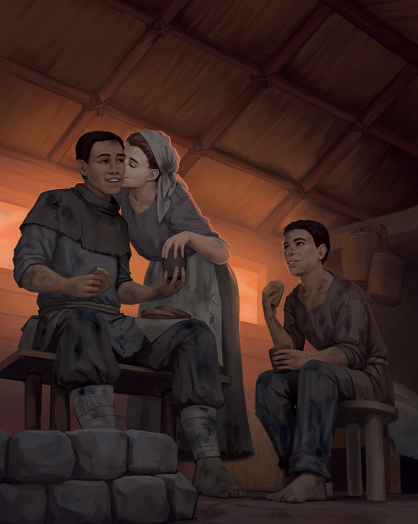
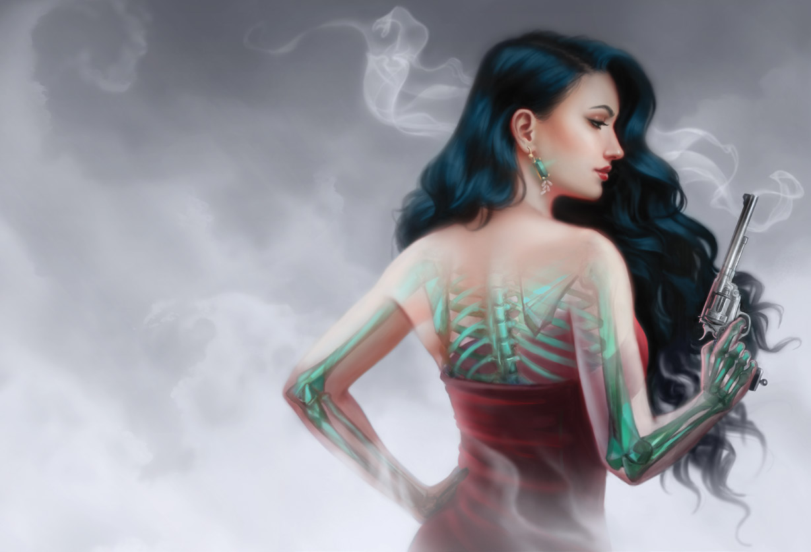
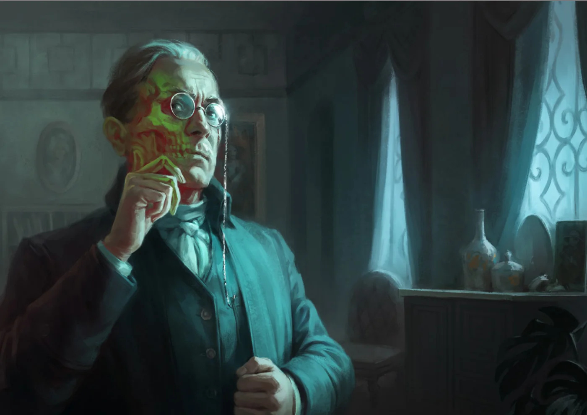
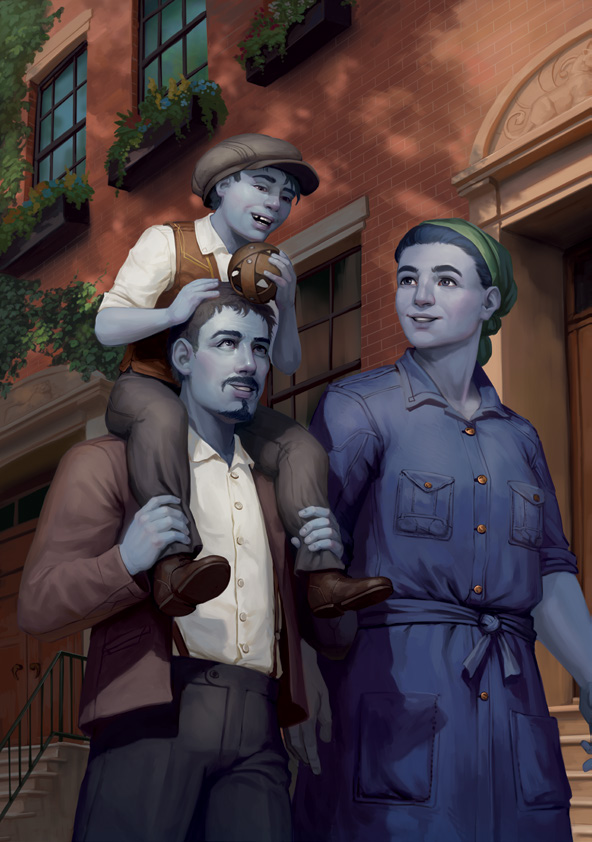

### 第 2 章：起源

你的角色（Character）的人生故事，早在遊戲開始之前就已展開。你當然不必寫出足以填滿一座圖書館或一塊紅銅意識（Coppermind）的背景故事。不過，只要大致了解角色從何而來，以及他可能如何與其他 PC 產生關聯，你的戰役（Campaign）就會更有意義。本章協助你打下這個基礎，其中有些選擇純粹是為故事增添色彩，有些則會顯著影響你的遊戲數據。

## 思考你的起源

開始建立角色時，想一想他走過怎樣曲折的道路，才來到冒險（Adventure）即將展開的這一刻。他出身何處、來自什麼樣的人家？他花時間學過些什麼，無論是出於自願，還是迫於無奈？他的個性如何影響他的興趣？最重要的是，你希望透過他的起源，為什麼樣的故事鋪路？到了角色建立的步驟 7，你會確定這些細節。不過，現在先想一想，就能為其他創角選擇帶來靈感。

最有趣、最令人滿足的故事，往往較少著墨於角色能做出什麼酷炫的事，而是更關注他為了達成這些事，付出了什麼犧牲、克服了什麼挑戰。無論你的角色是金屬之子（Metalborn）、坎得拉（kandra），或是出身較為平凡的人，過去多半都曾經歷艱辛，並努力堅持下來。記住這一點，現在就從起源開始，打造你的角色故事吧。

### 血統與文化

在角色建立的步驟 1，你會選擇血統（ancestry），以及塑造你的文化（Culture）。本章後續各節會詳細介紹這些選擇，以及它們如何影響遊戲規則。

### 故事考量

你會在角色建立的步驟 7，決定更多故事細節，但現在就可以開始思考以下因素。它們不會影響你的遊戲數據，卻確實會塑造你的為人，以及你在冒險中如何應對。

#### 階級

最後帝國（Final Empire）有嚴格的階級制度，將人們分為貴族（Noble）、司卡（skaa）與泰瑞司（Terris）人。決定角色出生於哪個世襲階級，有助於思考他認識誰、抱持什麼目標，以及能動用什麼資產。落灰之終（Catacendre）之後，階級仍由出身決定，但社會更加重視財富。你的角色可能來自與上流社會（High Society）有淵源的古老家族，也可能投身於正在改變世界運作方式的新興事業。無論哪個時代，貧富不均都是司卡德利亞（Scadrial）衝突的重要成因。

#### 職業

你可以依角色的年齡與能力，決定他過去或現在的職業。這段經歷不必直接對應你的選擇或在隊伍（Party）中的角色，但只要你願意，它就能影響許多決定。例如，職業可能影響你之後選擇的天賦（talent），起始裝備（Equipment）也可能反映你的職業。冒險之間有空檔時，你甚至可以靠手藝賺取盒金（Boxing）（見第 9 章〈休整期〉〔Downtime〕）。記得，你的經歷與本領應與等級（Level）相符。1 級角色還不會是團隊領袖，但只要有適當的專長（Expertise），你可以替盜賊團工作。

#### 身分認同

你的社會階級與職業或許屬於過去，但身分認同中的許多部分，無論走到哪裡都會跟著你。你幾歲？你的性別認同是什麼？是否有任何團體，無論是因環境而加入，還是出於自己的選擇，是你核心認同的一部分？

對頁：一位克羅司混血（koloss-blooded）戰士（Warrior）、一位人類（Human）殺霧者（Hazekiller），以及一位坎得拉神射手（Sharpshooter）精彩地撤離現場。

第 2 章：起源 31

KIERAN YANNER

#### 親友與派系

你越是孤單，有個能依靠的人就越重要。想一想，哪些關係對你的影響最深？可能是家人（包括你自己選擇的家人）、老朋友、信任的同事、勢不兩立的勁敵（Rival）等等。你是否對某人負有責任、欠了某人的債，或正為某人哀傷？除了個人，你還效忠哪些派系？第一時代，你可能與司卡地下組織或鋼鐵教廷（Steel Ministry）有關；第二時代，你可能與政府、宗教或工會有關。無論哪個時代，你都可能與貴族家族或祕密組織有所牽連。

## 血統

你的血統反映你的祖先是誰。在角色建立的步驟 1 選擇血統，會影響你的身分認同與大致外貌，也會賦予你天賦或其他能力，讓各物種的獨特特質在遊戲規則中呈現。

血統或許是你身分認同的重要部分，卻不會決定你的一切。本章稍後，你會選擇自己成長時所處的文化與社會，也可能再選一種你如今認同的文化。這些因素會影響你看待世界的方式，以及你對自己的期許，而這些期許可能與他人對你的期待不同。

本節詳述居住在司卡德利亞的三種智慧物種：人類、坎得拉與克羅司混血。

## 人類血統

在司卡德利亞，統御主（Lord Ruler）強制隔離不同的人類族群。他嘗試改造基因，並強制推行育種計畫（Breeding Program），讓人們更加相信最後帝國的司卡、貴族與泰瑞司人，在身體特徵上有所差異，包括身高、強健程度與生育率。鋼鐵教廷的教義將此稱為「平衡」（Balance）。事實上，統御主多半未能造成這些基因上的差異，但在過程中，確實帶來了深遠的文化傷害。

不同族群之間的主要差異，是他們擁有金屬之子能力的可能性，而這種潛能會透過血脈傳承。最後帝國時期，人類可能是迷霧之子（Mistborn）、藏金術師（Feruchemist），或迷霧人（Misting）。

落灰之終之後，和諧（Harmony）將所有直接遭到改造的人類基因恢復原狀。最後帝國的族群隔離也就此結束，個體變得更加多元。這也促成了雙生師（Twinborn）的出現：同時展現一種迷霧人能力與一種單藏金術師（Ferring）能力的罕見人物。

人類血統的規則適用於所有司卡德利亞人類，包括未受最後帝國統治的南方司卡德利亞人。金屬之子的能力以第 5、6 章的天賦呈現。族群的歷史則可透過你選擇的專長來表現。本章〈文化〉一節會介紹司卡德利亞各地區，以及居住在當地的族群。

### 選擇人類血統

如果你選擇人類血統，你的體型（Size）為中型（Medium），並在指定等級獲得以下好處：

**血統額外天賦（Ancestry Bonus Talents，第 1、6、11、16、21 級）。** 在角色建立的步驟 5，你會獲得一項額外天賦（Bonus Talent）。身為人類，你必須從英雄路徑（heroic path）中選擇這項天賦，例如第 4 章介紹的路徑。每當你達到新的階層（Tier）（見第 1 章的角色成長表），你會再次獲得一項英雄路徑的額外天賦。和一般情況相同，你必須符合這些天賦的前提條件（Prerequisite）（見第 4 章〈在路徑中成長〉）。

一家司卡人共享一餐。

LINDA LITHÉN

## 坎得拉血統

坎得拉是統御主創造的不朽間諜。牠們原本是霧魅（mistwraith），透過兩根稱為祝福（Blessing）的血金術尖刺（Hemalurgic Spike）獲得智慧。坎得拉接受的祝福不同，所獲得的特定好處也不同。

本章〈文化〉一節的坎得拉家園（Kandra Homeland）專長，概述了所有坎得拉都略知一二的資訊。你可以在《迷霧之子世界指南》（Mistborn World Guide）第 2 章，進一步了解坎得拉。

### 坎得拉世代

最後帝國統治時，坎得拉大約每隔一百年就會創造新一代同胞。如果你在第一時代遊玩，你的坎得拉角色多半來自第三代到第十代，不過若獲得 GM 許可，你也可能扮演第二代或第十一代的坎得拉。如果你在第二時代遊玩，角色很可能來自第十一代，因為這個時代仍活著的年長坎得拉已經很少。（所有坎得拉初代（First Generation）都是 NPC。）

### 坎得拉身體

在自然狀態下，坎得拉是一團可塑、半透明、膠質般的血肉。坎得拉能以骨骼為支架，將自己塑形成骨骼所屬之人的模樣。這個過程的快慢取決於技巧。年輕坎得拉可能需要數小時乃至數天才能形成外貌，熟練的年長坎得拉卻可能只需要幾秒。

坎得拉的身體通常與模仿對象的身體無法區分，但仍有一些限制。身體太小，會限制坎得拉清楚思考的能力；身體較大，則需要吞食更多物質。此外，坎得拉無法製造毛髮，必須使用現成的毛髮，一根一根安置到新身體上。

MeLaan 展露她的翡翠真體（True Body）。

第 2 章：起源 33

MIRANDA MEEKS

當坎得拉沒有採取其他物種的形態，例如與其他坎得拉相處或獨處時，可能會使用自己的「真體」。牠們驕傲地展示喜愛的人造骨架，透過半透明的皮膚，骨架清晰可見。這些骨骼可以由木頭、石頭製成，較少見的材料則包括水晶或玻璃。較年長的世代往往偏好保守、近似人類的真體；年輕世代則常創造更奇特的真體，或採用動物骨骼。（你的坎得拉角色可以獲得真體作為獎勵〔Reward〕，提升屬性〔attribute〕並取得其他好處，詳見第 8 章。）

### 坎得拉契約

坎得拉被創造出來並獲得祝福之後，會學習初約（First Contract）。這是一套準則，強調對統御主的奉獻、坎得拉的法定權利等內容，詳見本章後面的坎得拉家園專長。

最後帝國初期，坎得拉在彼此之間另訂了一份契約（Contract）。人類害怕坎得拉取代他人的能力，因此鎔金術師（Allomancer）曾獵殺坎得拉，幾乎使牠們滅絕。坎得拉為了從憎恨牠們的人類手中拯救同族，創立了這份新契約。

在契約中，坎得拉誓言服務人類，除非受人類契約約束，否則留在家園，而且絕不殺死人類。契約也規定，坎得拉只能奉契約持有人的指示更換骨骼。這份契約實際上使坎得拉淪為人類的奴僕，許多坎得拉也因此對人類的控制心懷怨懟。

在第一時代建立坎得拉角色時，請與 GM 合作，設計一位持有你契約的人類贊助者（Patron）。決定契約持有人的目標與你有多一致，以及對方會在你的冒險中參與到什麼程度。這位贊助者會提供供你模仿的骨骼，並期望你偶爾完成任務（Mission）。對方以天金（Atium）付酬，而你應將天金帶回家園。（建立贊助者的進一步指引，請見第 8 章〈贊助者〉。由於契約之下存在剝削性的權力失衡，你也可能希望參考第 13 章〈安全指南〉。）

在第二時代建立坎得拉角色時，請確定自己目前在人類社會中的身分。身為這個時代的坎得拉，你不再受到契約約束，而且很可能為和諧擔任密探（Agent）。第二時代的坎得拉不再住在家園中，可以在人類之間建立自己的生活。

### 選擇坎得拉血統

如果你選擇坎得拉血統，你的體型為中型，不能選擇第 5 章金屬之子路徑的天賦，並在指定等級獲得以下好處：

**坎得拉屬性（第 1 級）。** 在角色建立的步驟 3，你只能將 6 點分配到六項屬性，而不是一般的 12 點。作為交換，你會在同一個創角步驟，從接下來的〈坎得拉祝福〉一節選擇一種祝福。（請注意，你的坎得拉偽裝〔Kandra Disguise〕天賦，會暫時以吞入身體的力量〔Strength〕、速度〔Speed〕與察覺〔Awareness〕取代你的對應屬性，因此你可能會想優先分配其他屬性。）

**專屬天賦樹（第 1 級）。** 每次選擇新天賦時，除了你原本能使用的其他天賦樹（talent tree），你也可以從坎得拉天賦樹選擇。

**自然形態（Natural Form，第 1 級）。** 你獲得坎得拉天賦樹中的自然形態（坎得拉關鍵天賦〔Key Talent〕）天賦與坎得拉偽裝天賦。此外，在之後的遊戲中，你可以獲得構成真體的骨骼作為獎勵（見第 8 章〈坎得拉真體〉）。

**血統額外天賦（第 6、11、16、21 級）。** 每當你達到新的階層（見第 1 章的角色成長表），會再次獲得一項額外天賦。你必須從坎得拉天賦樹或任一英雄路徑中選擇這項天賦（見第 4 章）。

和一般情況相同，你必須符合這些天賦的前提條件（見第 4 章〈在路徑中成長〉）。

:::note[建立已經偽裝的坎得拉]

許多坎得拉角色擔任外勤密探。如果你想扮演一位戰役開始時就已經偽裝好的坎得拉，可以在 GM 裁定允許的範圍內，採取一位外貌由你選擇的平民（Commoner）的形態。這仍遵循坎得拉偽裝天賦的一般規則。採取平民形態時，你的力量為 0、速度為 1、察覺為 1。

:::

### 坎得拉祝福

每位坎得拉至少有一種祝福，也就是一對長三吋的血金術尖刺，賦予牠智慧與其他好處。在角色建立的步驟 3，從以下祝福中選擇一種。即使你處於坎得拉偽裝形態，祝福也會生效：

**意識的祝福（Blessing of Awareness）。** 你的察覺增加 2，察覺的屬性值上限也增加 2。

第 2 章：起源 34

**力量的祝福（Blessing of Potency）。** 你的力量增加 1，速度增加 1。力量與速度的屬性值上限也各增加 1。

**存在的祝福（Blessing of Presence）。** 你的智力（Intellect）增加 1，風采（Presence）增加 1。智力與風采的屬性值上限也各增加 1。

**穩定的祝福（Blessing of Stability）。** 你的意志（Willpower）增加 2，意志的屬性值上限也增加 2。

**堅韌的祝福（Blessing of Fortitude）。** 你的偏轉值（Deflect）增加 1。處於坎得拉偽裝形態時，你的偏轉值能減少衝擊傷害（Impact Damage）。

**取得第二種祝福。** 達到階層 3 後，你可以獲得第二種祝福作為獎勵。你必須選擇與第一種不同的祝福，並在第一種祝福的好處之外，同時獲得第二種祝福的好處。

不過，每位坎得拉在創造時都只有一種祝福，因此要取得第二種，前提是原本持有該祝福的坎得拉已經死亡。請與 GM 討論，決定你能否從已被他人殺死的坎得拉身上取得祝福，還是必須殺死活著的坎得拉，才能奪取對方的祝福。

**取得其他血金術尖刺。** 你的祝福尖刺不會帶來其他血金術尖刺的負面副作用。不過，只要你體內仍有成對的祝福尖刺，就不能再植入不屬於祝福的其他血金術尖刺（見第 8 章〈血金術尖刺〉）。

如果你取出一對祝福尖刺中的一根，就可以植入一根血金術尖刺。不過，你也會暫時失去祝福的好處，而且對自身心智狀態的掌握會更加薄弱。缺少一根祝福尖刺時，GM 可以花費 [變故]，以你和 GM 都認為最合適的方式，削弱你對現實的掌握。

### 坎得拉天賦

以下天賦適用於擁有坎得拉血統的角色。如何閱讀及使用這些天賦，請見第 4 章〈使用天賦〉。

#### 自然形態（坎得拉關鍵天賦）

前提條件：坎得拉血統

啟動（Activation）：[常駐]

*你不定形的身體能輕易避開足以刺穿或割開血肉的危險，也能鑽入狹窄的空間。*

身為坎得拉，你的自然形態是一團可塑、不定形的肌肉。無論你處於自然形態或坎得拉偽裝形態，都獲得以下好處：

- 你的偏轉值在對抗銳利傷害（Keen Damage）時增加 5。

- 受到銳利傷害時，你忽略穿刺（Pierce）武器特性。

- 你的傷勢（Injury）擲骰（Roll）結果低於 0 時，改為視為 0；但若傷勢來自酸、火焰，或其他會徹底摧毀坎得拉身體的手段，則不適用。

- 你不受情緒鎔金術（Allomancy）影響，包括黃銅（Brass）鎔金術與鋅（Zinc）鎔金術，除非施術者花費至少 6 點授予（Investiture）。

處於自然形態時，你還會受到以下效果影響：

- 你可以用 [1行動] 改變形狀，穿過直徑至少 1 呎的開口。

- 你無法說話，也難以溝通。

- 多數人類文化會以恐懼或輕蔑的眼光看待你。

你可以改用坎得拉偽裝天賦，變成所吞入人類的形態，不引人注意地融入人類社會。

#### 坎得拉天賦樹

| 天賦 | 啟動 | 圖中所列前提條件 | 摘要 |
| --- | --- | --- | --- |
| 自然形態（坎得拉關鍵天賦） | [常駐] | 坎得拉血統 | 處於不定形形態時，你無法說話，但可以穿過狹小開口。無論處於哪種形態，你都對傷勢與銳利傷害有一定抵抗力。 |
| 坎得拉偽裝 | [特殊啟動] | —| 在一次長休息（Long Rest）期間，吞入一名小型（Small）或中型人類，並採取其形態，以對方的力量、速度與察覺取代你的對應屬性。 |
| 即興模仿（Improvised Imitation） | [常駐] | 洞察（Insight）2+ | 觀察一名角色一個場景（Scene），以模仿其習慣舉止，並在相關的欺騙（Deception）檢定（Test）中獲得優勢（Advantage）。 |
| 體內藏物（Secret Away） | [1行動] | —| 你或附近一位盟友（Ally）可以在你體內的隱密隔間存放或取出一件物品。 |
| 快速重塑（Rapid Reshaping） | [常駐] | 醫學（Medicine）2+ | 吞入角色並採取其形態，只需要一次短休息（Short Rest），而非長休息。 |
| 活體工具（Organic Tools） | [常駐] | 竊術（Thievery）2+ | 將附肢精細塑形成工具，並在相關的竊術與工藝（Crafting）檢定中獲得優勢。 |
| 令人反感的形態（Distasteful Forms） | [常駐] | 醫學4+ | 吞入小型與中型的非人類，並採取其形態，從其身體形態獲得額外好處。 |
| 創意形態（Creative Forms） | [2行動] | 洞察3+ | 微調你的臉部與其他特徵。模仿特定角色時，進行欺騙檢定。 |

天賦樹連線：自然形態 → 坎得拉偽裝；坎得拉偽裝 → 即興模仿；坎得拉偽裝 → 體內藏物；即興模仿 → 快速重塑；體內藏物 → 活體工具；快速重塑 → 令人反感的形態；快速重塑 → 創意形態；活體工具 → 創意形態。

第 2 章：起源 35

#### 創意形態

前提條件：洞察3+；快速重塑天賦或活體工具天賦

啟動：[2行動]

*經過世代累積的練習，你能富有創意地塑造肌肉，不再只是模仿所吞入的生物。*

你可以對坎得拉偽裝天賦產生的形態，做出富有創意的小幅調整，例如改變五官與體重，讓你不再像所用骨骼原主人的模樣。

如果你想用這種方式模仿特定人物，在與認識對方的人互動時，必須通過欺騙檢定，才能避免引起懷疑。不過，如果你先花費一般所需的時間，研究模仿對象，就會在這次檢定中獲得優勢。

#### 令人反感的形態

前提條件：醫學4+；快速重塑天賦

啟動：[常駐]

*多數坎得拉對採取人類以外生物的形態感到反感。不過，像你這樣勇於嘗試的坎得拉，已經發現了其他形態的實用之處。*

使用坎得拉偽裝時，你可以吞入任何小型或中型角色，並採取其形態，不再限於人類。處於該形態時，你也會獲得其自然身體天生具備的下列任何好處：武器（Weapon）、偏轉值、移動速率（Movement Rate）與感官。不過，你的骨骼非常脆弱。如果該形態賦予你偏轉值，你不能用這個數值減少衝擊傷害。

#### 即興模仿

前提條件：洞察2+；坎得拉偽裝天賦

啟動：[常駐]

*你比多數坎得拉更擅長即興應變。只需簡單觀察幾次，就能精準推演出一個人平時的習慣舉止。*

如果你在吞入角色的骨骼前，仔細觀察對方一個場景，就能令人信服地模仿其習慣舉止。涉及你所不了解的對方過去資訊時，你在欺騙檢定中獲得優勢。不過，要完美模仿一個角色而不必進行欺騙檢定，你仍需花費一般所需的一個月研究。

#### 坎得拉偽裝

前提條件：自然形態關鍵天賦

啟動：[特殊啟動]

*你可以吞入一個人類的骨骼，完美變成對方的形態。如果你先在對方生前加以研究，還能精湛地模仿其習慣舉止。*

你可以放棄一次長休息的一般好處，改用這段時間吞入一名小型或中型人類的身體。完成後，只要骨骼仍留在你體內，你就會維持該角色的形態。處於這種形態時，你會受到以下效果影響：

- 暫時以你吞入的角色的力量、速度與察覺屬性，取代你的對應屬性，但坎得拉祝福仍然有效。更新所有依賴該屬性的數據，詳見第 3 章各屬性的小節。如果這使你的生命值（Health）上限增加，目前生命值也增加相同數值。如果這使生命值上限降低，目前生命值不變，除非會超過新的上限。

- 當你受到會折斷或移除骨骼的傷勢時，無法治癒該骨骼。因此，只要你維持這種形態，傷勢就是永久的。如果你排出這具形態的骨骼，就會失去該傷勢；但如果再次採取這種形態，就會重新得到該永久傷勢。

- 即使是熟識骨骼原主人的人，也無法從身體上區分你與對方。此外，如果你在對方生前，觀察或以其他方式研究對方一個月，就能完美模仿其習慣舉止。與認識對方的人一般交談時，不需要通過欺騙檢定，就能冒充該角色。不過，如果談到研究中不曾得知、極為特定或私密的資訊，GM 可能會要求你通過欺騙檢定，以免引起懷疑。

你可以用 [1行動]，選擇排出這具形態的骨骼，回到自然形態。如果保存這些骨骼，之後就能如同初次吞入一具身體那樣，利用它們再次採取該形態。

第 2 章：起源 36

#### 活體工具

前提條件：竊術2+；體內藏物天賦

啟動：[常駐]

*你可塑的身體不只能模仿他人，還能塑成特殊形狀，充當開鎖工具或其他工具。*

你能迅速將附肢重塑為工具，用來開鎖或進行其他精細操作。此外，能藉助這類工具的竊術與工藝檢定，你都獲得優勢。

#### 快速重塑

前提條件：醫學2+；即興模仿天賦

啟動：[常駐]

*其他坎得拉需要數小時，甚至數天，才能模仿他人的形態。透過大量練習，你改變形態所需的時間，只有他們的一小部分。*

你可以使用坎得拉偽裝天賦，在一次短休息期間吞入角色的身體，而不必花費一次長休息。

#### 體內藏物

前提條件：坎得拉偽裝天賦

啟動：[1行動]

*你能在肌肉上形成一道裂口，將外來物品藏在體內，躲過拍身搜查，也避開鎔金術的影響。*

你可以使用互動（Interact）行動（Action），在體內看不見的隔間取出或存放一件物品；也可以讓一位能碰觸到你的角色，改由對方使用該行動來這麼做。

這個隔間能藏一件長度不超過你前臂的物品。只有在一種授予之術（Invested Art）中擁有至少 6 個技能等級（Rank）的角色，才能用該授予能力影響藏在裡面的物品。

歐瑟（OreSeur）偽裝成雷弩大人（Lord Renoux）。

SVETLANA KOSTINA

## 克羅司混血血統 [第二時代]

克羅司混血是最後帝國克羅司（koloss）的後裔。落灰之終之後，克羅司能夠彼此生育，也能與人類生育。這些孩子出生時沒有尖刺（見〈克羅司的歷史〉），因此是克羅司混血，而不是完整的克羅司。克羅司混血所生的孩子，也同樣是克羅司混血。

克羅司有藍色皮膚與紅色眼睛，但克羅司混血後裔的膚色多樣，從斑駁的灰色到各種深淺的藍色都有。克羅司混血天生並不比人類更強壯或高大，但可以透過密集的體能訓練，增加力量與體型。

本章〈文化〉一節的克羅司混血專長，介紹克羅司混血的文化，以及他們如何生活在依藍戴盆地（Elendel Basin）與蠻橫區（The Roughs）各地。你可以在《迷霧之子世界指南》第 2 章，進一步了解克羅司混血。

### 克羅司的歷史

第一時代，克羅司是統御主手下最危險的部隊，巡邏外圍統御區（Outer Dominances）、鎮壓叛亂，並讓心懷恐懼的貴族服從。克羅司以四根鐵（Iron）血金術尖刺製成，擁有驚人的身體力量、更強的韌性，以及更強烈的暴力衝動。克羅司終其一生都會持續成長，最高可達十二呎。

落灰之終之後，和諧改造了克羅司，使其成為能自行繁衍的物種。創造克羅司所用的古老血金術尖刺會自然衰退，因此現代克羅司在轉變過程中，靈魂（Spiritual）受到的影響較小。

第二時代，克羅司混血生活在依藍戴盆地與蠻橫區各地。蠻橫區的克羅司混血，往往與克羅司氏族有較直接的親屬關係；盆地中的克羅司混血，則常聚居於大城市的社區或街區。

### 成為克羅司

大多數克羅司混血少年在剛進入青少年時期，就必須決定接受尖刺、成為克羅司，還是拒絕尖刺、維持克羅司混血的身分。這對克羅司氏族或克羅司混血社群而言，是令人振奮的時刻，因為少年正選擇如何塑造自己族人的靈魂與身體。無論接受還是拒絕尖刺，都值得慶祝。氏族重視的是出於真心的選擇，勝過選擇的結果。

不過，這種轉變並不限於年輕人。年紀較長的克羅司混血，甚至人類，也可以選擇接受克羅司尖刺，成為完整的克羅司。PC 可能在冒險中發現尖刺，也可能在與克羅司氏族建立贊助與交情後，最終獲贈尖刺。不過，PC 一旦接受這些尖刺，就會成為克羅司 NPC。

### 選擇克羅司混血血統

如果你選擇克羅司混血血統，你的體型為中型，並在指定等級獲得以下好處：

**克羅司屬性（第 1 級）。** 你的力量屬性值上限增加 1，而且在角色建立的步驟 3，可以將最多 4 點屬性點投入力量，而不是 3 點。

**克羅司耐力（Koloss Stamina，第 1 級）。** 你獲得克羅司混血天賦樹中的克羅司耐力（克羅司混血關鍵天賦）天賦。

**專屬天賦樹（第 1 級）。** 每次選擇新天賦時，除了你原本能使用的其他天賦樹，也可以從克羅司混血天賦樹選擇。

**血統額外天賦（第 6、11、16、21 級）。** 每當你達到新的階層（見第 1 章的角色成長表），會再次獲得一項額外天賦。你必須從克羅司混血天賦樹或任一英雄路徑中選擇這項天賦（見第 4 章）。

和一般情況相同，你必須符合這些天賦的前提條件（見第 4 章〈在路徑中成長〉）。

### 克羅司混血天賦

以下天賦適用於擁有克羅司混血血統的角色。如何閱讀及使用這些天賦，請見第 4 章〈使用天賦〉。

#### 克羅司耐力（克羅司混血關鍵天賦）

前提條件：克羅司混血血統

啟動：[常駐]

*你能適應身體承受的壓力，透過訓練，承擔比一般人更多的負荷。*

角色建立時，以及每次獲得一個等級時，你的生命值上限與目前生命值都增加 1。

第 2 章：起源 38

#### 克羅司恢復（Koloss Recovery）

前提條件：運動（Athletics）2+；克羅司耐力關鍵天賦

啟動：[特殊啟動]

*你比人類恢復得更快、更有效，能輕易承受足以拖慢他人的傷害。*

擲恢復骰（Recovery Die）之前，你可以選擇擲兩顆該種骰子，並將結果相加。這麼做時，你只能恢復生命值，不能恢復專注點（Focus）。

#### 快速恢復（Rapid Recovery）

前提條件：運動3+；克羅司恢復天賦

啟動：[1行動]

*就算被打得灰頭土臉，你也知道如何拍拍塵土，立刻重返戰局。*

以 [1行動] 使用恢復（Recover）行動。這麼做時，你只能恢復生命值，不能恢復專注點。每個場景中，你可以利用這項天賦，額外使用等同於你階層次數的恢復（而不是只能使用一次）。

#### 反應式恢復（Reactive Recovery）

前提條件：運動4+；快速恢復天賦

啟動：[反應]

*你的傷口以驚人的速度癒合，讓你更能承受傷勢。*

受到傷害（Damage）之前，以 [反應] 使用恢復行動。

#### 超常體型（Unchecked Size）

前提條件：等級11+；克羅司耐力關鍵天賦

啟動：[常駐]

*雖然你不會像完整的克羅司那樣，無拘束地長得那麼巨大，但你遠比人類高大強壯，甚至比許多克羅司混血同胞還高出一大截。*

取得這項天賦時，你的力量增加 1，力量的屬性值上限也增加 1。此外，除了占據的空間大小之外，所有用途都將你視為大型（Large）。

#### 克羅司混血天賦樹

| 天賦 | 啟動 | 圖中所列前提條件 | 摘要 |
| --- | --- | --- | --- |
| 克羅司耐力（克羅司混血關鍵天賦） | [常駐] | 克羅司混血血統 | 每個等級都讓你的生命值上限增加 1。 |
| 克羅司恢復 | [特殊啟動] | 運動2+ | 擲兩顆恢復骰，而非一顆；這麼做時只能恢復生命值。 |
| 超常體型 | [常駐] | 等級11+ | 力量增加 1；除了占據空間之外，所有用途都將你視為大型。 |
| 快速恢復 | [1行動] | 運動3+ | 以 [1行動] 使用恢復行動，只能恢復生命值。你可以使用的次數等於你的階層。 |
| 反應式恢復 | [反應] | 運動4+ | 受到傷害之前，以 [反應] 使用恢復行動。 |

天賦樹連線：克羅司耐力 → 克羅司恢復；克羅司耐力 → 超常體型；克羅司恢復 → 快速恢復；快速恢復 → 反應式恢復。

一家克羅司混血漫步在依藍戴（Elendel）的第三區（Third Octant）。

第 2 章：起源 39

LINDA LITHÉN

