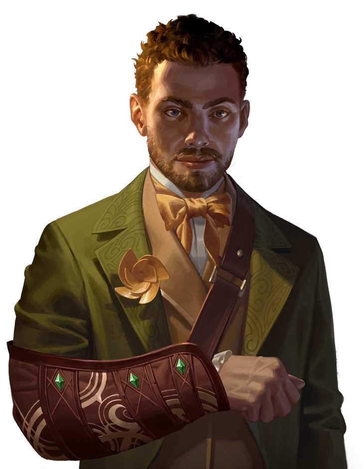

### Anastas Elariel（第一時代）

Anastas Elariel 是一名迷霧之子貴族。儘管具備才華與地位，他始終沒有闖出符合其血統與家族期待的名聲。他曾試圖刺殺依藍德．泛圖爾，失敗時留下了長期傷勢，只剩一隻手能用。這影響了他的行動，也左右了別人對他能力的看法。他避免公然施展鎔金術，在宮廷中以詩才、談吐和謹慎得體的舉止為人所知。

### Anastas Elariel

階層 2 勁敵 – 中型類人生物

實體（力量 防禦 速度） 意識（智力 防禦 意志） 靈魂（察覺 防禦 風采） 2 15 3 3 15 2 2 13 1

生命值：51（41–61） 專注點：4 授予：6

移動：30 呎。感知：10 呎（視覺）。實體技能：敏捷 +6、輕型武器 +5。意識技能：推理 +6、紀律 +5、學識 +6。靈魂技能：洞察 +4、感知 +4。金屬技藝技能：鎔金術 +3（1 技能等級，所有金屬）。

特徵

長期傷勢（Long-Term Injury）。Anastas 只有一隻手和手臂能活動。他進行實體技能檢定後，陷入精疲力竭（Exhausted）[−1]，直到場景結束。

以詩反制（Poetic Reversal）。每個場景中，Anastas 第一次要花費專注點抵抗影響時，無須花費專注點，且下一次檢定獲得一個優勢。

行動

[1行動] 打擊：小刀。攻擊 +5，觸及 5 呎或射程 20/60 呎，造成 1d4 + 5 銳利傷害。命中時，Anastas 可以花費 1 專注點，額外造成 2d4 傷害。

[1行動] 跳支舞吧？（Shall We Dance?，花費 1 授予）。Anastas 燃燒白鑞，讓步伐更靈活。他可以移動最多移動速率的一半，且不會觸發反擊機會（Reactive Strikes）。直到他的下一個輪次結束前，他無視精疲力竭狀態。

[1行動] 未受訓的鋼推（Untrained Steelpush，花費 2 授予）。Anastas 對 10 呎內每名穿戴或手持非鋁且未受授予的金屬的角色（自己除外）進行鎔金術檢定，對抗其實體防禦。成功時，目標必須放開手中的一件金屬物品（如果可以），否則就會倒地（Prone）。

[2行動] 未受訓的安撫（Untrained Soothing，花費 2 授予）。Anastas 對 10 呎內每名角色（自己除外）進行鎔金術檢定，對抗其靈魂防禦。成功時，目標的疑心受到安撫，因而放下戒心並陷入迷惑（Disoriented），直到該目標的下一個輪次結束。

↻ 未受訓的錫視（Untrained Tinsight，花費 1 授予）。在

Anastas 能感知到的角色攻擊他之前，他使該攻擊檢定承受一個劣勢。如果攻擊命中或造成擦傷，他可以立刻對攻擊者使用獲取優勢（無須花費行動）。

Anastas Elariel 的戰術

在壓力下，Anastas Elariel 的鎔金術會在短時間內猛烈爆發。遭到攻擊時，他會用未受訓的錫視擾亂對手的打擊，本能地抓住每一次命中或擦傷帶來的機會。遭到包圍時，他會用未受訓的鋼推解除對手的武裝或使其倒地。他靠「跳支舞吧？」撐過疲憊，並在有機會時立刻換位或脫離險境。

JUST HIEU

