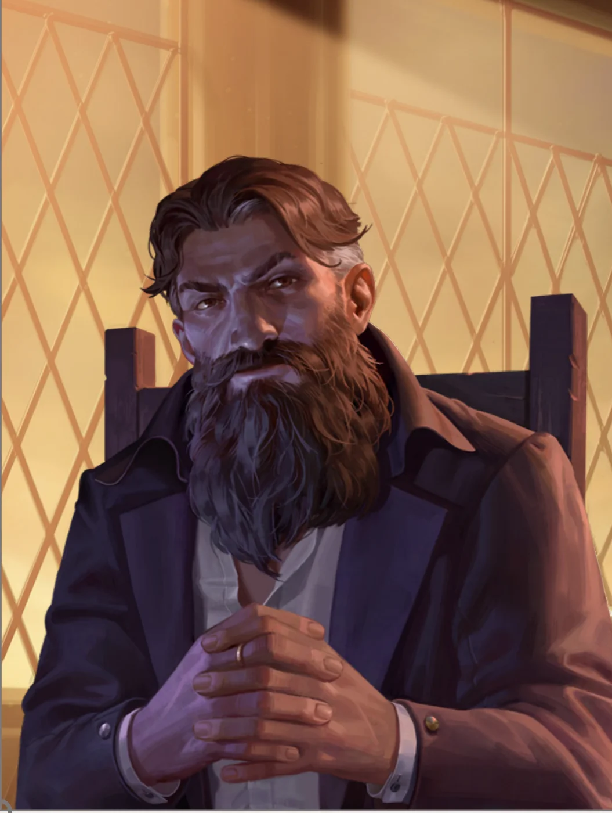
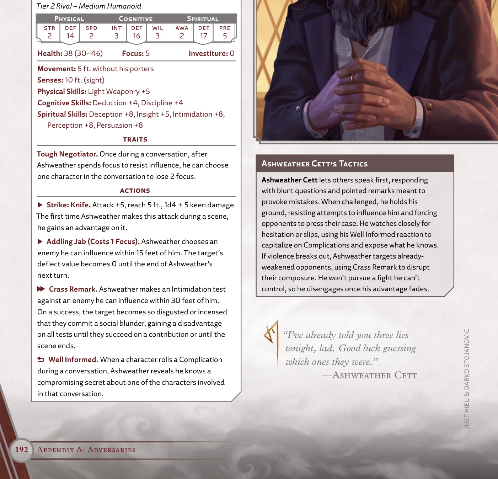

### 灰侯．塞特（第一時代）

灰侯．塞特（Ashweather Cett）是哈佛富雷克斯市的貴族，

來到陸沙德主張自己有權繼承王位。他公開以海斯丁堡為據點，親自接見議會成員和其他政界人士。塞特衣著陳舊，對首都的時尚和禮節毫不在意，說話直率而且十足自信。他自幼無法使用雙腿，去哪裡都由僕人以一把簡單的木椅抬著。

灰侯．塞特的戰術

灰侯．塞特會先讓別人開口，再以直截了當的提問和尖銳的話語誘使對方犯錯。遭到挑戰時，他立場堅定，抵抗對方的影響，逼對手為自己的主張提出更多理由。他仔細觀察對方是否遲疑或露出破綻，利用消息靈通反應抓住變故的機會，揭露自己掌握的消息。如果發生衝突，他會盯上已處於弱勢的對手，用粗鄙言論擾亂對方的心緒。他一旦失去優勢就會脫身，以免戰鬥超出掌控。

### 灰侯．塞特

階層 2 勁敵 – 中型類人生物

實體（力量 防禦 速度） 意識（智力 防禦 意志） 靈魂（察覺 防禦 風采） 2 14 2 3 16 3 2 17 5

生命值：38（30–46） 專注點：5 授予：0

移動：沒有抬椅僕人時為 5 呎。感知：10 呎（視覺）。實體技能：輕型武器 +5。意識技能：推理 +4、紀律 +4。靈魂技能：欺瞞 +8、洞察 +5、威嚇 +8、

感知 +8、說服 +8。

特徵

強硬談判者（Tough Negotiator）。每場談話一次，在

灰侯花費專注點抵抗影響後，他可以選擇一名參與談話的角色，使其失去 2 專注點。

行動

▶ 打擊：小刀。攻擊 +5，觸及 5 呎，造成 1d4 + 5 銳利傷害。灰侯在每個場景中第一次進行這項攻擊時，

獲得一個優勢。

▶ 使人分心的挖苦（Addling Jab，花費 1 專注點）。灰侯選擇 15 呎內一名他能影響的敵人。目標的偏轉值變為 0，直到灰侯下一個輪次結束。

[2行動] 粗鄙言論（Crass Remark）。灰侯對 30 呎內一名他能影響的敵人進行威嚇檢定。成功時，目標因厭惡或憤怒而失態，在所有檢定上承受一個劣勢，直到成功作出一次貢獻（contribution）或場景結束。

↻ 消息靈通（Well Informed）。當有角色擲出變故，

且當時正在談話，灰侯就會揭露自己知道一名談話參與者見不得光的祕密。

JUST HIEU & DARKO STOJANOVIC

### 「小子，我今晚已經騙了你三次。

### 祝你好運，

### 看你能不能猜出是哪三次。」

### ——灰侯．塞特

附錄 A：敵手 192

