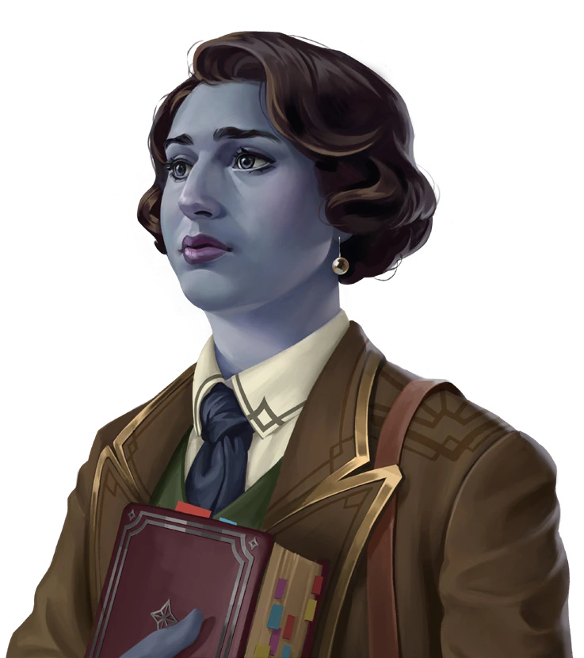

### Azmine Wilko（第二時代）

Azmine Wilko 是一名克羅司混血的人類，在依藍戴大學擔任歷史教授。她是城內研究落灰之終以前的司卡德利亞最具聲望的學者之一。Wilko 寫了大量私人日誌，記錄當代事件，讓後人得以了解今日。她也與志在取得和保存知識的獨立研究者和尋寶人密切合作。

Wilko 最近加入守護者組織。對一心尋求真相的人來說，她是難得的盟友。對那些企圖改寫歷史、掌控未來的人來說，她自然成了目標。更多關於 Wilko 的資訊，見本書導論的「重要人物」。

#### Azmine Wilko 的戰術

Azmine Wilko 會盡量置身戰鬥之外，躲在掩體後方。如果朋友受到威脅或開始動搖，她會使用「堅定不移」，讓對方恢復專注點並獲得堅定狀態。只有敵人逼近她的位置時，她才會用短管手槍攻擊。受傷時，Azmine 會用「克羅司恢復」撐到能夠脫離戰鬥。

### Azmine Wilko

階層 1 勁敵 — 中型類人生物

| 力量 | 實體防禦 | 速度 | 智力 | 意識防禦 | 意志 | 察覺 | 靈魂防禦 | 風采 |
| --- | --- | --- | --- | --- | --- | --- | --- | --- |
| 1 | 12 | 1 | 4 | 16 | 2 | 1 | 13 | 2 |

**生命值** 18（15–21）　**專注點** 4　**授予** 0  
**移動** 25 呎　**感知** 10 呎（視覺）  
**意識技能** 推理 +6、紀律 +4、學識 +7  
**靈魂技能** 說服 +4

#### 特徵

**不擅說謊。** Azmine 的所有欺騙檢定承受一次劣勢。

**熟諳歷史。** 每個場景一次，若一名 PC 與 Azmine 交談時擲出 [機遇]，她會憑藉淵博的歷史知識提供一項有用的事實或建議。某名 PC 首次進行與該事實或建議相關的檢定時，該次擲骰獲得一次優勢。

**活字典。** Azmine 的一名盟友與她交談至少一小時後，獲得一項與談話內容相關的臨時實用專長，持續到該盟友下次長休息。如果 PC 擁有博學天賦，這場談話也能讓其重新分配專長和技能等級，如同造訪圖書館。

#### 行動

**[1行動] 打擊：教科書。** 攻擊 +1，觸及 5 呎，造成 1d4 + 1 衝擊傷害。

**[1行動] 打擊：短管手槍。** 攻擊 +1，射程 20/60 呎，造成 1d4 + 1 銳利傷害。**穿刺。** 目標的偏轉值無法減免此傷害。**裝填 [6]。** 可用 [1行動] 將這把武器裝填至滿彈。

**[1行動] 克羅司恢復。** 每個場景一次，Azmine 恢復 2d6 生命值。

**[2行動] 堅定不移。** Azmine 使自己或 30 呎內一名她能影響的盟友獲得堅定狀態。目標也恢復 1 專注點。

TRISTAN BIDEAU

