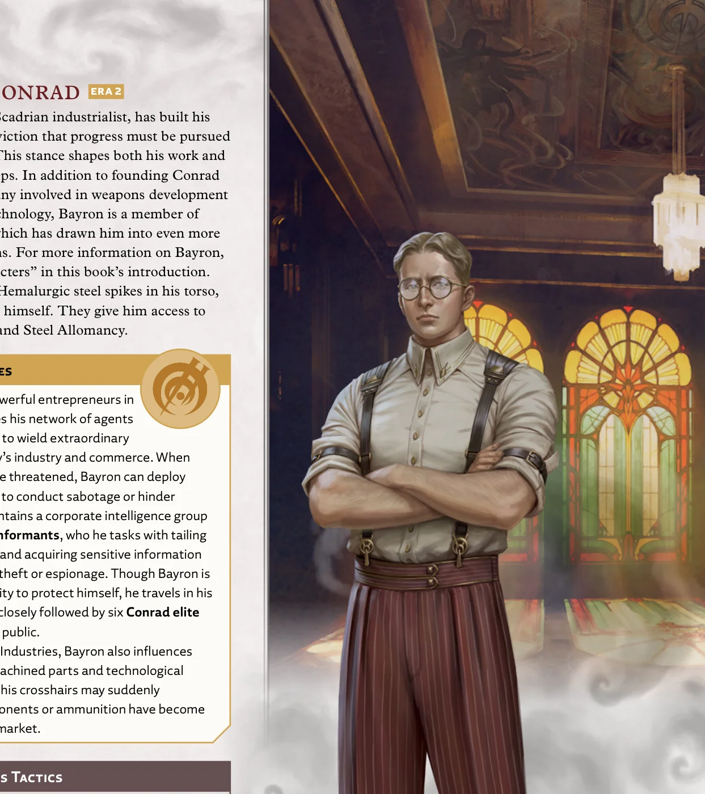
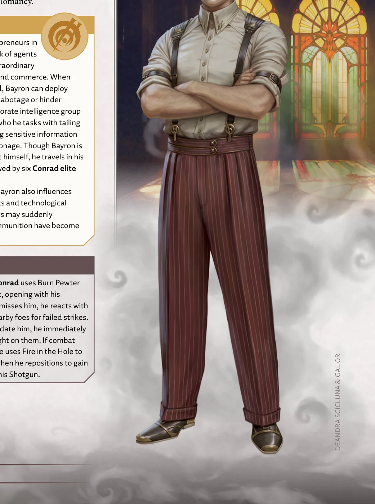
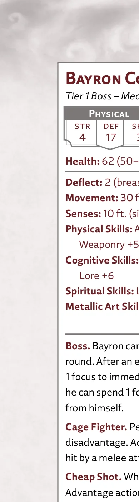
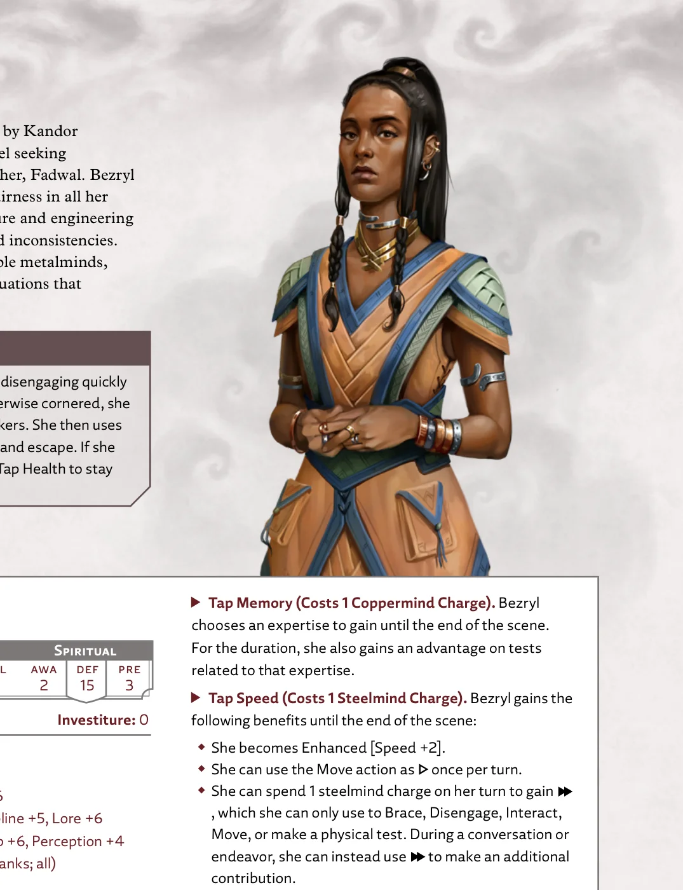

### Bayron Conrad（第二時代）

司卡德利亞實業家 Bayron Conrad 一生堅信，即使代價再大，也必須追求進步。這信念影響他的事業，也左右他與誰往來。Bayron 創辦了研發武器與監控技術的 Conrad Industries，也是鍍金三人組的一員，因而捲入更危險的計畫。更多關於 Bayron 的資訊，見本書導論的「重要人物」。Bayron 親手將兩根鋼製血金尖刺植入軀幹，因此能使用白鑞鎔金術和鋼鎔金術。

#### 鍍金資源

Bayron 是依藍戴最有權勢的企業家之一。他透過密探和工業間諜網，牢牢掌握城裡的工商業。當 Conrad 的利益受到威脅，他可以派出手下從事破壞或阻撓對手。他也養了一支由 Conrad 錫眼線人組成的企業情報小組，派他們跟蹤關注對象，藉由竊取文件或從事間諜活動取得敏感情報。Bayron 對自保能力很有信心，但他公開露面時仍搭乘裝甲汽車，身邊緊跟六名 Conrad 精銳幹員。他也透過 Conrad Industries 影響機加工零件和新技術的供應。被他盯上的人可能突然發現，市場上買不到自己急需的零件或彈藥。

#### Bayron Conrad 的戰術

一開戰，Bayron Conrad 就用「燃燒白鑞」逼近最近的威脅，先以指虎出擊。攻擊落空時，他會以「輕蔑嘲諷」應對，譏笑附近未能命中的敵人。若角色試圖威嚇他，他會立即逼近對方，集中火力對付該角色。若戰況轉而對他不利，他會用「炸彈來了」傷害敵人並使其迷惑，接著移動拉開距離，改用霰彈槍。

附錄 A：敵手 194

DEANDRA SCICLUNA & GAL OR

### Bayron Conrad

階層 1 首領，中型類人生物

| 力量 | 實體防禦 | 速度 | 智力 | 認知防禦 | 意志 | 察覺 | 靈性防禦 | 風采 |
| --- | --- | --- | --- | --- | --- | --- | --- | --- |
| 4 | 17 | 3 | 4 | 17 | 3 | 2 | 16 | 4 |

**生命值** 62（50–74）　**專注點** 5　**授予** 6  
**偏轉值** 2（胸甲）　**移動** 30 呎　**感知** 10 呎（視覺）  
**實體技能** 運動 +6、重型武器 +6、輕型武器 +5  
**意識技能** 工藝 +6、紀律 +5、威嚇 +5、學識 +6  
**靈魂技能** 領導 +6、感知 +4、說服 +6  
**金屬技藝技能** 鎔金術 +5（2 等級，白鑞、鋼）

#### 特徵

**首領。** Bayron 每回合可以各進行一個快速輪次和一個慢速輪次。敵人結束輪次後，Bayron 可以花費 1 專注點，立即額外使用 [1行動] 或 [自由行動]。此外，他在自己的輪次可以花費 1 專注點，移除自身的一個狀態。

**籠鬥士。** 對 Bayron 進行的說服檢定承受一次劣勢。此外，Bayron 被近戰攻擊命中後，獲得 1 專注點。

**耍陰招。** Bayron 使用推理或一項察覺技能成功執行「獲取優勢」行動後，他下一次對該目標的攻擊額外造成 1d8 傷害。

#### 行動

**[1行動] 打擊：指虎。** 攻擊 +6，觸及 5 呎，造成 1d6 + 6 衝擊傷害。Bayron 燃燒白鑞時，此傷害骰提升為 1d10。

**[1行動] 打擊：霰彈槍。** 攻擊 +6，射程 20/60 呎，造成 1d10 + 6 銳利傷害。**穿刺。** 目標的偏轉值無法減免此傷害。**裝填 [2]。** 可用 [1行動] 或花費 1 專注點將這把武器裝填至滿彈。

**[1行動] 燃燒白鑞（消耗 1–2 授予）。** 到 Bayron 的下一個輪次結束為止，他獲得以下好處。

- 他獲得增益［速度］和增益［力量］。這兩項屬性的加值等於消耗的授予除以 2，無條件進位。
- 如果他處於精疲力竭狀態，直到燃燒結束前，他的檢定結果都不受該狀態的減值影響。

白鑞燃燒結束前，他可以用 [自由行動] 花費至少 1 授予來維持燃燒。

**[1行動] 燃燒鋼。** 到場景結束為止，Bayron 可偵測自身 40 呎內所有鋁以外、未受授予的金屬來源。

**[1行動] 鋼推（消耗 1–2 授予）。** Bayron 選擇一件以「燃燒鋼」感知到的金屬物體，使自己或該物體沿兩者連線直接遠離另一方。每消耗 1 授予，最多移動 20 呎。較小的物體會遠離 Bayron。若物體與他同體型或更大，則由 Bayron 遠離物體。物體若附著於其他物體，兩者合計判定體型。這項能力可以靈活運用，例如繳械敵人的武器，或讓 Bayron 短距離「飛行」。若要以此影響不情願的角色，Bayron 必須成功通過對抗該目標實體防禦的鎔金術檢定。

**[2行動] 炸彈來了（可用 3 次）。** Bayron 引爆事先準備的炸彈，使其在他能感知的一個空間爆炸。他對距離爆炸處 10 呎內的每個角色進行遠程工藝攻擊，對抗其實體防禦，擲出 2d4 + 6 能量傷害。命中時，該角色也陷入迷惑，直到該角色的下一個輪次結束。

**[自由行動] 再生（消耗 1 授予）。** Bayron 恢復 1d6 + 1 生命值。

**[反應] 輕蔑嘲諷（消耗 1 專注點）。** 攻擊未命中 Bayron 後，他可以嘲諷附近的敵人，對自身 10 呎內每名他能影響的敵人進行威嚇檢定，對抗其靈性防禦。成功時，該角色的攻擊擲骰承受一次劣勢，直到該角色的下一個輪次結束。

**[反應] 火爆脾氣。** 一名角色對 Bayron 進行威嚇檢定後，他可以立即朝該角色移動，最多移動其移動距離。

#### 機遇與變故

**機遇。** 敵人可以消耗 [機遇] 來破壞 Bayron 預先布置的爆裂物，使他的「炸彈來了」少一次使用次數。

**變故。** GM 可以消耗敵人檢定中的 [變故]，讓 Bayron 以 [反應] 使用「鋼推」或「炸彈來了」。即使已用完「炸彈來了」的使用次數，他也能以這種方式使用它。

附錄 A：敵手 195

### Bezryl（第一時代）

Bezryl 是受僱於 Kandor Construction 的泰瑞司守護者。她來到陸沙德，打聽失蹤兄弟 Fadwal 的下落。Bezryl 待人處事講求誠實、直率與公平。她受過建築和工程訓練，能敏銳地察覺細節及矛盾之處。她是技藝高超的藏金術師，備有多件金屬意識庫，足以應對大多數狀況。

### Bezryl

階層 2 勁敵，中型類人生物

| 力量 | 實體防禦 | 速度 | 智力 | 認知防禦 | 意志 | 察覺 | 靈性防禦 | 風采 |
| --- | --- | --- | --- | --- | --- | --- | --- | --- |
| 3 | 14 | 1 | 3 | 15 | 2 | 2 | 15 | 3 |

**生命值** 42（34–50）　**專注點** 4　**授予** 0  
**移動** 25 呎　**感知** 10 呎（視覺）  
**實體技能** 敏捷 +4、運動 +6  
**意識技能** 推理 +6、紀律 +5、學識 +6  
**靈魂技能** 洞察 +4、領導 +6、感知 +4  
**金屬技藝技能** 藏金術 +6（3 等級，全部）

#### 能力

**金屬意識庫。** Bezryl 備有下列金屬意識庫，各儲存 6 充能。紅銅意識儲存記憶，黃銅意識儲存溫暖，金意識儲存健康，鋼意識儲存速度。

#### 行動

**[1行動] 打擊：徒手。** 攻擊 +6，觸及 5 呎，造成 1d4 + 6 衝擊傷害。

**[1行動] 汲取健康（消耗 1 金意識充能）。** Bezryl 終止自己身上一種疾病、藥物或毒物的效果。此外，她立即恢復 1d10 生命值，直到場景結束前，每次在自己的輪次開始時也恢復同樣數量的生命值。

**[1行動] 汲取記憶（消耗 1 紅銅意識充能）。** Bezryl 選擇並獲得一項專長，持續到場景結束。在這段期間，她進行與該專長相關的檢定時也獲得一次優勢。

**[1行動] 汲取速度（消耗 1 鋼意識充能）。** Bezryl 獲得以下好處，持續到場景結束。

- 她獲得增益［速度 +2］。
- 她每個輪次可以用 [自由行動] 執行一次「移動」行動。
- 她可在自己的輪次消耗 1 鋼意識充能，獲得 [2行動]，只能用來架防、脫離、互動、移動或進行實體檢定。在對話或試煉中，她也可以將這 [2行動] 用來額外作出一次貢獻。

**[1行動] 儲存溫暖。** Bezryl 儲存溫暖，持續到場景結束或她使用「汲取溫暖」為止。期間她在受到能量傷害前，先將該傷害減少 2。

**[1行動] 汲取溫暖（消耗 1 黃銅意識充能）。** Bezryl 汲取溫暖，持續到場景結束或她使用「儲存溫暖」為止。期間她受到的能量傷害增加 2。此外，在她的每個輪次結束時，若她已與另一名角色接觸超過數秒，可用 [自由行動] 對該角色造成 6 能量傷害。

**[反應] 有用的記憶（消耗 1 紅銅意識充能）。** 盟友擲出 [機遇] 時，Bezryl 汲取紅銅意識，找回一段與盟友目前的任務或個人目標相關的記憶。

#### Bezryl 的戰術

Bezryl 會避免暴力衝突，受到威脅時便迅速脫離。若遭擒抱或被逼到無路可退，她會使用「汲取溫暖」擺脫攻擊者，再以「汲取速度」避開危險並逃走。若受到 10 點以上傷害，她會使用「汲取健康」來撐住戰局。

NELE KLUMPE

附錄 A：敵手 196

