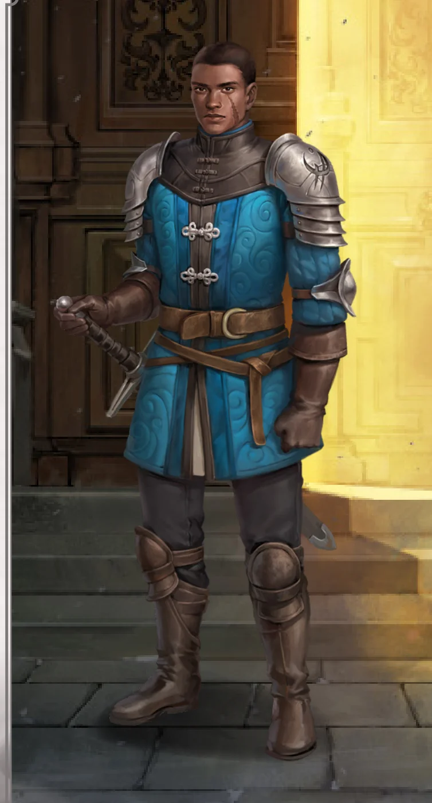

### 保鑣

保鑣（Bodyguard）為司卡德利亞各地的貴族家族、政府官員、黑道首腦及其他人物服務，保護要人與重要地點。

保鑣戰術

保鑣必須行動果斷迅速，擅長近身作戰。他們會盡快拉近距離，再用護衛職責保護當事人。第二時代的保鑣還沒趕到當事人身邊時，可以先用靴筒手槍攻擊，接著換用佩劍繼續作戰。有必要時，他們會使用制伏，替當事人爭取逃跑的機會。堅守陣線也讓保鑣不容易被迫退出戰鬥，能留在戰場上需要他們的位置。

*階層（Tier）1 勁敵（Rival）— 中型類人生物*

力量 3、實體防禦 15、速度 2、智力 1、意識防禦 14、意志 3、察覺 2、靈魂防禦 13、風采 1。

生命值（Health）：24（19–29）

專注點（Focus）：5

授予（Investiture）：0

偏轉值（Deflect）：1（皮革）

移動：25 呎

感知（Senses）：10 呎（視覺）

實體技能：運動（Athletics）+5、重型武器（Heavy Weaponry）+5、輕型武器（Light Weaponry）+4

意識技能：紀律（Discipline）+4、威嚇（Intimidation）+5

靈魂技能：洞察（Insight）+3、感知（Perception）+4

特徵

堅守陣線（Hold the Line）。保鑣在抵抗被擊倒並陷入倒地（Prone）的檢定中獲得一個優勢（Advantage）。此外，保鑣即將被迫移動時，會將該次移動的距離減少 5 呎。

行動

[1行動] **打擊（Strike）：佩劍（Sidesword）。** 攻擊 +5，觸及範圍 5 呎，造成 1d6 + 5 銳利傷害（keen damage）。命中時，若保鑣距一名盟友 5 呎內，目標額外受到 1d6 銳利傷害。

[1行動] **打擊：靴筒手槍（Boot Pistol）。** [第二時代] 攻擊 +4，距離 20/40 呎，造成 1d4 + 4 銳利傷害。命中時，若保鑣距一名盟友 5 呎內，目標額外受到 1d4 銳利傷害。穿刺（Pierce）：目標的偏轉值無法減少這次傷害。裝填（Loaded）[1]：花費[1行動]將這把武器的彈藥補滿。

[2行動] **制伏（Subdue）。** 保鑣選擇距自己 5 呎內一名大型（Large）或更小的角色，使其倒地，再對其實體防禦（Physical defense）進行運動檢定。成功時，保鑣也可以使目標陷入束縛（Restrained），直到保鑣的下一個輪次結束。

[自由行動] **拉近距離（Close the Distance）。** 保鑣距一名盟友 30 呎內時，每個輪次可以將移動（Move）行動作為[自由行動]使用一次。

[反應] **護衛職責（Protective Duty，花費 1 專注點）。** 在距保鑣 5 呎內的一名盟友受到攻擊之前，保鑣改為這次攻擊的目標，視同保鑣位在該盟友的空間內。

KIMBERLY PANTONI & LOGAN FELICIANO

