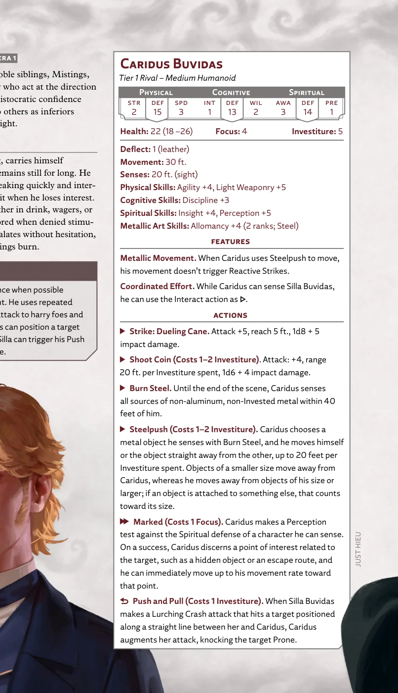
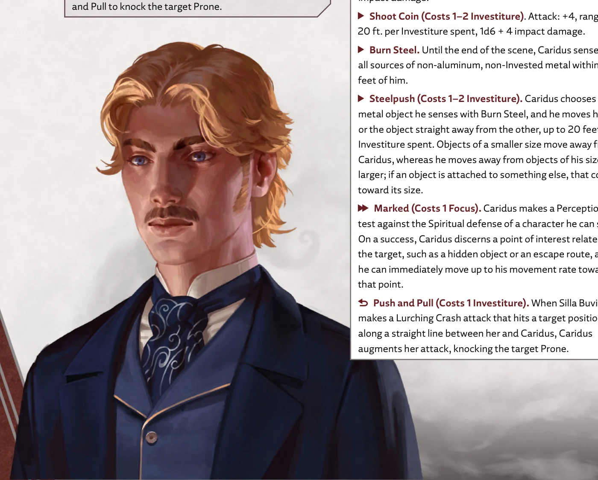
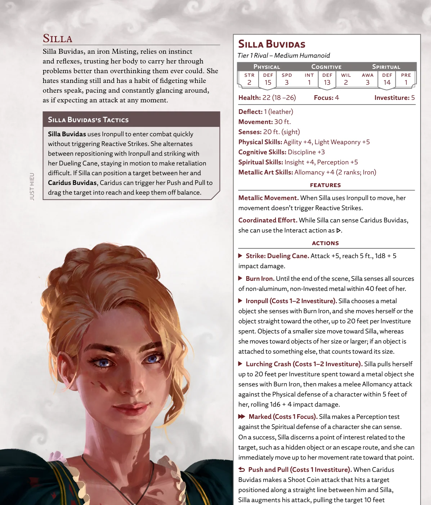
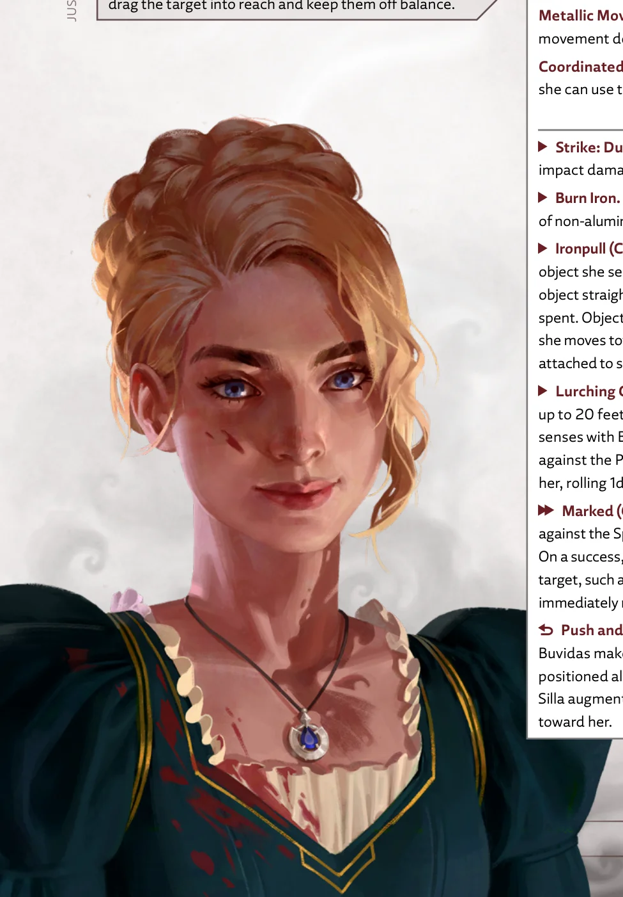

### 布維達雙胞胎（第一時代）

### Caridus Buvidas

階層 1 勁敵，中型類人生物

| 力量 | 實體防禦 | 速度 | 智力 | 認知防禦 | 意志 | 察覺 | 靈性防禦 | 風采 |
| --- | --- | --- | --- | --- | --- | --- | --- | --- |
| 2 | 15 | 3 | 1 | 13 | 2 | 3 | 14 | 1 |

**生命值** 22（18–26）　**專注點** 4　**授予** 5  
**偏轉值** 1（皮甲）　**移動** 30 呎　**感知** 20 呎（視覺）  
**實體技能** 敏捷 +4、輕型武器 +5  
**意識技能** 紀律 +3  
**靈魂技能** 洞察 +4、感知 +5  
**金屬技藝技能** 鎔金術 +4（2 等級，鋼）

#### 能力

**金屬位移。** Caridus 使用「鋼推」移動時，不會觸發反擊機會。

**協力配合。** 只要 Caridus 能感知到 Silla Buvidas，就可以用 [自由行動] 執行「互動」行動。

#### 行動

**[1行動] 打擊：決鬥杖。** 攻擊 +5，觸及 5 呎，造成 1d8 + 5 衝擊傷害。

**[1行動] 射出錢幣（消耗 1–2 授予）。** 攻擊 +4，每消耗 1 授予，射程為 20 呎，造成 1d6 + 4 衝擊傷害。

**[1行動] 燃燒鋼。** 到場景結束為止，Caridus 可感知自身 40 呎內所有鋁以外、未受授予的金屬來源。

**[1行動] 鋼推（消耗 1–2 授予）。** Caridus 選擇一件以「燃燒鋼」感知到的金屬物體，使自己或該物體沿兩者連線直接遠離另一方。每消耗 1 授予，最多移動 20 呎。較小的物體會遠離 Caridus。若物體與他同體型或更大，則由 Caridus 遠離物體。物體若附著於其他物體，兩者合計判定體型。

**[2行動] 鎖定目標（消耗 1 專注點）。** Caridus 進行感知檢定，對抗一名他能感知的角色的靈性防禦。成功時，他辨認出與目標有關的一處值得留意的位置，例如藏有物品的地方或一條逃生路線，並可立即朝該處移動，最多移動其移動距離。

**[反應] 一推一拉（消耗 1 授予）。** 當 Silla Buvidas 以「拉近猛撞」命中一名位於她與 Caridus 連線上的目標時，Caridus 可配合她的攻擊，使目標倒地。

Silla Buvidas 和 Caridus Buvidas 是貴族手足，也是迷霧人。他們隸屬於 Gilded Few，聽從 Delina 的指揮。兩人帶著貴族的自信，待人隨意而殘酷，說起話來總把別人當成下等人，並把反抗視為對自己的冒犯。

### Caridus

Caridus Buvidas 是一名鋼迷霧人，精力旺盛、坐立難安，很少能安靜待上一會兒。他講話飛快，動輒打斷別人，一失去興趣就不再理會。無論喝酒、下注或動手，他都喜歡玩過頭。一旦無事可做，旁人一眼就看得出他有多無聊。局勢緊張時，他會毫不猶豫地讓衝突升高，就為了看事情鬧大。

#### Caridus Buvidas 的戰術

Caridus Buvidas 會盡量保持距離，並在戰鬥中不斷變換位置。他反覆使用「鋼推」和「射出錢幣」騷擾敵人，讓對手無法站穩。若 Caridus 能讓目標位於自己與 Silla Buvidas 之間，Silla 就能觸發他的「一推一拉」，使目標倒地。

JUST HIEU

### Silla Buvidas

階層 1 勁敵，中型類人生物

| 力量 | 實體防禦 | 速度 | 智力 | 認知防禦 | 意志 | 察覺 | 靈性防禦 | 風采 |
| --- | --- | --- | --- | --- | --- | --- | --- | --- |
| 2 | 15 | 3 | 1 | 13 | 2 | 3 | 14 | 1 |

**生命值** 22（18–26）　**專注點** 4　**授予** 5  
**偏轉值** 1（皮甲）　**移動** 30 呎　**感知** 20 呎（視覺）  
**實體技能** 敏捷 +4、輕型武器 +5  
**意識技能** 紀律 +3  
**靈魂技能** 洞察 +4、感知 +5  
**金屬技藝技能** 鎔金術 +4（2 等級，鐵）

#### 能力

**金屬位移。** Silla 使用「鐵拉」移動時，不會觸發反擊機會。

**協力配合。** 只要 Silla 能感知到 Caridus Buvidas，就可以用 [自由行動] 執行「互動」行動。

#### 行動

**[1行動] 打擊：決鬥杖。** 攻擊 +5，觸及 5 呎，造成 1d8 + 5 衝擊傷害。

**[1行動] 燃燒鐵。** 到場景結束為止，Silla 可感知自身 40 呎內所有鋁以外、未受授予的金屬來源。

**[1行動] 鐵拉（消耗 1–2 授予）。** Silla 選擇一件以「燃燒鐵」感知到的金屬物體，使自己或該物體沿兩者連線直接朝另一方移動。每消耗 1 授予，最多移動 20 呎。較小的物體會朝 Silla 移動。若物體與她同體型或更大，則由 Silla 朝物體移動。物體若附著於其他物體，兩者合計判定體型。

**[1行動] 拉近猛撞（消耗 1–2 授予）。** Silla 朝一件以「燃燒鐵」感知到的金屬物體拉動自身。每消耗 1 授予，最多移動 20 呎。接著，她對自身 5 呎內一名角色進行近戰鎔金術攻擊，對抗其實體防禦，擲出 1d6 + 4 衝擊傷害。

**[2行動] 鎖定目標（消耗 1 專注點）。** Silla 進行感知檢定，對抗一名她能感知的角色的靈性防禦。成功時，她辨認出與目標有關的一處值得留意的位置，例如藏有物品的地方或一條逃生路線，並可立即朝該處移動，最多移動其移動距離。

**[反應] 一推一拉（消耗 1 授予）。** 當 Caridus Buvidas 以「射出錢幣」命中一名位於他與 Silla 連線上的目標時，Silla 可配合他的攻擊，將目標朝自己拉近 10 呎。

### Silla

Silla Buvidas 是一名鐵迷霧人。她行事仰賴直覺和反射，相信身體的反應比反覆思量更能幫她度過難關。她討厭站著不動。別人說話時，她總是動個不停，來回踱步，頻頻張望，彷彿隨時會有人發動攻擊。

#### Silla Buvidas 的戰術

Silla Buvidas 使用「鐵拉」快速切入戰鬥，不會觸發反擊機會。她交替使用「鐵拉」變換位置、用決鬥杖打擊，持續移動，讓敵人難以還手。若 Silla 能讓目標位於自己與 Caridus Buvidas 之間，Caridus 就能觸發她的「一推一拉」，把目標拖進觸及範圍，使其站不穩。

JUST HIEU

附錄 A：敵手 199

