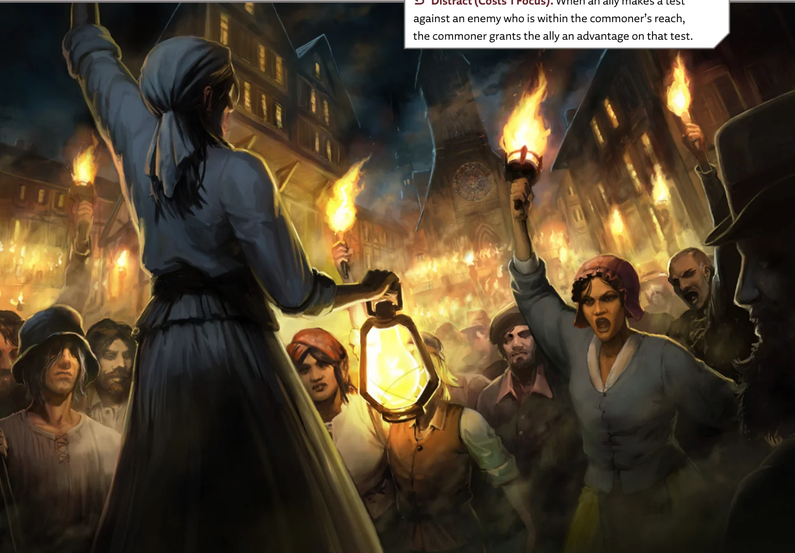

### 平民

經歷長期的文化停滯後，司卡德利亞人迎來一連串苦難、革命與變革。一場場重塑世界的劇變迫使他們承受苦難、適應變化、反覆重建，但每個人都有自己的希望、夢想和本領。平民（Commoner）是司卡德利亞各地城市裡隨處可見的普通百姓。第一時代稱他們為司卡，第二時代則稱為市民。大多數平民只想安穩過日子，盡力避開暴力、保護所愛的人，並尋求讓生活更好的機會。

平民戰術

戰鬥時，除非所愛的人正遭遇迫在眉睫的危險，平民通常會逃離現場並尋找安全的地方。被迫戰鬥時，平民通常會用臨時武器，也可能用分散注意行動幫助更有能力的盟友。在對話中，平民通常會向他們認為更有能力的人讓步。

階層 1 嘍囉 — 中型類人生物

實體、意識、靈魂。力量 0、實體防禦 11、速度 1、智力 1、認知防禦 12、意志 0、察覺 1、靈性防禦 11、風采 0。

生命值：10（8–12）。專注點：2。授予：0。

移動：25 呎。感知：10 呎（視覺）。實體技能：運動 +1。意識技能：工藝 +2。靈魂技能：洞察 +2、感知 +2。

特徵

嘍囉。平民的攻擊無法造成致命一擊，且一旦受到傷勢便立刻被擊敗。

能幹。平民擁有一項與某種職業相關的實用專長，進行與該職業相關的檢定時獲得一個優勢。

行動

[1行動] 打擊：臨時武器。攻擊 +1，觸及範圍 5 呎，造成 1d4 + 1 衝擊傷害。

[反應] 分散注意（花費 1 專注點）。當一名盟友對一個

位於平民觸及範圍內的敵人進行檢定時，平民讓該盟友在這次檢定中獲得一個優勢。

KEVIN O’NEILL

