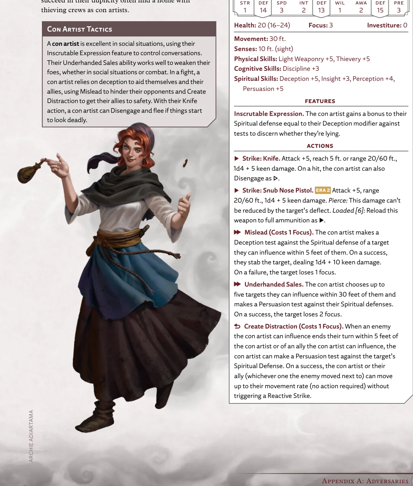
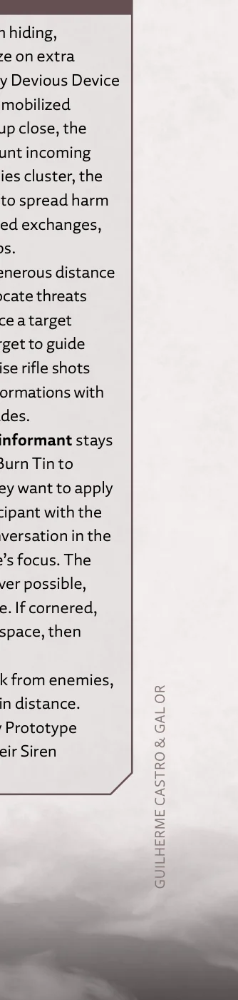
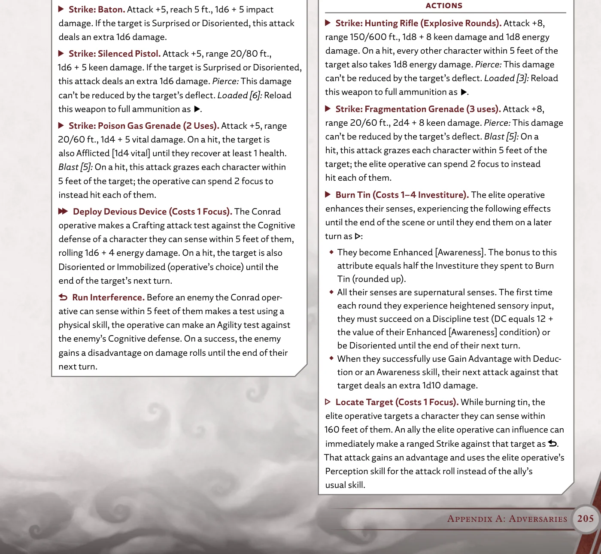

## 騙術高手

### 戰術

騙術高手擅長應付社交場合，以「不動聲色」主導對話，再用「黑心推銷」削弱對手。這項能力在社交和戰鬥中都有效。戰鬥時，他們靠欺瞞幫助自己和盟友，用「誤導」牽制敵人，再以「轉移注意」協助盟友脫身。若情勢危急，可以用小刀打擊後撤離並逃跑。

在最後帝國，不少人靠操縱與欺騙維生。擅長此道的人往往加入竊賊團隊，當上騙術高手。

**階層 1 勁敵｜中型類人生物**

| 力量 | 實體防禦 | 速度 | 智力 | 認知防禦 | 意志 | 察覺 | 靈性防禦 | 風采 |
| --- | --- | --- | --- | --- | --- | --- | --- | --- |
| 1 | 14 | 3 | 2 | 13 | 1 | 2 | 15 | 3 |

- **生命值** 20（16–24）　**專注點** 3　**授予** 0
- **移動** 30 呎　**感官** 10 呎（視覺）
- **實體技能** 輕型武器 +5、竊盜 +5
- **意識技能** 紀律 +3
- **靈魂技能** 欺瞞 +5、洞察 +3、感知 +4、說服 +5

### 特徵

**不動聲色。** 若檢定是為了判斷騙術高手是否說謊，他們的靈性防禦獲得等於其欺瞞調整值的加值。

### 行動

**[1行動] 打擊：小刀。** 攻擊 +5，觸及 5 呎或射程 20/60 呎，造成 1d4 + 5 銳利傷害。命中時，騙術高手也可用 [自由行動] 撤離。

**[1行動] 打擊：短管手槍（第二時代）。** 攻擊 +5，射程 20/60 呎，造成 1d4 + 5 銳利傷害。穿刺：目標的偏轉值無法減免此傷害。裝填［6］：花費 [1行動] 將彈藥補滿。

**[2行動] 誤導（消耗 1 專注點）。** 騙術高手選擇 5 呎內一名能影響的目標，進行對抗其靈性防禦的欺瞞檢定。成功時刺傷目標，造成 1d4 + 10 銳利傷害。失敗時，目標失去 1 專注點。

**[2行動] 黑心推銷。** 騙術高手選擇 30 呎內最多五名能影響的目標，進行對抗其靈性防禦的說服檢定。成功時，目標失去 2 專注點。

**[反應] 轉移注意（消耗 1 專注點）。** 騙術高手能影響的一名敵人在距離騙術高手或其能影響的盟友 5 呎內結束輪次時，騙術高手可以進行對抗該敵人靈性防禦的說服檢定。成功時，騙術高手或該盟友（視敵人移到誰旁邊而定）可以移動至多等同其移動速度的距離，無須行動，也不會觸發反應打擊。

ARCHIE ADIARTAMA

附錄 A：對手 203

## Conrad Industries 員工（第二時代）

Conrad Industries 的員工為依藍戴最具權勢的工業勢力之一效力，公司的業務遠超工廠和帳房的範圍。Conrad Industries 對外以創新、防護和監控聞名。員工受訓在嚴密的內部階級制度下行動，遵守紀律並審慎處理事務。任務從警備、外勤延伸到諜報和技術部署。公司將能幹的人員派到需要他們的地方，把勢力伸入盆地各處，出了醜聞仍可合理撇清責任。

### 員工戰術

Conrad 特工偏好從藏身處出擊，優先攻擊措手不及的敵人以造成額外傷害。接戰後，他們會用「部署詭計裝置」讓附近目標陷入迷惑或定身，再換下一個目標。遭敵人逼近時，他們以「出手干擾」減弱來襲的傷害，打斷攻勢。若敵人聚集，他們就用毒氣手榴彈擴大傷害，迫使敵人移位。他們避免久戰，一旦失去主導權便轉移位置。

Conrad 菁英特工會與潛在目標保持充足距離，先燃燒錫找出威脅，再決定是否接戰。確認目標後，他們用「定位目標」引導盟友的遠程攻擊，同時從遠處以步槍精準射擊。他們會挑好位置投擲破片手榴彈，打散敵方陣形。

交談時，Conrad 錫眼線人起初保持沉默，仔細觀察，並燃燒錫以掌握在場眾人的反應。想施壓時，他們用「討價還價」鎖定靈性防禦最高的與談者，引導談話並消耗眾人的專注點。他們會盡量避免實體衝突，一旦對話轉為敵對便悄悄離開。若遭逼入死角，只會用小刀打擊騰出空間，隨即撤退。

Conrad 工程師偏好與敵人保持距離，必要時用實驗型手槍維持間距。避開近戰後，他們會對最大的威脅「部署原型裝置」，或向一群敵人投擲警鳴手榴彈。

GUILHERME CASTRO & GAL OR

## Conrad 特工

**階層 1 勁敵｜中型類人生物**

| 力量 | 實體防禦 | 速度 | 智力 | 認知防禦 | 意志 | 察覺 | 靈性防禦 | 風采 |
| --- | --- | --- | --- | --- | --- | --- | --- | --- |
| 2 | 15 | 3 | 2 | 14 | 2 | 3 | 14 | 1 |

- **生命值** 30（24–36）　**專注點** 4　**授予** 0
- **偏轉值** 1（皮革）　**移動** 30 呎　**感官** 20 呎（視覺）
- **實體技能** 敏捷 +4、輕型武器 +5、隱匿 +5
- **意識技能** 工藝 +4、紀律 +4
- **靈魂技能** 感知 +5

### 行動

**[1行動] 打擊：警棍。** 攻擊 +5，觸及 5 呎，造成 1d6 + 5 衝擊傷害。目標若措手不及或陷入迷惑，此攻擊額外造成 1d6 傷害。

**[1行動] 打擊：消音手槍。** 攻擊 +5，射程 20/80 呎，造成 1d6 + 5 銳利傷害。目標若措手不及或陷入迷惑，此攻擊額外造成 1d6 傷害。穿刺：目標的偏轉值無法減免此傷害。裝填［6］：花費 [1行動] 將彈藥補滿。

**[1行動] 打擊：毒氣手榴彈（限用 2 次）。** 攻擊 +5，射程 20/60 呎，造成 1d4 + 5 命力傷害。命中時，目標也會陷入折磨［1d4 命力］，直到恢復至少 1 生命值。爆破［5］：命中時也擦傷目標周圍 5 呎內每名角色。特工可花費 2 專注點，改為命中他們每一人。

**[2行動] 部署詭計裝置（消耗 1 專注點）。** 特工選擇自己能感知且在 5 呎內的一名角色，進行對抗其認知防禦的工藝攻擊檢定，擲 1d6 + 4 能量傷害。命中時，目標也會陷入迷惑或定身（由特工選擇），直到目標下個輪次結束。

**[反應] 出手干擾。** 特工能感知且在 5 呎內的一名敵人即將以實體技能進行檢定前，特工可進行對抗該敵人認知防禦的敏捷檢定。成功時，敵人的傷害骰獲得一項劣勢，直到該敵人下個輪次結束。

## Conrad 菁英特工

**階層 3 勁敵｜中型類人生物**

| 力量 | 實體防禦 | 速度 | 智力 | 認知防禦 | 意志 | 察覺 | 靈性防禦 | 風采 |
| --- | --- | --- | --- | --- | --- | --- | --- | --- |
| 1 | 16 | 5 | 4 | 17 | 3 | 5 | 18 | 3 |

- **生命值** 54（43–65）　**專注點** 5　**授予** 7
- **偏轉值** 1（皮革）　**移動** 30 呎　**感官** 50 呎（視覺）
- **實體技能** 敏捷 +8、輕型武器 +8、隱匿 +7
- **意識技能** 工藝 +6、紀律 +6
- **靈魂技能** 領導 +5、感知 +7
- **金屬技藝技能** 鎔金術 +7（4 級，錫）

### 行動

**[1行動] 打擊：獵槍（爆裂彈）。** 攻擊 +8，射程 150/600 呎，造成 1d8 + 8 銳利傷害和 1d8 能量傷害。命中時，目標周圍 5 呎內其他每名角色也受到 1d8 能量傷害。穿刺：目標的偏轉值無法減免此傷害。裝填［3］：花費 [1行動] 將彈藥補滿。

**[1行動] 打擊：破片手榴彈（限用 3 次）。** 攻擊 +8，射程 20/60 呎，造成 2d4 + 8 銳利傷害。穿刺：目標的偏轉值無法減免此傷害。爆破［5］：命中時也擦傷目標周圍 5 呎內每名角色。菁英特工可花費 2 專注點，改為命中他們每一人。

**[1行動] 燃燒錫（消耗 1–4 授予）。** 菁英特工強化感官，獲得以下效果，直到場景結束，或稍後在自己的輪次以 [自由行動] 結束效果。

- 菁英特工獲得強化［察覺］。屬性加值等於燃燒錫所花授予的一半（無條件進位）。
- 所有感官均成為超自然感官。每輪第一次受到強烈感官刺激時，菁英特工必須成功通過紀律檢定（DC 等於 12 加上強化［察覺］的數值），否則陷入迷惑，直到自己的下個輪次結束。
- 以推理或察覺相關技能成功獲取優勢時，下一次對該目標的攻擊額外造成 1d10 傷害。

**[自由行動] 定位目標（消耗 1 專注點）。** 燃燒錫時，菁英特工選擇自己能感知且在 160 呎內的一名角色。一名菁英特工能影響的盟友可以立刻以 [反應] 對該目標進行一次遠程打擊。該攻擊獲得一項優勢，並用菁英特工的感知技能進行攻擊擲骰，取代盟友通常使用的技能。

附錄 A：對手 205

## Conrad 工程師

**階層 1 勁敵｜中型類人生物**

| 力量 | 實體防禦 | 速度 | 智力 | 認知防禦 | 意志 | 察覺 | 靈性防禦 | 風采 |
| --- | --- | --- | --- | --- | --- | --- | --- | --- |
| 1 | 14 | 2 | 3 | 15 | 2 | 3 | 14 | 1 |

- **生命值** 30（24–36）　**專注點** 4　**授予** 0
- **移動** 25 呎　**感官** 20 呎（視覺）
- **實體技能** 敏捷 +4、輕型武器 +4
- **意識技能** 工藝 +5、推理 +5、紀律 +4
- **靈魂技能** 感知 +5

### 特徵

**能幹的工程師。** 工程師在與機械相關的檢定中獲得一項優勢。

### 行動

**[1行動] 打擊：警棍。** 攻擊 +4，觸及 5 呎，造成 1d6 + 4 衝擊傷害。

**[1行動] 打擊：實驗型手槍。** 攻擊 +4，射程 20/80 呎，造成 1d6 + 4 銳利傷害。命中時，工程師可花費 1 專注點，將目標向遠離自己的方向推開 15 呎。穿刺：目標的偏轉值無法減免此傷害。裝填［8］：花費 [1行動] 將彈藥補滿。

**[2行動] 部署原型裝置（消耗 1 專注點）。** 工程師選擇自己能感知且在 15 呎內的一名角色，進行對抗其認知防禦的工藝攻擊檢定，擲 1d6 + 4 能量傷害。命中時，裝置困住目標，使其陷入定身和折磨［2d6 能量］，直到獲救。被困的目標或能觸及目標的角色可以使用技能，進行 DC 14 的敏捷或運動檢定。成功時，目標獲救。

**[2行動] 警鳴手榴彈（限用 1 次）。** 工程師把一個會發出刺耳警報聲、令人分心的裝置擲向 30 呎內能感知的一點。角色每次在裝置周圍 10 呎內花費專注點時，必須額外花費 1 專注點。能觸及裝置的角色可以使用技能，進行 DC 14 的運動或竊盜檢定，成功便結束警報效果。

## Conrad 錫眼線人

**階層 1 勁敵｜中型類人生物**

| 力量 | 實體防禦 | 速度 | 智力 | 認知防禦 | 意志 | 察覺 | 靈性防禦 | 風采 |
| --- | --- | --- | --- | --- | --- | --- | --- | --- |
| 0 | 11 | 1 | 2 | 14 | 2 | 2 | 13 | 1 |

- **生命值** 22（18–26）　**專注點** 4　**授予** 4
- **移動** 25 呎　**感官** 10 呎（視覺）
- **實體技能** 輕型武器 +2、隱匿 +2
- **意識技能** 推理 +4、學識 +4
- **靈魂技能** 欺瞞 +2、洞察 +4、感知 +4、說服 +3
- **金屬技藝技能** 鎔金術 +4（2 級，錫）

### 特性

**消息靈通。** 有錫眼線人登場的場景開始前，擲劇情骰。若擲出 [機遇]，錫眼線人知道對 PC 有用的情報。若擲出 [變故]，錫眼線人知道某名 PC 不願公開的情報。

**人脈廣泛。** 錫眼線人在與蒐集情報的地點或組織相關的技能檢定中獲得一項優勢，例如依藍戴警署、市場和產業界。

### 行動

**[1行動] 打擊：小刀。** 攻擊 +2，觸及 5 呎，造成 1d4 + 2 銳利傷害。命中時，錫眼線人可花費 1 專注點額外造成 2d4 傷害。

**[1行動] 討價還價。** 交談時，錫眼線人從能影響的角色中找出靈性防禦最高者，對抗其靈性防禦進行說服檢定。成功時，由錫眼線人挑選的每名與談角色失去 1 專注點。

**[1行動] 燃燒錫（消耗 1–2 授予）。** 錫眼線人強化感官，獲得以下效果，直到場景結束，或稍後在自己的輪次以 [自由行動] 結束效果。

- 錫眼線人獲得強化［察覺］。屬性加值等於燃燒錫所花授予的一半（無條件進位）。
- 所有感官均成為超自然感官。每輪第一次受到強烈感官刺激時，錫眼線人必須成功通過紀律檢定（DC 等於 12 加上強化［察覺］的數值），否則陷入迷惑，直到自己的下個輪次結束。
- 以推理或察覺相關技能成功獲取優勢時，下一次對該目標的攻擊額外造成 1d6 傷害。

附錄 A：對手 206
