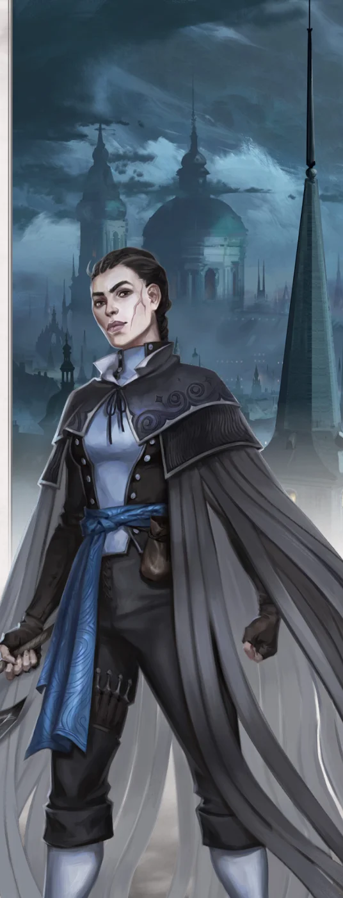
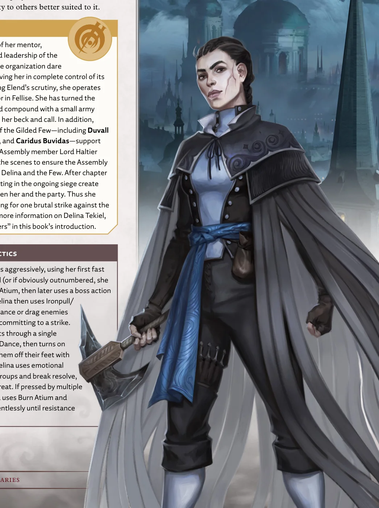

## Delina Tekiel（第一時代）

統御主殞落後，Tekiel 家族的迷霧之子 Delina 在混亂中成為叛離的審判者 Vadilek 最危險的門徒之一。其他貴族在政壇周旋，Delina 則偏好直接行動，以壓倒性的武力和艱苦訓練習得的本領正面擊潰阻力。她一出手便氣勢逼人，步步緊逼，視對手為要逼入絕境、徹底擊潰的獵物，至於講究手腕的事，她留給更擅長的人。

### 戰術

Delina Tekiel 會積極逼近，在第一個快速輪次使用「燃燒鐵／鋼」。若明顯寡不敵眾，她會在該輪次燃燒天金，稍後再用首領行動燃燒鐵／鋼。接著她用鐵拉／鋼推拉近距離或把敵人拖離原位，再出手打擊。接戰後，她用「刺客之舞」重創單一目標，接著用「毀滅橫掃」打倒周圍敵人。Delina 以情緒鎔金術瓦解敵人的陣勢與意志，迫使他們撤退。若同時受到多方威脅，她會燃燒天金，持續猛攻直到敵方無力抵抗。

### Gilded Few 的資源

導師 Vadilek 在儀式中死亡後，Delina 接掌了 Gilded Few。組織內無人敢公開反對她，所有資源都由她掌控。為躲避依藍德國王的注意，她以 Fellise 的 Seeris 莊園為據點，把宅邸改成設防堡壘，手下有三十名殺霧者隨時聽令。Duvall Haught、Silla Buvidas、Caridus Buvidas 等 Gilded Few 要員也支持她的行動。在陸沙德，議會成員 Haltier Habren 爵爺在幕後活動，確保議會不干預 Delina 和 Gilded Few。第 2 章過後，持續圍城的軍隊隔在她與隊伍之間，阻斷雙方接觸。她因此耐心等待時機，準備一次猛烈攻擊，對付英雄們和 Enge。有關 Delina Tekiel 的更多資訊，見本書導論的「重要角色」。

附錄 A：對手 208

## Delina Tekiel

**階層 2 首領｜中型類人生物**

| 力量 | 實體防禦 | 速度 | 智力 | 認知防禦 | 意志 | 察覺 | 靈性防禦 | 風采 |
| --- | --- | --- | --- | --- | --- | --- | --- | --- |
| 4 | 18 | 4 | 2 | 16 | 4 | 3 | 17 | 4 |

- **生命值** 155（124–186）　**專注點** 8　**授予** 8
- **移動** 30 呎　**感官** 20 呎（視覺）
- **實體技能** 敏捷 +7、運動 +7、重型武器 +7、隱匿 +7
- **意識技能** 紀律 +6、威嚇 +6
- **靈魂技能** 洞察 +6、領導 +7、感知 +6
- **金屬技藝技能** 鎔金術 +7（3 級，全部金屬）

### 特性

**首領。** Delina 每輪可以進行一個快速輪次和一個慢速輪次。敵人結束輪次後，Delina 可以花費 1 專注點，立即額外執行一個 [1行動] 或 [自由行動] 行動。她也可以在自己的輪次花費 1 專注點，解除自己身上的一種狀態。

**獵人直覺。** Delina 以感知檢定尋找她在本場景中曾傷害過的目標時，獲得一項優勢。

**懾人風采。** 在一個場景中，Delina 第一次要花費專注點抵抗影響時，免除該次消耗，場景中的每名敵人失去 1d4 專注點。

### 行動

**[1行動] 打擊：Vadilek 的黑曜石斧。** 攻擊 +7，觸及 5 呎，造成 1d6 + 7 銳利傷害。命中時，她可花費 2 授予，額外造成 2d6 傷害。

**[1行動] 射出錢幣（消耗 1–3 授予）。** 攻擊 +7，每花費 1 授予有 20 呎射程，造成 1d8 + 7 衝擊傷害。

**[2行動] 刺客之舞。** Delina 移動至多等同其移動速度的距離，再進行一次打擊。命中時，目標也會陷入迷惑，直到目標下個輪次結束。

**[3行動] 毀滅橫掃（消耗 2 專注點）。** Delina 對自己 5 呎內除自己外的每名角色各進行一次打擊。每個命中的目標也會倒地。

**[2行動] 燃燒天金（限用 1 次）。** 接下來 3 輪，Delina 進行涉及與其他角色實體互動的檢定時（包括對抗實體防禦的檢定），所有 d20 均直接視為 15，包括因優勢與劣勢擲出的骰。同樣地，敵人對 Delina 進行此類檢定時（包括對抗實體防禦的檢定），其 d20 均直接視為 5。

**[1行動] 燃燒鐵／鋼。** 直到場景結束，Delina 能感知自己 80 呎內所有鋁以外、未受授予的金屬來源。

**[1行動] 燃燒錫（消耗 1–3 授予）。** Delina 強化感官，獲得以下效果，直到場景結束，或她在稍後的輪次以 [自由行動] 結束效果。

- 她獲得強化［察覺］。屬性加值等於燃燒錫花費的授予的一半（無條件進位）。
- 她的所有感官均成為超自然感官。每輪第一次受到強烈感官刺激時，她必須成功通過紀律檢定（DC 等於 12 加上強化［察覺］的數值），否則會陷入迷惑，直到下個輪次結束。

**[1行動] 鐵拉／鋼推（消耗 1–3 授予）。** Delina 選擇一件以「燃燒鐵／鋼」感知到的金屬物體，使自己或物體沿直線靠近或遠離對方，每花費 1 授予最多移動 20 呎。較小的物體會靠近或遠離 Delina，與她同體型或更大的物體則會使 Delina 靠近或遠離它。物體若附著於其他東西，後者也計入其體型。這項能力可以靈活運用，例如繳械或攻擊物體飛行路徑上的敵人。若要影響不情願的角色，Delina 必須成功進行對抗目標實體防禦的鎔金術檢定。若效果會造成傷害，她必須改為進行鎔金術攻擊，擲 1d8 + 7 衝擊傷害。

**[2行動] 獵人的獵物（消耗 1–3 授予）。** Delina 同時安撫與煽動距離自己 80 呎內一個巨型（15 呎）區域中的所有角色，對區域內除她以外的每名角色進行對抗其靈性防禦的鎔金術檢定。成功時，目標若能採取反應，就必須以反應盡可能遠離 Delina，最多移動等同其移動速度的距離。目標也會陷入削弱［意志］，直到自己的下個輪次結束。屬性減值等於 Delina 花費的授予。

**[反應] 蠻力（消耗 1 專注點）。** Delina 遭近戰攻擊擦傷後，可進行運動檢定，DC 等於該攻擊的擲骰結果。成功時，她繳械攻擊者的武器，並可花費 1 授予造成 1d6 衝擊傷害。攻擊者的武器落在其周圍 5 呎內由 Delina 指定的位置。

### 機遇與變故

**機遇。** 敵人可以花費 [機遇]，讓 Delina 下一次對自己發動的攻擊所造成的傷害減半，或結束 Delina 正在持續的授予效果。

**變故。** GM 可以花費敵人檢定擲出的 [變故]，讓 Delina 以 [反應] 使用「飲用金屬液」，或恢復 1d4 專注點。

OKSANNA KERRO & LOGAN FELICIANO

附錄 A：對手 209
