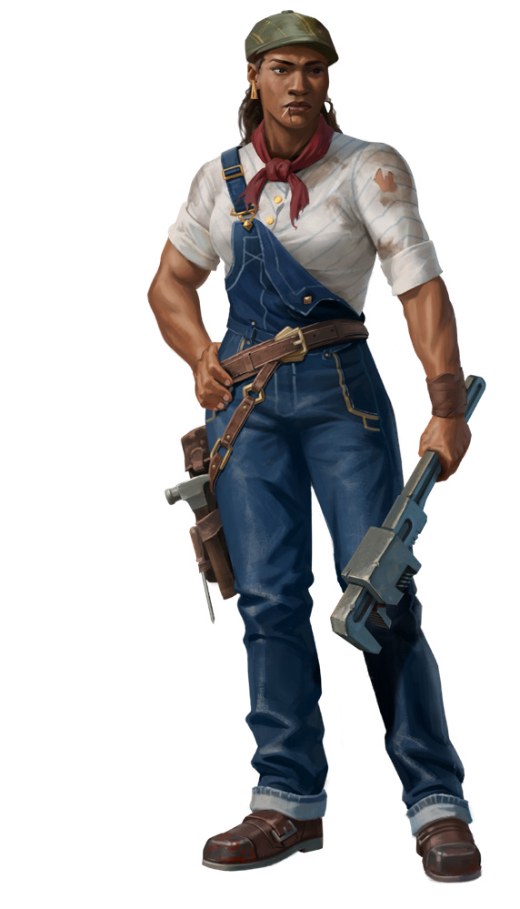

## 打手

需要以武力解決問題的團隊會僱用打手。打手通常忠於首領，無論是打破別人的頭，還是砸爛整個房間，都會毫不遲疑地照做。

### 戰術

打手行動迅速、莽撞而有效，從不臨陣退縮。他們會保護團隊中較弱的成員，用「猛衝」快速穿越戰場。第二時代的打手若無法靠近，可以用霰彈槍，但仍以進入近戰並用徒手打擊束縛敵人為首要目標。束縛敵人後，打手會用「折斷骨頭」重創單一目標，或用「臨場發揮」同時打倒多個敵人。若難以束縛目標，可以先用「擊倒」為下一次徒手打擊創造機會。

**階層 2 勁敵｜中型類人生物**

| 力量 | 實體防禦 | 速度 | 智力 | 意識防禦 | 意志 | 察覺 | 靈魂防禦 | 風采 |
| --- | --- | --- | --- | --- | --- | --- | --- | --- |
| 5 | 18 | 3 | 1 | 14 | 3 | 3 | 16 | 3 |

- **生命值** 45（36–54）　**專注點** 5　**授予** 0
- **移動** 30 呎　**感官** 20 呎（視覺）
- **實體技能** 運動 +7、重型武器 +6
- **意識技能** 威嚇 +6
- **靈魂技能** 感知 +6、求生 +5

### 特徵

**猛衝。** 打手可以穿越敵人占據的區域，且不會因中型或更小的物體造成的困難地形而陷入減速。

### 行動

**[1行動] 打擊：徒手。** 攻擊 +7，觸及 5 呎，造成 1d8 + 7 衝擊傷害。命中中型或更小的目標時，打手可使其陷入束縛，但解除此狀態前，打手無法攻擊其他目標。受束縛的目標可以花費 [2行動] 進行 DC 15 的敏捷或運動檢定，成功則解除束縛。

**[1行動] 打擊：霰彈槍（第二時代）。** 攻擊 +6，射程 20/60 呎，造成 1d10 + 6 銳利傷害。命中時也擦傷目標周圍 5 呎內每名角色。穿刺：目標的偏轉值無法減免此傷害。裝填［2］：花費 [1行動] 將彈藥補滿。

**[2行動] 折斷骨頭。** 打手對自己束縛的目標進行運動檢定，對抗其實體防禦。成功時，目標陷入以下其中一種狀態，直到打手下個輪次結束：迷惑、精疲力竭［−1］或減速。打手可花費 3 專注點，改為造成一處傷勢。

**[2行動] 臨場發揮。** 打手把自己束縛的敵人擲向距離自己 20 呎內的另一名敵人。打手進行運動攻擊，對抗兩個目標的實體防禦，擲 3d8 + 7 衝擊傷害。不論命中與否，被擲出的敵人都會倒地，落在另一名目標旁最近的未占據空間。

**[反應] 擊倒（消耗 1 專注點）。** 距離打手 5 呎內的大型或更小敵人以近戰攻擊命中打手後，打手使該攻擊者倒地。

FLORIAN HAECKH & GAL OR

