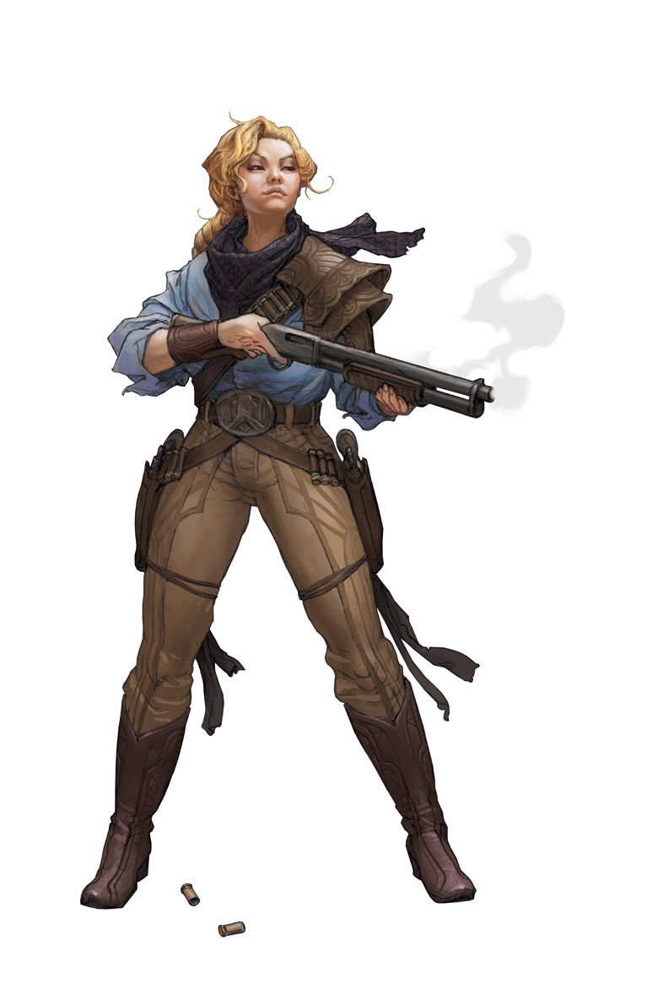

### 自由鬥士（第二時代）

司卡德利亞歷史上有許多影響深遠的運動，激起人們強烈的信念。這些運動的訴求各不相同，但總有少數堅定的信徒會將信念付諸行動。自由鬥士願意為理念奮戰流血。在北方蠻橫區，太齊爾鐵路腐敗而殘酷的經營手段迫使一些人尋求激進的解方，轉而加入 Ironbrands。這個團體由鐵砧（the Anvil）領導，為了讓蠻橫區獲得自由而採取行動，往往訴諸暴力。他們期盼蠻橫區有朝一日能擺脫依藍戴菁英的控制，成為獨立國家。

### 自由鬥士

*階層 2 嘍囉 — 中型類人生物*

力量 1、實體防禦 14、速度 1、智力 1、認知防禦 14、意志 3、察覺 2、靈性防禦 14、風采 2。

生命值：21（17–25）。專注點：5。授予：0。

偏轉值：0，除非受到堅定信念影響。移動：25 呎。感知：10 呎（視覺）。實體技能：敏捷 +4、輕型武器 +4。意識技能：紀律 +6。靈魂技能：感知 +5。

特徵

堅定信念（Conviction）。自由鬥士距能激發其信念的事物 120 呎內時，偏轉值提高 1。

嘍囉。自由鬥士的攻擊無法造成致命一擊，且一旦受到傷勢便立即遭到擊敗。

行動

[1行動] **打擊：小刀。** 攻擊 +4，觸及範圍 5 呎或距離 20/60 呎，造成 1d4 + 4 銳利傷害。

[1行動] **打擊：霰彈槍。** 攻擊 +1，距離 20/60 呎，造成 1d10 + 1 銳利傷害。穿刺：目標的偏轉值無法減少這次傷害。裝填 [2]：花費[1行動]將武器的彈藥補滿。

[2行動] **嚴厲裁決（Harsh Judgment，花費 3 專注點）。** 自由鬥士對距自己 5 呎內的一名敵人宣告裁決。距目標 5 呎內的其他每名自由鬥士都可以用[反應]加入裁決。每有一名自由鬥士宣告裁決，目標就受到 1d6 銳利傷害。

[2行動] **點燃熱情（Enkindled Passion）。** 自由鬥士使用獲取優勢行動（無須另花行動）。檢定成功時，距這名自由鬥士 5 呎內的其他每名自由鬥士，對同一目標進行下一次檢定時，也獲得一個優勢。

自由鬥士戰術

自由鬥士會聯手合作，互相鼓舞。戰鬥中，一群自由鬥士可以用嚴厲裁決合力圍攻敵人。靠近他們為之奮戰的事物時，堅定信念會讓他們更難受傷。專注點不足時，自由鬥士仍能用小刀或霰彈槍作戰，並用點燃熱情支援盟友。

STEVE PRESCOTT

附錄 A：敵手 213

