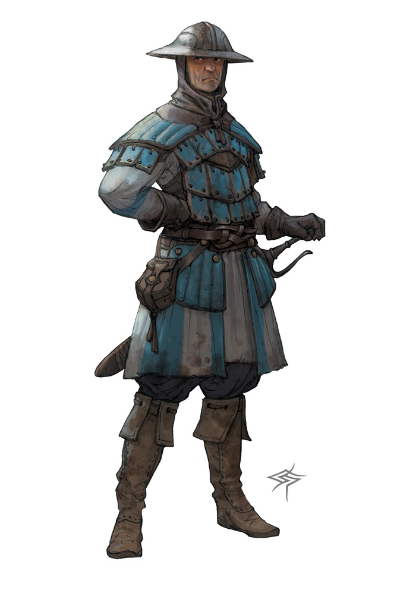

### 駐軍士兵

駐軍士兵（Garrisoner）訓練有素，能應付各種戰況，成群作戰或遠距離攻擊時尤其致命。無論是對抗腐敗的暴君，還是捍衛總督的權力，他們都受過訓練，能以規模龐大、令人畏懼的隊伍移動和作戰。這些士兵在一般防禦和進攻作戰中都至關重要。他們能有效保護重要人物、守住關鍵地點，也能排成壓倒性的陣列向前推進，突破敵軍防線。

這些訓練有素的戰士通常受雇於權勢人士，或其他財力足以調動大批士兵的人。駐軍士兵是少數會在戰鬥中穿戴金屬裝備並揮舞金屬武器的戰士。他們通常人多勢眾，足以壓制任何大意到敢正面迎戰一支軍隊的鎔金術師。

*階層 1 嘍囉 — 中型類人生物*

力量 2、實體防禦 14、速度 2、智力 2、認知防禦 13、意志 1、察覺 2、靈性防禦 13、風采 1。

生命值：12（9–15）

專注點：3

授予：0

偏轉值：2（胸甲）

移動：25 呎

感知：10 呎（視覺）

實體技能：運動 +3、重型武器 +4、輕型武器 +4

意識技能：紀律 +3、威嚇 +2

靈魂技能：感知 +4

特徵

嘍囉。駐軍士兵的攻擊無法造成致命一擊，且在受到傷勢時立即遭到擊敗。

行動

[1行動] **打擊：佩劍。** 攻擊 +4，觸及範圍 5 呎，造成 1d6 + 4 銳利傷害。命中時，駐軍士兵也可以用 [自由行動] 脫離。

[1行動] **打擊：長弓。** [第一時代] 攻擊 +4，距離 150/600 呎，造成 1d6 + 4 銳利傷害。命中時，若駐軍士兵在這次攻擊中至少有一個優勢，可花費 1 專注點，額外造成 1d6 傷害。

[1行動] **打擊：栓動步槍。** [第二時代] 攻擊 +4，距離 150/600 呎，造成 1d10 + 4 銳利傷害。穿刺：這次傷害無法以目標的偏轉值減少。裝填 [1]：花費 [1行動] 將這把武器的彈藥補滿。

[反應] **齊射（Volley Shot，花費 2 專注點）。** 距這名駐軍士兵 10 呎內的一名友方駐軍士兵以遠程攻擊命中目標後，這名駐軍士兵可以立即對距原目標 5 呎內的另一個目標進行一次遠程攻擊。

駐軍士兵戰術

駐軍士兵果斷而有效率。他們能集中火力對付單一強敵，也能用齊射反應分散傷害，同時逐一擊倒多個較弱的目標。必要時，駐軍士兵可以利用佩劍調整站位，堅守陣線。

駐軍士兵協同作戰，絕不丟下任何一名同袍。他們以合力擊倒敵人為先，個人的榮耀擺在其次。

附錄 A：敵手 214

STEVE PRESCOTT

