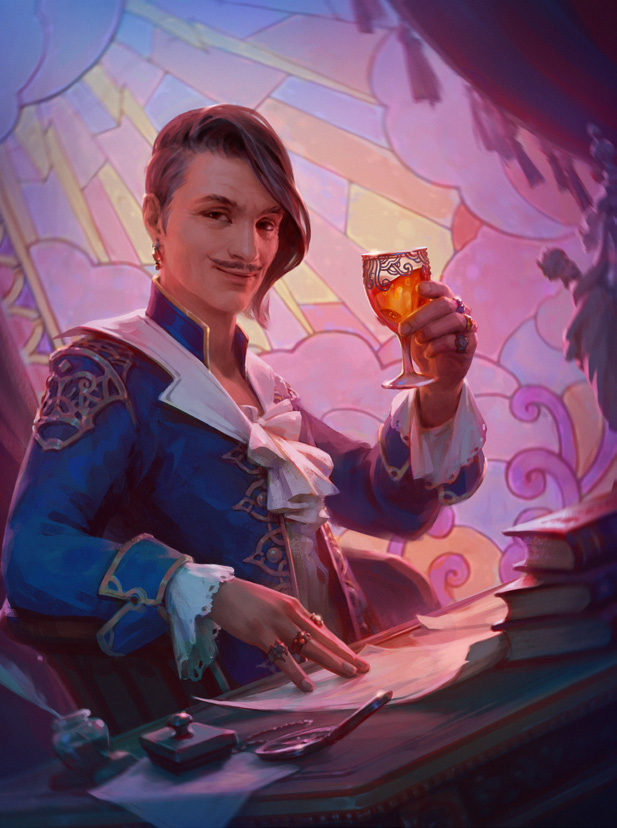

### Guiverre Seeris（第一時代）

Guiverre Seeris 在貴族社交圈裡舉止優雅，流露出縱情享樂的氣息。他曾是 Vadilek 的親信，宮廷人士的儀態下藏著善於鑽研理論的頭腦。身為受過訓練的搜尋者，他幾乎無時無刻都本能地燃燒青銅，把警戒化為日常習慣。他加入了 Gilded Few，又與 Delina Tekiel 有所往來，因此躋身於一小群追逐禁忌神器、自恃有權攫取更多的貴族之間。然而，兒子 Idren 的死動搖了這些關係，也讓他開始懷疑自己該效忠誰。

### Guiverre Seeris

階層 2 勁敵 — 中型類人生物

實體（力量 防禦 速度） 意識（智力 防禦 意志） 靈魂（察覺 防禦 風采） 2 15 3 4 17 3 2 15 3

生命值：45（36–54） 專注點：5 授予：5

移動：30 呎。感知：10 呎（視覺）。實體技能：敏捷 +5、輕型武器 +6、竊術 +5。意識技能：推理 +7、學識 +6。靈魂技能：洞察 +4、感知 +5、說服 +5。金屬技藝技能：鎔金術 +6（3 技能等級，青銅）。

特徵

從容應變（Effortless Contingency）。Guiverre 無須花費專注點即可造成擦傷。

靈活策略（Flexible Strategy）。Guiverre 成功使用獲取優勢行動時，可以把該優勢交給自身 30 呎內的一名盟友。

行動

[1行動] 打擊：小刀。攻擊 +6，觸及 5 呎，造成 1d4 + 6 銳利傷害。若 Guiverre 正以燃燒青銅追蹤目標，這次攻擊額外造成 2d6 傷害。

[1行動] 燃燒青銅（Burn Bronze，花費 1–3 授予）。直到場景結束，Guiverre 能偵測到自身 80 呎內的下列情況：

- 每一次花費授予。

- 每一項由授予維持的持續效果，例如鎔金術師的燃燒行動，即使授予是在 Guiverre 使用本行動前花費的。

Guiverre 能感知這些效果來源的大致方向。只要還能偵測這些效果，他也可以選擇追蹤其中若干項效果的確切位置與來源，數量等於花費的授予。Guiverre 可以花費 [1行動] 進行 DC 15 的鎔金術檢定，判明追蹤中的一項效果由何種能力產生。

[1行動] 聽我指揮（Follow My Lead）。Guiverre 向自身 60 呎內一名他能影響的盟友下達指示。該盟友可以用 [反應] 移動最多等於自身移動速率的距離，且不會觸發反擊機會。隨後，該盟友對一名角色進行一次打擊，或獲得集中狀態直到自己的下一個輪次結束，由 Guiverre 決定。若進行打擊，命中或造成擦傷時會額外造成 1d8 傷害。

[2行動] 秘密藏貨（Secret Stash，花費 1 專注點）。Guiverre 使用恢復，無須花費行動。接著，他拿出事先準備好、與當前場景相關的物品，例如一件黑曜石武器，並獲得

[1行動]，只能用於涉及該物品的行動。

Guiverre Seeris 的戰術

Guiverre Seeris 先燃燒青銅，辨識並追蹤授予的使用情況。他避免直接交戰，有機會就用獲取優勢，再以靈活策略把優勢交給盟友。他靠聽我指揮讓盟友換位，趁勢發動強力攻擊。只有追蹤中的目標露出破綻時，Guiverre 才會用小刀打擊，藉此造成額外傷害。若受到傷勢或成為直接攻擊的目標，他會用秘密藏貨恢復，並巧妙地因應局勢。

附錄 A：敵手 215

ALEXANDR LESKINEN

