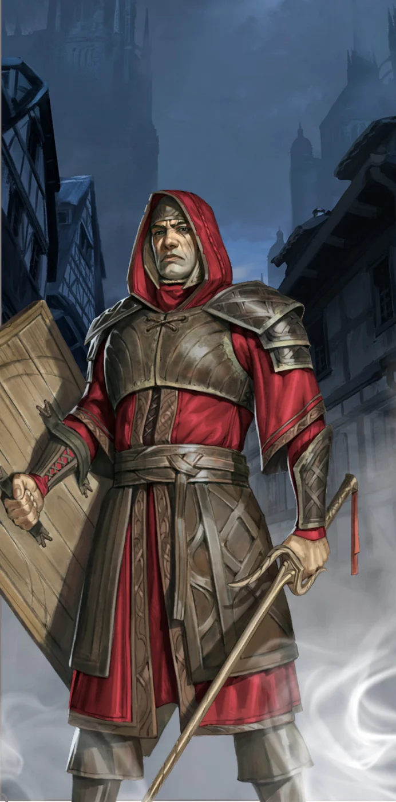
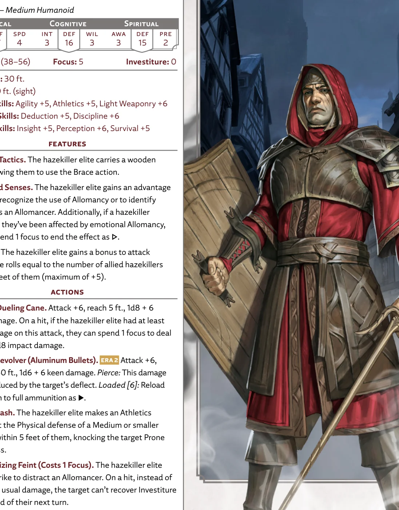
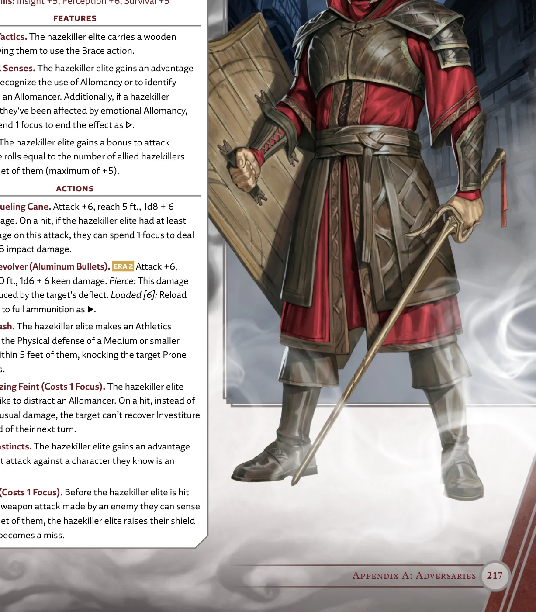

### 殺霧者

殺霧者是專門受訓獵殺鎔金術師的戰士。他們不攜帶金屬，改用專門對付金屬技藝使用者的武器、護甲與戰術。落灰之終前，富裕的貴族家族會在一般警備人員之外雇用殺霧者，同時防備鎔金術師與一般的司卡反抗軍。落灰之終後，殺霧者組成獵殺小隊受雇作戰，也會受聘保護知名雇主，支援一般保鑣。小隊的配備通常取決於雇主的財力。像「組織」這類富有的團體，能替雇用的小隊添置昂貴的鋁製武器和子彈，讓殺霧者更難對付。

### 技術

你可以調整殺霧者能力的敘述，展現他們反制鎔金術的各種手段。擊中 PC 的子彈可能在關鍵時刻揭曉為殺霧彈。斷絕授予的佯攻成功時，也可以描述成殺霧者用專門配備對付某位鎔金術師，例如用閃光手榴彈擾亂錫眼的感官。

殺霧者的戰術

殺霧者精銳靠敏銳感官做好迎戰鎔金術師的準備，能辨識鎔金術並抵抗其操縱。近身交戰時，殺霧者會用斷絕授予的佯攻阻止對方恢復授予，再試著用盾擊使對方倒地，好以決鬥杖造成額外傷害。殺霧者謹慎協同作戰，通常由殺霧者精銳帶隊。他們用迎戰鎔金術師反應一同衝向鎔金術師，接著保持隊形，靠獵殺小隊發揮團隊優勢。當一名殺霧者用盾擊打倒敵人時，盟友便會接著使用挫志。

階層 1 勁敵 — 中型類人生物

實體（力量 防禦 速度） 意識（智力 防禦 意志） 靈魂（察覺 防禦 風采） 2 15 3 1 13 2 3 14 1

生命值：26（21–31） 專注點：4 授予：0

移動：30 呎。感知：20 呎（視覺）。實體技能：敏捷 +4、運動 +5、輕型武器 +5。意識技能：推理 +3、紀律 +3。靈魂技能：洞察 +4、感知 +4、求生 +4。

特徵

防禦戰術（Defensive Tactics）。殺霧者攜帶木盾，因而可以使用架防行動。

獵殺小隊（Kill Squad）。殺霧者的攻擊擲骰和傷害擲骰獲得加值，數值等於自身 20 呎內的殺霧者盟友人數（最多 +5）。

行動

▶ 打擊：決鬥杖。攻擊 +5，觸及 5 呎，造成 1d8 + 5 衝擊傷害。命中時，若殺霧者在這次攻擊中至少有一個優勢，可以花費 1 專注點，額外造成 1d8 衝擊傷害。

▶ 打擊：左輪手槍（鋁彈）。第二時代。攻擊 +5，射程 20/80 呎，造成 1d6 + 5 銳利傷害。穿刺：目標的偏轉值無法減免這件武器的傷害。裝填 [6]：花費 ▶ 將這件武器的彈藥裝滿。

▶ 盾擊。殺霧者對自身 5 呎內一名中型或更小的角色進行運動檢定，對抗目標的實體防禦。成功時，目標倒地。

[2行動] 挫志（Break Spirit，花費 1 專注點）。殺霧者攻擊一名倒地角色。命中時，目標失去 1d4 專注點，取代通常的傷害。

↻ 迎戰鎔金術師（Engage Allomancer，花費 2 專注點）。一名殺霧者能感知的角色

使用飲用金屬液或任何須花費授予的行動後，如果殺霧者察覺此事，就能朝該角色移動最多等於自身移動速率一半的距離。

附錄 A：敵手 216

### 殺霧者精銳

階層 2 勁敵 — 中型類人生物

實體（力量 防禦 速度） 意識（智力 防禦 意志） 靈魂（察覺 防禦 風采） 3 17 4 3 16 3 3 15 2

生命值：47（38–56） 專注點：5 授予：0

移動：30 呎。感知：20 呎（視覺）。實體技能：敏捷 +5、運動 +5、輕型武器 +6。意識技能：推理 +5、紀律 +6。靈魂技能：洞察 +5、感知 +6、求生 +5。

特徵

防禦戰術。殺霧者精銳攜帶木盾，因而可以使用架防行動。

敏銳感官（Heightened Senses）。殺霧者精銳在辨識鎔金術的使用或判斷某人是否為鎔金術師的檢定上獲得一個優勢。此外，殺霧者精銳若知道自己受到情緒鎔金術影響，可以用 ▷ 花費 1 專注點來結束效果。

獵殺小隊。殺霧者精銳的攻擊擲骰和傷害擲骰獲得加值，數值等於自身 20 呎內的殺霧者盟友人數（最多 +5）。

行動

▶ 打擊：決鬥杖。攻擊 +6，觸及 5 呎，造成 1d8 + 6 衝擊傷害。命中時，若殺霧者精銳在這次攻擊中至少有一個優勢，可以花費 1 專注點，額外造成 2d8 衝擊傷害。

▶ 打擊：左輪手槍（鋁彈）。第二時代。攻擊 +6，射程 20/80 呎，造成 1d6 + 6 銳利傷害。穿刺：目標的偏轉值無法減免這次傷害。裝填 [6]：花費 ▶ 將這件武器的彈藥裝滿。

▶ 盾擊。殺霧者精銳對自身 5 呎內一名中型或更小的角色進行運動檢定，對抗目標的實體防禦。成功時，目標倒地。

[2行動] 斷絕授予的佯攻（Devitalizing Feint，花費 1 專注點）。殺霧者精銳進行一次打擊，分散一名鎔金術師的注意力。命中時，取代通常的傷害，目標無法恢復授予，直到其下一個輪次結束。

▷ 磨練直覺（Honed Instincts）。殺霧者精銳下一次攻擊一名已知是鎔金術師的角色時，獲得一個優勢。

↻ 偏轉（Deflect，花費 1 專注點）。當殺霧者精銳即將被

自身 60 呎內一名能感知到的敵人以遠程武器命中時，殺霧者精銳舉盾，使這次命中變成未命中。

附錄 A：敵手 217

PEDRO DUTRA & LOGAN FELICIANO

