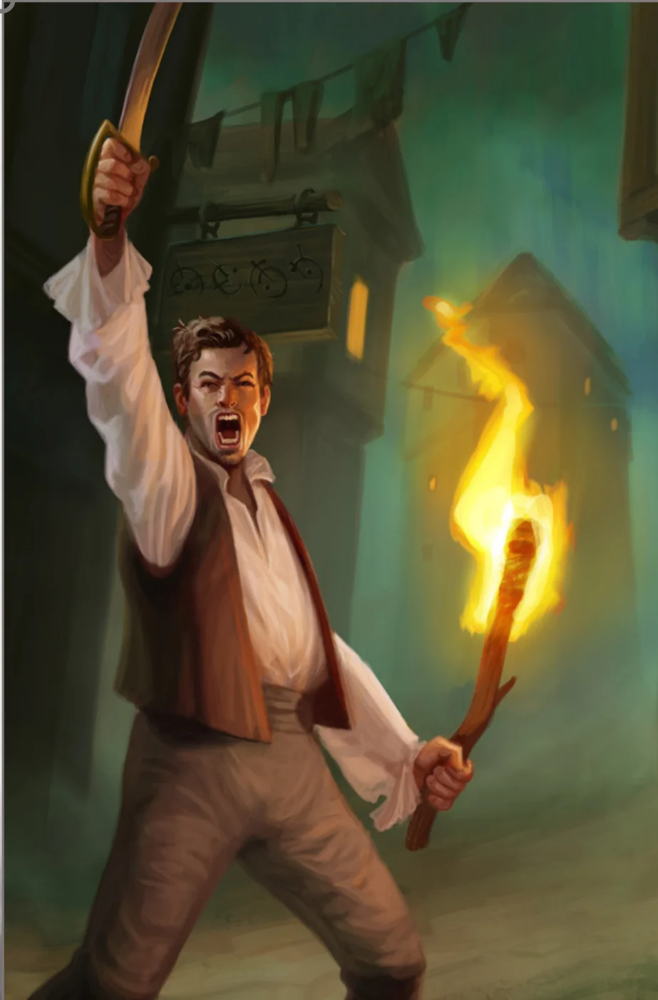

### 線人

### 煽動者

線人很少身居要職，靠的是人脈、消息和可用來談判的籌碼。

階層 1 勁敵 — 中型類人生物

實體（力量 防禦 速度） 意識（智力 防禦 意志） 靈魂（察覺 防禦 風采） 0 11 1 2 14 2 2 13 1

生命值：22（17–26） 專注點：4 授予：0

移動：25 呎。感知：10 呎（視覺）。實體技能：輕型武器 +2、隱匿 +2。意識技能：推理 +4、學識 +4。靈魂技能：欺瞞 +2、洞察 +4、感知 +4、

說服 +3。

特徵

消息靈通（Informed）。每個場景開始前，擲劇情骰。擲出 [機遇] 時，線人知道對 PC 有用的情報。擲出 [變故] 時，線人掌握

其中一名 PC 足以使其陷入困境的情報。

人脈廣闊（Well-Connected）。線人進行與其蒐集情報的地點或組織有關的檢定時，獲得一個優勢，例如涉及上流社會或犯罪地下世界的檢定。

行動

▶ 打擊：小刀。攻擊 +2，觸及 5 呎或射程 20/60 呎，造成 1d4 + 2 銳利傷害。命中時，線人可以花費 1 專注點，額外造成 2d4 銳利傷害。

▶ 討價還價（Bartering）。在談話中，線人對能影響且靈性防禦最高的角色進行說服檢定。成功時，線人選擇的每名談話參與者都失去 1 專注點。

線人的戰術

線人偏好靠情報阻止衝突演變成打鬥。在談話中，消息靈通特徵讓他們每次都有籌碼，很少處於下風。線人只肯用情報換取同等價值的消息或足夠的報酬。想逼他們多透露半點，可是出了名的難。戰鬥時，線人通常以保全自己為先，會想辦法撤到安全處。若被迫應戰，就用小刀攻擊自衛。

煽動者善於察覺情緒壓力，用精心選擇的言語或舉動引導事態。有時他們會置身於緊張局勢中，不動聲色，直到找出哪個舉動足以讓克制變成公開衝突。煽動者很少出面領導或組織，而是靠短暫的挑釁左右周遭人的行為，避免引人注意。

煽動者的戰術

煽動者會對敵人所在或可能經過的地形使用化為灰燼，接著燃燒鋅，煽動附近目標的恐懼或怒氣，並每回合維持效果。煽動者避免直接交戰，只有當敵人已受到其他人威脅時才用佩劍打擊。如果成為直接攻擊的目標，煽動者會脫離並換位，盡可能待在戰鬥外圍攪亂局勢。

附錄 A：敵手 222

DARKO STOJANOVIC

### 克羅司氏族守護者（第二時代）

### 煽動者

階層 1 勁敵 — 中型類人生物

實體（力量 防禦 速度） 意識（智力 防禦 意志） 靈魂（察覺 防禦 風采） 2 14 2 1 14 3 3 15 2

生命值：20（15–25） 專注點：5 授予：5

移動：25 呎。感知：20 呎（視覺）。實體技能：運動 +4、輕型武器 +4。意識技能：紀律 +5、威嚇 +5。靈魂技能：領導 +4、說服 +4、求生 +5。金屬技藝技能：鎔金術 +5（2 技能等級，鋅）。

特徵

浴血（Blood Bath）。煽動者能感知到的一名角色的生命值降至 0 時，煽動者恢復 1 專注點，並在下一次攻擊中獲得一個優勢。

行動

[1行動] 打擊：佩劍。攻擊 +4，觸及 5 呎，造成 1d6 + 4 銳利傷害。命中時，若目標受到燃燒鋅影響，煽動者額外造成 1d6 傷害。

[1行動] 打擊：臨時武器。攻擊 +4，觸及 5 呎或射程 15/30 呎，造成 1d4 + 4 衝擊傷害。如果攻擊也命中目標的認知防禦，目標陷入迷惑，直到其下一個輪次結束。

[2行動] 化為灰燼（To Ashes）。煽動者選擇自身 10 呎內一處大型（10 呎）空間，點燃該區域的地面和無人照管的物品。燃燒期間，該區域成為造成 1d8 能量傷害的危險地形。角色可以花費

[1行動] 撲滅一處 5 呎的區域。

[2行動] 燃燒鋅（Burn Zinc，花費 1–2 授予）。煽動者選擇一種情緒，並從自身 40 呎內一處大型（10 呎）區域中選擇一個或多個目標，對每個目標進行鎔金術檢定，對抗其靈性防禦。成功時，目標的該種情緒受到煽動，行為因而受其左右，直到其下一個輪次結束。在效果結束前，煽動者可以花費 1 點以上的授予作為 [自由行動]，維持該區域內所有受影響目標身上的效果。受影響的目標可以用 [自由行動] 抵抗，花費等同於燃燒鋅所花授予的專注點，取代抵抗影響的通常費用。這麼做後，目標無視受到改變的情緒，直到其下一個輪次開始。

[反應] 怒火熾盛（White-Hot Rage，花費 2 授予）。煽動者能感知到且位於自身 40 呎內的一名角色攻擊未命中時，煽動者可以瞬間煽動攻擊者的凶性，使攻擊者擦傷自己。

克羅司身材高大，皮膚呈藍色，雙眼泛紅。最後帝國覆滅幾個世紀後，他們已獲得自由，並在蠻橫區發展出充滿活力的氏族文化。

克羅司氏族守護者的戰術

克羅司氏族守護者會用克羅司尖刺槌打擊，使對手倒地，再對倒地的目標使用粉碎。對付遠處的目標時，可以用打擊士氣和手砲攻擊。

### 克羅司氏族守護者

階層 2 勁敵 — 中型類人生物

實體（力量 防禦 速度） 意識（智力 防禦 意志） 靈魂（察覺 防禦 風采） 6 19 3 1 14 3 1 14 3

生命值：50（40–60） 專注點：5 授予：0

偏轉值：2（克羅司血統）。移動：30 呎。感知：10 呎（視覺）。實體技能：運動 +8、重型武器 +8。意識技能：威嚇 +6。靈魂技能：感知 +4、求生 +4。

特徵

易受影響的意志（Malleable Will）。鎔金術師必須花費至少 6 授予來燃燒黃銅或燃燒鋅，情緒鎔金術才能影響克羅司。克羅司一旦受到影響，便無法自行結束效果。

不屈（Unyielding）。克羅司在抵抗被移動或擊倒的檢定上獲得一個優勢。

行動

▶ 打擊：克羅司尖刺槌。攻擊 +8，觸及 5 呎，造成 1d10 + 8 衝擊傷害。命中大型或更小的目標時，克羅司也可以花費 1 專注點使其倒地。

▶ 打擊：手砲。攻擊 +8，射程 20/80 呎，造成 1d8 + 8 銳利傷害。穿刺：這次傷害無法被

目標的偏轉值減免。裝填 [6]：花費 ▶ 將這件武器的彈藥裝滿。

[2行動] 粉碎（Pulverize）。攻擊 +8，觸及 5 呎，造成 2d8 + 8 衝擊傷害。這次攻擊對倒地目標額外造成 1d8 衝擊傷害。命中時，目標 5 呎內實體防禦等於或低於攻擊結果的每名角色，也會被這次攻擊擦傷。

▶ 打擊士氣（Demoralize）。克羅司對自身 30 呎內一名能影響的角色進行威嚇檢定，對抗其認知防禦。成功時，目標失去 1 專注點，且偏轉值變為 0，直到其下一個輪次結束。

附錄 A：敵手 223
